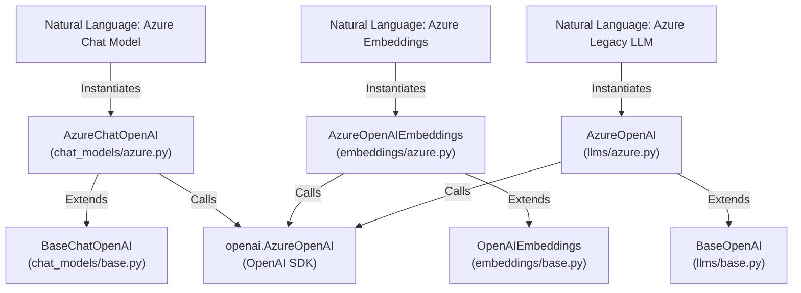
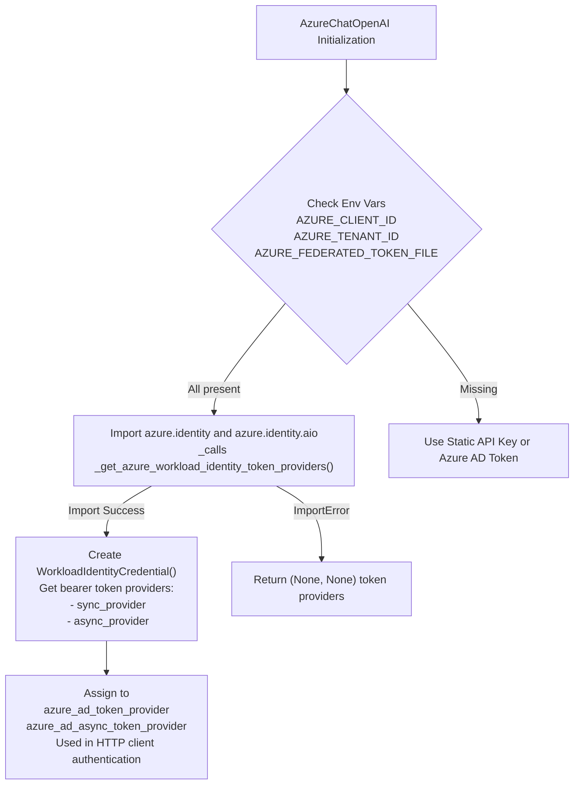

<!-- source: DeepWiki mcp.deepwiki.com · repo langchain-ai/langchain · extra page Azure OpenAI and Embeddings/LLMs · fetched 2026-10-26 -->

# Azure OpenAI and Embeddings/LLMs

<details>
<summary>Relevant source files</summary>

The following files were used as context for generating this wiki page:

- [libs/partners/openai/langchain_openai/chat_models/azure.py](libs/partners/openai/langchain_openai/chat_models/azure.py)
- [libs/partners/openai/langchain_openai/embeddings/azure.py](libs/partners/openai/langchain_openai/embeddings/azure.py)
- [libs/partners/openai/langchain_openai/embeddings/base.py](libs/partners/openai/langchain_openai/embeddings/base.py)
- [libs/partners/openai/langchain_openai/llms/azure.py](libs/partners/openai/langchain_openai/llms/azure.py)
- [libs/partners/openai/langchain_openai/llms/base.py](libs/partners/openai/langchain_openai/llms/base.py)
- [libs/partners/openai/tests/cassettes/test_langchain_openai_embeddings_equivalent_to_raw.yaml.gz](libs/partners/openai/tests/cassettes/test_langchain_openai_embeddings_equivalent_to_raw.yaml.gz)
- [libs/partners/openai/tests/cassettes/test_langchain_openai_embeddings_equivalent_to_raw_async.yaml.gz](libs/partners/openai/tests/cassettes/test_langchain_openai_embeddings_equivalent_to_raw_async.yaml.gz)
- [libs/partners/openai/tests/integration_tests/embeddings/test_azure.py](libs/partners/openai/tests/integration_tests/embeddings/test_azure.py)
- [libs/partners/openai/tests/integration_tests/embeddings/test_base.py](libs/partners/openai/tests/integration_tests/embeddings/test_base.py)
- [libs/partners/openai/tests/unit_tests/chat_models/test_azure.py](libs/partners/openai/tests/unit_tests/chat_models/test_azure.py)
- [libs/partners/openai/tests/unit_tests/conftest.py](libs/partners/openai/tests/unit_tests/conftest.py)
- [libs/partners/openai/tests/unit_tests/embeddings/test_azure_embeddings.py](libs/partners/openai/tests/unit_tests/embeddings/test_azure_embeddings.py)
- [libs/partners/openai/tests/unit_tests/embeddings/test_base.py](libs/partners/openai/tests/unit_tests/embeddings/test_base.py)
- [libs/partners/openai/tests/unit_tests/llms/test_base.py](libs/partners/openai/tests/unit_tests/llms/test_base.py)

</details>


This page details the implementation of Azure OpenAI integrations within the `langchain-openai` partner package (`libs/partners/openai/`). It covers the core wrapper classes (`AzureChatOpenAI`, `AzureOpenAIEmbeddings`, `AzureOpenAI`), their parameter handling mapped to the underlying `openai` SDK client, and comprehensive secrets and credential management including API keys, Azure Active Directory tokens, and support for Kubernetes Workload Identity.

---

## 1. Core Integration Classes

Azure OpenAI services require specific endpoint URLs, deployment names, and API versions distinct from the standard OpenAI API. The LangChain `langchain-openai` partner package provides dedicated wrapper classes to accommodate these Azure-specific configurations, extending base OpenAI classes for seamless integration.

---

### AzureChatOpenAI

The `AzureChatOpenAI` class inherits from `BaseChatOpenAI` and bridges LangChain chat models with Azure OpenAI Chat Completion deployments [libs/partners/openai/langchain_openai/chat_models/azure.py:65-133]().  

**Key parameters:**

- `azure_deployment`: (required) The name of the Azure deployment to use, mapping to an Azure resource.
- `azure_endpoint`: The Azure OpenAI resource base URL, e.g., `https://your-resource.openai.azure.com/`.
- `api_version`: Specifies the Azure OpenAI REST API version to use, e.g., `"2024-05-01-preview"`.
- Authentication options:
  - `openai_api_key`: Azure API Key for authentication.
  - `azure_ad_token`: Azure Active Directory token for token-based auth.
  - `azure_ad_token_provider`: Callable returning sync tokens.
  - `azure_ad_async_token_provider`: Async callable returning tokens.
- Additional params like `temperature`, `max_tokens`, `logprobs`, `model`, and `model_version` can be specified, and extra unsupported params are passed directly to SDK calls for flexibility.

**Usage example:**

```python
from langchain_openai import AzureChatOpenAI

model = AzureChatOpenAI(
    azure_deployment="your-deployment-name",
    api_version="2024-05-01-preview",
    azure_endpoint="https://your-endpoint.openai.azure.com/",
)
```

**Invocation:**

When invoking, the class converts LangChain message structures into the format expected by Azure OpenAI Chat Completion API, using the `openai.AzureOpenAI.chat.completions.create` client method under the hood. This maintains compatibility and allows passing through of parameters such as `logprobs` or streaming flags.

---

### AzureOpenAIEmbeddings

`AzureOpenAIEmbeddings` extends `OpenAIEmbeddings` to run embedding computation on Azure OpenAI deployments [libs/partners/openai/langchain_openai/embeddings/azure.py:16-160]().  

**Key features:**

- Supports Azure-specific parameters:
  - `azure_endpoint`: Azure resource URL.
  - `azure_deployment`: Azure model deployment.
  - `openai_api_version`: API version string, e.g., `"2024-02-01"`.
- `chunk_size` default is set to 2048 to align with Azure's batching limits.
- Authentication via environment or explicit parameters:
  - Supports `AZURE_OPENAI_API_KEY`, `AZURE_OPENAI_ENDPOINT`, `AZURE_OPENAI_API_VERSION`.
- Fully supports synchronous and asynchronous embedding calls.
- Internally manages tokenization, input chunking, and handles empty strings gracefully.
- Builds and calls the appropriate Azure OpenAI embeddings client (`openai.AzureOpenAI.embeddings.create`).

**Instantiation example:**

```python
from langchain_openai import AzureOpenAIEmbeddings

embeddings = AzureOpenAIEmbeddings(
    model="text-embedding-3-large",
    azure_endpoint="https://your-endpoint.openai.azure.com/",
    azure_deployment="your-deployment-name",
    api_version="2024-02-01",
)
```

It supports embedding single or batch documents with token limit-aware chunking strategies to respect Azure API constraints.

---

### AzureOpenAI

`AzureOpenAI` extends the `BaseOpenAI` class for legacy (non-chat) large language model completions on Azure [libs/partners/openai/langchain_openai/llms/azure.py:21-162]().  

**Core aspects:**

- Recognizes Azure-specific:
  - `azure_endpoint` (resource URL).
  - `deployment_name` (alias for `azure_deployment`) to select the model deployment.
  - `openai_api_version`.
- Provides validation logic to prevent incompatible streaming with batching options (`n > 1` or `best_of > 1`).
- Enforces Azure endpoint URL includes `/openai` suffix required by the SDK or raises a `ValueError`.
- Authentication parameters:
  - Supports API keys (`AZURE_OPENAI_API_KEY`).
  - Supports Azure Active Directory tokens and token providers.
- Passes through model invocation params including temperature, max tokens, penalties, and logit biases.

**Example usage:**

```python
from langchain_openai import AzureOpenAI

llm = AzureOpenAI(
    azure_deployment="mydeployment",
    azure_endpoint="https://myresource.openai.azure.com/",
    api_version="2023-05-15",
    openai_api_key="your-api-key",
)
```

---

## 2. Architecture and Entity Mapping

To clarify the relationship between natural language user concepts and their exact code implementations within LangChain's Azure integration, the following diagram shows class mappings and key interactions:

### Natural Language to Code Entity Mapping



---

## 3. Secrets Handling and Credential Management

Azure OpenAI integration handles authentication via multiple modes with careful secrets management to avoid accidental leaks.

### Secrets Masking and Storage

- Credentials like API keys (`openai_api_key`) or Azure AD tokens (`azure_ad_token`) are stored as `pydantic.SecretStr`, which masks the actual token values in logs or printouts.
- Tokens and keys can be supplied as strings, Pydantic secret types, or via environment variables.
- Environment variables used include:
  - `AZURE_OPENAI_API_KEY`
  - `AZURE_OPENAI_ENDPOINT`
  - `AZURE_OPENAI_API_VERSION`
  - `AZURE_OPENAI_AD_TOKEN`
  - `OPENAI_API_VERSION`
  - `OPENAI_ORG_ID`

### Azure Workload Identity Integration

When running in Kubernetes or cloud environments that use Azure Workload Identity, LangChain can dynamically obtain tokens without static secrets:

- On model initialization, the system checks for these environment variables:

  - `AZURE_CLIENT_ID`
  - `AZURE_TENANT_ID`
  - `AZURE_FEDERATED_TOKEN_FILE`

- If all present, it attempts to import the `azure.identity` and `azure.identity.aio` modules dynamically.
- Calls `get_bearer_token_provider()` with `WorkloadIdentityCredential()` against the Azure OpenAI scope:  
  `"https://cognitiveservices.azure.com/.default"`.
- Returns both synchronous and asynchronous token provider callables.
- These callables become the `azure_ad_token_provider` and `azure_ad_async_token_provider` attributes of the model.
- During request execution, these providers are called to fetch access tokens dynamically and transparently.
- If the Azure identity packages are missing, it falls back to using static API keys or explicitly provided tokens.

### Workload Identity Token Provider Setup Dataflow



---

## 4. Summary Table of Azure Integration Classes

| Class Name             | Module Path                              | Base Class           | Key Environment Variables                                 |
|------------------------|----------------------------------------|----------------------|----------------------------------------------------------|
| `AzureChatOpenAI`      | `langchain_openai.chat_models.azure`   | `BaseChatOpenAI`     | `AZURE_OPENAI_API_KEY`, `AZURE_OPENAI_ENDPOINT`, `AZURE_OPENAI_API_VERSION` |
| `AzureOpenAIEmbeddings`| `langchain_openai.embeddings.azure`    | `OpenAIEmbeddings`   | `AZURE_OPENAI_API_KEY`, `AZURE_OPENAI_ENDPOINT`, `AZURE_OPENAI_API_VERSION` |
| `AzureOpenAI`          | `langchain_openai.llms.azure`           | `BaseOpenAI`         | `AZURE_OPENAI_API_KEY`, `AZURE_OPENAI_ENDPOINT`, `AZURE_OPENAI_API_VERSION` |

---

# Summary

LangChain's Azure OpenAI integration offers specialized, cloud-provider-aware client wrappers for Azure-hosted OpenAI services. These wrappers extend LangChain's base classes for chat models, embeddings, and non-chat LLMs, adding required Azure-specific parameters such as deployment names, API versions, and endpoints. They also embed robust authentication support including static API keys, Azure Active Directory tokens, and Kubernetes Workload Identity integration, ensuring secure and scalable deployment in diverse Azure cloud environments.

All secrets are carefully managed using Pydantic's `SecretStr` to avoid exposure. The integration supports synchronous and asynchronous usage, batch processing, and respects Azure API constraints such as token limits and request chunking.

---

Sources:  
- libs/partners/openai/langchain_openai/chat_models/azure.py:1-191,65-133  
- libs/partners/openai/langchain_openai/embeddings/azure.py:1-160  
- libs/partners/openai/langchain_openai/llms/azure.py:1-162  
- libs/partners/openai/tests/unit_tests/chat_models/test_azure.py:1-196  
- libs/partners/openai/langchain_openai/embeddings/base.py:1-84  
- libs/partners/openai/langchain_openai/llms/base.py:1-130

---

