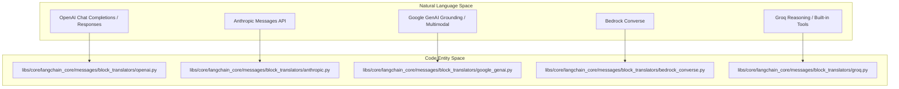
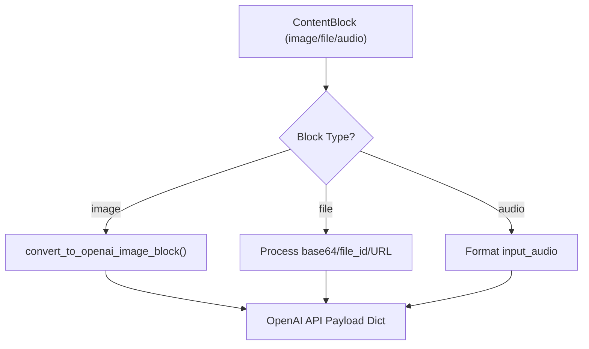
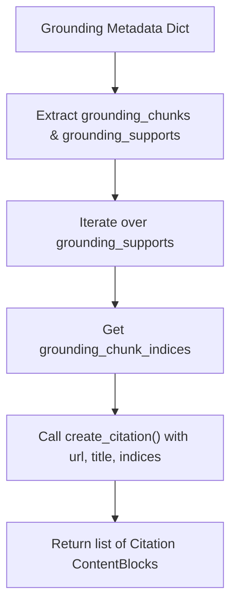
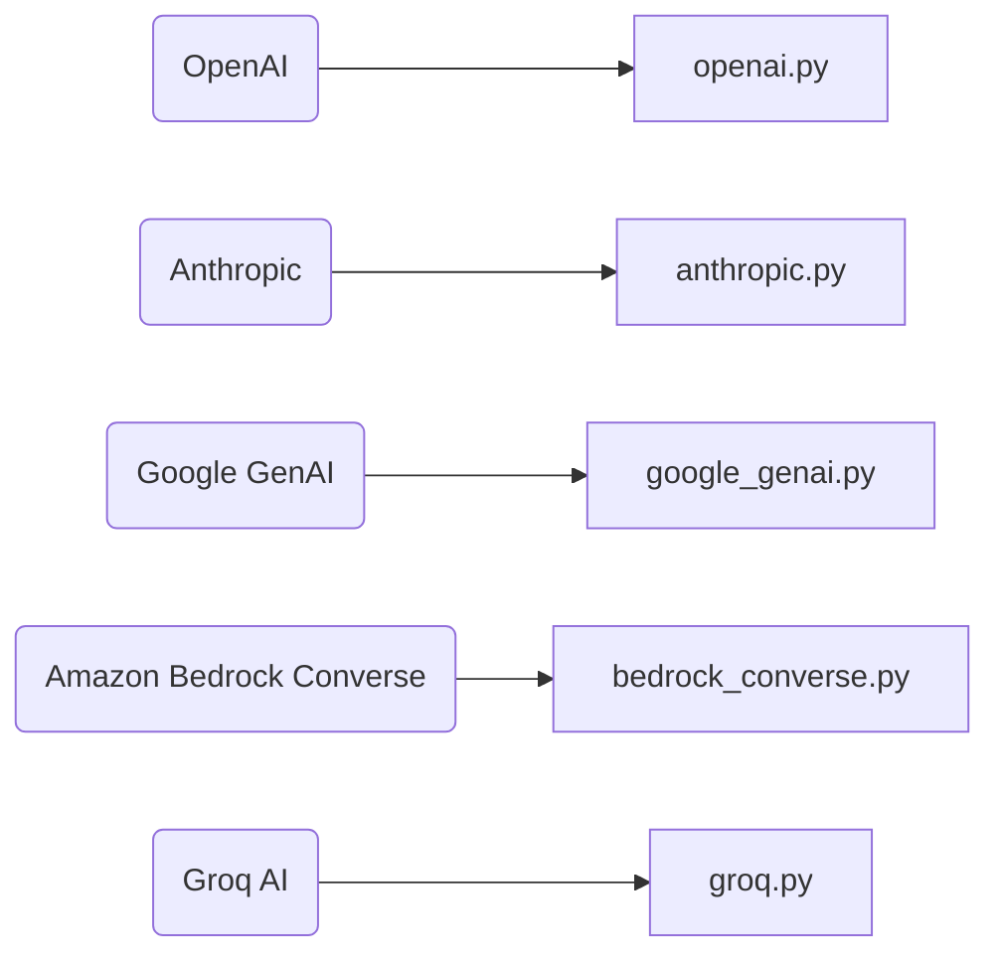
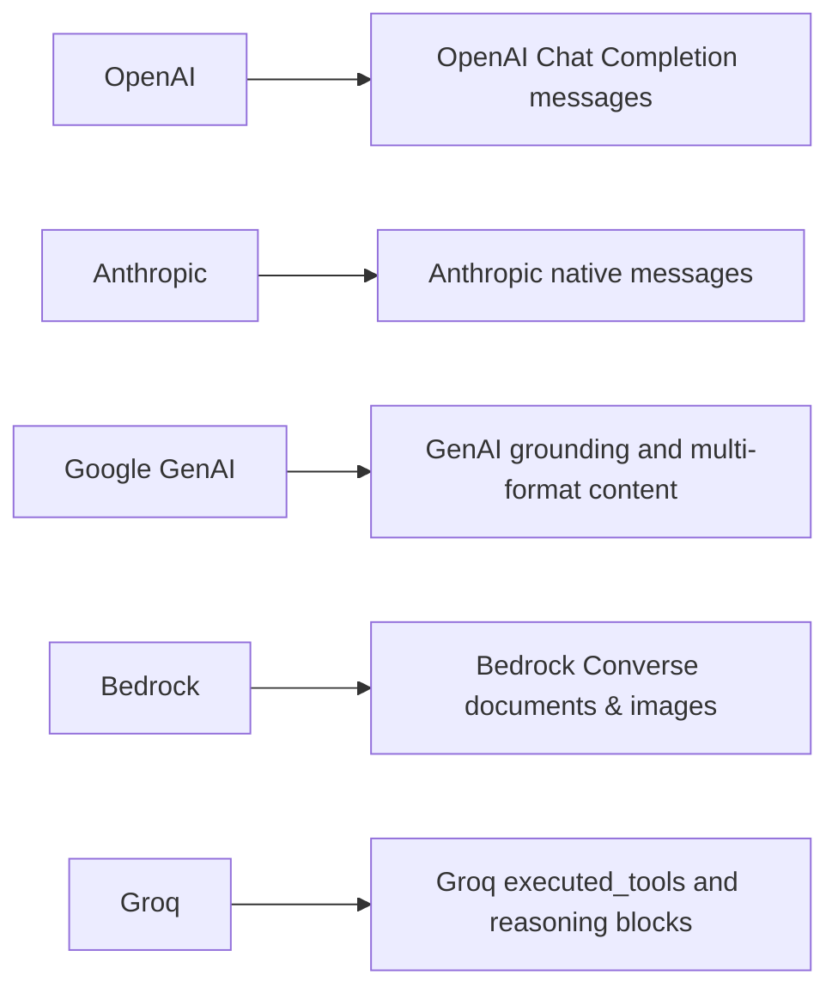

<!-- source: DeepWiki mcp.deepwiki.com · repo langchain-ai/langchain · extra page Block Translators for Providers · fetched 2026-10-26 -->

# Block Translators for Providers

Relevant source files

The following files were used as context for generating this wiki page:

- [libs/core/langchain_core/messages/block_translators/anthropic.py](libs/core/langchain_core/messages/block_translators/anthropic.py)
- [libs/core/langchain_core/messages/block_translators/bedrock.py](libs/core/langchain_core/messages/block_translators/bedrock.py)
- [libs/core/langchain_core/messages/block_translators/bedrock_converse.py](libs/core/langchain_core/messages/block_translators/bedrock_converse.py)
- [libs/core/langchain_core/messages/block_translators/google_genai.py](libs/core/langchain_core/messages/block_translators/google_genai.py)
- [libs/core/langchain_core/messages/block_translators/groq.py](libs/core/langchain_core/messages/block_translators/groq.py)
- [libs/core/langchain_core/messages/block_translators/openai.py](libs/core/langchain_core/messages/block_translators/openai.py)
- [libs/core/tests/unit_tests/messages/block_translators/test_anthropic.py](libs/core/tests/unit_tests/messages/block_translators/test_anthropic.py)
- [libs/core/tests/unit_tests/messages/block_translators/test_bedrock_converse.py](libs/core/tests/unit_tests/messages/block_translators/test_bedrock_converse.py)
- [libs/core/tests/unit_tests/messages/block_translators/test_google_genai.py](libs/core/tests/unit_tests/messages/block_translators/test_google_genai.py)
- [libs/core/tests/unit_tests/messages/block_translators/test_openai.py](libs/core/tests/unit_tests/messages/block_translators/test_openai.py)
- [libs/core/tests/unit_tests/messages/test_ai.py](libs/core/tests/unit_tests/messages/test_ai.py)
- [libs/partners/anthropic/README.md](libs/partners/anthropic/README.md)
- [libs/partners/anthropic/langchain_anthropic/_compat.py](libs/partners/anthropic/langchain_anthropic/_compat.py)
- [libs/partners/anthropic/langchain_anthropic/data/profile_augmentations.toml](libs/partners/anthropic/langchain_anthropic/data/profile_augmentations.toml)
- [libs/partners/anthropic/tests/unit_tests/test_compat.py](libs/partners/anthropic/tests/unit_tests/test_compat.py)
- [libs/partners/anthropic/tests/unit_tests/test_sonnet55.py](libs/partners/anthropic/tests/unit_tests/test_sonnet55.py)

## Purpose and Scope
The block translators subsystem within `langchain_core` standardizes provider-specific model response formats—covering OpenAI, Anthropic, Google GenAI, Amazon Bedrock, and Groq—into unified LangChain v1 content blocks (`ContentBlock`). This harmonization enables consistent processing of complex multi-modal content including text, images, files, citations, reasoning, and tool call metadata across disparate LLM backend providers. It abstracts away vendor-specific payload formats so downstream application logic can interact with a uniform content block schema.

---

## 1. Translator Architecture and Registry

Block translators act as protocol adapters, mapping disparate source-specific payload structures to the LangChain canonical v1 message and content block representation. This involves parsing raw API message content and response metadata, then translating to standard objects like `AIMessage`, `AIMessageChunk`, and associated content blocks.

Each supported provider has a dedicated translator module incorporating conversions for:

- **Text, images, audio, files** in multiple formats (URLs, base64 data, IDs)
- **Tool calls and tool call chunks**
- **Reasoning/thinking content blocks**
- **Citations and grounding metadata**

### Diagram: Provider Block Translators to Code Entities

*Sources: `libs/core/langchain_core/messages/block_translators/openai.py:1-153`(), `libs/core/langchain_core/messages/block_translators/anthropic.py:33-163`(), `libs/core/langchain_core/messages/block_translators/google_genai.py:25-181`(), `libs/core/langchain_core/messages/block_translators/bedrock_converse.py:33-125`(), `libs/core/langchain_core/messages/block_translators/groq.py:51-118`()*.

---

## 2. OpenAI Block Translation

The OpenAI block translator converts LangChain standard content blocks into the appropriate OpenAI Chat Completions or Responses API payloads, handling nuances across image, file, and audio block formats.

### Key Functions

- **`convert_to_openai_image_block(block)`**  
  Converts an `ImageContentBlock` to OpenAI's expected `image_url` structure.  
  - Supports `url` or base64-encoded image data with MIME type.  
  - Raises `ValueError` for missing required fields or unsupported source types.  
  [libs/core/langchain_core/messages/block_translators/openai.py:22-55]()

- **`convert_to_openai_data_block(block, api="chat/completions")`**  
  Formats a standard data block (`image`, `file`, or `audio`) for the targeted OpenAI API endpoint (Chat Completions or Responses).  
  - Handles base64 data and file IDs.  
  - For `file` type blocks, ensures required filename metadata or uses a placeholder with warning.  
  - Validates support depending on API type (e.g., file URLs unsupported in Chat Completions).  
  [libs/core/langchain_core/messages/block_translators/openai.py:58-153]()

### Data Flow Diagram

*Sources: `libs/core/langchain_core/messages/block_translators/openai.py:22-153`()*.

---

## 3. Anthropic and Bedrock Translators

### Anthropic Translator

Anthropic's model responses contain extended content types such as:

- `tool_use` blocks representing tool calls
- `thinking` blocks for reasoning/thinking processes
- `server_tool_use` and `server_tool_result` for server-initiated tool actions and results
- Rich search and document citations

These are normalized through conversion routines such as `_convert_to_v1_from_anthropic_input()`, which attempt to extract standard LangChain v1 content blocks from Anthropic's native block formats, preserving unknown keys in `extras` fields. For example, document content with base64 data or URLs are converted to standard `file` or `image` blocks with metadata preserved.

### Implementation Details

- The translator unwraps or converts keys like `source` with types (`base64`, `url`, `file`, or `text`) into respective LangChain content blocks such as `FileContentBlock` or `PlainTextContentBlock`.  
- It preserves any unknown keys in an `extras` dictionary for forward compatibility.  
- Tool calls and reasoning blocks translate into recognized v1 types (`tool_call`, `reasoning`).  
- Annotation conversion supports transforming Anthropic native citations into LangChain standardized annotations.

*Sources:* `libs/core/langchain_core/messages/block_translators/anthropic.py:33-163`(), `libs/partners/anthropic/langchain_anthropic/_compat.py:9-183`().

### Bedrock Converse Translator

Amazon Bedrock Converse API returns content with unique nested structures:

- Document blocks with possible PDF embedded bytes or plain-text
- Image blocks supporting base64 or URL sources
- Text blocks and citations

The `_convert_to_v1_from_converse_input()` function unwraps these provider-native blocks and translates them to LangChain v1 blocks, including:

- `FileContentBlock` with base64-encoded pdf bytes or URLs
- `PlainTextContentBlock` for text documents
- `ImageContentBlock` with base64 data or URL
- Calls `_populate_extras()` to retain unknown additional metadata under `extras`

Citations are normalized in `_convert_citation_to_v1()`, concatenating source content text and extracting titles.

*Sources:* `libs/core/langchain_core/messages/block_translators/bedrock_converse.py:15-150`(), `libs/core/langchain_core/messages/block_translators/anthropic.py:33-163`().

---

## 4. Google GenAI and Groq Translators

### Google GenAI Grounding Translator

Google GenAI provides grounding metadata including:

- Web search query strings
- Grounding chunks representing sources (web URLs, map places)
- Grounding supports mapping segments of text to grounding chunk references and confidence scores

The function `translate_grounding_metadata_to_citations(grounding_metadata)` parses these nested structures and converts them to LangChain's `Citation` content blocks. Each citation includes:

- URL and title from chunk web or map info
- Character-based indices of the cited segment
- The original cited text segment
- An `extras` dictionary with Google AI-specific metadata like web search queries, grounding chunk index, confidence scores, and map place IDs

This translation enables consistent use of Google GenAI grounding within LangChain's annotation and citation model.

### Data Flow Diagram for Google GenAI Grounding Translation

### GenAI Format Conversion

Additionally, `_convert_to_v1_from_genai_input()` translates Google GenAI native content blocks into LangChain standard v1 blocks when not directly detected, preserving unrecognized blocks as `non_standard`.

*Sources:* `libs/core/langchain_core/messages/block_translators/google_genai.py:25-181`(), `libs/core/tests/unit_tests/messages/block_translators/test_google_genai.py:1-134`().

### Groq Translator

Groq messages include specialized reasoning blocks and server tool executions, such as:

- `executed_tools` array containing tool call and tool result payloads, including web search and Python interpreter tools
- Custom `reasoning` content blocks

The `_convert_to_v1_from_groq()` function converts these extras and message content into LangChain v1 blocks representing `server_tool_call` and `server_tool_result` content, working with tool input/output data and metadata.

*Sources:* `libs/core/langchain_core/messages/block_translators/groq.py:51-118`().

---

# Summary

The block translators decouple vendor-specific message formats from the application-facing LangChain v1 content block schema, thereby standardizing:

- Text and multi-modal content representation
- Tool calls and streaming chunks
- Reasoning and thinking content types
- Citation and grounding metadata

These modules provide a clean, extensible interface to integrate new providers or adapt to evolving LLM model APIs without disrupting core downstream logic.

---

# Additional Technical Notes

- Conversion helpers often implement a two-step process: unwrapping non-standard blocks carrying native data, then mapping recognized native keys to standard LangChain block fields.
- Unknown or unhandled keys are preserved in an `extras` dictionary within the LangChain block to not discard metadata.
- Base64 binary data conversions ensure consistent MIME type and encoding representation between native and standard blocks.
- Tool calls and invalid tool call conversions handle provider idiosyncrasies in payload structure and error reporting.
- Annotations/citations across providers are normalized but retain provider-specific metadata fields inside `extras` for advanced use cases.

---

# References

| Provider  | Translator Module                                               | Notes                                                      |
|-----------|-----------------------------------------------------------------|------------------------------------------------------------|
| OpenAI    | `libs/core/langchain_core/messages/block_translators/openai.py`  | Image/file/audio block formatting for chat completions and responses APIs |
| Anthropic | `libs/core/langchain_core/messages/block_translators/anthropic.py` | Tool use, reasoning, structured output, and annotation translation |
| Bedrock   | `libs/core/langchain_core/messages/block_translators/bedrock_converse.py` | Converse API message normalization, support for PDF bytes and multi-format docs |
| Google GenAI | `libs/core/langchain_core/messages/block_translators/google_genai.py` | Grounding metadata to citations and multimodal content blocks |
| Groq      | `libs/core/langchain_core/messages/block_translators/groq.py`  | Reasoning blocks, executed_tools parsing with server tool calls/results |

---

# Mermaid Bridges: Associate Providers with Core Code Entities

### Bridge 1: Provider Names → Block Translator Modules

### Bridge 2: Provider Names → Typical Message Format Types

*These bridges enable developers to quickly locate relevant code for provider-specific content translation and understand common message formats encountered.*

---

*Sources:*

- `libs/core/langchain_core/messages/block_translators/openai.py:1-153`  
- `libs/core/langchain_core/messages/block_translators/anthropic.py:33-163`  
- `libs/core/langchain_core/messages/block_translators/google_genai.py:25-181`  
- `libs/core/langchain_core/messages/block_translators/bedrock_converse.py:33-125`  
- `libs/core/langchain_core/messages/block_translators/groq.py:51-118`  
- `libs/core/tests/unit_tests/messages/block_translators/test_google_genai.py`  
- `libs/partners/anthropic/langchain_anthropic/_compat.py`

---

