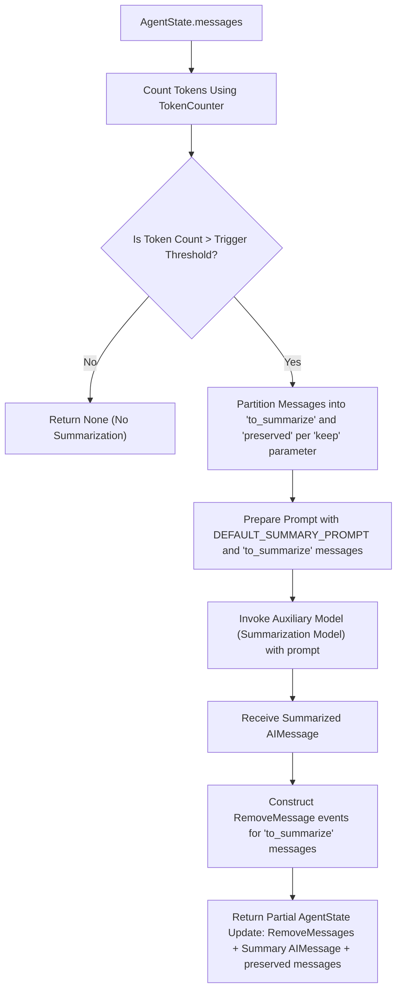
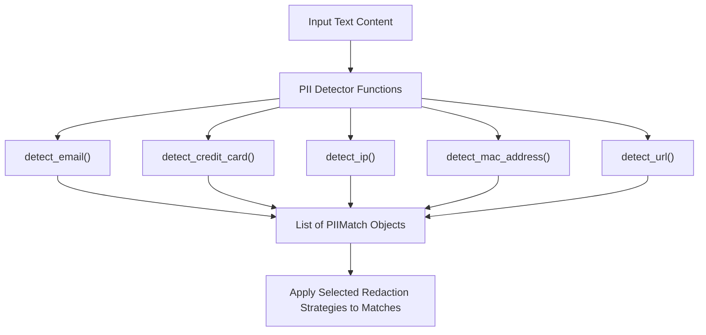
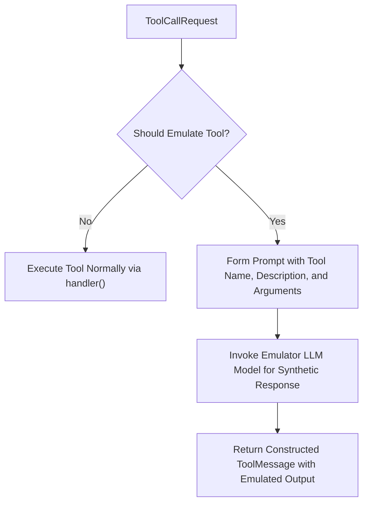
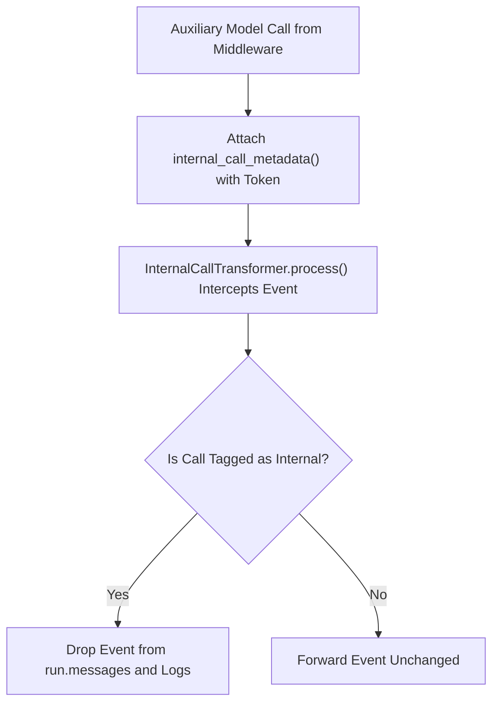
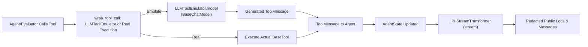

<!-- source: DeepWiki mcp.deepwiki.com · repo langchain-ai/langchain · extra page Context Management Middleware · fetched 2026-10-26 -->

# Context Management Middleware

<details>
<summary>Relevant source files</summary>

The following files were used as context for generating this wiki page:

- [libs/langchain_v1/langchain/agents/middleware/_redaction.py](libs/langchain_v1/langchain/agents/middleware/_redaction.py)
- [libs/langchain_v1/langchain/agents/middleware/internal_call_transformer.py](libs/langchain_v1/langchain/agents/middleware/internal_call_transformer.py)
- [libs/langchain_v1/langchain/agents/middleware/pii.py](libs/langchain_v1/langchain/agents/middleware/pii.py)
- [libs/langchain_v1/langchain/agents/middleware/summarization.py](libs/langchain_v1/langchain/agents/middleware/summarization.py)
- [libs/langchain_v1/langchain/agents/middleware/tool_emulator.py](libs/langchain_v1/langchain/agents/middleware/tool_emulator.py)
- [libs/langchain_v1/tests/unit_tests/agents/middleware/core/test_internal_call_transformer.py](libs/langchain_v1/tests/unit_tests/agents/middleware/core/test_internal_call_transformer.py)
- [libs/langchain_v1/tests/unit_tests/agents/middleware/core/test_transformers.py](libs/langchain_v1/tests/unit_tests/agents/middleware/core/test_transformers.py)
- [libs/langchain_v1/tests/unit_tests/agents/middleware/implementations/test_pii.py](libs/langchain_v1/tests/unit_tests/agents/middleware/implementations/test_pii.py)
- [libs/langchain_v1/tests/unit_tests/agents/middleware/implementations/test_summarization.py](libs/langchain_v1/tests/unit_tests/agents/middleware/implementations/test_summarization.py)
- [libs/langchain_v1/tests/unit_tests/agents/middleware/implementations/test_tool_emulator.py](libs/langchain_v1/tests/unit_tests/agents/middleware/implementations/test_tool_emulator.py)
- [libs/langchain_v1/tests/unit_tests/agents/middleware/implementations/test_tool_selection.py](libs/langchain_v1/tests/unit_tests/agents/middleware/implementations/test_tool_selection.py)
- [libs/langchain_v1/tests/unit_tests/agents/test_agent_streaming.py](libs/langchain_v1/tests/unit_tests/agents/test_agent_streaming.py)
- [libs/langchain_v1/tests/unit_tests/agents/test_subagent_transformer.py](libs/langchain_v1/tests/unit_tests/agents/test_subagent_transformer.py)

</details>


## Purpose and Scope

This document specifies the technical architecture and implementation details of the context management middleware subsystem in the `langchain_v1` package (`libs/langchain_v1/langchain/agents/middleware/`). The context management middleware suite encompasses modules for conversation summarization, context editing, todo list handling, dynamic tool selection, model fallback, and sensitive information (PII) redaction.

These middleware intercept key agent lifecycle hooks (such as `before_model`, `wrap_model_call`, and `wrap_tool_call`) as well as manipulate the streaming protocol events via `StreamTransformer` implementations. Their coordinated functions include regulating conversation length, redacting sensitive data in-flight, pruning or emulating available tools, isolating auxiliary internal model calls from public telemetry, and adapting model invocation requests depending on runtime conditions.

Sources: [libs/langchain_v1/langchain/agents/middleware/summarization.py:1-35](), [libs/langchain_v1/langchain/agents/middleware/pii.py:1-35]()

---

## 1. Summarization Middleware (`SummarizationMiddleware`)

The summarization middleware manages conversation history length by monitoring token usage. When conversation length surpasses a configured threshold (trigger), it compresses older messages into a structured AI-generated summary. This summary replaces obsolete conversation segments, preserving a configurable amount of recent context.

### Implementation and Data Flow

`SummarizationMiddleware` is implemented in `libs/langchain_v1/langchain/agents/middleware/summarization.py`. It registers as an agent middleware component and hooks into the agent runtime via the `before_model` lifecycle method to decide if summarization should trigger.

The general flow is:


**Diagram 1: SummarizationMiddleware Lifecycle Data Flow**

Key implementation points:

- Uses customizable `trigger` and `keep` configurations to control when summarization activates (e.g., token counts, message counts, or fraction of model max tokens).

- Accepts either a `BaseChatModel` instance or a string model identifier, supporting lazy initialization via `init_chat_model`.

- Maintains a `token_counter` callable (default uses approximate counting heuristics), with the ability to plug in model-specific counters.

- Implements message partitioning logic to select which messages to summarize vs. which are preserved (`_partition_messages` method).

- Summarization prompt, `DEFAULT_SUMMARY_PROMPT`, defines structured sections (SESSION INTENT, SUMMARY, ARTIFACTS, NEXT STEPS), enforcing a standardized summary format.

- Effects updates on the conversation by creating `RemoveMessage` events to delete old messages and inserting the summary message.

- Uses LangGraph `RemoveMessage` primitives for message removal to maintain graph state consistency.

Sources: [libs/langchain_v1/langchain/agents/middleware/summarization.py:33-195]()

### Key Classes and Concepts

| Concept | Description | File Reference |
|---|---|---|
| `ContextSize` Union | Type supporting context size specifications via fraction of max tokens, absolute tokens, or number of messages. | [libs/langchain_v1/langchain/agents/middleware/summarization.py:125-170]() |
| `DEFAULT_SUMMARY_PROMPT` | The fixed prompt template used for instructing the summarization model with explicit sections to populate. | [libs/langchain_v1/langchain/agents/middleware/summarization.py:40-96]() |
| `_partition_messages` method | Internal helper to split messages between those to summarize and those to preserve according to the `keep` parameter count. | [libs/langchain_v1/langchain/agents/middleware/summarization.py:184-195]() |

---

## 2. PII Redaction and Safety Middleware (`PIIMiddleware`)

The PII middleware continuously scans conversational messages, tool inputs/outputs, and state snapshots to detect and redact sensitive personally identifiable information (PII) such as emails, credit cards, IP addresses, MAC addresses, and URLs.

### Detection and Redaction Engine

PII detection combines regex-based scanning with semantic validations (e.g., Luhn checksum for credit cards) implemented in the `_redaction.py` module. Identified instances generate `PIIMatch` records which the middleware then applies configured redaction strategies to (e.g., block, redact, mask, or hash).


**Diagram 2: PII Detection and Redaction Pipeline**

Sources: [libs/langchain_v1/langchain/agents/middleware/_redaction.py:20-216]()

### Streaming Redaction Transformer: `_PIIStreamTransformer`

- Implemented in `libs/langchain_v1/langchain/agents/middleware/pii.py`, `_PIIStreamTransformer` subclasses LangGraph’s `StreamTransformer`.

- Intercepts `messages`, `tools`, and `values` protocol events in the data stream.

- Mutates content-block delta text in-flight to redact detected PII before it is visible to downstream consumers or logs.

- Maintains a sliding buffer keyed by `(run_id, content_block_index)` to handle PII patterns that span across message chunk boundaries (using a trailing buffer size `_DEFAULT_STREAM_LOOKBACK` of 128).

- Ensures redaction consistency for tool inputs, outputs, and conversation messages, preventing any leaking of sensitive data.

Sources: [libs/langchain_v1/langchain/agents/middleware/pii.py:50-115](), [libs/langchain_v1/langchain/agents/middleware/_redaction.py:1-45]()

---

## 3. Tool Selection and Emulation Middleware

This collection of middleware components manages the set of tools available to models dynamically, either restricting tools based on selection models or emulating tool execution responses using dedicated language models for testing and fault tolerance.

### Tool Emulation: `LLMToolEmulator`

`LLMToolEmulator` middleware intercepts calls to configured tools and substitutes actual tool execution with generated responses from an auxiliary language model.


**Diagram 3: Tool Emulation Middleware Execution Flow**

- Initialized with an optional list of tools to emulate (by name or instance). When the list is `None`, all tools are emulated.

- Uses a configurable emulator LLM model, defaulting to 'anthropic:claude-sonnet-4-5-20250929' (deprecated to encourage explicit model specification).

- Applies `InternalCallTransformer` to mark these auxiliary emulator calls as internal, preventing pollution of public message logs.

- If a non-emulated tool call is encountered, the middleware defers execution to the original handler unmodified.

Sources: [libs/langchain_v1/langchain/agents/middleware/tool_emulator.py:29-185]()

### Dynamic Tool Selection: `LLMToolSelectorMiddleware`

This middleware dynamically filters the active toolset before the primary model invocation by running a lightweight selection policy or model. It tailors which tools are exposed to the main model based on the current conversational context or state.

- Supports improved performance and relevance by exposing only a relevant subset of tools dynamically.

- The middleware intercepts model calls and rewrites the tool list as advised by the selection submodel.

- Detailed implementation and tests are included in the unit tests and related source files.

Sources: [libs/langchain_v1/tests/unit_tests/agents/middleware/implementations/test_tool_selection.py:1-172]()

---

## 4. Model Fallback Middleware (`ModelFallbackMiddleware`)

The model fallback middleware transparently retries alternate language models if the primary model fails or produces errors.

- Intercepts model call wrapping and mutates model requests to remove unsupported or provider-specific cache options before fallback attempts.

- Ensures safe switching between providers like Anthropic or Fireworks by sanitizing override config.

- Supports retry policies integrated with the model lifecycle hooks.

Sources: [libs/langchain_v1/langchain/agents/middleware/model_fallback.py:1-167]()

---

## 5. Internal Call Suppression (`InternalCallTransformer`)

Middleware that makes auxiliary model invocations (such as for summarization, tool emulation, or tool selection) must isolate these internal calls from the public event log and message history streams.

### Implementation Details

- `InternalCallTransformer` is a LangGraph `StreamTransformer` registered before built-in transformers to intercept `messages` events.

- It checks for the presence of internal call metadata tags, inserted with the utility function `internal_call_metadata()`.

- Tagged internal model call events are filtered out from the `run.messages` projection and raw event logs, preventing intermediate middleware calls from polluting user-visible history or telemetry.


**Diagram 4: Internal Call Suppression Pipeline**

- This transformer suppresses internal calls on a per-scope basis to avoid mixing auxiliary model calls with normal user calls.

- Multiple middleware components requesting internal call filtering are deduplicated to only register one transformer instance.

Sources: [libs/langchain_v1/langchain/agents/middleware/internal_call_transformer.py:1-108]()

---

# Summary Table of Middleware Components

| Middleware | Purpose | Key Classes / Functions | File Location |
|---|---|---|---|
| `SummarizationMiddleware` | Compress conversation history by summarizing when token/message limits exceeded | `SummarizationMiddleware`, `DEFAULT_SUMMARY_PROMPT`, `_partition_messages` | libs/langchain_v1/langchain/agents/middleware/summarization.py |
| `PIIMiddleware` | Detect and redact sensitive personal data in streamed messages and state | `_PIIStreamTransformer`, redaction detectors (`detect_email`, `detect_credit_card` etc.) | libs/langchain_v1/langchain/agents/middleware/pii.py, _redaction.py |
| `LLMToolEmulator` | Emulate tool responses via auxiliary LLM during testing or selective tool invocation | `LLMToolEmulator.wrap_tool_call`, uses `InternalCallTransformer` | libs/langchain_v1/langchain/agents/middleware/tool_emulator.py |
| `LLMToolSelectorMiddleware` | Dynamically select/narrow available tools based on context and policies | Model selection logic tested in unit tests | libs/langchain_v1/tests/unit_tests/agents/middleware/implementations/test_tool_selection.py |
| `ModelFallbackMiddleware` | Retry alternate LLM models on failure; sanitize cache settings on fallback | `ModelFallbackMiddleware._sanitize_request_for_fallback` | libs/langchain_v1/langchain/agents/middleware/model_fallback.py |
| `InternalCallTransformer` | Suppress internal auxiliary LLM call events from public message logs | `InternalCallTransformer.process()`, `internal_call_metadata()` | libs/langchain_v1/langchain/agents/middleware/internal_call_transformer.py |

---

# Detailed Data Flow: Bridging Natural Language Space to Code Entities

```mermaid
graph LR
    NL["Natural Language Input & Conversation"] --> Summarize["SummarizationMiddleware"]
    Summarize --> SummModel["BaseChatModel\n(summarization_model) Invoked"]
    SummModel --> SummaryAI["AIMessage (Summarized Context)"]
    SummaryAI --> RemoveOld["RemoveMessage Events"]
    RemoveOld --> AgentState["AgentState Messages Updated"]

    AgentState --> ModelCall["Model Call"]
    ModelCall -wrap_model_call-> ModelFallback["ModelFallbackMiddleware"]
    ModelFallback -sanitizes-> CleanRequest["Clean ModelRequest"]
    CleanRequest --> ModelCaller["BaseChatModel.invoke()"]
```
**Diagram 5: Flow from Conversational Input through Summarization and Model Fallback**


**Diagram 6: Tool Call Processing and PII Redaction Integration**

---

# Closing Notes

The context management middleware suite in `langchain_v1` is designed for extensibility and robustness. By leveraging composable agent middleware, granular stream transformers, and auxiliary model invocations tagged for internal isolation, it provides a rich ecosystem for managing conversation context dynamically while safeguarding privacy and facilitating complex agent workflows.

Implementers and integrators can combine these middleware elements to enhance agent behavior around conversation length limits, PII safety, failover resilience, and development/testing environments with tool emulation and dynamic tool selection.

---

# References

- libs/langchain_v1/langchain/agents/middleware/summarization.py:1-195
- libs/langchain_v1/langchain/agents/middleware/pii.py:1-170
- libs/langchain_v1/langchain/agents/middleware/_redaction.py:1-216
- libs/langchain_v1/langchain/agents/middleware/tool_emulator.py:29-185
- libs/langchain_v1/langchain/agents/middleware/model_fallback.py:1-167
- libs/langchain_v1/langchain/agents/middleware/internal_call_transformer.py:1-108
- libs/langchain_v1/tests/unit_tests/agents/middleware/implementations/test_tool_selection.py:1-172

Sources: See above citations.

---

