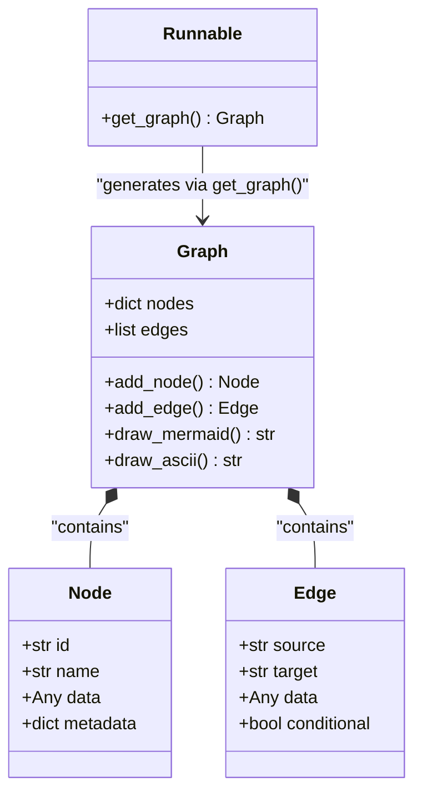
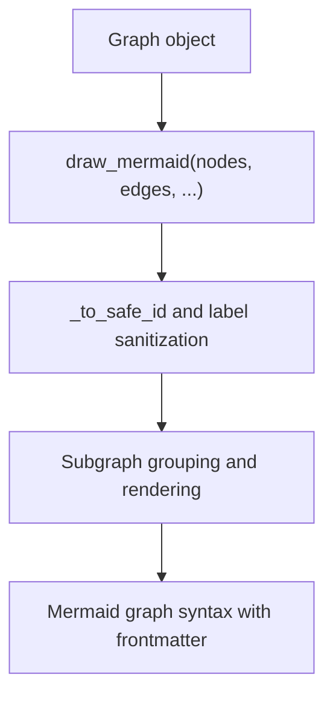
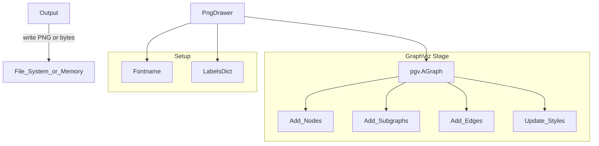
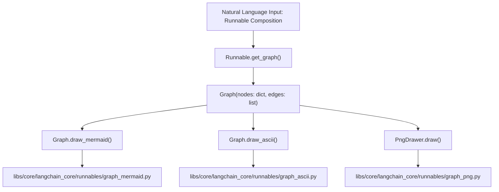

<!-- source: DeepWiki mcp.deepwiki.com · repo langchain-ai/langchain · extra page Graph Rendering and Visualization · fetched 2026-10-26 -->

# Graph Rendering and Visualization

<details>
<summary>Relevant source files</summary>

The following files were used as context for generating this wiki page:

- [libs/core/langchain_core/runnables/graph.py](libs/core/langchain_core/runnables/graph.py)
- [libs/core/langchain_core/runnables/graph_ascii.py](libs/core/langchain_core/runnables/graph_ascii.py)
- [libs/core/langchain_core/runnables/graph_mermaid.py](libs/core/langchain_core/runnables/graph_mermaid.py)
- [libs/core/langchain_core/runnables/graph_png.py](libs/core/langchain_core/runnables/graph_png.py)
- [libs/core/tests/unit_tests/runnables/__snapshots__/test_graph.ambr](libs/core/tests/unit_tests/runnables/__snapshots__/test_graph.ambr)
- [libs/core/tests/unit_tests/runnables/test_graph.py](libs/core/tests/unit_tests/runnables/test_graph.py)

</details>


## Overview and Scope

The graph rendering and visualization subsystem in `langchain-core` provides the mechanism for constructing, inspecting, and visually rendering execution workflows of composed `Runnable` objects. These `Runnable` workflows are expressed as directed acyclic graphs (DAGs) and rendered in multiple formats:

- **Mermaid.js syntax**, enabling rendering inside Markdown or web interfaces,
- **ASCII art**, suitable for terminal display or simple textual interfaces,
- **PNG images**, generated programmatically to create high-quality visual graphs.

This subsystem facilitates introspection, documentation, and debugging of complex `Runnable` workflows by offering structured and customizable visualizations of the underlying execution graphs.

The key implementation modules include:

- Core graph data structures (`Graph`, `Node`, `Edge`): [libs/core/langchain_core/runnables/graph.py:1-242]()
- Mermaid graph rendering utilities: [libs/core/langchain_core/runnables/graph_mermaid.py:1-201]()
- ASCII art graph renderer using hierarchical layout: [libs/core/langchain_core/runnables/graph_ascii.py:1-222]()
- PNG raster graphic renderer leveraging Graphviz and PyGraphviz: [libs/core/langchain_core/runnables/graph_png.py:1-215]()

---

## Core Graph Data Structures (`Graph`, `Node`, `Edge`)

This layer defines the graph abstraction used by `Runnable` objects to represent their internal structure.

### Entities

- **`Edge`**  
  Represents a directed edge with:  
  - `source` node ID (str)  
  - `target` node ID (str)  
  - Optional `data` field carrying label or metadata (stringifiable)  
  - `conditional` boolean flag indicating whether the edge represents a conditional branch  
  [libs/core/langchain_core/runnables/graph.py:65-92]()

- **`Node`**  
  Represents a graph node with:  
  - Unique `id` (str)  
  - `name` for display purposes (str)  
  - Optional `data` containing either a `Runnable` instance or a Pydantic schema class (for data barriers)  
  - Optional `metadata` dictionary for additional attributes  
  [libs/core/langchain_core/runnables/graph.py:95-128]()

- **`Branch`**  
  Defines branching control logic with a predicate callable determining the active branch, and optional end node mappings per branch [libs/core/langchain_core/runnables/graph.py:130-138]()

### Graph Construction and Representation

The `Graph` class (not fully excerpted) acts as a container holding nodes and edges, with utility methods for adding nodes/edges, and determining key nodes such as start and end in the workflow. `Runnable` compositional objects expose graph views of their internal execution flow via `.get_graph()`, thus mapping logical computations to nodes and edges that can be rendered [libs/core/langchain_core/runnables/graph.py:30, 65-138]()

### Diagram: Code Entities to Runtime Graph Model



*Sources: [libs/core/langchain_core/runnables/graph.py:65-138](), [libs/core/langchain_core/runnables/graph.py:30]()*


---

## Mermaid Rendering (`draw_mermaid`)

Mermaid is a flowchart and diagram syntax that renders easily in Markdown and web environments. The Mermaid renderer builds graph definition text conforming to Mermaid's syntax from the `Graph` nodes and edges.

### Key Features of `draw_mermaid`

- Renders nodes with customizable labels and styles.  
- Supports nested subgraphs derived from colon-separated node IDs, reflecting hierarchical grouping.  
- Allows highlighting of first and last nodes with distinct styling and Mermaid classes.  
- Supports rich node labels with minimal Markdown sanitization, embedding metadata inline as HTML fragments.  
- Wraps long edge labels for readability using HTML `<br>` tags.  
- Adds customizable Mermaid frontmatter YAML config for theming, styling, and curve styles (e.g., linear, cardinal) [libs/core/langchain_core/runnables/graph_mermaid.py:45-111]()

### Mermaid Rendering Steps

1. **Initialize Mermaid frontmatter config**, merging provided options and enforcing edge curve style.  
2. **Partition nodes** into regular nodes and subgraph nodes based on colon-delimited IDs.  
3. **Render nodes** using HTML-safe labels and optional metadata tooltips.  
4. **Group edges** by common prefix to generate hierarchical subgraphs.  
5. **Render edges** with label wrapping.  
6. **Output Mermaid graph string** with frontmatter at the top if styles enabled.

### Mermaid Rendering Pipeline Diagram



*Sources: [libs/core/langchain_core/runnables/graph_mermaid.py:45-111](), [libs/core/langchain_core/runnables/graph_mermaid.py:112-190]()*


---

## ASCII Rendering (`graph_ascii.py`)

To support environments without graphical UI, the ASCII renderer produces textual diagrams using ASCII characters to display the workflow graph.

### Implementation Highlights

- **VertexViewer**  
  Defines each node's bounding box: fixed height (3) and dynamic width based on text length. This supports layout calculations. [libs/core/langchain_core/runnables/graph_ascii.py:27-56]()

- **AsciiCanvas**  
  Mutable 2D grid canvas to draw nodes as boxes (`+`, `-`, `|`), text within boxes, and edges as lines (`*`, `-`, `|`). Provides drawing primitives like `point`, `line`, `box`, and `text`. [libs/core/langchain_core/runnables/graph_ascii.py:57-192]()

- **Sugiyama Layout Algorithm**  
  Converts nodes and edges to `grandalf` graph primitives, applying hierarchical graph layout and routing algorithms to find ideal node positions and edge paths. This yields layered, crossing-minimized graphs. [libs/core/langchain_core/runnables/graph_ascii.py:201-222]()

- **Rendering Output**  
  Executes drawing onto `AsciiCanvas` to create legible terminal diagrams. Utilizes vertical/horizontal lines and box drawing characters for clarity.

### Visual Sample (conceptual snippet)

```
+-------------+
| PromptInput |
+-------------+
     *
     *
+----------------+
| PromptTemplate |
+----------------+
     *
     *
+-------------+
| FakeListLLM |
+-------------+
     *
     *
+-------------------------------+
| CommaSeparatedListOutputParser |
+-------------------------------+
     *
     *
+--------------------------------------+
| CommaSeparatedListOutputParserOutput |
+--------------------------------------+
```

*Sources: [libs/core/langchain_core/runnables/graph_ascii.py:1-222]()

---

## PNG Renderer (`PngDrawer`)

This class enables export of a graph to a PNG image, facilitating high-quality graphical visualization. It leverages the Graphviz engine through the `pygraphviz` Python bindings.

### Features

- **Customizable font and labels:** Fonts default to Arial; node and edge labels can be globally customized via mappings `[libs/core/langchain_core/runnables/graph_png.py:28-53]()`.
- **Node styling:** Nodes are styled filled yellow with bold labels for clarity.  
- **Subgraph support:** Nodes with common ID prefixes form cluster subgraphs named accordingly, preserving nested hierarchical structure visually. [libs/core/langchain_core/runnables/graph_png.py:160-190]()
- **Edge styling:** Conditional edges rendered as dotted lines for distinction; normal edges with solid lines. [libs/core/langchain_core/runnables/graph_png.py:191-199]()
- **Rendering and output:** Graph is rendered with `dot` layout and saved as PNG to disk or returned as bytes buffer. The underlying graph is properly closed to prevent resource leaks. [libs/core/langchain_core/runnables/graph_png.py:120-154]()

### Workflow Diagram



*Sources: [libs/core/langchain_core/runnables/graph_png.py:28-215]()

---

## Summary Diagram: Natural Language Runnable Composition to Graph Visualization

This overview diagram outlines the flow from user-level runnable composition, through graph generation, to the multiple rendering outputs available:



*Sources: [libs/core/langchain_core/runnables/graph.py:1-242](), [libs/core/langchain_core/runnables/graph_mermaid.py:1-201](), [libs/core/langchain_core/runnables/graph_ascii.py:1-222](), [libs/core/langchain_core/runnables/graph_png.py:1-215]()*

---

## Additional Features

### Graph JSON Serialization and Metadata

The `Node` and `Edge` entities support conversion to JSON-serializable formats including:

- For nodes with runnable data, serializing class identifiers and runtime names.  
- For Pydantic schema nodes, optionally embedding full JSON schema metadata.  
- Defaulting to simple ID strings for unannotated nodes.

This enables inspection, debugging, and export of graph definitions in structured formats for external tooling [libs/core/langchain_core/runnables/graph.py:199-242]().

### Testing and Validation

The unit tests in `libs/core/tests/unit_tests/runnables/test_graph.py` verify:

- Correct graph construction from simple runnable chains and composed sequences.  
- Trimming methods to remove unnecessary nodes (excluding entry/exit nodes when multi-edges exist).  
- Consistency between Mermaid and ASCII output formats via snapshot testing.  
- Handling of nested subgraphs and duplicate naming errors.  
- Special character escaping within node names and frontmatter configuration application.  
- Integration of runnable metadata into graph node labels.  
- Graph serialization results with/without embedded Pydantic schemas [libs/core/tests/unit_tests/runnables/test_graph.py:27-159]().

---

# References

| Component                         | File Path                                            |
|----------------------------------|-----------------------------------------------------|
| Core Graph Types and Utilities    | `libs/core/langchain_core/runnables/graph.py`       |
| Mermaid Renderer Implementation  | `libs/core/langchain_core/runnables/graph_mermaid.py`|
| ASCII Art Renderer Implementation| `libs/core/langchain_core/runnables/graph_ascii.py` |
| PNG Renderer Implementation       | `libs/core/langchain_core/runnables/graph_png.py`   |
| Unit Test Examples                | `libs/core/tests/unit_tests/runnables/test_graph.py`|

*Sources: [libs/core/langchain_core/runnables/graph.py:1-242](), [libs/core/langchain_core/runnables/graph_mermaid.py:1-201](), [libs/core/langchain_core/runnables/graph_ascii.py:1-222](), [libs/core/langchain_core/runnables/graph_png.py:1-215](), [libs/core/tests/unit_tests/runnables/test_graph.py:1-159]()*

---

