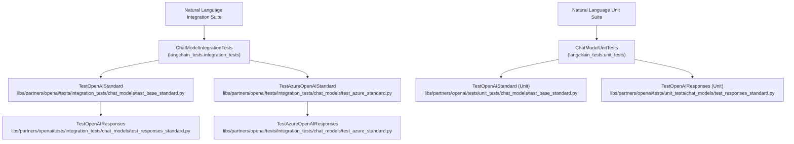
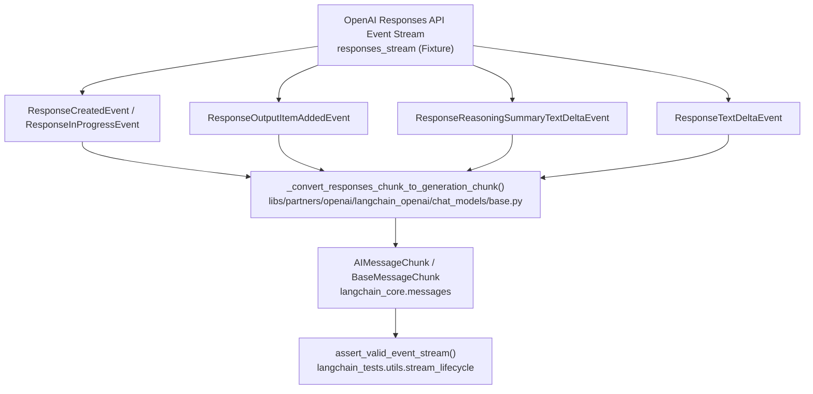
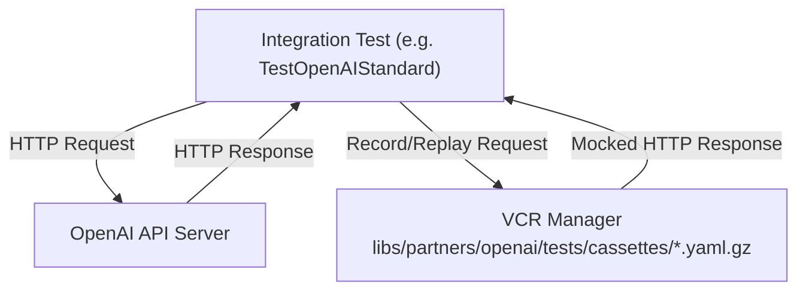
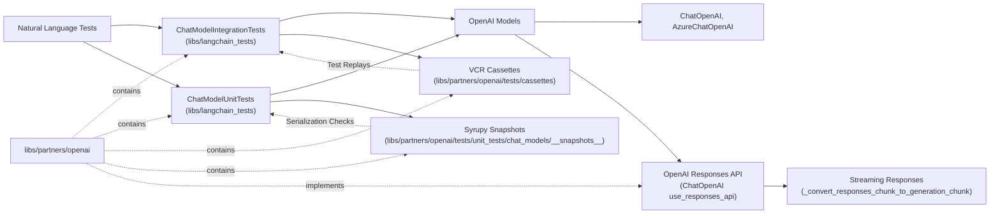

<!-- source: DeepWiki mcp.deepwiki.com · repo langchain-ai/langchain · extra page OpenAI Test Suite, Cassettes and Snapshots · fetched 2026-10-26 -->

# OpenAI Test Suite, Cassettes and Snapshots

<details>
<summary>Relevant source files</summary>

The following files were used as context for generating this wiki page:

- [libs/partners/openai/tests/cassettes/test_code_interpreter.yaml.gz](libs/partners/openai/tests/cassettes/test_code_interpreter.yaml.gz)
- [libs/partners/openai/tests/cassettes/test_image_generation_multi_turn.yaml.gz](libs/partners/openai/tests/cassettes/test_image_generation_multi_turn.yaml.gz)
- [libs/partners/openai/tests/cassettes/test_image_generation_streaming.yaml.gz](libs/partners/openai/tests/cassettes/test_image_generation_streaming.yaml.gz)
- [libs/partners/openai/tests/cassettes/test_mcp_builtin.yaml.gz](libs/partners/openai/tests/cassettes/test_mcp_builtin.yaml.gz)
- [libs/partners/openai/tests/cassettes/test_mcp_builtin_zdr.yaml.gz](libs/partners/openai/tests/cassettes/test_mcp_builtin_zdr.yaml.gz)
- [libs/partners/openai/tests/cassettes/test_reasoning.yaml.gz](libs/partners/openai/tests/cassettes/test_reasoning.yaml.gz)
- [libs/partners/openai/tests/cassettes/test_stream_encrypted_reasoning.yaml.gz](libs/partners/openai/tests/cassettes/test_stream_encrypted_reasoning.yaml.gz)
- [libs/partners/openai/tests/cassettes/test_stream_reasoning_summary.yaml.gz](libs/partners/openai/tests/cassettes/test_stream_reasoning_summary.yaml.gz)
- [libs/partners/openai/tests/cassettes/test_web_search.yaml.gz](libs/partners/openai/tests/cassettes/test_web_search.yaml.gz)
- [libs/partners/openai/tests/integration_tests/chat_models/test_azure_standard.py](libs/partners/openai/tests/integration_tests/chat_models/test_azure_standard.py)
- [libs/partners/openai/tests/integration_tests/chat_models/test_base_standard.py](libs/partners/openai/tests/integration_tests/chat_models/test_base_standard.py)
- [libs/partners/openai/tests/integration_tests/chat_models/test_responses_standard.py](libs/partners/openai/tests/integration_tests/chat_models/test_responses_standard.py)
- [libs/partners/openai/tests/unit_tests/chat_models/__snapshots__/test_azure_standard.ambr](libs/partners/openai/tests/unit_tests/chat_models/__snapshots__/test_azure_standard.ambr)
- [libs/partners/openai/tests/unit_tests/chat_models/__snapshots__/test_base_standard.ambr](libs/partners/openai/tests/unit_tests/chat_models/__snapshots__/test_base_standard.ambr)
- [libs/partners/openai/tests/unit_tests/chat_models/__snapshots__/test_responses_standard.ambr](libs/partners/openai/tests/unit_tests/chat_models/__snapshots__/test_responses_standard.ambr)
- [libs/partners/openai/tests/unit_tests/chat_models/test_azure_standard.py](libs/partners/openai/tests/unit_tests/chat_models/test_azure_standard.py)
- [libs/partners/openai/tests/unit_tests/chat_models/test_base_standard.py](libs/partners/openai/tests/unit_tests/chat_models/test_base_standard.py)
- [libs/partners/openai/tests/unit_tests/chat_models/test_responses_standard.py](libs/partners/openai/tests/unit_tests/chat_models/test_responses_standard.py)
- [libs/partners/openai/tests/unit_tests/chat_models/test_responses_stream.py](libs/partners/openai/tests/unit_tests/chat_models/test_responses_stream.py)
- [libs/partners/openai/tests/unit_tests/embeddings/test_azure_standard.py](libs/partners/openai/tests/unit_tests/embeddings/test_azure_standard.py)
- [libs/partners/openai/tests/unit_tests/embeddings/test_base_standard.py](libs/partners/openai/tests/unit_tests/embeddings/test_base_standard.py)
- [libs/partners/xai/tests/unit_tests/__snapshots__/test_chat_models_standard.ambr](libs/partners/xai/tests/unit_tests/__snapshots__/test_chat_models_standard.ambr)

</details>


## Purpose and Scope
This page documents the testing infrastructure for the `langchain-openai` partner package (`libs/partners/openai`). It details the comprehensive standardized conformance test suites, specialized unit and integration tests for both the classic OpenAI Chat Completions API and the newer Responses API, the streaming responses validation methodology, management of HTTP interaction mocking through VCR cassettes, and the usage of Syrupy snapshot testing to validate serialization and stable constructor configuration mappings.

---

## 1. Standard Conformance Test Suites

The `langchain-openai` package rigorously validates its chat model implementations by extending LangChain’s well-defined test interfaces:

- **Integration Tests:** Utilize `ChatModelIntegrationTests` to validate live interactions with the OpenAI service or their simulated replays.
- **Unit Tests:** Use `ChatModelUnitTests` to isolate internal logic without network dependencies.

These test suites check the models' compatibility against expected LangChain capabilities such as:

- Support for image inputs, image URLs, and PDF inputs
- JSON mode for structured prompts and parsing
- Acceptance of Anthropic-flavored inputs (due to provider compatibility layering)
- Usage metadata reporting for cache reads and reasoning outputs
- Streaming response handling and validation
- Cache-read input and reasoning output validations

### Key Test Classes Overview

| Test Class                         | Type         | Description                                                                                      | Source File & Lines                              |
|----------------------------------|--------------|------------------------------------------------------------------------------------------------|-------------------------------------------------|
| `TestOpenAIStandard`              | Integration  | Tests `ChatOpenAI` with model `"gpt-4o-mini"`, enabling advanced features like image inputs and streaming usage. | `[libs/partners/openai/tests/integration_tests/chat_models/test_base_standard.py:16-75]()` |
| `TestOpenAIResponses`             | Integration  | Extends `TestOpenAIStandard`, but switches to the OpenAI Responses API mode with `"use_responses_api": True`. | `[libs/partners/openai/tests/integration_tests/chat_models/test_responses_standard.py:16-89]()` |
| `TestAzureOpenAIStandard`         | Integration  | Azure-specific deployment testing using `AzureChatOpenAI`, checking config param loading and feature support. | `[libs/partners/openai/tests/integration_tests/chat_models/test_azure_standard.py:15-54]()` |
| `TestAzureOpenAIResponses`        | Integration  | Azure variant ensuring Responses API compatibility on Azure-specific clients.                  | `[libs/partners/openai/tests/integration_tests/chat_models/test_azure_standard.py:41-54]()` |
| `TestOpenAIStandard` (unit)       | Unit         | Unit tests for `ChatOpenAI` checking environment variable mapping, serialization, and defaults. | `[libs/partners/openai/tests/unit_tests/chat_models/test_base_standard.py:9-19]()` |
| `TestOpenAIResponses` (unit)      | Unit         | Unit tests for the OpenAI Responses API mode in the `ChatOpenAI` model.                        | `[libs/partners/openai/tests/unit_tests/chat_models/test_responses_standard.py:9-21]()` |

---

### Diagram: Test Class Inheritance Hierarchy (Natural Language → Code Entity Space)



Sources:  
`[libs/partners/openai/tests/integration_tests/chat_models/test_base_standard.py:16-75]()`  
`[libs/partners/openai/tests/integration_tests/chat_models/test_responses_standard.py:16-89]()`  
`[libs/partners/openai/tests/integration_tests/chat_models/test_azure_standard.py:15-54]()`  
`[libs/partners/openai/tests/unit_tests/chat_models/test_base_standard.py:9-19]()`  
`[libs/partners/openai/tests/unit_tests/chat_models/test_responses_standard.py:9-21]()`  

---

## 2. Responses API and Streaming Test Architecture

The OpenAI Responses API offers a sophisticated streaming interface, where responses arrive as a detailed event stream composed of multiple event types describing creation, progress, partial content additions, function calls, reasoning summaries, usage data, and completion status.

The LangChain OpenAI integration (`ChatOpenAI`) processes these granular server-sent events into LangChain-specific message chunks (`AIMessageChunk` and other `BaseMessageChunk` variants), which support incremental streaming and partial receipt of outputs in the SDK.

### Key Components and Flow

- **Fixture `responses_stream`:** A list of detailed mock event objects (e.g., `ResponseCreatedEvent`, `ResponseInProgressEvent`, `ResponseOutputItemAddedEvent`, `ResponseReasoningSummaryTextDeltaEvent`, etc.) representing a full lifecycle of a streamed response with reasoning and summary blocks. These simulate live streamed events for unit tests.  
- **Transformation function:** `_convert_responses_chunk_to_generation_chunk` (defined in `libs/partners/openai/langchain_openai/chat_models/base.py`) converts raw response event chunks to `langchain_core.messages` chunk objects used internally in LangChain.  
- **Stream Lifecycle Validation:** The `assert_valid_event_stream` utility (from `langchain_tests.utils.stream_lifecycle`) verifies the correctness of event sequencing, ensures no invalid state transitions, and confirms the integrity of streaming partials.  
- **Context Managers (MockSyncContextManager / MockAsyncContextManager):** Used to mock streaming interfaces for unit tests, simulating real-world asynchronous streaming scenarios.

---

### Diagram: Responses Streaming Event Processing Pipeline



Sources:  
`[libs/partners/openai/tests/unit_tests/chat_models/test_responses_stream.py:1-125]()`  
`[libs/partners/openai/langchain_openai/chat_models/base.py:53-55]()`  
`[langchain_tests.utils.stream_lifecycle:full module]()`  

---

## 3. VCR Cassettes and Network Mocking

To enable robust and reproducible integration testing with the external OpenAI services without incurring API rate limits or network unreliability, LangChain employs VCR cassettes.

### Features and Usage

- **VCR Integration:** Tests record HTTP interactions in YAML-formatted cassette files (compressed via gzip). Recorded cassettes store HTTP requests and corresponding responses.
- **Replay Mode:** During test execution, HTTP calls are intercepted and mocked by replaying stored responses rather than hitting live endpoints.
- **Control Flag:** The property `enable_vcr_tests` in the test classes returns `True` to activate VCR usage. This flag is used in `TestOpenAIStandard` integration tests.  
- **Cassette Storage:** The cassettes reside under `libs/partners/openai/tests/cassettes`. These include specialized scenarios such as:
  - `test_code_interpreter.yaml.gz`: Interactions related to the code interpreter module.  
  - `test_mcp_builtin_zdr.yaml.gz`: Cassettes capturing multi-turn reasoning dialogues and chained processing tests.

This approach optimizes test stability and developer experience by making tests faster, deterministic, and network-agnostic.

---

### Diagram: Network Mocking Flow with VCR Cassettes



Sources:  
`[libs/partners/openai/tests/integration_tests/chat_models/test_base_standard.py:59-60]()`  
`[libs/partners/openai/tests/cassettes/test_code_interpreter.yaml.gz:1-23]()`  
`[libs/partners/openai/tests/cassettes/test_mcp_builtin_zdr.yaml.gz:1-42]()`  

---

## 4. Syrupy Snapshots (`.ambr` files)

Syrupy snapshot testing is utilized to guarantee serialization stability and consistent constructor parameter mappings for OpenAI chat models.

### Characteristics

- Snapshots capture a precise serialized dictionary representation of the model constructor configuration, including:

  - Model names and parameters (e.g. temperature, max tokens)
  - API keys (mocked and obfuscated as secrets)
  - API endpoints and base URLs
  - Streaming usage flags
  - Disabled or legacy parameters

- These snapshots are stored as `.ambr` files under:

  ```
  libs/partners/openai/tests/unit_tests/chat_models/__snapshots__/
  ```

- The snapshots act as a regression detector during CI/CD, alerting maintainers if inadvertent changes affect serialization formats or constructor configs.

### Representative Snapshot Files

| Filename                            | Description                                               | Source File & Lines                        |
|-----------------------------------|-----------------------------------------------------------|-------------------------------------------|
| `test_base_standard.ambr`          | Snapshot capturing `ChatOpenAI` constructor serialized output with default params. | `[libs/partners/openai/tests/unit_tests/chat_models/__snapshots__/test_base_standard.ambr:1-31]()` |
| `test_azure_standard.ambr`         | Snapshot representing Azure-specific `AzureChatOpenAI` constructor config serialization. | `[libs/partners/openai/tests/unit_tests/chat_models/__snapshots__/test_azure_standard.ambr:1-37]()` |
| `test_responses_standard.ambr`     | Snapshot verifying `ChatOpenAI` constructor output with Responses API enabled. | `[libs/partners/openai/tests/unit_tests/chat_models/__snapshots__/test_responses_standard.ambr:1-33]()` |

---

# Summary Diagram: LangChain OpenAI Partner Testing Architecture



---

# Additional Notes

- The detailed streaming test fixtures simulate realistic complex event flows, including reasoning summaries, encrypted content flags, and function call deltas, closely following the OpenAI Responses API structure.
- Integration tests leverage VCR for efficient repeatability with less dependency on OpenAI API availability or cost.
- Syrupy snapshotting ensures robustness across LangChain releases protecting against unintended serialization changes.
- The test classes inherit well-defined standard method signatures to facilitate shared testing logic across various model/provider implementations.

---

# References

- `[libs/partners/openai/tests/integration_tests/chat_models/test_base_standard.py:16-75]()`
- `[libs/partners/openai/tests/integration_tests/chat_models/test_responses_standard.py:16-89]()`
- `[libs/partners/openai/tests/integration_tests/chat_models/test_azure_standard.py:15-54]()`
- `[libs/partners/openai/tests/unit_tests/chat_models/test_responses_stream.py:1-125]()`
- `[libs/partners/openai/tests/unit_tests/chat_models/test_base_standard.py:9-19]()`
- `[libs/partners/openai/tests/unit_tests/chat_models/test_responses_standard.py:9-21]()`
- `[libs/partners/openai/tests/unit_tests/chat_models/__snapshots__/test_base_standard.ambr:1-31]()`
- `[libs/partners/openai/tests/unit_tests/chat_models/__snapshots__/test_azure_standard.ambr:1-37]()`
- `[libs/partners/openai/tests/unit_tests/chat_models/__snapshots__/test_responses_standard.ambr:1-33]()`
- `[libs/partners/openai/tests/cassettes/test_code_interpreter.yaml.gz:1-23]()`
- `[libs/partners/openai/tests/cassettes/test_mcp_builtin_zdr.yaml.gz:1-42]()`

---

