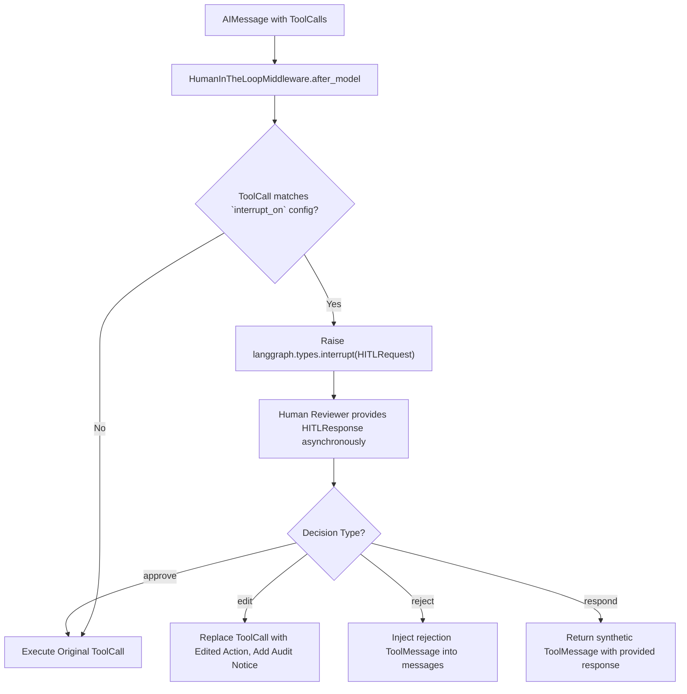
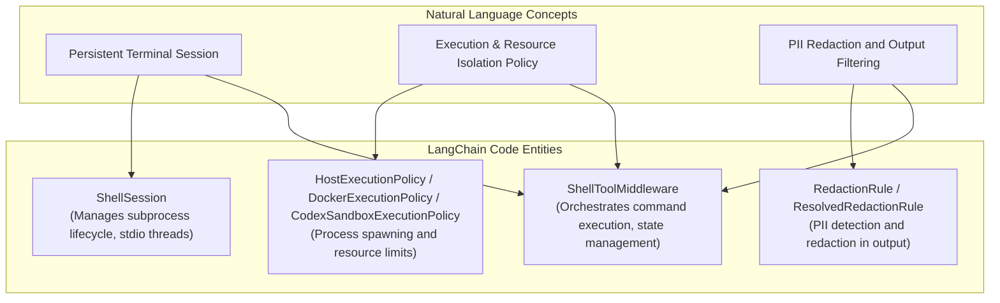
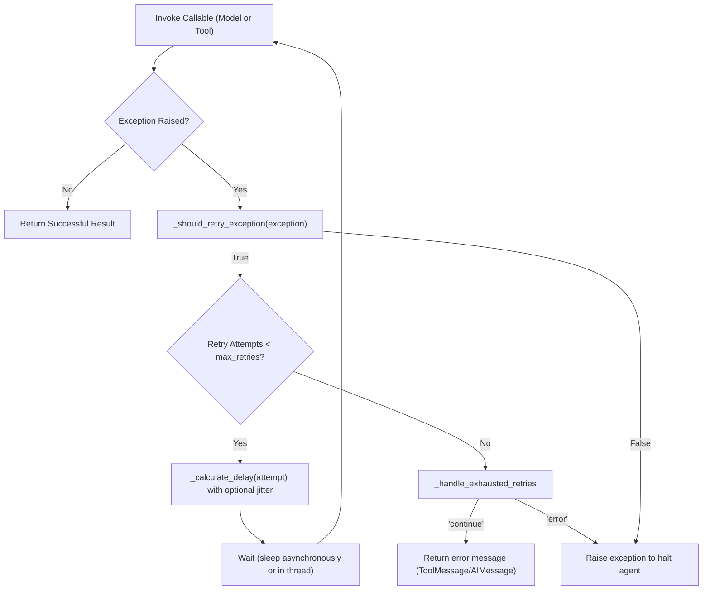

<!-- source: DeepWiki mcp.deepwiki.com · repo langchain-ai/langchain · extra page Safety, Limits and Retry Middleware · fetched 2026-10-26 -->

# Safety, Limits and Retry Middleware

Relevant source files

The following files were used as context for generating this wiki page:

- [libs/langchain_v1/langchain/agents/middleware/_execution.py](libs/langchain_v1/langchain/agents/middleware/_execution.py)
- [libs/langchain_v1/langchain/agents/middleware/_retry.py](libs/langchain_v1/langchain/agents/middleware/_retry.py)
- [libs/langchain_v1/langchain/agents/middleware/human_in_the_loop.py](libs/langchain_v1/langchain/agents/middleware/human_in_the_loop.py)
- [libs/langchain_v1/langchain/agents/middleware/model_call_limit.py](libs/langchain_v1/langchain/agents/middleware/model_call_limit.py)
- [libs/langchain_v1/langchain/agents/middleware/model_retry.py](libs/langchain_v1/langchain/agents/middleware/model_retry.py)
- [libs/langchain_v1/langchain/agents/middleware/shell_tool.py](libs/langchain_v1/langchain/agents/middleware/shell_tool.py)
- [libs/langchain_v1/langchain/agents/middleware/tool_call_limit.py](libs/langchain_v1/langchain/agents/middleware/tool_call_limit.py)
- [libs/langchain_v1/langchain/agents/middleware/tool_retry.py](libs/langchain_v1/langchain/agents/middleware/tool_retry.py)
- [libs/langchain_v1/tests/integration_tests/agents/middleware/__init__.py](libs/langchain_v1/tests/integration_tests/agents/middleware/__init__.py)
- [libs/langchain_v1/tests/integration_tests/agents/middleware/test_human_in_the_loop_integration.py](libs/langchain_v1/tests/integration_tests/agents/middleware/test_human_in_the_loop_integration.py)
- [libs/langchain_v1/tests/integration_tests/agents/middleware/test_shell_tool_integration.py](libs/langchain_v1/tests/integration_tests/agents/middleware/test_shell_tool_integration.py)
- [libs/langchain_v1/tests/unit_tests/agents/middleware/core/test_overrides.py](libs/langchain_v1/tests/unit_tests/agents/middleware/core/test_overrides.py)
- [libs/langchain_v1/tests/unit_tests/agents/middleware/core/test_wrap_model_call.py](libs/langchain_v1/tests/unit_tests/agents/middleware/core/test_wrap_model_call.py)
- [libs/langchain_v1/tests/unit_tests/agents/middleware/core/test_wrap_tool_call.py](libs/langchain_v1/tests/unit_tests/agents/middleware/core/test_wrap_tool_call.py)
- [libs/langchain_v1/tests/unit_tests/agents/middleware/implementations/test_human_in_the_loop.py](libs/langchain_v1/tests/unit_tests/agents/middleware/implementations/test_human_in_the_loop.py)
- [libs/langchain_v1/tests/unit_tests/agents/middleware/implementations/test_model_call_limit.py](libs/langchain_v1/tests/unit_tests/agents/middleware/implementations/test_model_call_limit.py)
- [libs/langchain_v1/tests/unit_tests/agents/middleware/implementations/test_model_retry.py](libs/langchain_v1/tests/unit_tests/agents/middleware/implementations/test_model_retry.py)
- [libs/langchain_v1/tests/unit_tests/agents/middleware/implementations/test_shell_execution_policies.py](libs/langchain_v1/tests/unit_tests/agents/middleware/implementations/test_shell_execution_policies.py)
- [libs/langchain_v1/tests/unit_tests/agents/middleware/implementations/test_shell_tool.py](libs/langchain_v1/tests/unit_tests/agents/middleware/implementations/test_shell_tool.py)
- [libs/langchain_v1/tests/unit_tests/agents/middleware/implementations/test_tool_call_limit.py](libs/langchain_v1/tests/unit_tests/agents/middleware/implementations/test_tool_call_limit.py)
- [libs/langchain_v1/tests/unit_tests/agents/middleware/implementations/test_tool_retry.py](libs/langchain_v1/tests/unit_tests/agents/middleware/implementations/test_tool_retry.py)
- [libs/langchain_v1/tests/unit_tests/agents/middleware_typing/test_middleware_backwards_compat.py](libs/langchain_v1/tests/unit_tests/agents/middleware_typing/test_middleware_backwards_compat.py)
- [libs/langchain_v1/tests/unit_tests/agents/middleware_typing/test_middleware_typing.py](libs/langchain_v1/tests/unit_tests/agents/middleware_typing/test_middleware_typing.py)

## Purpose and Scope
This document covers the technical architecture and implementation details of safety, execution governance, call limiting, and retry middlewares within the LangChain v1 agent framework (`libs/langchain_v1/langchain/agents/middleware/`) [libs/langchain_v1/langchain/agents/middleware/human_in_the_loop.py:1-212](). These components ensure controlled execution, human verification, secure environment isolation, resource quota enforcement, and fault-tolerant retry handling for both model and tool interactions.

---

## 1. Human-in-the-Loop Middleware (`HumanInTheLoopMiddleware`)

The `HumanInTheLoopMiddleware` inspects model-generated tool calls and pauses execution using LangGraph's `interrupt()` primitive when actions match pre-configured review rules. It enables a human overseer to approve, edit, reject, or respond on behalf of a tool call before its execution, providing an essential safety control to avoid undesired or unsafe operations [libs/langchain_v1/langchain/agents/middleware/human_in_the_loop.py:12-212]().

### Architecture and Decision Flow
When an agent generates tool calls (embedded in `AIMessage.tool_calls`), this middleware checks each tool call against its `interrupt_on` configuration predicate, which includes allowed decisions and optional schema-based validation. If a tool call requires human review, the middleware suspends execution by raising an interrupt carrying an `HITLRequest` payload describing the pending actions.

The human reviewer asynchronously returns an `HITLResponse` containing one or more decisions:

- **approve**: The original tool call is executed without modification.
- **edit**: The tool call is replaced with an edited action supplied by the human, while the original call is retained for audit with a prepended notice `_EDIT_NOTICE`.
- **reject**: The tool call is skipped; an optional textual rejection message is injected in the message stream.
- **respond**: Bypass tool execution by returning a synthetic successful tool message with the provided human response.

This flow ensures human-in-the-loop oversight and safe intervention to govern potentially unsafe or sensitive tool invocations.

*Sources: [libs/langchain_v1/langchain/agents/middleware/human_in_the_loop.py:15-150](), [libs/langchain_v1/tests/unit_tests/agents/middleware/implementations/test_human_in_the_loop.py:30-165]*

### Configuration and Payload Structure

- `interrupt_on`: A dictionary keyed by tool name mapping to `InterruptOnConfig` entries specifying:

  - `allowed_decisions`: Non-empty list of decision literals (`approve`, `edit`, `reject`, `respond`).
  
  - Optional `args_schema`: JSON Schema for validation when human edits are allowed.
  
  - Optional `description`: Human-readable text or factory function dynamically generating description per tool call.
  
  - Optional `when`: Predicate lambda to conditionally enable interrupt for specific tool calls.

- The middleware constructs an `HITLRequest` including all relevant pending tool calls for review with respective `ReviewConfig` embedded.
  
- Upon receiving an `HITLResponse`, the middleware updates the agent state to reflect changes (edited actions), injects audit notices into AI messages referencing tool calls replaced by human edits, or inserts rejection messages.
  
- The middleware guarantees that tool call IDs remain consistent on edits to maintain traceability.

---

## 2. Persistent Shell Tool and Execution Policies

`ShellToolMiddleware` provides a persistent shell environment as a system-level tool enabling agents to execute arbitrary shell commands safely within a controlled workspace. This is augmented by sandboxed execution policies enforcing resource limits and output redaction to protect sensitive information [libs/langchain_v1/langchain/agents/middleware/shell_tool.py:1-212]().

### Bridging Natural Language Concepts to Code Entities

This diagram maps shell tool conceptual components to their LangChain code entities:

*Sources: [libs/langchain_v1/langchain/agents/middleware/shell_tool.py:125-212](), [libs/langchain_v1/langchain/agents/middleware/_redaction.py:35-40]()*

### ShellSession and Execution Flow

- **ShellSession** maintains a UNIX shell subprocess initialized inside the agent-configured workspace.

- Manages concurrent standard output and error streams with dedicated reader threads that enqueue data lines asynchronously into an internal queue.

- Commands are sent sequentially through the subprocess's stdin; the session maintains state like environment variables and working directory implicitly.

- Supports lifecycle control including `start()`, `stop(timeout)`, and `restart()` to ensure robust cleanup and session state reset.

- Output is carefully truncated and marked if exceeding line/byte limits to avoid overwhelming agents with excessive data.

### Execution Policies

Execution policies determine how shell subprocesses are launched and constrained:

- **HostExecutionPolicy**: Runs in the host OS shell environment, applying resource limits (CPU time, memory in bytes) via `prlimit` on Linux or `setrlimit` on macOS for subprocesses. Supports process group control flags and handles platform-specific nuances [libs/langchain_v1/tests/unit_tests/agents/middleware/implementations/test_shell_execution_policies.py:57-185]().

- **DockerExecutionPolicy**: Runs commands inside Docker containers for isolated sandboxing.

- **CodexSandboxExecutionPolicy**: Uses the Codex CLI sandbox tool if available for additional containment.

Each policy implements a `spawn(workspace, env, command)` method that returns a subprocess `Popen` instance configured with environment variables and resource limits.

### Redaction Rules

Outputs from shell commands pass through configurable `RedactionRule` chains that detect patterns corresponding to personally identifiable information (PII) such as emails. Matches are replaced with standardized placeholders (e.g., `[REDACTED_EMAIL]`), preventing leakage of sensitive data back into the agent's visible context [libs/langchain_v1/langchain/agents/middleware/_redaction.py:35-40]().

---

## 3. Call Limit Middlewares

To prevent runaway or excessive API usage and tool invocations, LangChain deploys middlewares limiting the number of model and tool calls, supporting both thread-persistent and single-run granularities.

### 3.1 Tool Call Limit Middleware (`ToolCallLimitMiddleware`)

- Tracks tool call counts in the agent state for each tool name and a global key (`__all__`) under data keys:

  - `thread_tool_call_count`: Persistent count across runs for each tool.

  - `run_tool_call_count`: Counts within the current invocation.

- When a tool call is about to execute, it increments counts and checks limits configured per tool globally and individually.

- `exit_behavior` determines how exceeding limits are handled:

  - `'continue'`: Block execution of exceeded tools with error `ToolMessage` responses but allow other tools and model execution to proceed.

  - `'error'`: Raise `ToolCallLimitExceededError` immediately to halt execution.

  - `'end'`: Immediately stop execution injecting error `ToolMessage`s for exceeded tools, skip pending parallel tool calls, and insert a final `AIMessage` clarifying the limit breach.

- Provides detailed error messages to the model for graceful fallback or user-facing explanation.

### 3.2 Model Call Limit Middleware (`ModelCallLimitMiddleware`)

- Analogous to tool call limits but tracks LLM model invocation counts:

  - State keys: `thread_model_call_count` and `run_model_call_count`.

  - Configured limits for thread and run scopes.

- `exit_behavior` options:

  - `'end'`: Jump to the end state, injecting an AI message explaining the call limit violation.

  - `'error'`: Raise `ModelCallLimitExceededError` to abort execution.

- Middleware hooks on `before_model` to perform limit checks and enforce exit policies proactively.

---

## 4. Retry Middlewares and Error Resilience

Retry middlewares automatically handle transient failures during tool or model calls, improving agent reliability.

### General Retry Control Flow

*Sources: [libs/langchain_v1/langchain/agents/middleware/_retry.py:1-20]()*

### Retry Parameters and Behavior

- **`max_retries`**: Maximum retry attempts after the initial call (must be ≥ 0).

- **`retry_on`**: Tuple of exception types or a callable predicate specifying which exceptions are retryable.

- **`backoff_factor`**: Multiplier controlling exponential backoff delay between retries:  
  Delay = `initial_delay * (backoff_factor ^ retry_attempt)`

- **`jitter`**: Optionally adds ±25% random jitter to retry delays to avoid thundering herd issues.

- **`on_failure`**: Defines behavior after exhausting retries:

  - `'continue'`: Return error message to agent for graceful handling.

  - `'error'`: Raise the final exception to stop execution.

  - Custom callable: Generates custom error message content.

### Specific Middleware Implementations

- **`ToolRetryMiddleware`**: Wraps tool call execution with retry logic honoring the above parameters, applying only to configured tools if specified [libs/langchain_v1/langchain/agents/middleware/tool_retry.py:32-199]().

- **`ModelRetryMiddleware`**: Wraps model call execution similarly, retrying on model-call related transient errors, passing parameters like delay, retry_on exceptions, and failure handling [libs/langchain_v1/langchain/agents/middleware/model_retry.py:33-201]().

Both middlewares integrate uniformly with the LangChain v1 middleware framework, using shared utilities in `_retry.py` for delay calculation, exception filtering, and retry orchestration.

---

# Summary Table of Middleware Roles

| Middleware Name           | Purpose                                  | Enforced Limits         | Key Classes / Functions                          |
|--------------------------|------------------------------------------|------------------------|-------------------------------------------------|
| `HumanInTheLoopMiddleware` | Human oversight on tool calls via pause & review | Conditional interrupts on configured tool calls | `HumanInTheLoopMiddleware`, `interrupt()`       |
| `ShellToolMiddleware`    | Persistent shell environment tool for agents | Resource/time limits via execution policies    | `ShellSession`, `HostExecutionPolicy`, `DockerExecutionPolicy` |
| `ToolCallLimitMiddleware` | Limits total tool calls to prevent abuse | Thread and run call limits, exit behaviors     | `ToolCallLimitMiddleware`, `ToolCallLimitState` |
| `ModelCallLimitMiddleware`| Limits total LLM model calls             | Thread and run call limits, exit behaviors     | `ModelCallLimitMiddleware`, `ModelCallLimitState` |
| `ToolRetryMiddleware`    | Retries transient tool call failures      | Max retry count, backoff, error handling       | `ToolRetryMiddleware`, shared `_retry` utils    |
| `ModelRetryMiddleware`   | Retries transient model call failures     | Max retry count, backoff, error handling       | `ModelRetryMiddleware`, shared `_retry` utils   |

---

This middleware stack forms a critical safety and reliability framework within LangChain agents, combining human oversight, resource isolation, call quotas, and automated retry handling to provide controlled, robust, and transparent agent execution.

# End of Page

---

## Sources

- libs/langchain_v1/langchain/agents/middleware/human_in_the_loop.py:1-212
- libs/langchain_v1/langchain/agents/middleware/shell_tool.py:1-212
- libs/langchain_v1/langchain/agents/middleware/_redaction.py:35-40
- libs/langchain_v1/langchain/agents/middleware/tool_call_limit.py:1-178
- libs/langchain_v1/langchain/agents/middleware/model_call_limit.py:1-190
- libs/langchain_v1/langchain/agents/middleware/_retry.py:1-20
- libs/langchain_v1/langchain/agents/middleware/tool_retry.py:30-199
- libs/langchain_v1/langchain/agents/middleware/model_retry.py:30-201
- libs/langchain_v1/tests/unit_tests/agents/middleware/implementations/test_human_in_the_loop.py:1-172
- libs/langchain_v1/tests/unit_tests/agents/middleware/implementations/test_shell_tool.py:1-188
- libs/langchain_v1/tests/unit_tests/agents/middleware/implementations/test_shell_execution_policies.py:1-192

---

