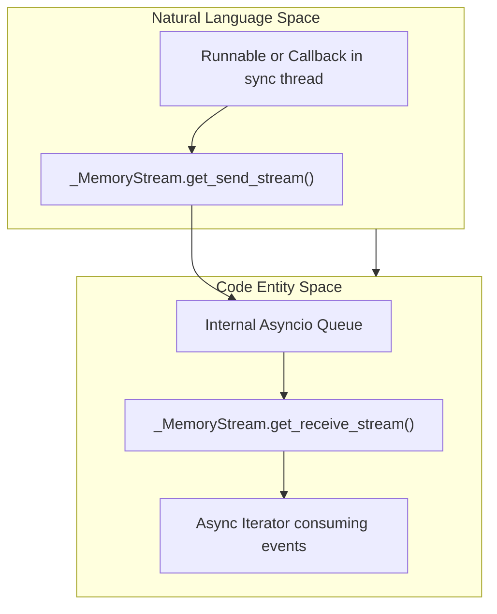
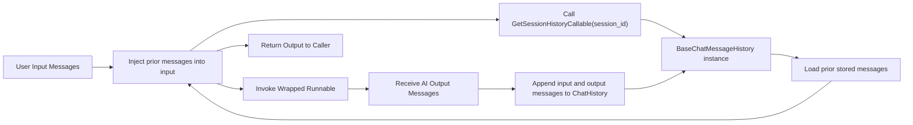

<!-- source: DeepWiki mcp.deepwiki.com · repo langchain-ai/langchain · extra page Streaming, Events and Chat History Runnables · fetched 2026-10-26 -->

# Streaming, Events and Chat History Runnables

<details>
<summary>Relevant source files</summary>

The following files were used as context for generating this wiki page:

- [libs/core/langchain_core/chat_history.py](libs/core/langchain_core/chat_history.py)
- [libs/core/langchain_core/chat_loaders.py](libs/core/langchain_core/chat_loaders.py)
- [libs/core/langchain_core/chat_sessions.py](libs/core/langchain_core/chat_sessions.py)
- [libs/core/langchain_core/runnables/__init__.py](libs/core/langchain_core/runnables/__init__.py)
- [libs/core/langchain_core/runnables/history.py](libs/core/langchain_core/runnables/history.py)
- [libs/core/langchain_core/tools/__init__.py](libs/core/langchain_core/tools/__init__.py)
- [libs/core/langchain_core/tracers/event_stream.py](libs/core/langchain_core/tracers/event_stream.py)
- [libs/core/langchain_core/tracers/log_stream.py](libs/core/langchain_core/tracers/log_stream.py)
- [libs/core/langchain_core/tracers/memory_stream.py](libs/core/langchain_core/tracers/memory_stream.py)
- [libs/core/tests/unit_tests/chat_history/__init__.py](libs/core/tests/unit_tests/chat_history/__init__.py)
- [libs/core/tests/unit_tests/chat_history/test_chat_history.py](libs/core/tests/unit_tests/chat_history/test_chat_history.py)
- [libs/core/tests/unit_tests/runnables/test_history.py](libs/core/tests/unit_tests/runnables/test_history.py)
- [libs/core/tests/unit_tests/runnables/test_imports.py](libs/core/tests/unit_tests/runnables/test_imports.py)
- [libs/core/tests/unit_tests/runnables/test_runnable_events_v1.py](libs/core/tests/unit_tests/runnables/test_runnable_events_v1.py)
- [libs/core/tests/unit_tests/runnables/test_runnable_events_v2.py](libs/core/tests/unit_tests/runnables/test_runnable_events_v2.py)
- [libs/core/tests/unit_tests/test_imports.py](libs/core/tests/unit_tests/test_imports.py)
- [libs/core/tests/unit_tests/test_pydantic_imports.py](libs/core/tests/unit_tests/test_pydantic_imports.py)
- [libs/core/tests/unit_tests/tracers/test_memory_stream.py](libs/core/tests/unit_tests/tracers/test_memory_stream.py)

</details>


## Purpose and Scope

This page provides an in-depth technical overview of key runnable primitives within `langchain-core` that enable:

- Streaming of fine-grained lifecycle and run events via the `astream_events` API (versions v1 and v2),
- Streaming of runnable execution logs with patch updates via `astream_log` and the `LogStreamCallbackHandler`,
- Thread-safe asynchronous event queuing using the `_MemoryStream` primitive,
- Management of conversational chat message history through the `RunnableWithMessageHistory` runnable wrapper.

These primitives empower developers to build robust, observable, and stateful asynchronous execution pipelines with rich event streaming and context continuation capabilities.

---

## 1. Unified Event Streaming: `astream_events` v1 and v2

The `astream_events()` method on a `Runnable` enables streaming every relevant lifecycle event emitted during execution of runnable chains, tools, prompts, or language models. This interface returns an asynchronous iterator over `StreamEvent` objects that represent granular run events.

### Core Implementation: `_AstreamEventsCallbackHandler`

The internal engine powering `astream_events` is `_AstreamEventsCallbackHandler`, defined in `tracers/event_stream.py`. This class extends both asynchronous callback handling and a streaming callback interface, collecting all runtime events and dispatching them via an internal asynchronous queue.

Key details:

- **Run Tracking:**  
  It maintains a `run_map` dictionary keyed by run UUIDs, storing run metadata for each active run (name, tags, run type, inputs). Alongside, a `parent_map` tracks parent-child run relationships, enabling hierarchical event context.

- **Event Filtering:**  
  `_RootEventFilter` allows filtering on run names, types, and tags to control which events to include or exclude based on user criteria.

- **Stream Delivery:**  
  Events passing the filter are pushed into a `_MemoryStream` send queue accessed by the caller as an async iterator (`__aiter__`).

- **Parent ID Resolution:**  
  Parent run IDs are provided in reverse order so receivers can reconstruct the run nesting from root to immediate parent.

- **Tap Output Async Iterator:**  
  Supports tapping outputs that are asynchronous iterators, converting each chunk into a stream event.

### Versions v1 vs v2

- **v1** event streaming has a flatter event structure without explicit parent ID tracking and minimal metadata. Marked deprecated but serves legacy compatibility.

- **v2** event streaming enhances metadata, explicitly tracks parent-child run relationships, and uses more structured payloads for streamed chunks, improving integration with external tooling and observability.

LangChain recommends using **v2** for all new integrations.

### Event Flow Diagram: `astream_events` mechanism

```mermaid
graph TD
    subgraph NL["Natural Language Space"]
    UserRequest["User calls `Runnable.astream_events(version='v1/v2')`"] --> EventHandlerCall["_AstreamEventsCallbackHandler instantiated"]
    end

    subgraph CE["Code Entity Space"]
    EventHandlerCall --> RunMaps["Maintains run_map and parent_map"]
    RunMaps --> Filter["_RootEventFilter applies event include/exclude rules"]
    Filter --> StreamQueue["_MemoryStream send stream (async queue)"]
    StreamQueue --> AsyncIteratorOutput["`__aiter__` yields `StreamEvent`s to caller"]
    end

    NL --> CE
```

*Diagram 1: Natural Language request triggers creating a streaming callback handler that manages run metadata, filters events, and produces an async stream.*

---

## 2. Run Log Streaming: `astream_log` and `LogStreamCallbackHandler`

Besides event streams, LangChain supports streamed **run logs** as incremental JSONPatch-based snapshots representing the entire runnable execution tree.

### Core Concepts

- **LogEntry:**  
  Represents an atomic execution record for a sub-run. Includes fields such as ID, name, type (prompt, chain, LLM, etc.), tags, metadata, start/end timestamps, streamed output chunks, and final output.  

- **RunState:**  
  The complete current state of the runnable execution including all nested runs (logs dictionary), streamed output aggregates, and final outputs.

- **RunLogPatch:**  
  A JSONPatch sequence encoding minimal operations needed to transform an empty state into the current partial state. This compact representation supports incremental updates.

- **RunLog:**  
  Combines patches with a concrete `RunState` snapshot, allowing efficient patch addition and state reconstruction.

### `LogStreamCallbackHandler`

- Captures lifecycle events, assembles `RunLogPatch` objects describing state mutations and streamed data.

- Provides an async event stream for consumers with all logs and incremental updates.

- Internally uses `_MemoryStream` for emitting updates to ensure thread-safe asynchronous communication.

This log streaming mechanism is useful for building UIs or diagnostic tooling that require a snapshot consistent view of execution progress.

---

## 3. Asynchronous Memory and Queue Primitives: `_MemoryStream`

The low-level asynchronous streaming is built atop `_MemoryStream` implemented in `tracers/memory_stream.py`.

### Purpose

Designed for safe bridging between synchronous contexts (e.g., blocking run invocations) and asynchronous consumers, `_MemoryStream` provides:

- Thread-safe send and receive interfaces,
- An internal asyncio queue for event buffering,
- Support for managing event loops, including creating a dedicated event loop when used from threads without one.

### Structure: Separate Send and Receive Streams

- **Send Stream:**  
  Used by producers (often synchronous threads or callback handlers) to push events via thread-safe methods like `send_nowait`.

- **Receive Stream:**  
  An async iterator exposing the buffered items for consumption by async code downstream.

### Operational Flow Diagram



*Diagram 2: `_MemoryStream` as a queue bridging sync event producers and async event consumers.*

---

## 4. Chat History Management: `RunnableWithMessageHistory`

The `RunnableWithMessageHistory` class wraps any runnable to provide automated conversational chat history persistence and injection.

### Overview

- Wraps an inner `Runnable` that takes chat messages or dictionaries containing message sequences.

- Uses a user-provided callable (a session factory) that returns a `BaseChatMessageHistory` instance corresponding to a session identifier (e.g., `session_id`).

- Before forwarding inputs to the wrapped runnable, loads prior messages from history and injects them into the input.

- After the wrapped runnable returns output messages, appends both input and output messages to the chat history store.

- Supports sync and async invocation, preserving full compatibility with LangChain's runnable lifecycle.

### Input and Output Handling

- Input can be a sequence of `BaseMessage` or a dictionary containing a key pointing to the messages.

- Output, typically AI-generated messages, is appended back with the user inputs to the message history.

### `BaseChatMessageHistory`

- Abstract base class defining interface for chat message historic storage.

- Defines sync and async variants of:

  - `add_messages(messages: Sequence[BaseMessage])`

  - `aget_messages() -> list[BaseMessage]`

  - `clear()`

- Must be subclassed to provide concrete persistent or in-memory implementations (e.g., `InMemoryChatMessageHistory`).

### Typical Usage

```python
from langchain_core.chat_history import BaseChatMessageHistory
from langchain_core.messages import BaseMessage, AIMessage, HumanMessage
from langchain_core.runnables import RunnableLambda
from langchain_core.runnables.history import RunnableWithMessageHistory

# Simple in-memory message history store
class InMemoryHistory(BaseChatMessageHistory):
    def __init__(self):
        self.messages = []
    def add_messages(self, messages):
        self.messages.extend(messages)
    @property
    def messages(self):
        return self._messages

# Factory function to get history by session_id
store = {}
def get_history(session_id: str) -> BaseChatMessageHistory:
    if session_id not in store:
        store[session_id] = InMemoryHistory()
    return store[session_id]

# Create a simple runnable
def echo_runnable(messages: list[BaseMessage]) -> str:
    return "\n".join(m.content for m in messages if isinstance(m, HumanMessage))

runnable = RunnableLambda(echo_runnable)
wrapped = RunnableWithMessageHistory(runnable, get_history)

# Invocation with session config
config = {"configurable": {"session_id": "session1"}}
response = wrapped.invoke([HumanMessage(content="Hello")], config)
```

### Data Flow Diagram: `RunnableWithMessageHistory`



---

## Summary Table of Core Primitives and Files

| Concept                               | Key Classes/Functions                       | File and Line Reference                         |
|-------------------------------------|--------------------------------------------|------------------------------------------------|
| Event Stream Handler                 | `_AstreamEventsCallbackHandler`            | `tracers/event_stream.py:101-204`              |
| Event Filter                        | `_RootEventFilter`                          | `tracers/event_stream.py:133-140`              |
| Stream Event Schema                 | `StreamEvent` (schema)                      | `runnables/schema.py` (not provided here)      |
| Run Log Streaming                   | `LogStreamCallbackHandler`, `RunLog`, `RunLogPatch` | `tracers/log_stream.py:40-222`                  |
| Async Event Queue                  | `_MemoryStream`, `_get_or_create_loop`     | `tracers/memory_stream.py` and usage in `event_stream.py` |
| Abstract Chat History               | `BaseChatMessageHistory`                    | `chat_history.py:31-185`                        |
| Chat History Runnable Wrapper      | `RunnableWithMessageHistory`                | `runnables/history.py:39-185`                   |
| Runnable Event Stream Tests         | `test_event_stream_with_simple_function_tool`, etc. | `tests/unit_tests/runnables/test_runnable_events_v2.py` |
| Chat History Wrapper Tests          | `test_input_messages`, `test_input_dict`   | `tests/unit_tests/runnables/test_history.py`   |

---

## Additional Notes

- The `RunnableWithMessageHistory` class is deprecated; LangChain encourages usage of LangGraph’s built-in persistence features for chat history in newer applications.

- Event streaming APIs (`astream_events`) support fine-grained filtering on run names, types, and tags, enabling highly configurable observability.

- Thread-safe asynchronous queuing via `_MemoryStream` accommodates complex concurrency scenarios involving synchronous execution and asynchronous event consumption, including cross-thread and cross-event loop contexts.

- Streaming outputs from runnables (including chunked LLM tokens) are carefully intercepted and emitted as stream events or log patches for reactive interfaces.

---

# References and Sources

- `libs/core/langchain_core/tracers/event_stream.py:101-204`  
- `libs/core/langchain_core/runnables/history.py:39-185`  
- `libs/core/langchain_core/tracers/log_stream.py:40-222`  
- `libs/core/langchain_core/tracers/memory_stream.py`  
- `libs/core/langchain_core/chat_history.py:31-185`  
- `libs/core/tests/unit_tests/runnables/test_runnable_events_v2.py`  
- `libs/core/tests/unit_tests/runnables/test_history.py`  
- `libs/core/tests/unit_tests/tracers/test_memory_stream.py`

---

