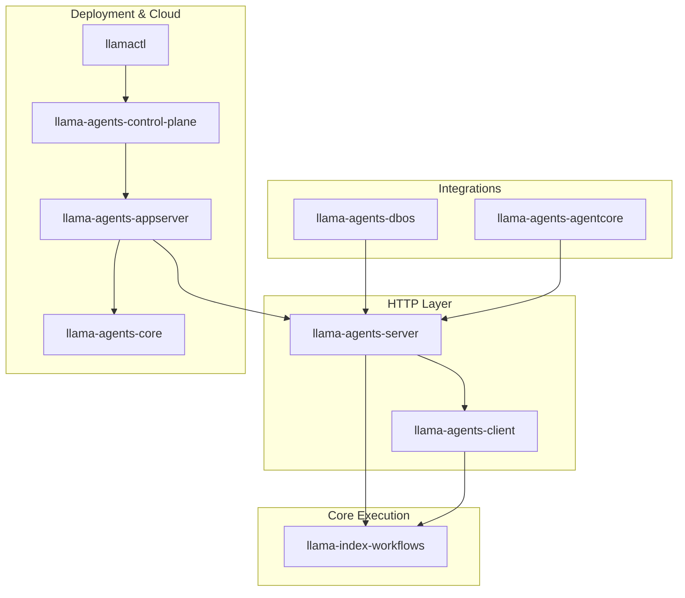
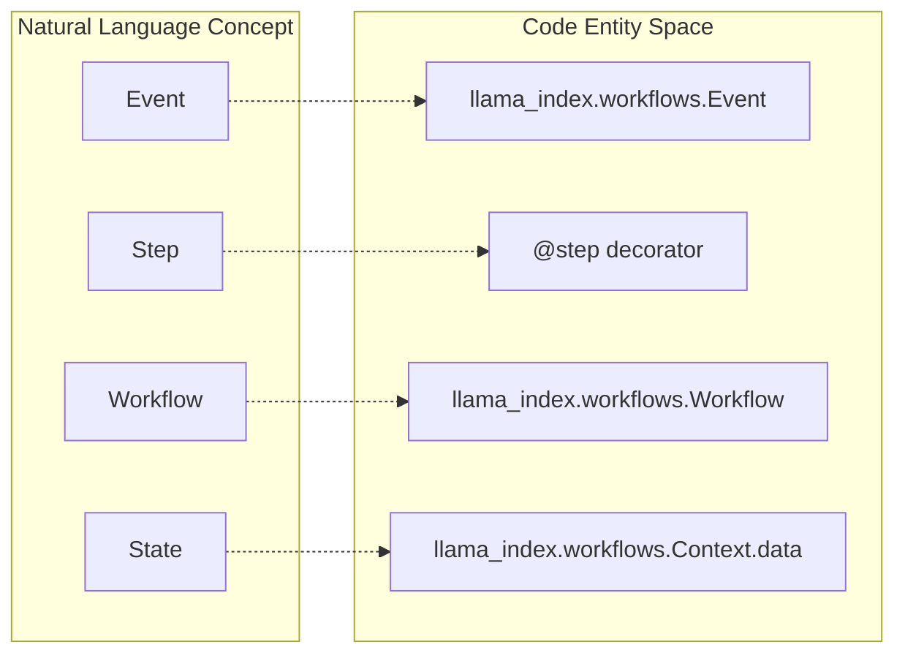
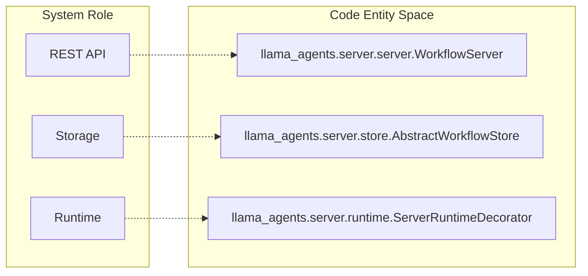

<!-- source: DeepWiki mcp.deepwiki.com · repo run-llama/llama-agents · page 1.2 Repository Structure and Package Map · fetched 2026-10-26 -->

# Repository Structure and Package Map

<details>
<summary>Relevant source files</summary>

The following files were used as context for generating this wiki page:

- [packages/llama-agents-appserver/CHANGELOG.md](packages/llama-agents-appserver/CHANGELOG.md)
- [packages/llama-agents-appserver/package.json](packages/llama-agents-appserver/package.json)
- [packages/llama-agents-appserver/pyproject.toml](packages/llama-agents-appserver/pyproject.toml)
- [packages/llama-agents-client/CHANGELOG.md](packages/llama-agents-client/CHANGELOG.md)
- [packages/llama-agents-client/package.json](packages/llama-agents-client/package.json)
- [packages/llama-agents-client/pyproject.toml](packages/llama-agents-client/pyproject.toml)
- [packages/llama-agents-core/CHANGELOG.md](packages/llama-agents-core/CHANGELOG.md)
- [packages/llama-agents-core/package.json](packages/llama-agents-core/package.json)
- [packages/llama-agents-server/CHANGELOG.md](packages/llama-agents-server/CHANGELOG.md)
- [packages/llama-agents-server/package.json](packages/llama-agents-server/package.json)
- [packages/llama-agents-server/pyproject.toml](packages/llama-agents-server/pyproject.toml)
- [packages/llama-index-workflows/CHANGELOG.md](packages/llama-index-workflows/CHANGELOG.md)
- [packages/llama-index-workflows/package.json](packages/llama-index-workflows/package.json)
- [packages/llama-index-workflows/pyproject.toml](packages/llama-index-workflows/pyproject.toml)
- [pyproject.toml](pyproject.toml)
- [uv.lock](uv.lock)

</details>


The `llama-agents` repository is organized as a monorepo managed by `uv` and `pnpm`. It contains a collection of Python packages that together provide a framework for building, serving, and orchestrating event-driven AI workflows. The layout separates the core execution engine from deployment-specific logic, client libraries, and cloud management infrastructure.

## Monorepo Layout and Workspace Configuration

The repository uses `uv` workspaces to manage dependencies and inter-package linking. All functional code resides within the `packages/` directory, while the root `pyproject.toml` defines the workspace members and shared development configurations [pyproject.toml:179-202]().

### Package Categories

| Category | Packages | Role |
| :--- | :--- | :--- |
| **Core Engine** | `llama-index-workflows` | The foundational event-driven workflow execution library. |
| **Server/Client** | `llama-agents-server`, `llama-agents-client` | HTTP interfaces for exposing and consuming workflows. |
| **Cloud/Deployment** | `llama-agents-control-plane`, `llama-agents-appserver`, `llama-agents-core` | Infrastructure for Kubernetes orchestration and LlamaDeploy. |
| **Integrations** | `llama-agents-dbos`, `llama-agents-agentcore` | Durable execution backends and AWS Bedrock bridges. |
| **Tooling** | `llamactl`, `llama-index-utils-workflow` | CLI management and visualization utilities. |

**Sources:** [uv.lock:11-27](), [pyproject.toml:182-201]()

---

## Core Package Map

The following diagram illustrates the primary packages and their relationships within the monorepo.

### Package Dependency Graph

**Sources:** [packages/llama-agents-server/pyproject.toml:27-28](), [packages/llama-agents-client/pyproject.toml:23-24](), [packages/llama-agents-appserver/pyproject.toml:29-34]()

---

## Package Roles and Implementation Details

### 1. llama-index-workflows
The foundational package. It implements the `Workflow` class and the `@step` decorator pattern.
- **Key Entities**: `Workflow`, `Context`, `StartEvent`, `StopEvent`.
- **Implementation**: Provides the event-driven control loop that handles step execution and state management [packages/llama-index-workflows/pyproject.toml:24-26]().

### 2. llama-agents-server
Provides the `WorkflowServer` to wrap workflows as Starlette-based HTTP services.
- **Key Entities**: `WorkflowServer`, `AbstractWorkflowStore`, `PersistenceDecorator`.
- **Functionality**: Manages workflow lifecycles, persistence of state across restarts, and SSE (Server-Sent Events) streaming for real-time updates [packages/llama-agents-server/pyproject.toml:21-32]().

### 3. llama-agents-client
A lightweight HTTP client for interacting with a `WorkflowServer`.
- **Key Entities**: `WorkflowClient`.
- **Functionality**: Handles cursor-based SSE event streaming and automatic reconnection logic [packages/llama-agents-client/CHANGELOG.md:94-95]().

### 4. llama-agents-appserver
The runtime component designed to run inside Kubernetes pods or containerized environments.
- **Key Entities**: `DeploymentConfig`, `load_workflows`.
- **Functionality**: Bootstraps workflows based on configuration files (e.g., `llama_deploy.yaml`) and integrates with the Control Plane [packages/llama-agents-appserver/pyproject.toml:18-20]().

### 5. llamactl
The command-line interface for the entire ecosystem.
- **Functionality**: Manages deployments, streams logs from Kubernetes, and handles authentication with the Control Plane [pyproject.toml:71-72]().

---

## Workspace Integration

The monorepo leverages `uv` to ensure that local changes in one package are immediately reflected in dependent packages without requiring a manual publish to PyPI.

### Dependency Resolution
In the root `uv.lock`, all packages are resolved as workspace members [uv.lock:11-27](). For example, `llama-agents-server` depends on `llama-index-workflows` via a workspace reference:
```toml
[tool.uv.sources]
llama-index-workflows = {workspace = true}
llama-agents-client = {workspace = true}
```
**Sources:** [packages/llama-agents-server/pyproject.toml:62-64]()

### Python Versioning
The monorepo targets Python `>=3.10` [pyproject.toml:23](). Specific packages like `llama-agents-integration-tests` or the internal `dev_cli` may target newer versions (up to `3.14`) for testing and development tooling [pyproject.toml:80-84]().

---

## Code Entity to System Mapping

The following diagrams bridge the gap between high-level system components and the specific code entities that implement them.

### Workflow Execution Mapping

**Sources:** [packages/llama-index-workflows/pyproject.toml:24-26](), [packages/llama-index-workflows/CHANGELOG.md:8-10]()

### Server & Persistence Mapping

**Sources:** [packages/llama-agents-server/pyproject.toml:38](), [packages/llama-agents-server/CHANGELOG.md:167-171]()

---

## Summary of Package Roles

| Package | Directory | Primary Role |
| :--- | :--- | :--- |
| `llama-index-workflows` | `packages/llama-index-workflows` | Core logic for event-driven steps. |
| `llama-agents-server` | `packages/llama-agents-server` | Starlette server for workflow hosting. |
| `llama-agents-client` | `packages/llama-agents-client` | HTTP/SSE client for workflows. |
| `llama-agents-appserver`| `packages/llama-agents-appserver`| Deployment-ready wrapper for workflows. |
| `llama-agents-dbos` | `packages/llama-agents-dbos` | Durable execution via DBOS. |
| `llamactl` | `packages/llamactl` | CLI for management and orchestration. |

**Sources:** [uv.lock:11-27](), [pyproject.toml:182-202]()

---

