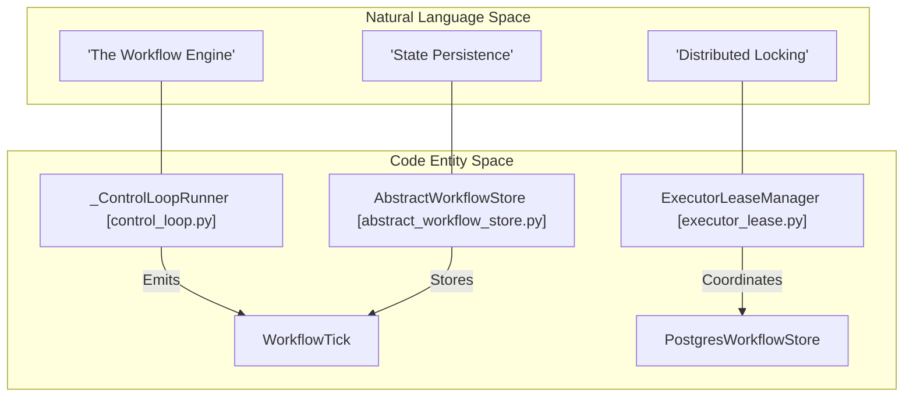
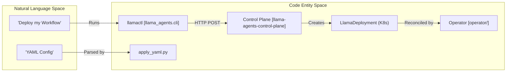

<!-- source: DeepWiki mcp.deepwiki.com · repo run-llama/llama-agents · page 10 Glossary · fetched 2026-10-26 -->

# Glossary

Relevant source files

The following files were used as context for generating this wiki page:

- [.github/actions/setup-publish/action.yml](.github/actions/setup-publish/action.yml)
- [.github/workflows/publish_changesets.yml](.github/workflows/publish_changesets.yml)
- [charts/llama-agents/CHANGELOG.md](charts/llama-agents/CHANGELOG.md)
- [charts/llama-agents/Chart.yaml](charts/llama-agents/Chart.yaml)
- [charts/llama-agents/README.md](charts/llama-agents/README.md)
- [charts/llama-agents/package.json](charts/llama-agents/package.json)
- [charts/llama-agents/values.yaml](charts/llama-agents/values.yaml)
- [operator/CHANGELOG.md](operator/CHANGELOG.md)
- [operator/package.json](operator/package.json)
- [packages/llama-agents-agentcore/CHANGELOG.md](packages/llama-agents-agentcore/CHANGELOG.md)
- [packages/llama-agents-agentcore/package.json](packages/llama-agents-agentcore/package.json)
- [packages/llama-agents-agentcore/pyproject.toml](packages/llama-agents-agentcore/pyproject.toml)
- [packages/llama-agents-client/CHANGELOG.md](packages/llama-agents-client/CHANGELOG.md)
- [packages/llama-agents-client/package.json](packages/llama-agents-client/package.json)
- [packages/llama-agents-client/pyproject.toml](packages/llama-agents-client/pyproject.toml)
- [packages/llama-agents-control-plane/pyproject.toml](packages/llama-agents-control-plane/pyproject.toml)
- [packages/llama-agents-control-plane/tests/test_endpoints.py](packages/llama-agents-control-plane/tests/test_endpoints.py)
- [packages/llama-agents-core/pyproject.toml](packages/llama-agents-core/pyproject.toml)
- [packages/llama-agents-core/src/llama_agents/core/schema/deployments.py](packages/llama-agents-core/src/llama_agents/core/schema/deployments.py)
- [packages/llama-agents-core/tests/test_schema.py](packages/llama-agents-core/tests/test_schema.py)
- [packages/llama-agents-dbos/src/llama_agents/dbos/executor_lease.py](packages/llama-agents-dbos/src/llama_agents/dbos/executor_lease.py)
- [packages/llama-agents-dbos/src/llama_agents/dbos/runtime.py](packages/llama-agents-dbos/src/llama_agents/dbos/runtime.py)
- [packages/llama-agents-dbos/tests/test_dbos_runtime.py](packages/llama-agents-dbos/tests/test_dbos_runtime.py)
- [packages/llama-agents-dbos/tests/test_executor_lease.py](packages/llama-agents-dbos/tests/test_executor_lease.py)
- [packages/llama-agents-server/CHANGELOG.md](packages/llama-agents-server/CHANGELOG.md)
- [packages/llama-agents-server/package.json](packages/llama-agents-server/package.json)
- [packages/llama-agents-server/pyproject.toml](packages/llama-agents-server/pyproject.toml)
- [packages/llama-agents-server/src/llama_agents/server/_pool.py](packages/llama-agents-server/src/llama_agents/server/_pool.py)
- [packages/llama-agents-server/src/llama_agents/server/_store/postgres_workflow_store.py](packages/llama-agents-server/src/llama_agents/server/_store/postgres_workflow_store.py)
- [packages/llama-agents-server/tests/server/test_pool.py](packages/llama-agents-server/tests/server/test_pool.py)
- [packages/llama-agents-server/tests/server/test_postgres_workflow_store.py](packages/llama-agents-server/tests/server/test_postgres_workflow_store.py)
- [packages/llama-index-workflows/CHANGELOG.md](packages/llama-index-workflows/CHANGELOG.md)
- [packages/llama-index-workflows/package.json](packages/llama-index-workflows/package.json)
- [packages/llama-index-workflows/pyproject.toml](packages/llama-index-workflows/pyproject.toml)
- [packages/llama-index-workflows/src/workflows/plugins/basic.py](packages/llama-index-workflows/src/workflows/plugins/basic.py)
- [packages/llama-index-workflows/src/workflows/representation/validate.py](packages/llama-index-workflows/src/workflows/representation/validate.py)
- [packages/llama-index-workflows/src/workflows/runtime/control_loop.py](packages/llama-index-workflows/src/workflows/runtime/control_loop.py)
- [packages/llama-index-workflows/src/workflows/runtime/types/plugin.py](packages/llama-index-workflows/src/workflows/runtime/types/plugin.py)
- [packages/llama-index-workflows/src/workflows/workflow.py](packages/llama-index-workflows/src/workflows/workflow.py)
- [packages/llama-index-workflows/tests/conftest.py](packages/llama-index-workflows/tests/conftest.py)
- [packages/llama-index-workflows/tests/runtime/conftest.py](packages/llama-index-workflows/tests/runtime/conftest.py)
- [packages/llama-index-workflows/tests/runtime/test_control_loop.py](packages/llama-index-workflows/tests/runtime/test_control_loop.py)
- [packages/llama-index-workflows/tests/runtime/test_control_loop_transformations.py](packages/llama-index-workflows/tests/runtime/test_control_loop_transformations.py)
- [packages/llama-index-workflows/tests/test_graph_validation.py](packages/llama-index-workflows/tests/test_graph_validation.py)
- [packages/llama-index-workflows/tests/test_workflow.py](packages/llama-index-workflows/tests/test_workflow.py)
- [packages/llamactl/CHANGELOG.md](packages/llamactl/CHANGELOG.md)
- [packages/llamactl/package.json](packages/llamactl/package.json)
- [packages/llamactl/pyproject.toml](packages/llamactl/pyproject.toml)
- [packages/llamactl/src/llama_agents/cli/apply_yaml.py](packages/llamactl/src/llama_agents/cli/apply_yaml.py)
- [packages/llamactl/tests/test_apply_yaml.py](packages/llamactl/tests/test_apply_yaml.py)
- [src/dev_cli/changesets.py](src/dev_cli/changesets.py)
- [src/dev_cli/commands/changesets_cmd.py](src/dev_cli/commands/changesets_cmd.py)
- [src/dev_cli/commands/publish_cmd.py](src/dev_cli/commands/publish_cmd.py)
- [src/dev_cli/gha.py](src/dev_cli/gha.py)
- [tests/dev_cli/test_changesets.py](tests/dev_cli/test_changesets.py)

This page provides a comprehensive reference for terms, abbreviations, and domain concepts specific to the `llama-agents` codebase. It serves as a bridge between high-level architectural concepts and their concrete implementations in the Python and Go packages.

## Core Concepts

### Workflow
An event-driven, async-first orchestration unit. Workflows are defined by decorating methods with `@step` and using `Context` to manage state and event flow.
*   **Implementation**: Defined in `Workflow` class [packages/llama-index-workflows/src/workflows/workflow.py:1-100]().
*   **Key Functions**: 
    *   `@step`: Decorator that registers a method as a workflow step.
    *   `run()`: Entry point for executing a workflow instance.

### Step
A discrete unit of execution within a Workflow. Steps consume specific `Event` types and emit new ones.
*   **Implementation**: Wrapped by `StepWorkerFunction` [packages/llama-index-workflows/src/workflows/runtime/control_loop.py:115-115]().
*   **Behavior**: Steps can be retried using `ExponentialBackoffRetryPolicy` [packages/llama-index-workflows/CHANGELOG.md:69-69]().

### Event
The primary mechanism for communication between steps. Events are Pydantic models that carry data through the system.
*   **Implementation**: Base class `Event` in [packages/llama-index-workflows/src/workflows/events.py:23-23]().
*   **System Events**:
    *   `StartEvent`: Triggered when a workflow begins.
    *   `StopEvent`: Terminates the workflow and returns a result.
    *   `InputRequiredEvent`: Signals that the workflow is waiting for external human-in-the-loop (HITL) input.

### Tick
A discrete, serializable record of a state change or event within the workflow runtime. Ticks enable deterministic replay and persistence.
*   **Implementation**: `WorkflowTick` [packages/llama-index-workflows/src/workflows/runtime/control_loop.py:87-87]().
*   **Types**: `TickStepResult`, `TickAddEvent`, `TickIdleCheck` [packages/llama-index-workflows/src/workflows/runtime/control_loop.py:79-88]().

---

## Architecture & Runtime

### Control Loop
The sequential, deterministic engine that manages the execution of steps, event dispatching, and timeouts.
*   **Implementation**: `_ControlLoopRunner` [packages/llama-index-workflows/src/workflows/runtime/control_loop.py:121-164]().
*   **Mechanism**: Uses a `tick_buffer` and `scheduled_wakeups` heap to ensure ordering [packages/llama-index-workflows/src/workflows/runtime/control_loop.py:146-154]().

### Runtime
The abstraction layer that executes the control loop. It can be local (Basic) or distributed (DBOS).
*   **Implementation**: `Runtime` interface [packages/llama-agents-dbos/src/llama_agents/dbos/runtime.py:77-77]().
*   **DBOS Runtime**: Provides durable execution by journaling ticks to a database and using `ExecutorLeaseManager` for distributed coordination [packages/llama-agents-dbos/src/llama_agents/dbos/runtime.py:4-8]().

### Persistence Decorators
Wrappers around the Workflow Server runtime that inject cross-cutting concerns like database storage and idle management.
*   **ServerRuntimeDecorator**: Base class for runtime extensions [packages/llama-agents-server/CHANGELOG.md:167-170]().
*   **PersistenceDecorator**: Automatically saves ticks and state to a `WorkflowStore` [packages/llama-agents-server/CHANGELOG.md:208-209]().
*   **IdleReleaseDecorator**: Drops workflow handlers from memory when they are waiting on external input to save resources [packages/llama-agents-server/CHANGELOG.md:167-170]().

### Diagram: Natural Language to Code Entity (Runtime)

Sources: [packages/llama-index-workflows/src/workflows/runtime/control_loop.py:121-164](), [packages/llama-agents-dbos/src/llama_agents/dbos/executor_lease.py:1-50](), [packages/llama-agents-server/src/llama_agents/server/_store/abstract_workflow_store.py:34-40]()

---

## Infrastructure & Tooling

### LlamaDeployment (CRD)
A Kubernetes Custom Resource Definition that defines the desired state of a workflow deployment, including replicas, environment variables, and workflow source.
*   **Implementation**: Reconciled by the Go-based operator in `operator/` [Wiki Table of Contents: Section 6]().

### llamactl
The command-line interface used to interact with the Control Plane and manage deployments.
*   **Implementation**: [packages/llamactl/pyproject.toml:45-45]().
*   **Key Command**: `llamactl apply` parses YAML configurations and upserts them to the Control Plane [Wiki Table of Contents: Section 7.1]().

### Changesets
A mechanism for managing versioning and changelogs in the monorepo.
*   **Implementation**: Managed via `dev changeset-plan` in the CI pipeline [.github/workflows/publish_changesets.yml:103-105]().

### Diagram: Deployment Flow (Natural Language to Code)

Sources: [packages/llamactl/src/llama_agents/cli/apply_yaml.py:1-50](), [packages/llamactl/pyproject.toml:45-45](), [.github/workflows/publish_changesets.yml:1-40]()

---

## Glossary Table

| Term | Definition | Code Pointer |
| :--- | :--- | :--- |
| **BrokerState** | The internal state of the runtime's event broker, tracking in-progress workers and queued events. | [packages/llama-index-workflows/src/workflows/runtime/types/internal_state.py:50-50]() |
| **InternalRunAdapter** | Interface used by the control loop to receive ticks and send commands to the host environment. | [packages/llama-index-workflows/src/workflows/runtime/types/plugin.py:63-63]() |
| **StateStore** | Protocol for persisting arbitrary key-value state associated with a specific workflow run. | [packages/llama-index-workflows/CHANGELOG.md:121-122]() |
| **JournalCrud** | Database operations for the DBOS Task Journal, used for deterministic replay. | [packages/llama-agents-dbos/src/llama_agents/dbos/journal/crud.py:98-103]() |
| **PoolProvider** | Manages shared database connection pools (e.g., `asyncpg`) across different server components. | [packages/llama-agents-server/src/llama_agents/server/_pool.py:25-25]() |
| **SSE Streaming** | Server-Sent Events used by the client to receive real-time updates from a running workflow. | [packages/llama-agents-server/CHANGELOG.md:120-120]() |

Sources: [packages/llama-index-workflows/src/workflows/runtime/control_loop.py:49-88](), [packages/llama-agents-dbos/src/llama_agents/dbos/runtime.py:98-110](), [packages/llama-agents-server/CHANGELOG.md:1-200]()