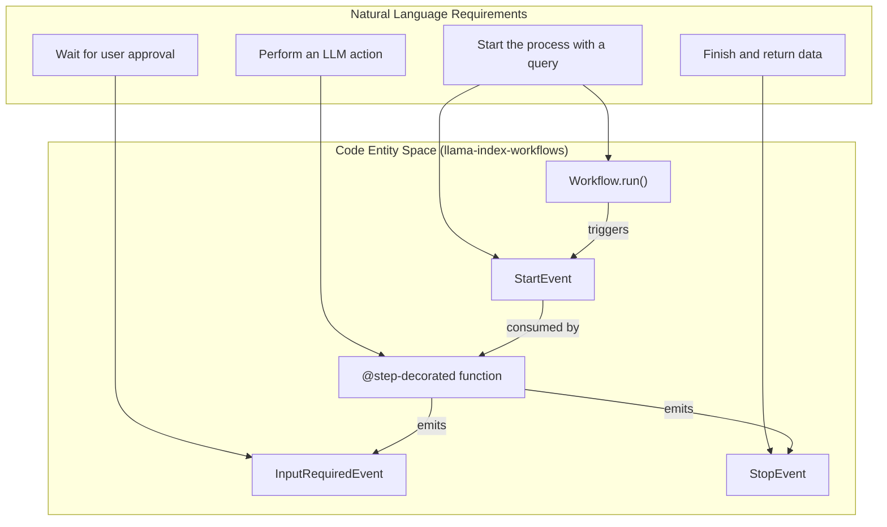
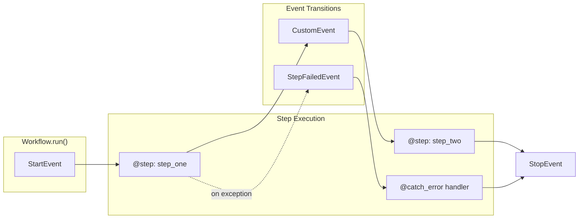

<!-- source: DeepWiki mcp.deepwiki.com · repo run-llama/llama-agents · page 2.1 Workflow, Steps, and Events · fetched 2026-10-26 -->

# Workflow, Steps, and Events

Relevant source files

The following files were used as context for generating this wiki page:

- [docs/api_docs/docs/api_reference/events.md](docs/api_docs/docs/api_reference/events.md)
- [docs/api_docs/docs/api_reference/index.md](docs/api_docs/docs/api_reference/index.md)
- [docs/api_docs/docs/api_reference/retry_policy.md](docs/api_docs/docs/api_reference/retry_policy.md)
- [docs/api_docs/mkdocs.yml](docs/api_docs/mkdocs.yml)
- [docs/src/content/docs/llamaagents/workflows/assets/arize.png](docs/src/content/docs/llamaagents/workflows/assets/arize.png)
- [docs/src/content/docs/llamaagents/workflows/assets/branching.png](docs/src/content/docs/llamaagents/workflows/assets/branching.png)
- [docs/src/content/docs/llamaagents/workflows/assets/different_events.png](docs/src/content/docs/llamaagents/workflows/assets/different_events.png)
- [docs/src/content/docs/llamaagents/workflows/assets/joke.png](docs/src/content/docs/llamaagents/workflows/assets/joke.png)
- [docs/src/content/docs/llamaagents/workflows/assets/loop.png](docs/src/content/docs/llamaagents/workflows/assets/loop.png)
- [docs/src/content/docs/llamaagents/workflows/branches_and_loops.md](docs/src/content/docs/llamaagents/workflows/branches_and_loops.md)
- [docs/src/content/docs/llamaagents/workflows/concurrent_execution.md](docs/src/content/docs/llamaagents/workflows/concurrent_execution.md)
- [docs/src/content/docs/llamaagents/workflows/customizing_entry_exit_points.md](docs/src/content/docs/llamaagents/workflows/customizing_entry_exit_points.md)
- [docs/src/content/docs/llamaagents/workflows/drawing.md](docs/src/content/docs/llamaagents/workflows/drawing.md)
- [docs/src/content/docs/llamaagents/workflows/durable_workflows.md](docs/src/content/docs/llamaagents/workflows/durable_workflows.md)
- [docs/src/content/docs/llamaagents/workflows/human_in_the_loop.md](docs/src/content/docs/llamaagents/workflows/human_in_the_loop.md)
- [docs/src/content/docs/llamaagents/workflows/index.md](docs/src/content/docs/llamaagents/workflows/index.md)
- [docs/src/content/docs/llamaagents/workflows/managing_state.md](docs/src/content/docs/llamaagents/workflows/managing_state.md)
- [docs/src/content/docs/llamaagents/workflows/resources.md](docs/src/content/docs/llamaagents/workflows/resources.md)
- [docs/src/content/docs/llamaagents/workflows/retry_steps.md](docs/src/content/docs/llamaagents/workflows/retry_steps.md)
- [docs/src/content/docs/llamaagents/workflows/streaming.mdx](docs/src/content/docs/llamaagents/workflows/streaming.mdx)
- [docs/src/content/docs/llamaagents/workflows/unbound_functions.md](docs/src/content/docs/llamaagents/workflows/unbound_functions.md)
- [packages/llama-index-workflows/src/workflows/decorators.py](packages/llama-index-workflows/src/workflows/decorators.py)
- [packages/llama-index-workflows/src/workflows/events.py](packages/llama-index-workflows/src/workflows/events.py)
- [packages/llama-index-workflows/src/workflows/plugins/basic.py](packages/llama-index-workflows/src/workflows/plugins/basic.py)
- [packages/llama-index-workflows/src/workflows/representation/validate.py](packages/llama-index-workflows/src/workflows/representation/validate.py)
- [packages/llama-index-workflows/src/workflows/retry_policy.py](packages/llama-index-workflows/src/workflows/retry_policy.py)
- [packages/llama-index-workflows/src/workflows/runtime/types/plugin.py](packages/llama-index-workflows/src/workflows/runtime/types/plugin.py)
- [packages/llama-index-workflows/src/workflows/workflow.py](packages/llama-index-workflows/src/workflows/workflow.py)
- [packages/llama-index-workflows/tests/conftest.py](packages/llama-index-workflows/tests/conftest.py)
- [packages/llama-index-workflows/tests/runtime/conftest.py](packages/llama-index-workflows/tests/runtime/conftest.py)
- [packages/llama-index-workflows/tests/test_event.py](packages/llama-index-workflows/tests/test_event.py)
- [packages/llama-index-workflows/tests/test_graph_validation.py](packages/llama-index-workflows/tests/test_graph_validation.py)
- [packages/llama-index-workflows/tests/test_retry_policy.py](packages/llama-index-workflows/tests/test_retry_policy.py)
- [packages/llama-index-workflows/tests/test_workflow.py](packages/llama-index-workflows/tests/test_workflow.py)

The `llama-index-workflows` package provides an event-driven engine for building complex, branching, and concurrent application logic. At its core, a workflow is a collection of steps that communicate by sending and receiving typed events.

## The Workflow Class

The `Workflow` class is the primary orchestrator. It manages the lifecycle of an execution, including validation, resource injection, and timeout management [packages/llama-index-workflows/src/workflows/workflow.py:41-87]().

Workflows are defined by subclassing `Workflow` and decorating methods with `@step`. When a workflow is instantiated, it automatically detects these steps using a metaclass (`WorkflowMeta`) [packages/llama-index-workflows/src/workflows/workflow.py:35-41]().

### Configuration and Initialization
When initializing a `Workflow`, several parameters control its behavior:
- `timeout`: Maximum seconds for completion (default 45.0) [packages/llama-index-workflows/src/workflows/workflow.py:98-141]().
- `disable_validation`: If True, skips the pre-run graph checks [packages/llama-index-workflows/src/workflows/workflow.py:99-143]().
- `verbose`: Enables printing of step activity [packages/llama-index-workflows/src/workflows/workflow.py:100-142]().
- `skip_graph_checks`: A set of specific validation rules to ignore, such as `"reachability"` or `"terminal_event"` [packages/llama-index-workflows/src/workflows/workflow.py:105-174]().

**Sources:** [packages/llama-index-workflows/src/workflows/workflow.py:41-182]()

---

## Steps and the @step Decorator

A step is a callable (method or free function) that accepts an event and optionally returns another event. The `@step` decorator extracts metadata from the function signature to build the execution graph [packages/llama-index-workflows/src/workflows/decorators.py:112-158]().

### Step Configuration
The decorator populates a `StepConfig` object which includes:
- `accepted_events`: The type of event that triggers this step [packages/llama-index-workflows/src/workflows/decorators.py:45-196]().
- `return_types`: The types of events this step might emit [packages/llama-index-workflows/src/workflows/decorators.py:47-202]().
- `num_workers`: Concurrency limit for this specific step (default 4) [packages/llama-index-workflows/src/workflows/decorators.py:49-99]().
- `retry_policy`: An optional policy for handling step failures [packages/llama-index-workflows/src/workflows/decorators.py:50-100]().

### Step Signature Validation
The engine enforces strict rules on step signatures:
1. A step must accept at least one positional argument (the event) [packages/llama-index-workflows/src/workflows/decorators.py:196]().
2. If a step requires the `Context`, it must be explicitly typed in the arguments [packages/llama-index-workflows/src/workflows/decorators.py:203]().
3. Return types must be instances of `Event` or `None` [packages/llama-index-workflows/src/workflows/decorators.py:202]().

### Free Functions as Steps
Steps do not have to be methods. They can be free functions associated with a workflow class using the `workflow` parameter in the decorator:
`@step(workflow=MyWorkflow)` [packages/llama-index-workflows/src/workflows/decorators.py:150-157]().

**Sources:** [packages/llama-index-workflows/src/workflows/decorators.py:43-209](), [packages/llama-index-workflows/src/workflows/workflow.py:89-91]()

---

## Event Types

Events are the data carriers between steps. All events must inherit from the base `Event` class [packages/llama-index-workflows/src/workflows/events.py]().

### Core Event Types

| Event Type | Purpose |
| :--- | :--- |
| `StartEvent` | The entry point. Triggered when `workflow.run()` is called [packages/llama-index-workflows/src/workflows/events.py](). |
| `StopEvent` | The exit point. Returning this terminates the workflow and returns the `result` to the caller [packages/llama-index-workflows/src/workflows/events.py](). |
| `InputRequiredEvent` | Used for Human-in-the-loop (HITL). Pauses execution until a `HumanResponseEvent` is received [packages/llama-index-workflows/src/workflows/events.py](). |
| `StepFailedEvent` | Emitted internally when a step raises an exception. It is routed to `@catch_error` handlers [packages/llama-index-workflows/src/workflows/events.py](). |

### Data Flow and System Mapping
The following diagram illustrates how natural language requirements map to the code entities that handle event transitions.

**Entity Mapping: Requirements to Code**

**Sources:** [packages/llama-index-workflows/src/workflows/events.py](), [packages/llama-index-workflows/src/workflows/workflow.py:64-70]()

---

## Error Handling with @catch_error

The `@catch_error` decorator allows developers to define specialized steps that handle failures from other steps. When a step raises an exception, the runtime wraps it in a `StepFailedEvent` and routes it to a matching handler [packages/llama-index-workflows/src/workflows/decorators.py:54-58]().

- **Wildcard Handlers**: If no specific step names are provided, the handler catches errors from any step [packages/llama-index-workflows/src/workflows/decorators.py:56-57]().
- **Recovery Limits**: The `catch_error_max_recoveries` parameter prevents infinite loops if a handler itself fails repeatedly [packages/llama-index-workflows/src/workflows/decorators.py:58]().

**Sources:** [packages/llama-index-workflows/src/workflows/decorators.py:43-73]()

---

## Graph Validation

Before execution (unless `disable_validation` is set), the workflow builds a `StepGraph` to ensure the logic is sound [packages/llama-index-workflows/src/workflows/representation/validate.py:51-62]().

### Validation Checks
The `validate_graph` function performs three primary checks:
1. **Reachability**: Every step must be reachable from a `StartEvent` or `HumanResponseEvent` [packages/llama-index-workflows/src/workflows/representation/validate.py:169-181]().
2. **Terminal Events**: Any event produced that is not consumed by another step must be a subclass of `StopEvent` or `InputRequiredEvent` [packages/llama-index-workflows/src/workflows/representation/validate.py:192-200]().
3. **Dead Ends**: Every step must eventually lead to a `StopEvent` [packages/llama-index-workflows/src/workflows/representation/validate.py:151]().

**Workflow Execution Flow**

**Sources:** [packages/llama-index-workflows/src/workflows/representation/validate.py:51-110](), [packages/llama-index-workflows/src/workflows/workflow.py:148-174](), [packages/llama-index-workflows/tests/test_workflow.py:77-124]()

---

