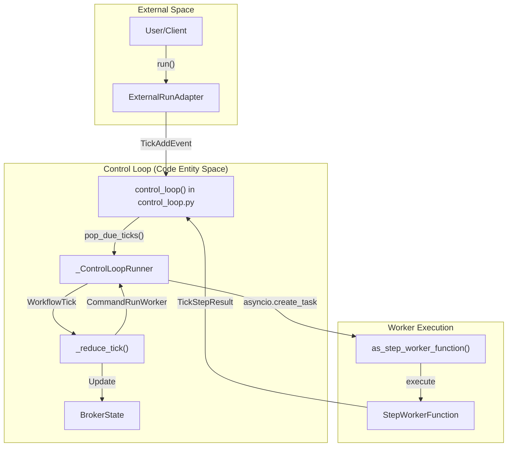
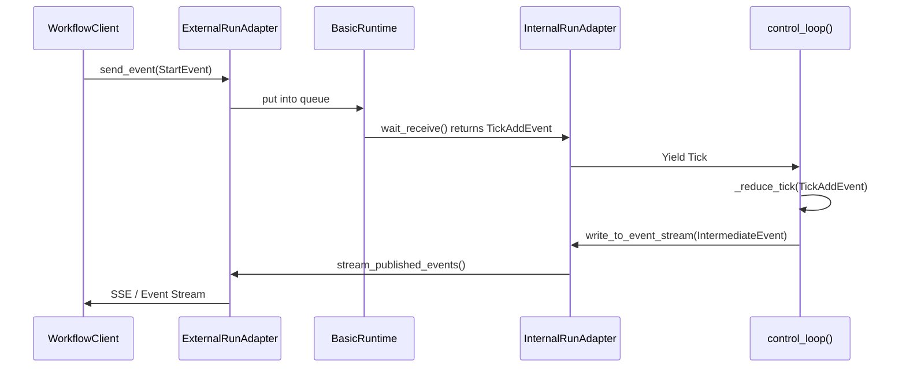

<!-- source: DeepWiki mcp.deepwiki.com · repo run-llama/llama-agents · page 2.2 Control Loop and Runtime Architecture · fetched 2026-10-26 -->

# Control Loop and Runtime Architecture

Relevant source files

The following files were used as context for generating this wiki page:

- [packages/llama-index-workflows/src/workflows/context/context.py](packages/llama-index-workflows/src/workflows/context/context.py)
- [packages/llama-index-workflows/src/workflows/context/internal_context.py](packages/llama-index-workflows/src/workflows/context/internal_context.py)
- [packages/llama-index-workflows/src/workflows/plugins/basic.py](packages/llama-index-workflows/src/workflows/plugins/basic.py)
- [packages/llama-index-workflows/src/workflows/representation/validate.py](packages/llama-index-workflows/src/workflows/representation/validate.py)
- [packages/llama-index-workflows/src/workflows/runtime/control_loop.py](packages/llama-index-workflows/src/workflows/runtime/control_loop.py)
- [packages/llama-index-workflows/src/workflows/runtime/types/commands.py](packages/llama-index-workflows/src/workflows/runtime/types/commands.py)
- [packages/llama-index-workflows/src/workflows/runtime/types/named_task.py](packages/llama-index-workflows/src/workflows/runtime/types/named_task.py)
- [packages/llama-index-workflows/src/workflows/runtime/types/plugin.py](packages/llama-index-workflows/src/workflows/runtime/types/plugin.py)
- [packages/llama-index-workflows/src/workflows/runtime/types/results.py](packages/llama-index-workflows/src/workflows/runtime/types/results.py)
- [packages/llama-index-workflows/src/workflows/runtime/types/step_function.py](packages/llama-index-workflows/src/workflows/runtime/types/step_function.py)
- [packages/llama-index-workflows/src/workflows/runtime/types/ticks.py](packages/llama-index-workflows/src/workflows/runtime/types/ticks.py)
- [packages/llama-index-workflows/src/workflows/runtime/verbose.py](packages/llama-index-workflows/src/workflows/runtime/verbose.py)
- [packages/llama-index-workflows/src/workflows/workflow.py](packages/llama-index-workflows/src/workflows/workflow.py)
- [packages/llama-index-workflows/tests/conftest.py](packages/llama-index-workflows/tests/conftest.py)
- [packages/llama-index-workflows/tests/context/test_context.py](packages/llama-index-workflows/tests/context/test_context.py)
- [packages/llama-index-workflows/tests/runtime/conftest.py](packages/llama-index-workflows/tests/runtime/conftest.py)
- [packages/llama-index-workflows/tests/runtime/test_control_loop.py](packages/llama-index-workflows/tests/runtime/test_control_loop.py)
- [packages/llama-index-workflows/tests/runtime/test_control_loop_transformations.py](packages/llama-index-workflows/tests/runtime/test_control_loop_transformations.py)
- [packages/llama-index-workflows/tests/runtime/test_named_task.py](packages/llama-index-workflows/tests/runtime/test_named_task.py)
- [packages/llama-index-workflows/tests/test_child_state_inheritance.py](packages/llama-index-workflows/tests/test_child_state_inheritance.py)
- [packages/llama-index-workflows/tests/test_graph_validation.py](packages/llama-index-workflows/tests/test_graph_validation.py)
- [packages/llama-index-workflows/tests/test_verbose_decorator.py](packages/llama-index-workflows/tests/test_verbose_decorator.py)
- [packages/llama-index-workflows/tests/test_workflow.py](packages/llama-index-workflows/tests/test_workflow.py)

The Core Workflow Engine in `llama-index-workflows` is built on a deterministic, tick-based reducer pattern. This architecture separates the side-effect-heavy execution of steps from the logical state transitions of the workflow. By treating every significant occurrence (event arrival, step completion, timeout) as a discrete `WorkflowTick`, the system enables advanced features like durable execution, deterministic replay, and fine-grained observability.

## The Tick-Based Reducer Pattern

At the heart of the execution model is the `control_loop`. Instead of steps calling each other directly, they communicate via a central broker that manages a state machine.

1.  **Ticks as Inputs**: Every input to the system is encapsulated in a `WorkflowTick` [packages/llama-index-workflows/src/workflows/runtime/types/ticks.py:101-111]().
2.  **State Transformation**: The `_reduce_tick` function (and its sub-processors like `_process_add_event_tick`) takes the current `BrokerState` and a `WorkflowTick`, returning a new `BrokerState` and a list of `WorkflowCommand` objects [packages/llama-index-workflows/src/workflows/runtime/control_loop.py:34-47]().
3.  **Command Execution**: The `control_loop` executes the resulting commands (e.g., starting a worker, scheduling a timeout, or publishing an event) [packages/llama-index-workflows/src/workflows/runtime/control_loop.py:121-163]().

### Workflow Lifecycle Diagram

This diagram bridges the conceptual "Natural Language" flow to the specific "Code Entities" that manage the runtime.

**Sources:** [packages/llama-index-workflows/src/workflows/runtime/control_loop.py:121-163](), [packages/llama-index-workflows/src/workflows/runtime/types/step_function.py:147-168](), [packages/llama-index-workflows/src/workflows/runtime/types/ticks.py:101-111]()

## Key Data Structures

### BrokerState
The `BrokerState` represents the complete logical state of a workflow run at any given moment. It includes:
*   `is_running`: Execution status [packages/llama-index-workflows/src/workflows/runtime/types/internal_state.py:50]().
*   `workers`: A map of step names to `InternalStepWorkerState`, which tracks queues and in-progress tasks [packages/llama-index-workflows/src/workflows/runtime/types/internal_state.py:50]().
*   `rehydrate_with_ticks()`: A method used to reconstruct state from a history of ticks [packages/llama-index-workflows/src/workflows/runtime/control_loop.py:149-150]().

### WorkflowTick and WorkflowCommand
The communication between the reducer and the runner is strictly typed.

| Type | Purpose | Key Variants |
| :--- | :--- | :--- |
| **WorkflowTick** | Inputs to the state machine | `TickAddEvent`, `TickStepResult`, `TickTimeout`, `TickCancelRun` |
| **WorkflowCommand** | Outputs from the state machine | `CommandRunWorker`, `CommandPublishEvent`, `CommandCompleteRun`, `CommandHalt` |

**Sources:** [packages/llama-index-workflows/src/workflows/runtime/types/ticks.py:101-111](), [packages/llama-index-workflows/src/workflows/runtime/types/commands.py:37-46]()

## Runtime Interfaces and Adapters

The engine uses a "Plugin" architecture to support different execution environments (e.g., local memory vs. durable DBOS).

### InternalRunAdapter vs. ExternalRunAdapter
*   **InternalRunAdapter**: Used *inside* the `control_loop`. It provides methods like `wait_receive()` to get the next tick and `write_to_event_stream()` to surface progress [packages/llama-index-workflows/src/workflows/runtime/types/plugin.py:81-98]().
*   **ExternalRunAdapter**: Used *outside* the loop (by the client or server). It allows sending events into the workflow via `send_event()` and streaming published events [packages/llama-index-workflows/src/workflows/runtime/types/plugin.py:213-220]().

### BasicRuntime
The `BasicRuntime` is the default implementation for local, non-durable execution. It manages in-memory queues (`AsyncioAdapterQueues`) to route ticks between the external caller and the internal control loop [packages/llama-index-workflows/src/workflows/plugins/basic.py:25-50]().

### Runtime Architecture Diagram

**Sources:** [packages/llama-index-workflows/src/workflows/runtime/types/plugin.py:81-220](), [packages/llama-index-workflows/src/workflows/plugins/basic.py:25-50]()

## The Control Loop Runner

The `_ControlLoopRunner` encapsulates the transient state of an active run [packages/llama-index-workflows/src/workflows/runtime/control_loop.py:121-131]().

### Deterministic Scheduling
To ensure that replays are identical to original runs, the runner avoids concurrent `asyncio.sleep` calls for timeouts. Instead:
1.  It maintains a `scheduled_wakeups` heap [packages/llama-index-workflows/src/workflows/runtime/control_loop.py:154-155]().
2.  It calculates the `next_wakeup_timeout()` based on the nearest scheduled tick [packages/llama-index-workflows/src/workflows/runtime/control_loop.py:171-180]().
3.  The `InternalRunAdapter.wait_receive(timeout)` uses this calculated value, ensuring that the loop wakes up exactly when a timeout is due or a new event arrives [packages/llama-index-workflows/src/workflows/runtime/control_loop.py:107-110]().

### Worker Execution
When a `CommandRunWorker` is issued, the runner:
1.  Wraps the step function using `as_step_worker_function` to inject `Context` and handle retries [packages/llama-index-workflows/src/workflows/runtime/types/step_function.py:147-152]().
2.  Creates an `asyncio.Task` and tracks it in `worker_tasks` [packages/llama-index-workflows/src/workflows/runtime/control_loop.py:145]().
3.  Upon completion, the task result is converted back into a `TickStepResult` and fed back into the loop [packages/llama-index-workflows/src/workflows/runtime/control_loop.py:198-214]().

**Sources:** [packages/llama-index-workflows/src/workflows/runtime/control_loop.py:121-214](), [packages/llama-index-workflows/src/workflows/runtime/types/step_function.py:147-182]()

---

