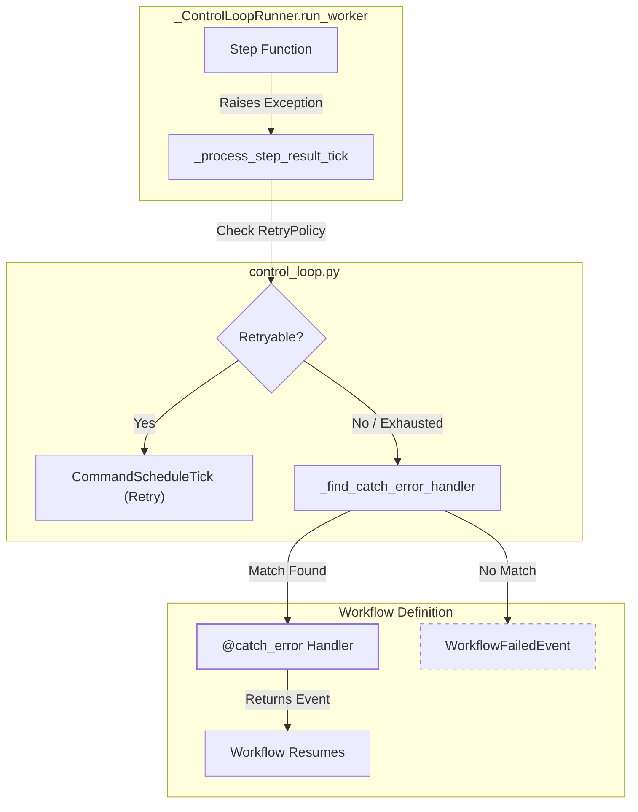
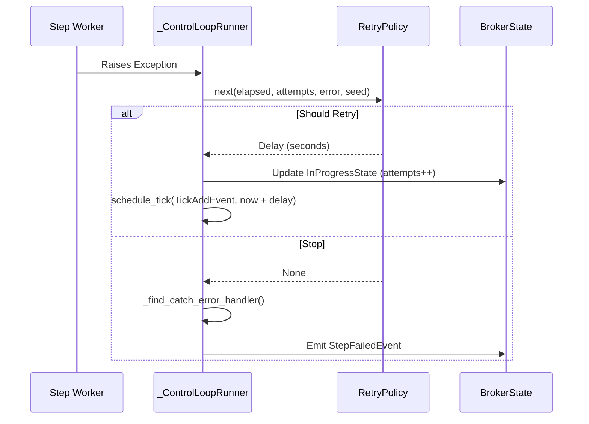

<!-- source: DeepWiki mcp.deepwiki.com · repo run-llama/llama-agents · page 2.4 Retry Policies and Error Handling · fetched 2026-10-26 -->

# Retry Policies and Error Handling

Relevant source files

The following files were used as context for generating this wiki page:

- [docs/api_docs/docs/api_reference/index.md](docs/api_docs/docs/api_reference/index.md)
- [docs/api_docs/docs/api_reference/retry_policy.md](docs/api_docs/docs/api_reference/retry_policy.md)
- [docs/api_docs/mkdocs.yml](docs/api_docs/mkdocs.yml)
- [docs/src/content/docs/llamaagents/workflows/retry_steps.md](docs/src/content/docs/llamaagents/workflows/retry_steps.md)
- [packages/llama-index-workflows/src/workflows/decorators.py](packages/llama-index-workflows/src/workflows/decorators.py)
- [packages/llama-index-workflows/src/workflows/retry_policy.py](packages/llama-index-workflows/src/workflows/retry_policy.py)
- [packages/llama-index-workflows/src/workflows/runtime/control_loop.py](packages/llama-index-workflows/src/workflows/runtime/control_loop.py)
- [packages/llama-index-workflows/tests/runtime/test_control_loop.py](packages/llama-index-workflows/tests/runtime/test_control_loop.py)
- [packages/llama-index-workflows/tests/runtime/test_control_loop_transformations.py](packages/llama-index-workflows/tests/runtime/test_control_loop_transformations.py)
- [packages/llama-index-workflows/tests/test_retry_policy.py](packages/llama-index-workflows/tests/test_retry_policy.py)

Llama-agents provides a robust error handling framework built into the `llama-index-workflows` core. This system allows developers to manage transient failures via composable retry policies and handle terminal step failures through specialized error routing.

## Retry Primitives and Policies

The retry system is modeled after the `tenacity` library, using three families of building blocks to define how a step should behave when it encounters an exception [docs/src/content/docs/llamaagents/workflows/retry_steps.md:15-23]().

### Core Components
1.  **Retry Conditions**: Predicates that decide if an exception is retryable (e.g., `retry_if_exception_type`) [packages/llama-index-workflows/src/workflows/retry_policy.py:102-105]().
2.  **Wait Strategies**: Functions that calculate the delay before the next attempt (e.g., `wait_exponential`) [packages/llama-index-workflows/src/workflows/retry_policy.py:108-111]().
3.  **Stop Conditions**: Predicates that determine when to give up (e.g., `stop_after_attempt`) [packages/llama-index-workflows/src/workflows/retry_policy.py:114-119]().

### Composable API
The `retry_policy()` function serves as the primary constructor [packages/llama-index-workflows/src/workflows/retry_policy.py:657-674](). It allows combining these blocks using operators:
*   **Retry/Stop Conditions**: Use `|` (OR) and `&` (AND) [packages/llama-index-workflows/src/workflows/retry_policy.py:128-138]().
*   **Wait Strategies**: Use `+` to combine delays [packages/llama-index-workflows/src/workflows/retry_policy.py:147-148]().

### Legacy Policies
For backward compatibility, the framework maintains two pre-configured classes:
*   `ConstantDelayRetryPolicy`: Retries with a fixed delay [packages/llama-index-workflows/src/workflows/retry_policy.py:734-754]().
*   `ExponentialBackoffRetryPolicy`: Retries with increasing delays [packages/llama-index-workflows/src/workflows/retry_policy.py:768-806]().

### Deterministic Jitter
During workflow replay (e.g., in DBOS), jitter must be deterministic. The `RetryPolicy` protocol's `next` method accepts an optional `seed` [packages/llama-index-workflows/src/workflows/retry_policy.py:86-99](). This seed is derived from a hash of the event and attempt count in the control loop to ensure the same wait times are generated during re-execution [packages/llama-index-workflows/src/workflows/runtime/control_loop.py:345-353]().

**Sources:** [packages/llama-index-workflows/src/workflows/retry_policy.py:1-120](), [packages/llama-index-workflows/src/workflows/runtime/control_loop.py:340-360](), [docs/src/content/docs/llamaagents/workflows/retry_steps.md:15-51]()

---

## Error Handling with @catch_error

When a step fails and its `RetryPolicy` (if any) is exhausted or the error is not retryable, the workflow enters the error handling phase. The `@catch_error` decorator allows defining specialized steps to intercept these failures [packages/llama-index-workflows/src/workflows/decorators.py:237-268]().

### Handler Routing Logic
1.  **Scoped Handlers**: A handler can be limited to specific steps using the `for_steps` parameter [packages/llama-index-workflows/src/workflows/decorators.py:261-262]().
2.  **Wildcard Handlers**: If `for_steps` is `None`, the handler acts as a catch-all for any step not covered by a scoped handler [packages/llama-index-workflows/src/workflows/decorators.py:56-57]().
3.  **StepFailedEvent**: Handlers receive a `StepFailedEvent`, which contains the original `exception` and the `step_name` that failed [packages/llama-index-workflows/src/workflows/events.py:108-112]().

### Recovery Mechanism
Handlers can return a new event to "recover" the workflow and continue execution from a different point. The `max_recoveries` parameter prevents infinite loops by limiting how many times a handler can be invoked for the same failure chain [packages/llama-index-workflows/src/workflows/decorators.py:58-58]().

### Code Entity Space: Error Flow
The following diagram illustrates how an exception in a worker is transformed into a `StepFailedEvent` and routed to a `@catch_error` handler.

**Error Routing Architecture**

**Sources:** [packages/llama-index-workflows/src/workflows/runtime/control_loop.py:330-410](), [packages/llama-index-workflows/src/workflows/decorators.py:43-74](), [packages/llama-index-workflows/tests/runtime/test_control_loop_transformations.py:218-240]()

---

## Implementation Details and Data Flow

The `_ControlLoopRunner` manages the state of retries and failures using `BrokerState` [packages/llama-index-workflows/src/workflows/runtime/control_loop.py:121-144]().

### Data Flow for Retries
When a step fails, the control loop calls `_process_step_result_tick` [packages/llama-index-workflows/src/workflows/runtime/control_loop.py:330]().

1.  **Retry Calculation**: It retrieves the `RetryPolicy` from `InternalStepConfig` [packages/llama-index-workflows/src/workflows/runtime/types/internal_state.py:61-63]().
2.  **State Tracking**: The `InProgressState` tracks the number of `attempts` and the timestamp of the first failure [packages/llama-index-workflows/src/workflows/runtime/types/internal_state.py:51-53]().
3.  **Scheduling**: If the policy returns a delay, a `TickAddEvent` is wrapped in a `CommandScheduleTick` for future execution [packages/llama-index-workflows/src/workflows/runtime/control_loop.py:355-360]().

### Retry State Introspection
Steps can access their current retry status via `Context.retry_info()`. This returns a `RetryInfo` snapshot containing the attempt count and the last exception encountered [packages/llama-index-workflows/src/workflows/retry_policy.py:21-44]().

**Entity Mapping: State to Code**
| Concept | Code Entity | Purpose |
| :--- | :--- | :--- |
| **Retry State** | `RetryInfo` | Metadata passed to `Context` for step introspection. |
| **Policy Logic** | `RetryPolicy` | Protocol defining the `next()` retry decision method. |
| **Worker State** | `InProgressState` | Persisted state in `BrokerState` tracking attempts. |
| **Failure Event** | `StepFailedEvent` | Event emitted when a step fails permanently. |
| **Handler Metadata** | `CatchErrorHandler` | Descriptor used by the control loop for routing. |

**Data Flow: Retry and Replay**

**Sources:** [packages/llama-index-workflows/src/workflows/runtime/control_loop.py:165-170](), [packages/llama-index-workflows/src/workflows/runtime/types/internal_state.py:49-63](), [packages/llama-index-workflows/src/workflows/retry_policy.py:80-99](), [packages/llama-index-workflows/src/workflows/decorators.py:61-74]()

---

