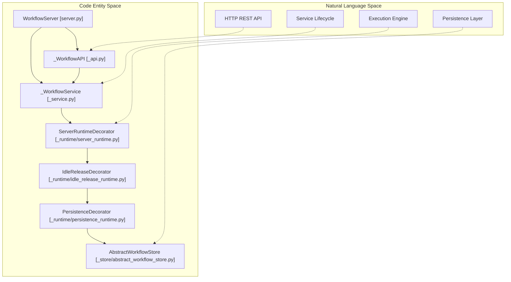
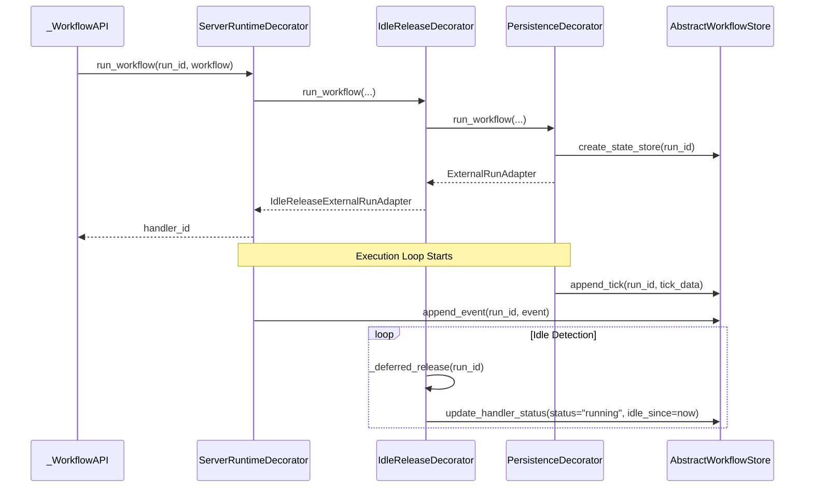

<!-- source: DeepWiki mcp.deepwiki.com · repo run-llama/llama-agents · page 3.1 WorkflowServer: API, Service, and Runtime Chain · fetched 2026-10-26 -->

# WorkflowServer: API, Service, and Runtime Chain

Relevant source files

The following files were used as context for generating this wiki page:

- [packages/llama-agents-client/src/llama_agents/client/client.py](packages/llama-agents-client/src/llama_agents/client/client.py)
- [packages/llama-agents-client/tests/client/test_client.py](packages/llama-agents-client/tests/client/test_client.py)
- [packages/llama-agents-core/src/llama_agents/core/iter_utils.py](packages/llama-agents-core/src/llama_agents/core/iter_utils.py)
- [packages/llama-agents-core/tests/test_iter_utils.py](packages/llama-agents-core/tests/test_iter_utils.py)
- [packages/llama-agents-dbos/src/llama_agents/dbos/idle_release.py](packages/llama-agents-dbos/src/llama_agents/dbos/idle_release.py)
- [packages/llama-agents-dbos/tests/test_dbos_idle_release.py](packages/llama-agents-dbos/tests/test_dbos_idle_release.py)
- [packages/llama-agents-integration-tests/src/llama_agents_integration_tests/fake_agent_data.py](packages/llama-agents-integration-tests/src/llama_agents_integration_tests/fake_agent_data.py)
- [packages/llama-agents-server/src/llama_agents/server/_api.py](packages/llama-agents-server/src/llama_agents/server/_api.py)
- [packages/llama-agents-server/src/llama_agents/server/_runtime/event_interceptor.py](packages/llama-agents-server/src/llama_agents/server/_runtime/event_interceptor.py)
- [packages/llama-agents-server/src/llama_agents/server/_runtime/idle_release_runtime.py](packages/llama-agents-server/src/llama_agents/server/_runtime/idle_release_runtime.py)
- [packages/llama-agents-server/src/llama_agents/server/_runtime/persistence_runtime.py](packages/llama-agents-server/src/llama_agents/server/_runtime/persistence_runtime.py)
- [packages/llama-agents-server/src/llama_agents/server/_runtime/server_runtime.py](packages/llama-agents-server/src/llama_agents/server/_runtime/server_runtime.py)
- [packages/llama-agents-server/src/llama_agents/server/_service.py](packages/llama-agents-server/src/llama_agents/server/_service.py)
- [packages/llama-agents-server/src/llama_agents/server/_store/abstract_workflow_store.py](packages/llama-agents-server/src/llama_agents/server/_store/abstract_workflow_store.py)
- [packages/llama-agents-server/src/llama_agents/server/_store/agent_data_store.py](packages/llama-agents-server/src/llama_agents/server/_store/agent_data_store.py)
- [packages/llama-agents-server/src/llama_agents/server/server.py](packages/llama-agents-server/src/llama_agents/server/server.py)
- [packages/llama-agents-server/tests/server/server_test_fixtures.py](packages/llama-agents-server/tests/server/server_test_fixtures.py)
- [packages/llama-agents-server/tests/server/test_error_handling.py](packages/llama-agents-server/tests/server/test_error_handling.py)
- [packages/llama-agents-server/tests/server/test_handler_serialization.py](packages/llama-agents-server/tests/server/test_handler_serialization.py)
- [packages/llama-agents-server/tests/server/test_runtime_decorators.py](packages/llama-agents-server/tests/server/test_runtime_decorators.py)
- [packages/llama-agents-server/tests/server/test_server.py](packages/llama-agents-server/tests/server/test_server.py)
- [packages/llama-agents-server/tests/server/test_server_endpoints.py](packages/llama-agents-server/tests/server/test_server_endpoints.py)
- [packages/llama-agents-server/tests/server/test_server_runtime.py](packages/llama-agents-server/tests/server/test_server_runtime.py)
- [packages/llama-agents-server/tests/server/test_workflow_service.py](packages/llama-agents-server/tests/server/test_workflow_service.py)
- [packages/llama-index-workflows/src/workflows/runtime/runtime_decorators.py](packages/llama-index-workflows/src/workflows/runtime/runtime_decorators.py)

The `WorkflowServer` is the primary HTTP entry point for exposing `Workflow` instances as RESTful services. It assembles a Starlette-based API, a lifecycle service, and a sophisticated chain of runtime decorators that handle persistence, idle-state management, and event streaming.

## System Architecture

The `WorkflowServer` architecture follows a layered approach, separating the HTTP transport (`_WorkflowAPI`), the business logic and lifecycle management (`_WorkflowService`), and the execution engine (the `Runtime` decorator chain).

### Component Relationship Diagram

The following diagram bridges the natural language concepts to the specific code entities that implement them.

"WorkflowServer Component Map"

Sources: [packages/llama-agents-server/src/llama_agents/server/server.py:29-131](), [packages/llama-agents-server/src/llama_agents/server/_api.py:73-121](), [packages/llama-agents-server/src/llama_agents/server/_service.py:45-50]()

---

## WorkflowServer Assembly

The `WorkflowServer` class acts as the orchestrator. Upon initialization, it constructs the default runtime stack and prepares the ASGI application.

*   **Runtime Stack Construction**: By default, it wraps the `basic_runtime` with a `PersistenceDecorator`, followed by an `IdleReleaseDecorator`, and finally a `ServerRuntimeDecorator` [packages/llama-agents-server/src/llama_agents/server/server.py:107-120]().
*   **Workflow Registration**: Workflows are added via `add_workflow()`, which assigns a URL-safe name and injects the server's runtime into the workflow instance [packages/llama-agents-server/src/llama_agents/server/server.py:138-161]().

Sources: [packages/llama-agents-server/src/llama_agents/server/server.py:59-132]()

---

## _WorkflowAPI: Starlette Routes

The `_WorkflowAPI` class encapsulates the Starlette `app` and defines the HTTP interface for workflow interaction.

### Key Endpoints

| Route | Method | Function | Description |
| :--- | :--- | :--- | :--- |
| `/workflows/{name}/run` | POST | `_run_workflow` | Synchronous execution; waits for `StopEvent`. |
| `/workflows/{name}/run-nowait` | POST | `_run_workflow_nowait` | Returns a `handler_id` immediately. |
| `/events/{handler_id}` | GET | `_stream_events` | SSE streaming of workflow events. |
| `/events/{handler_id}` | POST | `_post_event` | Sends external events to a running workflow. |
| `/results/{handler_id}` | GET | `_get_workflow_result` | Retrieves the `StopEvent` result. |
| `/handlers` | GET | `_get_handlers` | Lists all persisted workflow handlers. |

Sources: [packages/llama-agents-server/src/llama_agents/server/_api.py:136-179]()

### SSE Event Streaming
Streaming is implemented using `StreamingResponse`. The `_stream_events` method utilizes `_service.stream_events()`, which leverages the underlying store's subscription mechanism [packages/llama-agents-server/src/llama_agents/server/_api.py:446-485](). It supports heartbeats via `: heartbeat` comments to keep connections alive [packages/llama-agents-server/src/llama_agents/server/_api.py:458-460]().

---

## _WorkflowService: Lifecycle Logic

The `_WorkflowService` acts as the bridge between the API routes and the runtime. It handles:
*   **Execution Mapping**: Converting HTTP requests into `runtime.run_workflow()` calls [packages/llama-agents-server/src/llama_agents/server/_service.py:130-170]().
*   **State Retrieval**: Querying the `AbstractWorkflowStore` for handler metadata [packages/llama-agents-server/src/llama_agents/server/_service.py:102-114]().
*   **Event Routing**: Brokering events between the store and the HTTP stream [packages/llama-agents-server/src/llama_agents/server/_service.py:220-250]().

Sources: [packages/llama-agents-server/src/llama_agents/server/_service.py:45-300]()

---

## The Runtime Decorator Chain

Execution logic is extended through a chain of decorators. Each decorator implements the `Runtime` interface and wraps an inner runtime.

"Runtime Decorator Data Flow"

Sources: [packages/llama-agents-server/src/llama_agents/server/_runtime/server_runtime.py:157-178](), [packages/llama-agents-server/src/llama_agents/server/_runtime/idle_release_runtime.py:110-130](), [packages/llama-agents-server/src/llama_agents/server/_runtime/persistence_runtime.py:134-160]()

### 1. ServerRuntimeDecorator
The outermost decorator. It is responsible for:
*   **Event Recording**: Every event emitted by the workflow is intercepted and persisted to the store via `append_event()` [packages/llama-agents-server/src/llama_agents/server/_runtime/server_runtime.py:95-145]().
*   **Status Updates**: It listens for terminal events (`StopEvent`, `WorkflowFailedEvent`) and updates the handler status in the store [packages/llama-agents-server/src/llama_agents/server/_runtime/server_runtime.py:107-142]().
*   **Retry Logic**: Implements `_retry_store_write()` to handle transient persistence failures [packages/llama-agents-server/src/llama_agents/server/_runtime/server_runtime.py:179-195]().

### 2. IdleReleaseDecorator
Manages memory efficiency for long-running workflows:
*   **Idle Detection**: Monitors the event stream for `WorkflowIdleEvent` [packages/llama-agents-server/src/llama_agents/server/_runtime/idle_release_runtime.py:62-70]().
*   **Eviction**: After `idle_timeout` seconds of inactivity, it cancels the in-memory execution task via `_abort_inner_run()` [packages/llama-agents-server/src/llama_agents/server/_runtime/idle_release_runtime.py:172-188]().
*   **Reload-on-Demand**: When a new event arrives for a released handler, it uses `context_from_ticks()` to reconstruct the workflow state and resume execution [packages/llama-agents-server/src/llama_agents/server/_runtime/idle_release_runtime.py:98-107]().

### 3. PersistenceDecorator
Provides the foundation for durability:
*   **Tick Persistence**: Uses an internal adapter to save every `WorkflowTick` to the store [packages/llama-agents-server/src/llama_agents/server/_runtime/persistence_runtime.py:108-117]().
*   **State Reconstruction**: Implements `context_from_ticks()`, which replays the entire history of ticks to rebuild a `Context` object exactly as it was before a crash or eviction [packages/llama-agents-server/src/llama_agents/server/_runtime/persistence_runtime.py:190-210]().

Sources: [packages/llama-agents-server/src/llama_agents/server/_runtime/server_runtime.py:157-250](), [packages/llama-agents-server/src/llama_agents/server/_runtime/idle_release_runtime.py:110-210](), [packages/llama-agents-server/src/llama_agents/server/_runtime/persistence_runtime.py:134-220]()

---

