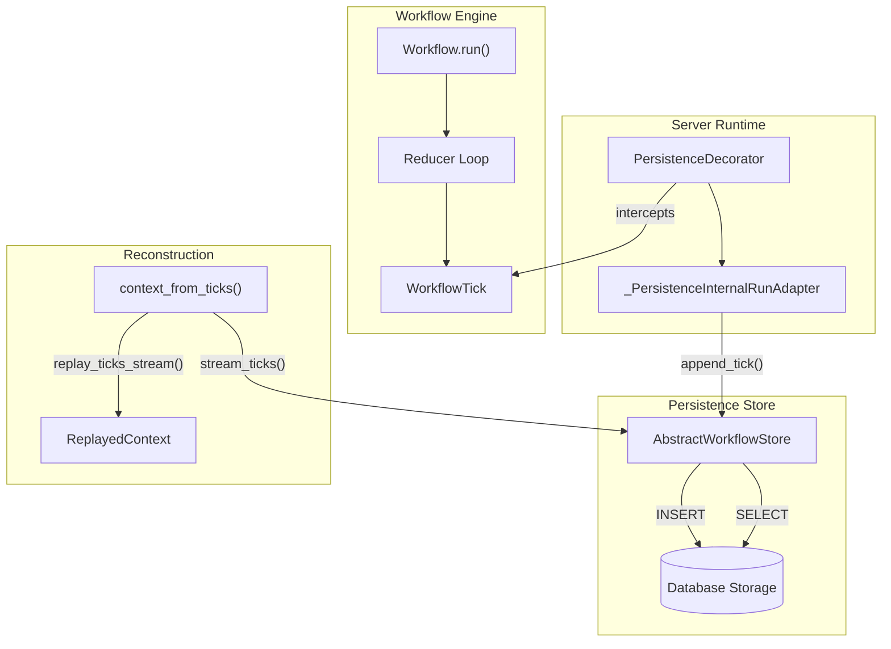
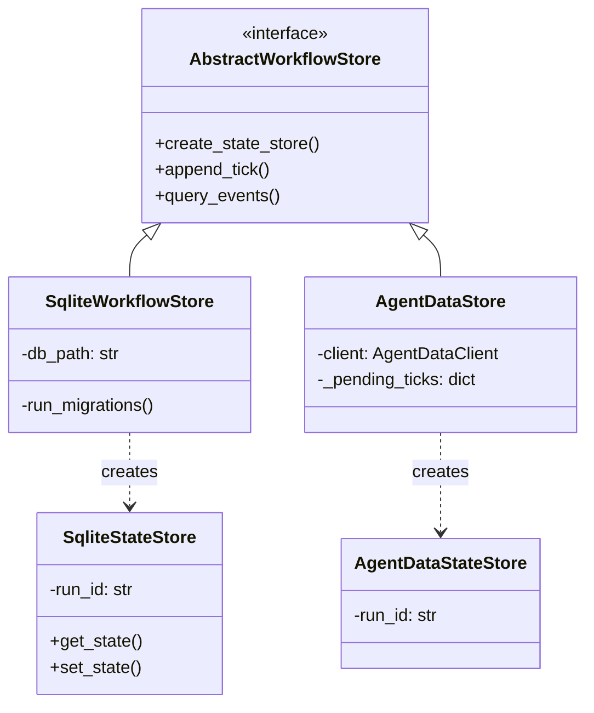

<!-- source: DeepWiki mcp.deepwiki.com · repo run-llama/llama-agents · page 3.2 Workflow Persistence Stores · fetched 2026-10-26 -->

# Workflow Persistence Stores

Relevant source files

The following files were used as context for generating this wiki page:

- [packages/llama-agents-agentcore/src/llama_agents/agentcore/entrypoint.py](packages/llama-agents-agentcore/src/llama_agents/agentcore/entrypoint.py)
- [packages/llama-agents-integration-tests/src/llama_agents_integration_tests/fake_agent_data.py](packages/llama-agents-integration-tests/src/llama_agents_integration_tests/fake_agent_data.py)
- [packages/llama-agents-integration-tests/src/llama_agents_integration_tests/server_test_utils.py](packages/llama-agents-integration-tests/src/llama_agents_integration_tests/server_test_utils.py)
- [packages/llama-agents-integration-tests/tests/test_agent_data_store.py](packages/llama-agents-integration-tests/tests/test_agent_data_store.py)
- [packages/llama-agents-integration-tests/tests/test_runtime_matrix.py](packages/llama-agents-integration-tests/tests/test_runtime_matrix.py)
- [packages/llama-agents-integration-tests/tests/test_server_http_matrix.py](packages/llama-agents-integration-tests/tests/test_server_http_matrix.py)
- [packages/llama-agents-integration-tests/tests/test_server_store_matrix.py](packages/llama-agents-integration-tests/tests/test_server_store_matrix.py)
- [packages/llama-agents-server/src/llama_agents/server/_runtime/idle_release_runtime.py](packages/llama-agents-server/src/llama_agents/server/_runtime/idle_release_runtime.py)
- [packages/llama-agents-server/src/llama_agents/server/_runtime/persistence_runtime.py](packages/llama-agents-server/src/llama_agents/server/_runtime/persistence_runtime.py)
- [packages/llama-agents-server/src/llama_agents/server/_store/abstract_workflow_store.py](packages/llama-agents-server/src/llama_agents/server/_store/abstract_workflow_store.py)
- [packages/llama-agents-server/src/llama_agents/server/_store/agent_data_client.py](packages/llama-agents-server/src/llama_agents/server/_store/agent_data_client.py)
- [packages/llama-agents-server/src/llama_agents/server/_store/agent_data_state_store.py](packages/llama-agents-server/src/llama_agents/server/_store/agent_data_state_store.py)
- [packages/llama-agents-server/src/llama_agents/server/_store/agent_data_store.py](packages/llama-agents-server/src/llama_agents/server/_store/agent_data_store.py)
- [packages/llama-agents-server/src/llama_agents/server/_store/memory_workflow_store.py](packages/llama-agents-server/src/llama_agents/server/_store/memory_workflow_store.py)
- [packages/llama-agents-server/src/llama_agents/server/_store/postgres_state_store.py](packages/llama-agents-server/src/llama_agents/server/_store/postgres_state_store.py)
- [packages/llama-agents-server/src/llama_agents/server/_store/sqlite/migrate.py](packages/llama-agents-server/src/llama_agents/server/_store/sqlite/migrate.py)
- [packages/llama-agents-server/src/llama_agents/server/_store/sqlite/migrations/0001_init.sql](packages/llama-agents-server/src/llama_agents/server/_store/sqlite/migrations/0001_init.sql)
- [packages/llama-agents-server/src/llama_agents/server/_store/sqlite/migrations/0002_extend_handlers.sql](packages/llama-agents-server/src/llama_agents/server/_store/sqlite/migrations/0002_extend_handlers.sql)
- [packages/llama-agents-server/src/llama_agents/server/_store/sqlite/migrations/0003_add_idle_since.sql](packages/llama-agents-server/src/llama_agents/server/_store/sqlite/migrations/0003_add_idle_since.sql)
- [packages/llama-agents-server/src/llama_agents/server/_store/sqlite/sqlite_state_store.py](packages/llama-agents-server/src/llama_agents/server/_store/sqlite/sqlite_state_store.py)
- [packages/llama-agents-server/src/llama_agents/server/_store/sqlite/sqlite_workflow_store.py](packages/llama-agents-server/src/llama_agents/server/_store/sqlite/sqlite_workflow_store.py)
- [packages/llama-agents-server/tests/server/test_agent_data_store.py](packages/llama-agents-server/tests/server/test_agent_data_store.py)
- [packages/llama-agents-server/tests/server/test_durable_runtime.py](packages/llama-agents-server/tests/server/test_durable_runtime.py)
- [packages/llama-agents-server/tests/server/test_memory_workflow_store.py](packages/llama-agents-server/tests/server/test_memory_workflow_store.py)
- [packages/llama-agents-server/tests/server/test_migrations.py](packages/llama-agents-server/tests/server/test_migrations.py)
- [packages/llama-agents-server/tests/server/test_workflow_store_events.py](packages/llama-agents-server/tests/server/test_workflow_store_events.py)
- [packages/llama-index-workflows/tests/test_workflow_internal_events.py](packages/llama-index-workflows/tests/test_workflow_internal_events.py)

Workflow persistence stores provide the durability layer for `llama-agents`. They are responsible for saving the execution state of workflows, including event logs, execution "ticks," and handler metadata. This architecture allows workflows to survive server restarts, scale across multiple pods, and support long-running processes that may go idle for days.

## The AbstractWorkflowStore Contract

All persistence backends implement the `AbstractWorkflowStore` interface. This contract ensures that the `WorkflowServer` can interact with different storage engines (Memory, SQLite, Postgres, or LlamaCloud) using a unified API.

Key responsibilities of a store include:
- **Handler Management**: Tracking the lifecycle of a workflow run via `PersistentHandler` [packages/llama-agents-server/src/llama_agents/server/_store/abstract_workflow_store.py:60-70]().
- **Event Logging**: Appending and querying `StoredEvent` objects [packages/llama-agents-server/src/llama_agents/server/_store/abstract_workflow_store.py:103-107]().
- **Tick Persistence**: Storing `WorkflowTick` objects which represent the state transitions of the workflow reducer [packages/llama-agents-server/src/llama_agents/server/_store/abstract_workflow_store.py:96-101]().
- **State Store Creation**: Providing a `StateStore` for mutable workflow context data [packages/llama-agents-server/src/llama_agents/server/_store/abstract_workflow_store.py:114-125]().

### Workflow Storage Data Flow

The following diagram illustrates how the `PersistenceDecorator` coordinates with the `AbstractWorkflowStore` to persist execution data.

Title: Persistence Data Flow

Sources: [packages/llama-agents-server/src/llama_agents/server/_runtime/persistence_runtime.py:96-132](), [packages/llama-agents-server/src/llama_agents/server/_runtime/persistence_runtime.py:190-210](), [packages/llama-agents-server/src/llama_agents/server/_store/abstract_workflow_store.py:147-160]()

## Store Implementations

### MemoryWorkflowStore
A volatile, in-memory implementation used primarily for testing and ephemeral development environments. It uses `asyncio.Condition` variables to implement `subscribe_events` without polling [packages/llama-agents-server/src/llama_agents/server/_store/abstract_workflow_store.py:212-218]().

### SqliteWorkflowStore
The standard store for local production and single-node deployments. It supports automatic schema migrations and specialized connection modes for environments like AWS Bedrock AgentCore.

- **Migrations**: Uses a versioned SQL file system located in `migrations/` [packages/llama-agents-server/src/llama_agents/server/_store/sqlite/migrate.py:99-132]().
- **WAL Mode**: Automatically enables Write-Ahead Logging (WAL) to support concurrent read/write access [packages/llama-agents-server/src/llama_agents/server/_store/sqlite/migrate.py:77-80]().
- **Single Connection Mode**: Can be configured with `single_connection=True` and `unix-none` VFS to disable file locking, which is required in certain restricted environments [packages/llama-agents-server/src/llama_agents/server/_store/sqlite/sqlite_workflow_store.py:52-60]().

### AgentDataStore
A cloud-native store backed by the LlamaCloud Agent Data API. It is optimized for high-latency environments through several mechanisms:
- **Fire-and-Forget Writes**: Tick and event writes are dispatched as background tasks [packages/llama-agents-server/src/llama_agents/server/_store/agent_data_store.py:121-131]().
- **Write Regrouping**: Pending writes are awaited and flushed at step boundaries via `after_tick` [packages/llama-agents-server/src/llama_agents/server/_store/agent_data_store.py:154-158]().
- **In-Memory Queues**: Local subscribers receive events via internal queues instead of re-polling the API [packages/llama-agents-server/src/llama_agents/server/_store/agent_data_store.py:116-119]().

Sources: [packages/llama-agents-server/src/llama_agents/server/_store/sqlite/sqlite_workflow_store.py:32-51](), [packages/llama-agents-server/src/llama_agents/server/_store/agent_data_store.py:34-46]()

## State Reconstruction via Ticks

Llama-agents uses a "tick-based" state reconstruction model. Rather than serializing the entire Python object graph of a workflow context at every step, the system persists a stream of `WorkflowTick` objects.

When a workflow is reloaded (e.g., after an idle release or a server restart), the `PersistenceDecorator` calls `context_from_ticks` [packages/llama-agents-server/src/llama_agents/server/_runtime/persistence_runtime.py:190-192](). This function:
1. Streams all stored ticks for the `run_id` [packages/llama-agents-server/src/llama_agents/server/_runtime/persistence_runtime.py:202]().
2. Uses `replay_ticks_stream` to feed these ticks back into a fresh `Workflow` instance [packages/llama-agents-server/src/llama_agents/server/_runtime/persistence_runtime.py:26]().
3. Rebuilds the `Context` to the exact state it was in after the last persisted tick [packages/llama-agents-server/src/llama_agents/server/_runtime/persistence_runtime.py:72-73]().

### State Store Mapping

Title: Persistence Entity Mapping

Sources: [packages/llama-agents-server/src/llama_agents/server/_store/sqlite/sqlite_workflow_store.py:74-89](), [packages/llama-agents-server/src/llama_agents/server/_store/agent_data_store.py:78-79](), [packages/llama-agents-server/src/llama_agents/server/_store/sqlite/sqlite_state_store.py:47-52]()

## Handler Lifecycle and Status

The `PersistentHandler` tracks the high-level status of a workflow run. The status transitions are managed by the `WorkflowServer` through the `update_handler_status` method [packages/llama-agents-server/src/llama_agents/server/_store/abstract_workflow_store.py:169-177]().

| Status | Description |
| :--- | :--- |
| `running` | The workflow is currently being processed by a runtime. |
| `completed` | The workflow reached a `StopEvent`. |
| `failed` | The workflow terminated due to an unhandled exception. |
| `cancelled` | The workflow was explicitly halted by a user or system command. |

### Idle Tracking
For durable runtimes, the `idle_since` field is used to mark handlers that are waiting for external input [packages/llama-agents-server/src/llama_agents/server/_store/abstract_workflow_store.py:70](). When a handler is reloaded, `idle_since` is cleared [packages/llama-agents-server/src/llama_agents/server/_store/abstract_workflow_store.py:198-199]().

Sources: [packages/llama-agents-server/src/llama_agents/server/_store/abstract_workflow_store.py:30-32](), [packages/llama-agents-server/src/llama_agents/server/_store/abstract_workflow_store.py:60-70]()

---

