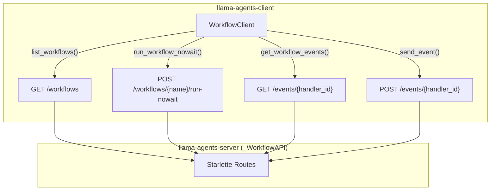
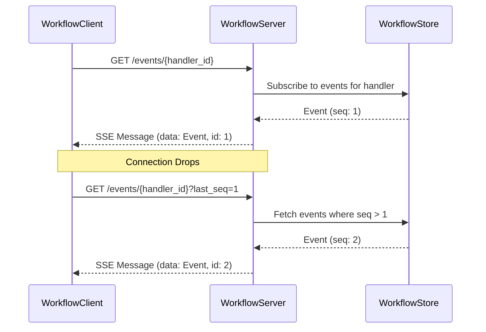
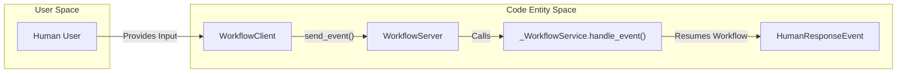

<!-- source: DeepWiki mcp.deepwiki.com · repo run-llama/llama-agents · page 3.4 WorkflowClient and SSE Streaming · fetched 2026-10-26 -->

# WorkflowClient and SSE Streaming

Relevant source files

The following files were used as context for generating this wiki page:

- [docs/api_docs/.gitignore](docs/api_docs/.gitignore)
- [docs/api_docs/docs/api_reference/workflow_server/client.md](docs/api_docs/docs/api_reference/workflow_server/client.md)
- [docs/api_docs/docs/api_reference/workflow_server/models.md](docs/api_docs/docs/api_reference/workflow_server/models.md)
- [docs/api_docs/docs/api_reference/workflow_server/server.md](docs/api_docs/docs/api_reference/workflow_server/server.md)
- [docs/src/content/docs/llamaagents/workflows/client.md](docs/src/content/docs/llamaagents/workflows/client.md)
- [docs/src/content/docs/llamaagents/workflows/deployment.md](docs/src/content/docs/llamaagents/workflows/deployment.md)
- [examples/client/base/workflow_client.py](examples/client/base/workflow_client.py)
- [examples/client/base/workflow_server.py](examples/client/base/workflow_server.py)
- [examples/client/human_in_the_loop/workflow_client_hitl.py](examples/client/human_in_the_loop/workflow_client_hitl.py)
- [examples/client/human_in_the_loop/workflow_server_hitl.py](examples/client/human_in_the_loop/workflow_server_hitl.py)
- [packages/llama-agents-client/CHANGELOG.md](packages/llama-agents-client/CHANGELOG.md)
- [packages/llama-agents-client/package.json](packages/llama-agents-client/package.json)
- [packages/llama-agents-client/pyproject.toml](packages/llama-agents-client/pyproject.toml)
- [packages/llama-agents-client/src/llama_agents/client/__init__.py](packages/llama-agents-client/src/llama_agents/client/__init__.py)
- [packages/llama-agents-server/CHANGELOG.md](packages/llama-agents-server/CHANGELOG.md)
- [packages/llama-agents-server/package.json](packages/llama-agents-server/package.json)
- [packages/llama-agents-server/pyproject.toml](packages/llama-agents-server/pyproject.toml)
- [packages/llama-index-workflows/CHANGELOG.md](packages/llama-index-workflows/CHANGELOG.md)
- [packages/llama-index-workflows/package.json](packages/llama-index-workflows/package.json)
- [packages/llama-index-workflows/pyproject.toml](packages/llama-index-workflows/pyproject.toml)

The `llama-agents-client` package provides a high-level HTTP interface for interacting with `WorkflowServer` instances. It abstracts the underlying REST API calls and implements robust Server-Sent Events (SSE) streaming with cursor-based tracking and automatic reconnection.

## Overview of WorkflowClient

The `WorkflowClient` class is the primary entry point for client-side interactions. It manages an internal `httpx.AsyncClient` session to communicate with the server's `_WorkflowAPI` routes [packages/llama-agents-client/pyproject.toml:22]().

### Key Functionality
- **Workflow Discovery**: Listing available workflows registered on the server.
- **Execution Management**: Launching workflows synchronously (`run_workflow`) or asynchronously (`run_workflow_nowait`).
- **Event Streaming**: Consuming workflow events via SSE with built-in durability.
- **Human-in-the-Loop (HITL)**: Sending external events back into a running workflow to satisfy `InputRequiredEvent` or `ctx.wait_for_event()` requirements.

### Code Entity Mapping: Client to Server
The following diagram illustrates how `WorkflowClient` methods map to the REST endpoints defined in the server's API layer.

**Client-Server Interaction Map**

Sources: [docs/src/content/docs/llamaagents/workflows/deployment.md:102-115](), [examples/client/base/workflow_client.py:16-33]()

## SSE Cursor-Based Streaming

One of the most critical features of the `WorkflowClient` is its implementation of event streaming. Unlike simple HTTP streaming, it uses sequence-based cursors to ensure no events are lost during network instability.

### Implementation Details
The client implements a cursor-based iteration pattern via `get_workflow_events`. 
1. **Sequence Tracking**: Every event emitted by the server includes a sequence ID (often derived from the `WorkflowTick` or event log in the `AbstractWorkflowStore`) [packages/llama-agents-server/CHANGELOG.md:169-170]().
2. **Reconnection Logic**: If the connection drops, the client automatically re-establishes the SSE connection, passing the `last_sequence_id` to the server [packages/llama-agents-client/CHANGELOG.md:94-95]().
3. **Server-Side Filtering**: The server uses this cursor to resume the stream from the exact point of failure, preventing duplicate processing or missed events.

### Data Flow for Streaming

Sources: [packages/llama-agents-client/CHANGELOG.md:94-98](), [packages/llama-agents-server/CHANGELOG.md:169-170]()

## Human-in-the-Loop (HITL) Patterns

The client facilitates HITL workflows by providing the `send_event` method. This is used when a workflow enters an idle state, waiting for external input via `HumanResponseEvent` or other custom event types.

### HITL Communication Flow
1. **Detection**: The client iterates through the event stream and identifies a specific "Request" event type (e.g., `InputRequiredEvent`) [examples/client/human_in_the_loop/workflow_client_hitl.py:23-28]().
2. **Input Collection**: The client application (e.g., a CLI or Web UI) collects data from the user.
3. **Injection**: The client calls `send_event(handler_id, event)`, which POSTs the serialized event to the server [examples/client/human_in_the_loop/workflow_client_hitl.py:30-33]().
4. **Resumption**: The server's runtime receives the event, matches it to the waiting `handler_id`, and triggers the next step in the workflow execution loop.

**HITL Entity Relationship**

Sources: [examples/client/human_in_the_loop/workflow_client_hitl.py:18-39](), [docs/src/content/docs/llamaagents/workflows/deployment.md:112]()

## Summary of Client Interface

| Method | Role | Primary Use Case |
| :--- | :--- | :--- |
| `list_workflows()` | Discovery | Fetching names of workflows available to run [examples/client/base/workflow_client.py:17](). |
| `run_workflow_nowait()` | Initiation | Starting a long-running task without blocking [examples/client/base/workflow_client.py:21-25](). |
| `get_workflow_events()` | Monitoring | Real-time SSE streaming with auto-reconnect [packages/llama-agents-client/CHANGELOG.md:94-95](). |
| `send_event()` | Interaction | Injecting events for HITL or multi-agent coordination [examples/client/human_in_the_loop/workflow_client_hitl.py:30-33](). |
| `get_handler()` | Inspection | Retrieving final result and status of a completed handler [examples/client/base/workflow_client.py:33](). |

Sources: [packages/llama-agents-client/CHANGELOG.md:1-155](), [examples/client/base/workflow_client.py:15-39]()

---

