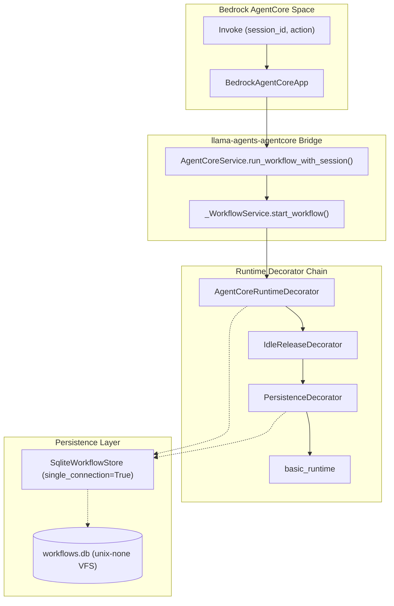

<!-- source: DeepWiki mcp.deepwiki.com · repo run-llama/llama-agents · page 4.2 AgentCore and AWS Bedrock Integration (llama-agents-agentcore) · fetched 2026-10-26 -->

# AgentCore and AWS Bedrock Integration (llama-agents-agentcore)

Relevant source files

The following files were used as context for generating this wiki page:

- [architecture-docs/control-loop.md](architecture-docs/control-loop.md)
- [architecture-docs/core-overview.md](architecture-docs/core-overview.md)
- [architecture-docs/server-architecture.md](architecture-docs/server-architecture.md)
- [charts/llama-agents/CHANGELOG.md](charts/llama-agents/CHANGELOG.md)
- [charts/llama-agents/Chart.yaml](charts/llama-agents/Chart.yaml)
- [charts/llama-agents/README.md](charts/llama-agents/README.md)
- [charts/llama-agents/package.json](charts/llama-agents/package.json)
- [charts/llama-agents/values.yaml](charts/llama-agents/values.yaml)
- [docs/api_docs/docs/api_reference/context.md](docs/api_docs/docs/api_reference/context.md)
- [docs/api_docs/docs/api_reference/decorators.md](docs/api_docs/docs/api_reference/decorators.md)
- [packages/llama-agents-agentcore/CHANGELOG.md](packages/llama-agents-agentcore/CHANGELOG.md)
- [packages/llama-agents-agentcore/package.json](packages/llama-agents-agentcore/package.json)
- [packages/llama-agents-agentcore/pyproject.toml](packages/llama-agents-agentcore/pyproject.toml)
- [packages/llama-agents-agentcore/src/llama_agents/agentcore/_runtime_decorator.py](packages/llama-agents-agentcore/src/llama_agents/agentcore/_runtime_decorator.py)
- [packages/llama-agents-agentcore/src/llama_agents/agentcore/_service.py](packages/llama-agents-agentcore/src/llama_agents/agentcore/_service.py)
- [packages/llama-agents-agentcore/src/llama_agents/agentcore/deploy.py](packages/llama-agents-agentcore/src/llama_agents/agentcore/deploy.py)
- [packages/llama-agents-agentcore/src/llama_agents/agentcore/entrypoint.py](packages/llama-agents-agentcore/src/llama_agents/agentcore/entrypoint.py)
- [packages/llama-agents-agentcore/tests/test_export.py](packages/llama-agents-agentcore/tests/test_export.py)
- [packages/llama-agents-integration-tests/tests/test_runtime_matrix.py](packages/llama-agents-integration-tests/tests/test_runtime_matrix.py)
- [packages/llama-agents-server/src/llama_agents/server/_store/agent_data_state_store.py](packages/llama-agents-server/src/llama_agents/server/_store/agent_data_state_store.py)
- [packages/llama-agents-server/src/llama_agents/server/_store/postgres_state_store.py](packages/llama-agents-server/src/llama_agents/server/_store/postgres_state_store.py)
- [packages/llama-agents-server/src/llama_agents/server/_store/sqlite/sqlite_state_store.py](packages/llama-agents-server/src/llama_agents/server/_store/sqlite/sqlite_state_store.py)
- [packages/llama-agents-server/src/llama_agents/server/_store/sqlite/sqlite_workflow_store.py](packages/llama-agents-server/src/llama_agents/server/_store/sqlite/sqlite_workflow_store.py)

The `llama-agents-agentcore` package provides a specialized integration bridge between LlamaIndex Workflows and the **AWS Bedrock AgentCore** runtime. It allows workflows to be deployed as Bedrock Agents, mapping AgentCore sessions to persistent workflow handlers and providing a robust execution environment with SQLite-backed durability and background task execution.

## Overview and Purpose

The primary goal of `llama-agents-agentcore` is to wrap LlamaIndex Workflows using the `BedrockAgentCoreApp` [packages/llama-agents-agentcore/src/llama_agents/agentcore/entrypoint.py:37-37](). It exposes workflow capabilities over a single AgentCore invoke channel, supporting both synchronous and asynchronous execution patterns.

Key features include:
- **Session-to-Handler Mapping**: Automatically uses the AgentCore `session_id` as the default `handler_id` to provide idempotent execution within a session [packages/llama-agents-agentcore/src/llama_agents/agentcore/entrypoint.py:8-12]().
- **Local Mode Durability**: Uses a specialized SQLite implementation for persistence, optimized for the single-process environment typical of AgentCore [packages/llama-agents-agentcore/src/llama_agents/agentcore/entrypoint.py:147-148]().
- **Action-Based Routing**: Supports a command-based payload (e.g., `run`, `get_result`, `send_event`) to interact with workflows via the AgentCore interface [packages/llama-agents-agentcore/src/llama_agents/agentcore/entrypoint.py:15-26]().

**Sources:** [packages/llama-agents-agentcore/src/llama_agents/agentcore/entrypoint.py:1-26](), [packages/llama-agents-agentcore/pyproject.toml:16-29]()

## System Architecture and Data Flow

The integration bridges the Bedrock AgentCore request/response model with the internal `WorkflowService` and `Runtime` chain.

### Entity Mapping: Natural Language to Code
This diagram maps high-level AgentCore concepts to their implementation classes in the codebase.

| Conceptual Entity | Code Entity | File Path |
| :--- | :--- | :--- |
| **AgentCore Application** | `BedrockAgentCoreApp` | [packages/llama-agents-agentcore/src/llama_agents/agentcore/entrypoint.py:37-37]() |
| **Workflow Bridge** | `AgentCoreService` | [packages/llama-agents-agentcore/src/llama_agents/agentcore/_service.py:39-39]() |
| **Execution Decorator** | `AgentCoreRuntimeDecorator` | [packages/llama-agents-agentcore/src/llama_agents/agentcore/_runtime_decorator.py:1-1]() |
| **Local Store** | `SqliteWorkflowStore` | [packages/llama-agents-server/src/llama_agents/server/_store/sqlite/sqlite_workflow_store.py:32-32]() |
| **Session State** | `SqliteStateStore` | [packages/llama-agents-server/src/llama_agents/server/_store/sqlite/sqlite_state_store.py:47-47]() |

**Sources:** [packages/llama-agents-agentcore/src/llama_agents/agentcore/entrypoint.py:37-61](), [packages/llama-agents-agentcore/src/llama_agents/agentcore/_service.py:39-61]()

### Execution Flow Diagram
The following diagram illustrates how an AgentCore invocation is routed through the runtime stack.

**Sources:** [packages/llama-agents-agentcore/src/llama_agents/agentcore/_service.py:48-61](), [packages/llama-agents-agentcore/src/llama_agents/agentcore/entrypoint.py:144-152](), [packages/llama-agents-server/src/llama_agents/server/_store/sqlite/sqlite_workflow_store.py:53-60]()

## Runtime Decorator Chain

The `AgentCoreService` assembles a specific chain of `ServerRuntimeDecorator` instances to manage the workflow lifecycle [packages/llama-agents-agentcore/src/llama_agents/agentcore/_service.py:48-58]().

1.  **AgentCoreRuntimeDecorator**: The outermost layer that handles background task execution for workflows, ensuring they can run asynchronously within the AgentCore environment [packages/llama-agents-agentcore/src/llama_agents/agentcore/_service.py:53-58]().
2.  **IdleReleaseDecorator**: Manages resource cleanup by releasing workflow instances after a period of inactivity (default 60 seconds) [packages/llama-agents-agentcore/src/llama_agents/agentcore/_service.py:19-19](), [packages/llama-agents-agentcore/src/llama_agents/agentcore/_service.py:48-52]().
3.  **PersistenceDecorator**: Interfaces with the `SqliteWorkflowStore` to save and restore workflow state and event history between ticks [packages/llama-agents-agentcore/src/llama_agents/agentcore/_service.py:49-49]().

**Sources:** [packages/llama-agents-agentcore/src/llama_agents/agentcore/_service.py:39-61](), [packages/llama-agents-agentcore/CHANGELOG.md:49-50]()

## SQLite Durability for Local Mode

In AgentCore environments, workflows often require local persistence that is resilient to the ephemeral nature of the container while avoiding the overhead of a full database server.

### SqliteWorkflowStore
The `SqliteWorkflowStore` is configured with `single_connection=True` for AgentCore [packages/llama-agents-agentcore/src/llama_agents/agentcore/entrypoint.py:147-147](). It uses the `unix-none` VFS (Virtual File System) to disable `fcntl` locking calls, which is safe for single-process access and improves performance in session storage [packages/llama-agents-server/src/llama_agents/server/_store/sqlite/sqlite_workflow_store.py:53-60]().

### SqliteStateStore
The `SqliteStateStore` implements the `StateStore` interface for persistent context data.
- **Direct Write-Through**: Every `set_state` call writes directly to the database, and `get_state` reads from it, ensuring no state is lost if the process restarts [packages/llama-agents-server/src/llama_agents/server/_store/sqlite/sqlite_state_store.py:47-52]().
- **State Seeding**: Supports seeding new runs from existing serialized state or SQL-level copies from other `run_id`s [packages/llama-agents-server/src/llama_agents/server/_store/sqlite/sqlite_state_store.py:89-102]().

**Sources:** [packages/llama-agents-server/src/llama_agents/server/_store/sqlite/sqlite_workflow_store.py:32-60](), [packages/llama-agents-server/src/llama_agents/server/_store/sqlite/sqlite_state_store.py:47-154]()

## Entrypoint and Deployment

The package includes an entrypoint that handles workflow loading and environment configuration.

### Workflow Loading
The `_load_workflows()` function performs the following steps:
1.  Locates `pyproject.toml` in the current working directory [packages/llama-agents-agentcore/src/llama_agents/agentcore/entrypoint.py:104-110]().
2.  Reads deployment configuration using `read_deployment_config_from_git_root_or_cwd` [packages/llama-agents-agentcore/src/llama_agents/agentcore/entrypoint.py:111-113]().
3.  Loads environment variables and validates required keys [packages/llama-agents-agentcore/src/llama_agents/agentcore/entrypoint.py:117-118]().
4.  Instantiates workflows defined in the configuration [packages/llama-agents-agentcore/src/llama_agents/agentcore/entrypoint.py:120-128]().

### Session Storage Path
The SQLite database is stored at `/mnt/workspace/workflows.db` if the AgentCore workspace directory exists; otherwise, it defaults to the local directory [packages/llama-agents-agentcore/src/llama_agents/agentcore/entrypoint.py:131-140]().

**Sources:** [packages/llama-agents-agentcore/src/llama_agents/agentcore/entrypoint.py:98-152]()

---

