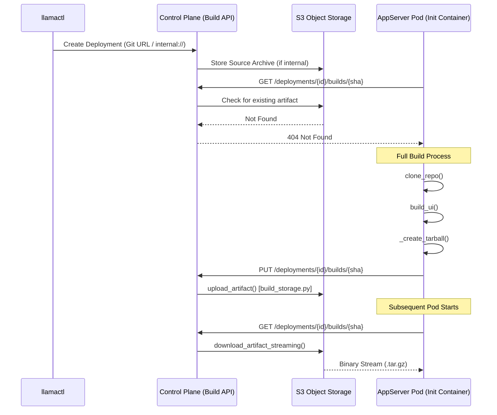
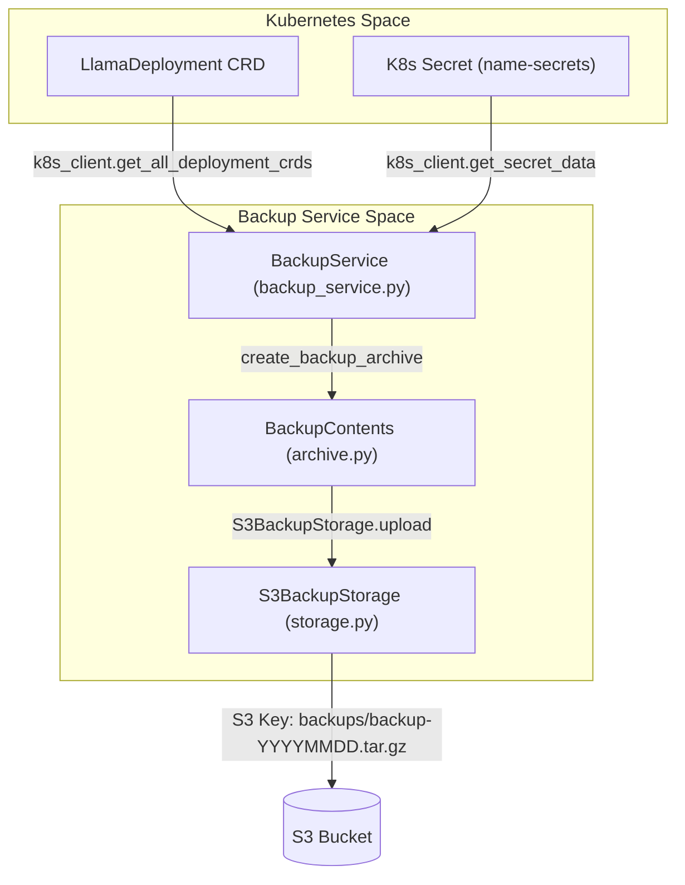

<!-- source: DeepWiki mcp.deepwiki.com · repo run-llama/llama-agents · page 5.2 Git Integration, Code Repository, and Build API · fetched 2026-10-26 -->

# Git Integration, Code Repository, and Build API

Relevant source files

The following files were used as context for generating this wiki page:

- [docker/Dockerfile](docker/Dockerfile)
- [operator/internal/controller/resources.go](operator/internal/controller/resources.go)
- [operator/internal/controller/resources_build_unit_test.go](operator/internal/controller/resources_build_unit_test.go)
- [packages/llama-agents-appserver/src/llama_agents/appserver/bootstrap.py](packages/llama-agents-appserver/src/llama_agents/appserver/bootstrap.py)
- [packages/llama-agents-appserver/tests/test_bootstrap.py](packages/llama-agents-appserver/tests/test_bootstrap.py)
- [packages/llama-agents-control-plane/src/llama_agents/control_plane/backup/storage.py](packages/llama-agents-control-plane/src/llama_agents/control_plane/backup/storage.py)
- [packages/llama-agents-control-plane/src/llama_agents/control_plane/build_api/build_gc.py](packages/llama-agents-control-plane/src/llama_agents/control_plane/build_api/build_gc.py)
- [packages/llama-agents-control-plane/src/llama_agents/control_plane/build_api/build_service.py](packages/llama-agents-control-plane/src/llama_agents/control_plane/build_api/build_service.py)
- [packages/llama-agents-control-plane/src/llama_agents/control_plane/build_api/build_storage.py](packages/llama-agents-control-plane/src/llama_agents/control_plane/build_api/build_storage.py)
- [packages/llama-agents-control-plane/src/llama_agents/control_plane/code_repo/service.py](packages/llama-agents-control-plane/src/llama_agents/control_plane/code_repo/service.py)
- [packages/llama-agents-control-plane/src/llama_agents/control_plane/code_repo/storage.py](packages/llama-agents-control-plane/src/llama_agents/control_plane/code_repo/storage.py)
- [packages/llama-agents-control-plane/src/llama_agents/control_plane/git/_git_service.py](packages/llama-agents-control-plane/src/llama_agents/control_plane/git/_git_service.py)
- [packages/llama-agents-control-plane/src/llama_agents/control_plane/git/github_api_client.py](packages/llama-agents-control-plane/src/llama_agents/control_plane/git/github_api_client.py)
- [packages/llama-agents-control-plane/src/llama_agents/control_plane/manage_api/backup_service.py](packages/llama-agents-control-plane/src/llama_agents/control_plane/manage_api/backup_service.py)
- [packages/llama-agents-control-plane/src/llama_agents/control_plane/settings.py](packages/llama-agents-control-plane/src/llama_agents/control_plane/settings.py)
- [packages/llama-agents-control-plane/src/llama_agents/control_plane/storage.py](packages/llama-agents-control-plane/src/llama_agents/control_plane/storage.py)
- [packages/llama-agents-control-plane/tests/code_repo/test_storage.py](packages/llama-agents-control-plane/tests/code_repo/test_storage.py)
- [packages/llama-agents-control-plane/tests/test_build_gc.py](packages/llama-agents-control-plane/tests/test_build_gc.py)
- [packages/llama-agents-control-plane/tests/test_git_service.py](packages/llama-agents-control-plane/tests/test_git_service.py)
- [packages/llama-agents-control-plane/tests/test_ui_build_path.py](packages/llama-agents-control-plane/tests/test_ui_build_path.py)
- [packages/llamactl/src/llama_agents/cli/utils/retry.py](packages/llamactl/src/llama_agents/cli/utils/retry.py)
- [packages/llamactl/tests/test_retry.py](packages/llamactl/tests/test_retry.py)

The llama-agents control plane provides a centralized infrastructure for managing application source code, build artifacts, and system-wide backups. It leverages S3-compatible object storage to handle large binary blobs and integrates with GitHub for secure code retrieval.

## Code Repository and Internal Git Storage

The system supports two primary methods for sourcing application code: external Git repositories (e.g., GitHub) and an internal S3-backed repository (using the `internal://` scheme).

### Internal S3 Storage (`internal://`)
When a deployment is created using the internal scheme, the control plane stores a compressed archive of the source code in S3. This is managed by the `CodeRepoStorage` class [packages/llama-agents-control-plane/src/llama_agents/control_plane/code_repo/storage.py](). The `create_code_repo_storage` function initializes this service using settings such as `s3_bucket` and `code_repo_s3_key_prefix` [packages/llama-agents-control-plane/src/llama_agents/control_plane/code_repo/service.py:9-22]().

### GitHub Integration and OAuth Flow
For external repositories, the `GitService` [packages/llama-agents-control-plane/src/llama_agents/control_plane/git/_git_service.py]() handles authentication and metadata retrieval.
- **GitHub App Auth**: The system uses `GitHubAppAuth` to generate JWTs for API access [packages/llama-agents-control-plane/src/llama_agents/control_plane/git/_github_auth.py]().
- **API Clients**: The `GitHubAppApiClient` [packages/llama-agents-control-plane/src/llama_agents/control_plane/git/github_api_client.py:110]() handles installation-level tokens, while `pat_api_client` [packages/llama-agents-control-plane/src/llama_agents/control_plane/git/github_api_client.py:154]() supports Personal Access Tokens.
- **Validation**: Before deployment, `validate_git_application` checks repository accessibility and parses the `pyproject.toml` or `llama_deploy.yaml` to locate workflows and UI directories [packages/llama-agents-control-plane/tests/test_ui_build_path.py:70-81]().

**Sources:**
- [packages/llama-agents-control-plane/src/llama_agents/control_plane/code_repo/service.py:9-22]()
- [packages/llama-agents-control-plane/src/llama_agents/control_plane/git/github_api_client.py:110-170]()
- [packages/llama-agents-control-plane/src/llama_agents/control_plane/settings.py:124-129]()

---

## Build API and Artifact Management

The Build API (typically exposed on port 8001) acts as a proxy for managing build artifacts. These artifacts are `.tar.gz` bundles containing the fully prepared application environment (including installed dependencies and built UI assets).

### Build Artifact Storage
The `BuildArtifactStorage` class [packages/llama-agents-control-plane/src/llama_agents/control_plane/build_api/build_storage.py:27]() extends `S3ObjectStorage` to provide:
- **Streaming Downloads**: `download_artifact_streaming` allows pods to pull large artifacts without loading them into the control plane's memory [packages/llama-agents-control-plane/src/llama_agents/control_plane/build_api/build_storage.py:78]().
- **Existence Checks**: `artifact_exists` is used by bootstrap processes to determine if a build needs to be triggered [packages/llama-agents-control-plane/src/llama_agents/control_plane/build_api/build_storage.py:116]().

### Bootstrap Workflow
Pods utilize `bootstrap_app_from_repo` [packages/llama-agents-appserver/src/llama_agents/appserver/bootstrap.py:195]() to initialize. The logic branches based on the presence of `LLAMA_DEPLOY_BUILD_ID`:
1. **Cache Hit**: If the artifact exists in S3, the pod calls `_download_and_extract_artifact` [packages/llama-agents-appserver/src/llama_agents/appserver/bootstrap.py:77]().
2. **Cache Miss**: The pod performs a full `clone_repo`, installs dependencies, and then calls `_upload_artifact` to store the result for future replicas [packages/llama-agents-appserver/src/llama_agents/appserver/bootstrap.py:170]().

### Build Artifact Garbage Collection
To prevent S3 bloat, `build_gc.py` implements a cleanup routine. It respects a grace period defined by `BUILD_ARTIFACT_GC_GRACE_SECONDS` (default 4500s) to ensure artifacts for active or recently finished Kubernetes Jobs are not deleted [packages/llama-agents-control-plane/src/llama_agents/control_plane/settings.py:118-122]().

**Sources:**
- [packages/llama-agents-control-plane/src/llama_agents/control_plane/build_api/build_storage.py:27-171]()
- [packages/llama-agents-appserver/src/llama_agents/appserver/bootstrap.py:77-183]()
- [packages/llama-agents-control-plane/src/llama_agents/control_plane/settings.py:109-122]()

---

## Data Flow: Source to Pod

The following diagram illustrates how source code is transformed into a running pod artifact and stored in S3.

**Build and Bootstrap Data Flow**

**Sources:**
- [packages/llama-agents-appserver/src/llama_agents/appserver/bootstrap.py:6-10]()
- [packages/llama-agents-control-plane/src/llama_agents/control_plane/build_api/build_storage.py:78-114]()

---

## Backup and Restore Subsystem

The `BackupService` provides disaster recovery by archiving Kubernetes Custom Resource Definitions (CRDs) and their associated Secrets.

### Backup Creation
When `create_backup` is invoked [packages/llama-agents-control-plane/src/llama_agents/manage_api/backup_service.py:32]():
1. **CRD Export**: It fetches all deployment CRDs via `k8s_client.get_all_deployment_crds()` [packages/llama-agents-control-plane/src/llama_agents/manage_api/backup_service.py:41]().
2. **Secret Collection**: It retrieves paired secrets (e.g., `{deployment}-secrets`) [packages/llama-agents-control-plane/src/llama_agents/manage_api/backup_service.py:59]().
3. **Encryption**: If `BACKUP_ENCRYPTION_PASSWORD` is set, secrets are encrypted within the archive [packages/llama-agents-control-plane/src/llama_agents/manage_api/backup_service.py:74]().
4. **S3 Upload**: The final `.tar.gz` is uploaded via `S3BackupStorage` [packages/llama-agents-control-plane/src/llama_agents/backup/storage.py:50]().

### Restore Logic
The `_perform_restore` method [packages/llama-agents-control-plane/src/llama_agents/manage_api/backup_service.py:130]() downloads the archive and reconstructs the environment. It includes safety checks, such as refusing to overwrite deployments belonging to different project IDs [packages/llama-agents-control-plane/src/llama_agents/manage_api/backup_service.py:181-187]().

**Backup Entity Mapping**

**Sources:**
- [packages/llama-agents-control-plane/src/llama_agents/manage_api/backup_service.py:32-87]()
- [packages/llama-agents-control-plane/src/llama_agents/backup/storage.py:47-57]()

---

## Authentication and Security

### Token Authentication for Pods
Pods authenticate with the Build API and Control Plane using a Bearer token. This token is typically passed via the `LLAMA_DEPLOY_AUTH_TOKEN` environment variable [packages/llama-agents-appserver/src/llama_agents/appserver/bootstrap.py:81]().

### S3 Configuration
The `S3ObjectStorage` base class [packages/llama-agents-control-plane/src/llama_agents/control_plane/storage.py:27]() handles the underlying `aioboto3` session. It supports:
- **Signed Requests**: Using `aws_access_key_id` and `aws_secret_access_key` [packages/llama-agents-control-plane/src/llama_agents/control_plane/storage.py:57-59]().
- **Unsigned Requests**: Enabled via `S3_UNSIGNED=true` for backends like `s3proxy` or local MinIO instances without authentication [packages/llama-agents-control-plane/src/llama_agents/control_plane/storage.py:52-56]().

**Sources:**
- [packages/llama-agents-control-plane/src/llama_agents/control_plane/storage.py:46-60]()
- [packages/llama-agents-control-plane/src/llama_agents/control_plane/settings.py:62-95]()
- [packages/llama-agents-appserver/src/llama_agents/appserver/bootstrap.py:89-93]()

---

