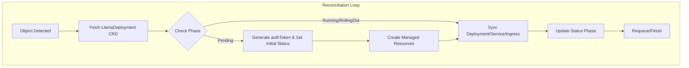
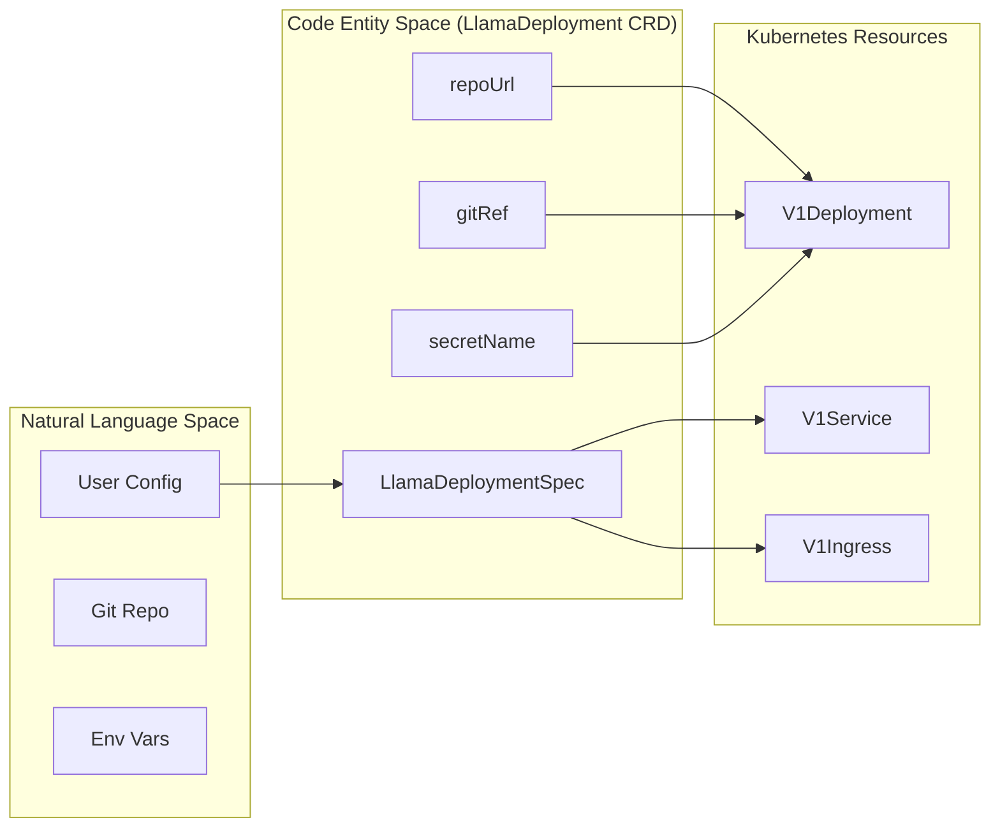
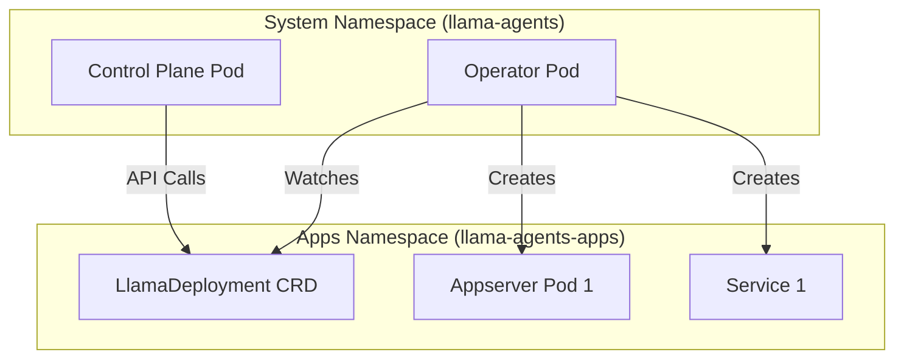

<!-- source: DeepWiki mcp.deepwiki.com · repo run-llama/llama-agents · page 6.1 LlamaDeployment CRD and Reconciliation Controller · fetched 2026-10-26 -->

# LlamaDeployment CRD and Reconciliation Controller

Relevant source files

The following files were used as context for generating this wiki page:

- [charts/llama-agents/templates/operator-deployment-template.yaml](charts/llama-agents/templates/operator-deployment-template.yaml)
- [charts/llama-agents/templates/operator-deployment.yaml](charts/llama-agents/templates/operator-deployment.yaml)
- [charts/llama-agents/templates/rbac.yaml](charts/llama-agents/templates/rbac.yaml)
- [charts/llama-agents/tests/apps_namespace_test.yaml](charts/llama-agents/tests/apps_namespace_test.yaml)
- [operator/go.mod](operator/go.mod)
- [operator/go.sum](operator/go.sum)
- [operator/internal/controller/apps_namespace_test.go](operator/internal/controller/apps_namespace_test.go)
- [packages/llama-agents-control-plane/src/llama_agents/control_plane/k8s_client.py](packages/llama-agents-control-plane/src/llama_agents/control_plane/k8s_client.py)
- [packages/llama-agents-control-plane/src/llama_agents/control_plane/manage_api/deployments_service.py](packages/llama-agents-control-plane/src/llama_agents/control_plane/manage_api/deployments_service.py)
- [packages/llama-agents-control-plane/tests/deployments/test_deployments_service.py](packages/llama-agents-control-plane/tests/deployments/test_deployments_service.py)
- [packages/llama-agents-control-plane/tests/test_k8s_client.py](packages/llama-agents-control-plane/tests/test_k8s_client.py)
- [packages/llama-agents-core/src/llama_agents/core/client/manage_client.py](packages/llama-agents-core/src/llama_agents/core/client/manage_client.py)
- [packages/llama-agents-core/src/llama_agents/core/server/manage_api/_abstract_deployments_service.py](packages/llama-agents-core/src/llama_agents/core/server/manage_api/_abstract_deployments_service.py)
- [packages/llama-agents-core/src/llama_agents/core/server/manage_api/_create_deployments_router.py](packages/llama-agents-core/src/llama_agents/core/server/manage_api/_create_deployments_router.py)

The Kubernetes Operator for `llama-agents` is a Go-based controller built with the `controller-runtime` library. It manages the lifecycle of `LlamaDeployment` custom resources, orchestrating the underlying Kubernetes primitives (Deployments, Services, Ingress, etc.) required to run agentic workflows in a cloud-native environment.

## LlamaDeployment CRD Structure

The `LlamaDeployment` Custom Resource Definition (CRD) is the primary interface for deploying agent applications. It defines the desired state of a deployment, including its source code location, configuration, and environment.

### LlamaDeploymentSpec
The `spec` field defines the configuration for the deployment:
*   **`name`**: The unique identifier for the deployment.
*   **`projectId`**: The project to which this deployment belongs.
*   **`repoUrl`**: The URL of the Git repository (or `internal://` for S3-backed code push).
*   **`gitRef`**: The branch, tag, or commit SHA to deploy.
*   **`gitSha`**: The specific commit SHA used for the current rollout.
*   **`deploymentFilePath`**: Path to the `llama_deploy.yaml` or `pyproject.toml` inside the repo.
*   **`secretName`**: Optional reference to a Kubernetes Secret containing environment variables.

### LlamaDeploymentStatus
The `status` field tracks the observed state and provides metadata to the Control Plane:
*   **`phase`**: The current lifecycle stage (e.g., `Pending`, `Running`, `Failed`, `RollingOut`).
*   **`authToken`**: A generated token used by the appserver to authenticate with the Control Plane.
*   **`observedGeneration`**: The generation of the spec that was last reconciled.
*   **`conditions`**: Standard Kubernetes conditions describing the health of the resource.

### LlamaDeploymentTemplate
The `LlamaDeploymentTemplate` is a cluster-scoped or namespace-scoped resource that provides default values for `LlamaDeployment` objects, such as default container images or resource limits.

**Sources:**
*   [packages/llama-agents-core/src/llama_agents/core/schema/deployments.py:39-52]() (Python definitions for CRD fields)
*   [charts/llama-agents/templates/operator-deployment-template.yaml:1-10]() (Template definition)

## Reconciliation Loop and Phases

The controller implements a state machine to transition the `LlamaDeployment` through various phases. The reconciliation logic ensures that for every `LlamaDeployment` object, the corresponding Kubernetes resources are created or updated.

### Reconciliation Flow
The controller watches for changes to `LlamaDeployment` resources and triggers the `Reconcile` function.

### Deployment Phases
1.  **`Pending`**: The resource has been created but resources are not yet fully provisioned.
2.  **`RollingOut`**: A change in `gitSha` or `secretName` has triggered a rolling update of the underlying Kubernetes Deployment.
3.  **`Running`**: The underlying Pods are ready and the Service is reachable.
4.  **`Failed`**: A terminal error occurred (e.g., image pull error or build failure).

**Sources:**
*   [packages/llama-agents-control-plane/src/llama_agents/control_plane/k8s_client.py:44-48]() (Phase definitions)
*   [operator/go.mod:1-14]() (Controller dependencies)

## Managed Resource Creation

When a `LlamaDeployment` is reconciled, the controller ensures the existence and correctness of several sub-resources.

| Resource | Purpose |
| :--- | :--- |
| **Deployment** | Runs the `llama-agents-appserver` container. Injects environment variables from `secretName` and sets the `LLAMA_DEPLOY_TOKEN`. |
| **Service** | Provides a stable cluster-internal DNS name for the appserver (typically port 8000). |
| **Secret** | If using internal code storage, the controller may manage secrets for S3 access. |
| **Ingress** | (Optional) Exposes the deployment to the internet using a host-based routing rule (e.g., `{deploy-id}.example.com`). |
| **NetworkPolicy** | Restricts traffic to ensure isolation between different agent deployments. |

### Data Flow: CRD to Kubernetes
This diagram bridges the high-level CRD fields to the specific Kubernetes API objects managed by the controller.

**Sources:**
*   [packages/llama-agents-control-plane/src/llama_agents/control_plane/k8s_client.py:27-35]() (K8s API imports)
*   [charts/llama-agents/templates/operator-deployment.yaml:51-93]() (Operator environment configuration)

## RBAC and Namespace Isolation

The operator supports two modes of operation: **Single Namespace** and **Split Namespace**.

### RBAC Permissions
The operator requires a `Role` with permissions to manage the entire lifecycle of its sub-resources. Key permissions include:
*   `create`, `patch`, `update` on `apps/deployments` and `services`.
*   `get`, `list`, `watch` on `llama-agents.deploy.llamaindex.ai/llamadeployments`.
*   `update` on `llamadeployments/status` and `llamadeployments/finalizers`.

### Namespace Modes
*   **Single Namespace**: The operator, the control plane, and all managed agent deployments run in the same namespace (e.g., `llama-agents`).
*   **Split Namespace**: The operator and control plane run in a "system" namespace, while managed agent deployments are isolated in a separate "apps" namespace. This is controlled by the `WATCH_NAMESPACE` environment variable on the operator.

**Sources:**
*   [charts/llama-agents/templates/rbac.yaml:12-62]() (RBAC Role definition)
*   [charts/llama-agents/templates/operator-deployment.yaml:52-57]() (WATCH_NAMESPACE configuration)
*   [charts/llama-agents/tests/apps_namespace_test.yaml:77-115]() (Split namespace test logic)

## Integration with Control Plane

The Control Plane acts as the API gateway for the Operator. It uses a `K8sClient` to interact with the Kubernetes API and manipulate `LlamaDeployment` objects.

### Key Functions
*   **`create_deployment`**: Called by the `DeploymentService` when a user runs `llamactl deploy`. It calculates the initial CRD spec and creates the object in K8s. [packages/llama-agents-control-plane/src/llama_agents/control_plane/manage_api/deployments_service.py:153-200]()
*   **`update_deployment`**: Updates the `gitSha` or `gitRef` in the CRD, which triggers the Operator to perform a rolling update. [packages/llama-agents-control-plane/src/llama_agents/control_plane/manage_api/deployments_service.py:88-91]()
*   **`validate_deployment_token`**: Used to verify that an incoming request from an appserver pod contains the correct `authToken` stored in the `LlamaDeployment` status. [packages/llama-agents-control-plane/src/llama_agents/control_plane/k8s_client.py:181-199]()

**Sources:**
*   [packages/llama-agents-control-plane/src/llama_agents/control_plane/manage_api/deployments_service.py:113-124]() (DeploymentService implementation)
*   [packages/llama-agents-control-plane/src/llama_agents/control_plane/k8s_client.py:81-160]() (K8sClient class)

---

