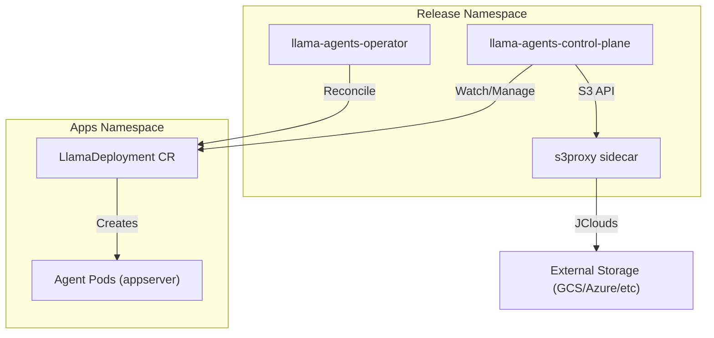
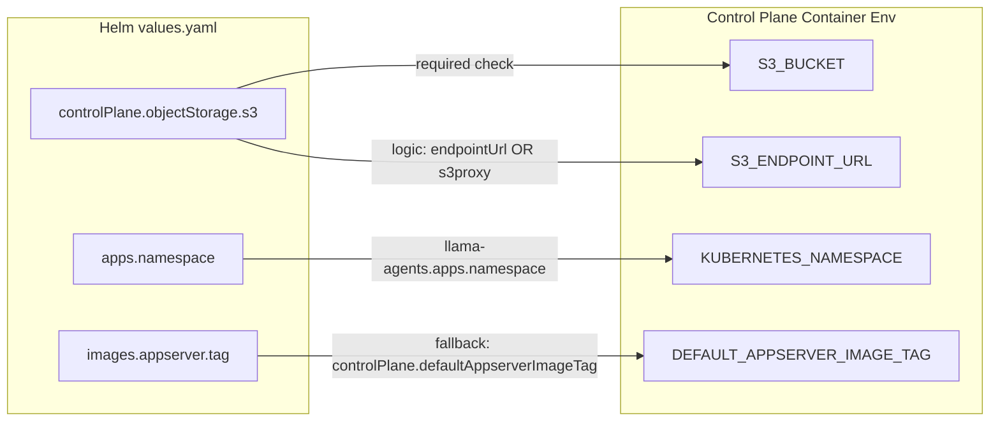

<!-- source: DeepWiki mcp.deepwiki.com · repo run-llama/llama-agents · page 6.2 Helm Chart Deployment (charts/llama-agents) · fetched 2026-10-26 -->

# Helm Chart Deployment (charts/llama-agents)

Relevant source files

The following files were used as context for generating this wiki page:

- [charts/llama-agents/CHANGELOG.md](charts/llama-agents/CHANGELOG.md)
- [charts/llama-agents/Chart.yaml](charts/llama-agents/Chart.yaml)
- [charts/llama-agents/README.md](charts/llama-agents/README.md)
- [charts/llama-agents/README.md.gotmpl](charts/llama-agents/README.md.gotmpl)
- [charts/llama-agents/package.json](charts/llama-agents/package.json)
- [charts/llama-agents/templates/_helpers.tpl](charts/llama-agents/templates/_helpers.tpl)
- [charts/llama-agents/templates/_s3proxy.tpl](charts/llama-agents/templates/_s3proxy.tpl)
- [charts/llama-agents/templates/_secrets.tpl](charts/llama-agents/templates/_secrets.tpl)
- [charts/llama-agents/templates/controlplane-s3-secret.yaml](charts/llama-agents/templates/controlplane-s3-secret.yaml)
- [charts/llama-agents/templates/deployment.yaml](charts/llama-agents/templates/deployment.yaml)
- [charts/llama-agents/templates/s3proxy-configmap.yaml](charts/llama-agents/templates/s3proxy-configmap.yaml)
- [charts/llama-agents/templates/s3proxy-secret.yaml](charts/llama-agents/templates/s3proxy-secret.yaml)
- [charts/llama-agents/tests/object_storage_test.yaml](charts/llama-agents/tests/object_storage_test.yaml)
- [charts/llama-agents/tests/operator_image_tag_env_test.yaml](charts/llama-agents/tests/operator_image_tag_env_test.yaml)
- [charts/llama-agents/tests/s3proxy_test.yaml](charts/llama-agents/tests/s3proxy_test.yaml)
- [charts/llama-agents/values.yaml](charts/llama-agents/values.yaml)
- [packages/llama-agents-agentcore/CHANGELOG.md](packages/llama-agents-agentcore/CHANGELOG.md)
- [packages/llama-agents-agentcore/package.json](packages/llama-agents-agentcore/package.json)
- [packages/llama-agents-agentcore/pyproject.toml](packages/llama-agents-agentcore/pyproject.toml)

The `llama-agents` Helm chart provides a production-ready deployment mechanism for the Llama Agents ecosystem on Kubernetes [charts/llama-agents/Chart.yaml:1-5](). It orchestrates the lifecycle of the **Control Plane** and the **Operator**, while providing extensive configuration for object storage, networking, and namespace isolation [charts/llama-agents/README.md:5-12]().

## Architecture and Components

The chart deploys two primary long-running services and manages the Custom Resource Definitions (CRDs) required for the agentic infrastructure.

### Component Map

| Component | Code Entity / Image | Role |
| :--- | :--- | :--- |
| **Control Plane** | `llamaindex/llama-agents-control-plane` | API server for managing deployments, builds, and backups [charts/llama-agents/README.md:9-9](). |
| **Operator** | `llamaindex/llama-agents-operator` | Kubernetes controller that reconciles `LlamaDeployment` CRs into Pods [charts/llama-agents/README.md:10-10](). |
| **App Server** | `llamaindex/llama-agents-appserver` | The base image used by the operator for managed agent pods [charts/llama-agents/values.yaml:36-42](). |
| **S3 Proxy** | `gaul/s3proxy` | Optional sidecar for non-S3 object storage backends [charts/llama-agents/README.md:75-80](). |

### Deployment Data Flow

The following diagram illustrates how the Helm chart configures the relationship between the management components and the target applications.

**System Component Interaction**

**Sources:** [charts/llama-agents/README.md:5-15](), [charts/llama-agents/templates/deployment.yaml:50-60](), [charts/llama-agents/README.md:57-62]().

---

## Configuration and Implementation

### Control Plane Deployment
The control plane is deployed as a `Deployment` with a `Recreate` strategy [charts/llama-agents/templates/deployment.yaml:1-15](). It exposes two primary ports:
1.  **HTTP (8000)**: The main management API [charts/llama-agents/values.yaml:61-64]().
2.  **Build API (8001)**: Dedicated port for Git proxying and token validation [charts/llama-agents/values.yaml:107-110]().

It is configured via environment variables that define the operational context for the `llama-agents-control-plane` package:
- `KUBERNETES_NAMESPACE`: Derived from `.Values.apps.namespace` to tell the control plane where to look for `LlamaDeployment` resources [charts/llama-agents/templates/deployment.yaml:51-52]().
- `DEFAULT_APPSERVER_IMAGE_TAG`: Injected into the control plane to ensure managed deployments use the version of `llama-agents-appserver` compatible with the current release [charts/llama-agents/templates/deployment.yaml:53-54]().

**Sources:** [charts/llama-agents/templates/deployment.yaml:36-80](), [charts/llama-agents/values.yaml:57-115]().

### Object Storage Integration
Llama Agents requires S3-compatible storage for build artifacts, code repositories (via the internal Git scheme), and backups. The chart supports three credential modes [charts/llama-agents/README.md:106-135]():

1.  **BYO Secret**: User provides an existing Secret containing `S3_ACCESS_KEY` and `S3_SECRET_KEY` via `controlPlane.objectStorage.s3.secret` [charts/llama-agents/values.yaml:138-141]().
2.  **Inline Credentials**: Chart renders a `Secret` named `llama-agents-controlplane-s3` from `accessKey` and `secretKey` values [charts/llama-agents/templates/_helpers.tpl:36-39](), [charts/llama-agents/tests/object_storage_test.yaml:147-171]().
3.  **Workload Identity**: No keys provided; the Pod relies on IAM roles for service accounts (IRSA) [charts/llama-agents/README.md:130-135]().

#### S3Proxy Sidecar
For non-AWS backends (e.g., Azure Blob, GCS), the chart can inject an `s3proxy` sidecar [charts/llama-agents/README.md:75-80]().
- When `s3proxy.enabled` is `true`, the Control Plane's `S3_ENDPOINT_URL` is automatically set to `http://localhost:8080` [charts/llama-agents/templates/deployment.yaml:55-62]().
- `S3_UNSIGNED` defaults to `true` in this mode unless explicitly overridden [charts/llama-agents/templates/deployment.yaml:67-74]().

**Sources:** [charts/llama-agents/values.yaml:115-157](), [charts/llama-agents/templates/deployment.yaml:55-80](), [charts/llama-agents/README.md:75-105]().

### Namespace Isolation
By default, the operator and the agent pods it manages reside in the same namespace. Setting `apps.namespace` enables isolation [charts/llama-agents/README.md:57-62]():
- **Release Namespace**: Contains the Control Plane and Operator.
- **Apps Namespace**: Contains `LlamaDeployment` CRs, generated `Deployments`, `Services`, and `Secrets`.

The helper `llama-agents.apps.namespace` resolves this logic across all templates [charts/llama-agents/templates/_helpers.tpl:50-57]().

**Sources:** [charts/llama-agents/templates/_helpers.tpl:50-65](), [charts/llama-agents/values.yaml:175-181]().

---

## Custom Resource Definitions (CRDs)

The chart includes CRDs in the `crds/` directory, which Helm installs only on the initial installation [charts/llama-agents/README.md:12-15]().

### Managed CRD Upgrades
Because Helm does not upgrade CRDs, the project provides a companion `llama-agents-crds` chart. The `llama-agents` chart pins the compatible version in its values:
- `crds.version`: Tracks the specific version of the CRD schema required by the current Operator [charts/llama-agents/values.yaml:183-186]().

The synchronization of these versions is handled by the `syncValues` engine during the release pipeline, which maps `{llama-agents-crds:version}` to the `crds.version` field in `values.yaml` [charts/llama-agents/package.json:12-19]().

**Sources:** [charts/llama-agents/README.md:34-55](), [charts/llama-agents/package.json:12-19](), [charts/llama-agents/values.yaml:183-187]().

## Resource Mapping Diagram

The following diagram maps Helm value keys to the resulting environment variables and configuration logic within the Control Plane container.

**Value-to-Runtime Mapping**

**Sources:** [charts/llama-agents/templates/deployment.yaml:50-80](), [charts/llama-agents/templates/_helpers.tpl:50-57](), [charts/llama-agents/values.yaml:115-125]().

## Network Isolation and Security
The chart implements `NetworkPolicy` to restrict traffic to the managed agent applications.
- **Namespace Isolation**: Policies can be configured to allow traffic only from the Control Plane or specific ingress controllers [charts/llama-agents/CHANGELOG.md:46-52]().
- **Egress Control**: Supports `extraEgressRules` and a `blockPrivateRanges` toggle to prevent agents from accessing internal cluster services unless explicitly permitted [charts/llama-agents/CHANGELOG.md:52-53]().

**Sources:** [charts/llama-agents/CHANGELOG.md:46-57]().

---

