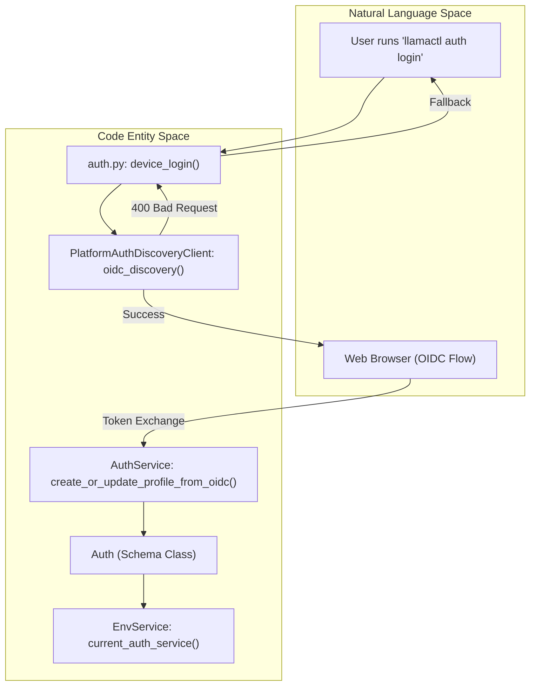
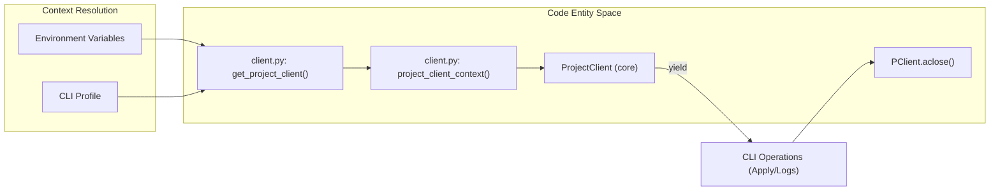

<!-- source: DeepWiki mcp.deepwiki.com · repo run-llama/llama-agents · page 7.2 Authentication, Projects, and Organizations · fetched 2026-10-26 -->

# Authentication, Projects, and Organizations

Relevant source files

The following files were used as context for generating this wiki page:

- [packages/llamactl/src/llama_agents/cli/app.py](packages/llamactl/src/llama_agents/cli/app.py)
- [packages/llamactl/src/llama_agents/cli/auth/client.py](packages/llamactl/src/llama_agents/cli/auth/client.py)
- [packages/llamactl/src/llama_agents/cli/client.py](packages/llamactl/src/llama_agents/cli/client.py)
- [packages/llamactl/src/llama_agents/cli/commands/agentcore.py](packages/llamactl/src/llama_agents/cli/commands/agentcore.py)
- [packages/llamactl/src/llama_agents/cli/commands/auth.py](packages/llamactl/src/llama_agents/cli/commands/auth.py)
- [packages/llamactl/src/llama_agents/cli/commands/config.py](packages/llamactl/src/llama_agents/cli/commands/config.py)
- [packages/llamactl/src/llama_agents/cli/commands/dev.py](packages/llamactl/src/llama_agents/cli/commands/dev.py)
- [packages/llamactl/src/llama_agents/cli/commands/environments.py](packages/llamactl/src/llama_agents/cli/commands/environments.py)
- [packages/llamactl/src/llama_agents/cli/commands/init.py](packages/llamactl/src/llama_agents/cli/commands/init.py)
- [packages/llamactl/src/llama_agents/cli/commands/organizations.py](packages/llamactl/src/llama_agents/cli/commands/organizations.py)
- [packages/llamactl/src/llama_agents/cli/commands/pkg.py](packages/llamactl/src/llama_agents/cli/commands/pkg.py)
- [packages/llamactl/src/llama_agents/cli/commands/projects.py](packages/llamactl/src/llama_agents/cli/commands/projects.py)
- [packages/llamactl/src/llama_agents/cli/commands/serve.py](packages/llamactl/src/llama_agents/cli/commands/serve.py)
- [packages/llamactl/src/llama_agents/cli/log_format.py](packages/llamactl/src/llama_agents/cli/log_format.py)
- [packages/llamactl/src/llama_agents/cli/param_types.py](packages/llamactl/src/llama_agents/cli/param_types.py)
- [packages/llamactl/src/llama_agents/cli/render.py](packages/llamactl/src/llama_agents/cli/render.py)
- [packages/llamactl/tests/test_auth_cli.py](packages/llamactl/tests/test_auth_cli.py)
- [packages/llamactl/tests/test_auth_login.py](packages/llamactl/tests/test_auth_login.py)
- [packages/llamactl/tests/test_commands_core.py](packages/llamactl/tests/test_commands_core.py)
- [packages/llamactl/tests/test_init_command.py](packages/llamactl/tests/test_init_command.py)
- [packages/llamactl/tests/test_log_format.py](packages/llamactl/tests/test_log_format.py)
- [packages/llamactl/tests/test_param_types.py](packages/llamactl/tests/test_param_types.py)
- [packages/llamactl/tests/test_render.py](packages/llamactl/tests/test_render.py)
- [packages/llamactl/tests/test_serve_llama_cloud.py](packages/llamactl/tests/test_serve_llama_cloud.py)

The `llamactl` CLI manages the security and organizational context for interacting with LlamaDeploy control planes. This system handles identity via OpenID Connect (OIDC) or API tokens, manages local configuration profiles, and allows users to switch between different projects and organizations.

## Authentication Mechanisms

The CLI supports two primary authentication flows: browser-based OIDC and static API tokens.

### Browser-based Login (OIDC)
The `llamactl auth login` command initiates a device code flow [packages/llamactl/src/llama_agents/cli/commands/auth.py:141-144](). It utilizes the `PlatformAuthDiscoveryClient` to probe the control plane for OIDC support [packages/llamactl/src/llama_agents/cli/auth/client.py:10-13](). If the server returns a 400 error during discovery, the CLI catches the `OIDCNotEnabledError` and suggests using token-based authentication instead [packages/llamactl/src/llama_agents/cli/commands/auth.py:157-162]().

### Token-based Authentication
Users can authenticate non-interactively or as a fallback using `llamactl auth token`. In non-interactive mode, both `--api-key` and `--project` are mandatory [packages/llamactl/src/llama_agents/cli/commands/auth.py:105-112]().

### Authentication Data Flow
The following diagram illustrates the transition from user input to the internal configuration state.

**Auth Flow: Input to Config**

Sources: [packages/llamactl/src/llama_agents/cli/commands/auth.py:141-166](), [packages/llamactl/src/llama_agents/cli/auth/client.py:82-98](), [packages/llamactl/src/llama_agents/cli/config/env_service.py:63-65]()

## Profile and Environment Management

The CLI maintains multiple "profiles" within an "environment". An environment defines the `api_url` of the control plane, while a profile stores the credentials and current project context for that URL [packages/llamactl/src/llama_agents/cli/commands/auth.py:172-177]().

- **Profile Switching**: `llamactl auth use <name>` sets the active profile [packages/llamactl/src/llama_agents/cli/commands/auth.py:204-207]().
- **Environment Management**: Managed via `llamactl environments`, allowing context switching between local development, staging, and production control planes [packages/llamactl/src/llama_agents/cli/commands/environments.py:1-10]().

### Profile Display
Profiles are rendered using the `AuthProfileDisplay` class, which highlights the currently active profile in the terminal output [packages/llamactl/src/llama_agents/cli/commands/auth.py:191-196]().

Sources: [packages/llamactl/src/llama_agents/cli/commands/auth.py:18-20](), [packages/llamactl/src/llama_agents/cli/commands/auth.py:172-196]()

## Projects and Organizations

LlamaDeploy organizes resources into **Projects**, which belong to **Organizations**.

### Context Switching
- **Organizations**: Users can view accessible organizations via `llamactl organizations get` [packages/llamactl/src/llama_agents/cli/commands/organizations.py:1-10]().
- **Projects**: `llamactl projects use <project_id>` switches the active project for the current profile [packages/llamactl/src/llama_agents/cli/commands/projects.py:85-96]().

### Project Discovery and Validation
When switching projects, the CLI validates the existence of the `project_id` across all accessible organizations to ensure the user has appropriate permissions [packages/llamactl/src/llama_agents/cli/commands/projects.py:105-118](). Interactive sessions provide a selection menu populated by `_list_projects` [packages/llamactl/src/llama_agents/cli/commands/projects.py:127-141]().

Sources: [packages/llamactl/src/llama_agents/cli/commands/projects.py:42-82](), [packages/llamactl/src/llama_agents/cli/commands/projects.py:85-170]()

## ProjectClient HTTP Session Lifecycle

The `ProjectClient` is the primary interface for performing operations (like deployments) within a specific project context.

### Session Initialization
The client is typically obtained via `get_project_client()`, which resolves the authentication context in the following order of precedence [packages/llamactl/src/llama_agents/cli/client.py:144-160]():
1. **Environment Variables**: `LLAMA_CLOUD_API_KEY` and `LLAMA_AGENTS_PROJECT_ID` [packages/llamactl/src/llama_agents/cli/client.py:28-48]().
2. **Active Profile**: The profile currently selected in the CLI configuration [packages/llamactl/src/llama_agents/cli/client.py:51-66]().

### Lifecycle Management
The `project_client_context` async context manager ensures that the HTTP session is properly closed after use, even if exceptions occur [packages/llamactl/src/llama_agents/cli/client.py:185-197]().

**ProjectClient Lifecycle**

Sources: [packages/llamactl/src/llama_agents/cli/client.py:71-78](), [packages/llamactl/src/llama_agents/cli/client.py:144-160](), [packages/llamactl/src/llama_agents/cli/client.py:185-197]()

## Shell Completion and Parameter Types

To improve UX, `llamactl` implements custom Click `ParamType` classes that perform lazy, asynchronous fetching of resources for shell completion.

| Class | Description | Implementation Detail |
| :--- | :--- | :--- |
| `ProfileType` | Completes profile names from local config | Calls `auth_svc.list_profiles()` [packages/llamactl/src/llama_agents/cli/param_types.py:99-112]() |
| `ProjectType` | Completes project IDs from the control plane | Calls `client.list_projects()` via `_fetch_projects` [packages/llamactl/src/llama_agents/cli/param_types.py:115-121]() |
| `OrgType` | Completes organization IDs | Calls `client.list_organizations()` via `_fetch_organizations` [packages/llamactl/src/llama_agents/cli/param_types.py:124-130]() |
| `DeploymentType` | Completes deployment IDs | Scoped by `--project` override if present [packages/llamactl/src/llama_agents/cli/param_types.py:86-96]() |

All remote fetches are wrapped in `_safe_fetch` with a 2.0s timeout to prevent the CLI from hanging during completion if the network is unstable [packages/llamactl/src/llama_agents/cli/param_types.py:14-23]().

Sources: [packages/llamactl/src/llama_agents/cli/param_types.py:14-130]()

---

