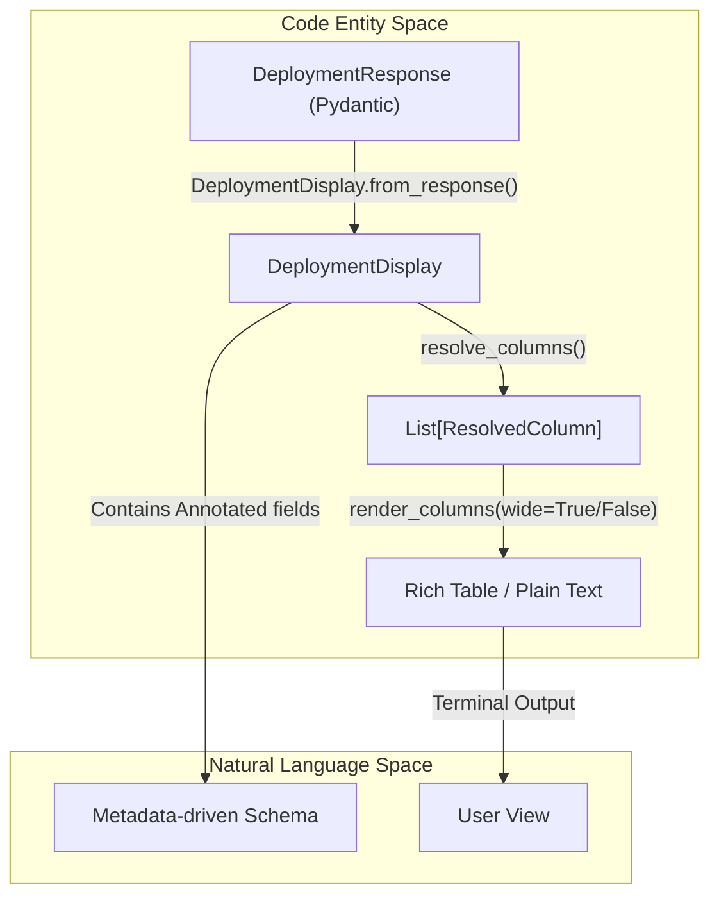
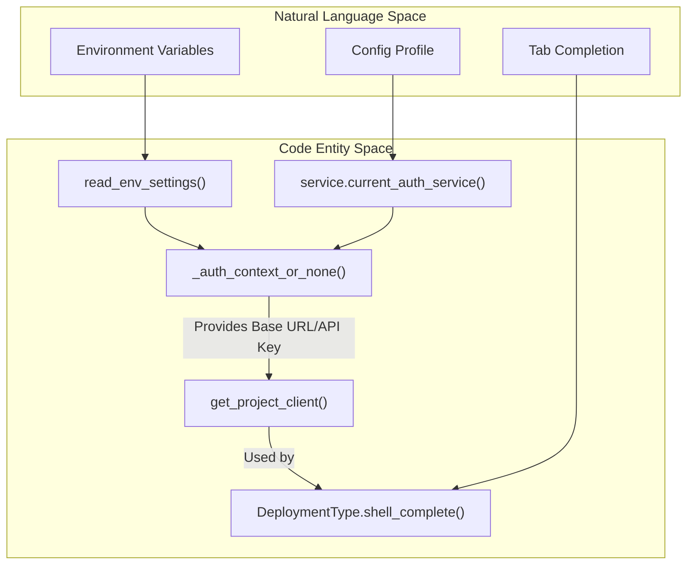

<!-- source: DeepWiki mcp.deepwiki.com · repo run-llama/llama-agents · page 7.3 CLI Internals: Display, Output, and Configuration · fetched 2026-10-26 -->

# CLI Internals: Display, Output, and Configuration

Relevant source files

The following files were used as context for generating this wiki page:

- [AGENTS.md](AGENTS.md)
- [packages/llamactl/src/llama_agents/cli/__init__.py](packages/llamactl/src/llama_agents/cli/__init__.py)
- [packages/llamactl/src/llama_agents/cli/client.py](packages/llamactl/src/llama_agents/cli/client.py)
- [packages/llamactl/src/llama_agents/cli/commands/completion.py](packages/llamactl/src/llama_agents/cli/commands/completion.py)
- [packages/llamactl/src/llama_agents/cli/commands/deployment.py](packages/llamactl/src/llama_agents/cli/commands/deployment.py)
- [packages/llamactl/src/llama_agents/cli/config/_config.py](packages/llamactl/src/llama_agents/cli/config/_config.py)
- [packages/llamactl/src/llama_agents/cli/display.py](packages/llamactl/src/llama_agents/cli/display.py)
- [packages/llamactl/src/llama_agents/cli/log_format.py](packages/llamactl/src/llama_agents/cli/log_format.py)
- [packages/llamactl/src/llama_agents/cli/options.py](packages/llamactl/src/llama_agents/cli/options.py)
- [packages/llamactl/src/llama_agents/cli/param_types.py](packages/llamactl/src/llama_agents/cli/param_types.py)
- [packages/llamactl/src/llama_agents/cli/paths.py](packages/llamactl/src/llama_agents/cli/paths.py)
- [packages/llamactl/src/llama_agents/cli/render.py](packages/llamactl/src/llama_agents/cli/render.py)
- [packages/llamactl/src/llama_agents/cli/yaml_template.py](packages/llamactl/src/llama_agents/cli/yaml_template.py)
- [packages/llamactl/tests/test_commands_core.py](packages/llamactl/tests/test_commands_core.py)
- [packages/llamactl/tests/test_completion_commands.py](packages/llamactl/tests/test_completion_commands.py)
- [packages/llamactl/tests/test_deployments_get_output.py](packages/llamactl/tests/test_deployments_get_output.py)
- [packages/llamactl/tests/test_deployments_template_cmd.py](packages/llamactl/tests/test_deployments_template_cmd.py)
- [packages/llamactl/tests/test_display.py](packages/llamactl/tests/test_display.py)
- [packages/llamactl/tests/test_local_context.py](packages/llamactl/tests/test_local_context.py)
- [packages/llamactl/tests/test_log_format.py](packages/llamactl/tests/test_log_format.py)
- [packages/llamactl/tests/test_param_types.py](packages/llamactl/tests/test_param_types.py)
- [packages/llamactl/tests/test_render.py](packages/llamactl/tests/test_render.py)
- [packages/llamactl/tests/test_yaml_template.py](packages/llamactl/tests/test_yaml_template.py)

This page details the internal architecture of `llamactl`, focusing on how data is transformed from API responses into user-facing displays, the declarative framework for tabular and YAML output, and the management of CLI configurations and shell completions.

## Declarative Column Framework

`llamactl` uses a declarative system to define how Pydantic models are rendered in the terminal. Instead of manual string formatting in every command, models use `Annotated` metadata to define their tabular representation.

### Key Annotations

- **`Column`**: Marks a field to be included in tabular output. It specifies the header name, an optional formatter function, a default value for nulls, and whether the column is "wide-only" [packages/llamactl/src/llama_agents/cli/display.py:99-118]().
- **`Doc`**: Attaches documentation comments to fields, primarily used by the YAML template generator to provide guidance in scaffolded files [packages/llamactl/src/llama_agents/cli/display.py:73-88]().
- **`TrailingDoc`**: Adds a short note rendered after a scalar value in YAML [packages/llamactl/src/llama_agents/cli/display.py:92-95]().

### Column Resolution and Rendering

The `resolve_columns` function performs a recursive walk of a `BaseModel`, discovering all fields marked with `Column` [packages/llamactl/src/llama_agents/cli/display.py:148-180](). This metadata is then consumed by `render_columns`, which uses the `rich` library or plain text to output a formatted table [packages/llamactl/src/llama_agents/cli/display.py:196-224]().

### Data Flow: API to Table
The following diagram illustrates how a `DeploymentResponse` from the Control Plane is projected into a `DeploymentDisplay` and finally rendered.

**Tabular Rendering Pipeline**

Sources: [packages/llamactl/src/llama_agents/cli/display.py:3-19](), [packages/llamactl/src/llama_agents/cli/display.py:148-180](), [packages/llamactl/src/llama_agents/cli/options.py:129-150]().

---

## Output Dispatching (`render_output`)

The `render_output()` function serves as the central dispatcher for all CLI read commands. It supports four primary modes via the `-o` (or `--output`) flag [packages/llamactl/src/llama_agents/cli/options.py:107-125]().

| Mode | Implementation | Behavior |
| :--- | :--- | :--- |
| `text` | `render_columns(wide=False)` | Standard tabular view with essential columns. |
| `wide` | `render_columns(wide=True)` | Extended tabular view (similar to `kubectl -o wide`). |
| `json` | `json.dumps()` | Canonical JSON output for machine parsing. |
| `yaml` | `yaml.safe_dump()` | Standard YAML representation of the Pydantic model. |
| `template`| `yaml_template.render()` | Specialized annotated YAML for `deployments apply`. |

The dispatcher automatically detects if the payload model supports the `Column` framework. If it does not, it falls back to a provided `text_renderer` callback [packages/llamactl/src/llama_agents/cli/options.py:140-159]().

Sources: [packages/llamactl/src/llama_agents/cli/options.py:107-184](), [packages/llamactl/src/llama_agents/cli/display.py:99-118]().

---

## YAML Template Generation

The `template` output mode (and the `deployments template` command) uses a specialized renderer to create "apply-shaped" YAML. Unlike standard YAML dumping, this process:
1. **Preserves Declaration Order**: Fields appear in the order defined in the Python class [packages/llamactl/src/llama_agents/cli/yaml_template.py:149-155]().
2. **Injects Documentation**: `Doc` annotations are converted into `##` comments above fields [packages/llamactl/src/llama_agents/cli/yaml_template.py:160-170]().
3. **Handles Unset Fields**: Optional fields that are not set are rendered as commented-out examples (e.g., `# git_ref: main`) using a predefined `_EXAMPLES` map [packages/llamactl/src/llama_agents/cli/yaml_template.py:63-74]().
4. **Masks Secrets**: Preserves `SECRET_MASK` (`********`) placeholders so users can see which keys exist without leaking values [packages/llamactl/src/llama_agents/cli/yaml_template.py:31-36]().

Sources: [packages/llamactl/src/llama_agents/cli/yaml_template.py:3-37](), [packages/llamactl/src/llama_agents/cli/yaml_template.py:77-121]().

---

## Configuration and Parameter Types

### Project and Environment Resolution
`llamactl` determines the target project and API endpoint through a hierarchy of configuration:
1. **Command Line Overrides**: The `--project` flag [packages/llamactl/src/llama_agents/cli/options.py:90-104]().
2. **Environment Variables**: `LLAMA_CLOUD_API_KEY` and `LLAMA_AGENTS_PROJECT_ID` [packages/llamactl/src/llama_agents/cli/client.py:28-48]().
3. **Active Profile**: The profile selected via `llamactl auth login` or `llamactl auth profile` [packages/llamactl/src/llama_agents/cli/client.py:51-66]().

### Shell Completion
Custom `click.ParamType` classes provide dynamic shell completion by fetching data from the Control Plane API:
- **`DeploymentType`**: Completes deployment IDs for the current project [packages/llamactl/src/llama_agents/cli/param_types.py:86-96]().
- **`GitShaType`**: Completes Git SHAs from a deployment's history [packages/llamactl/src/llama_agents/cli/param_types.py:167-182]().
- **`ProjectType`**: Completes project IDs accessible to the user [packages/llamactl/src/llama_agents/cli/param_types.py:115-121]().

**Configuration and Client Resolution**

Sources: [packages/llamactl/src/llama_agents/cli/client.py:69-79](), [packages/llamactl/src/llama_agents/cli/client.py:144-159](), [packages/llamactl/src/llama_agents/cli/param_types.py:26-33]().

---

## Implementation Details

### Secret Masking
To prevent sensitive data from round-tripping through the CLI, `strip_masks()` is used to remove `SECRET_MASK` sentinels before the data is parsed for an `apply` operation [packages/llamactl/src/llama_agents/cli/display.py:49-69](). Conversely, the `DeploymentDisplay.from_response()` method injects these masks when receiving data from the API [packages/llamactl/tests/test_display.py:96-105]().

### Interactive vs. Non-Interactive Auth
The `get_project_client()` function checks `is_interactive_session()`. In an interactive terminal, it will trigger `validate_authenticated_profile()`, which may prompt the user to login if no credentials exist. In scripts or CI/CD, it raises a `ClickException` immediately [packages/llamactl/src/llama_agents/cli/client.py:161-182]().

Sources: [packages/llamactl/src/llama_agents/cli/display.py:49-69](), [packages/llamactl/src/llama_agents/cli/client.py:161-182](), [packages/llamactl/src/llama_agents/cli/interactive.py:18-22]().

---

