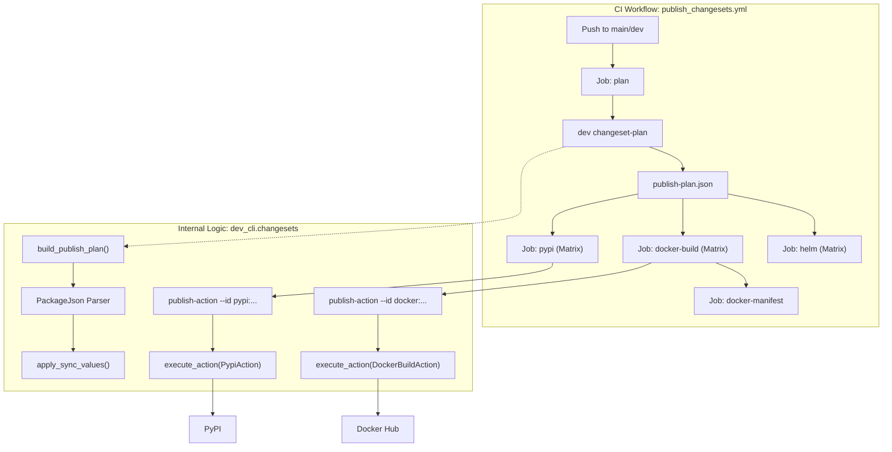
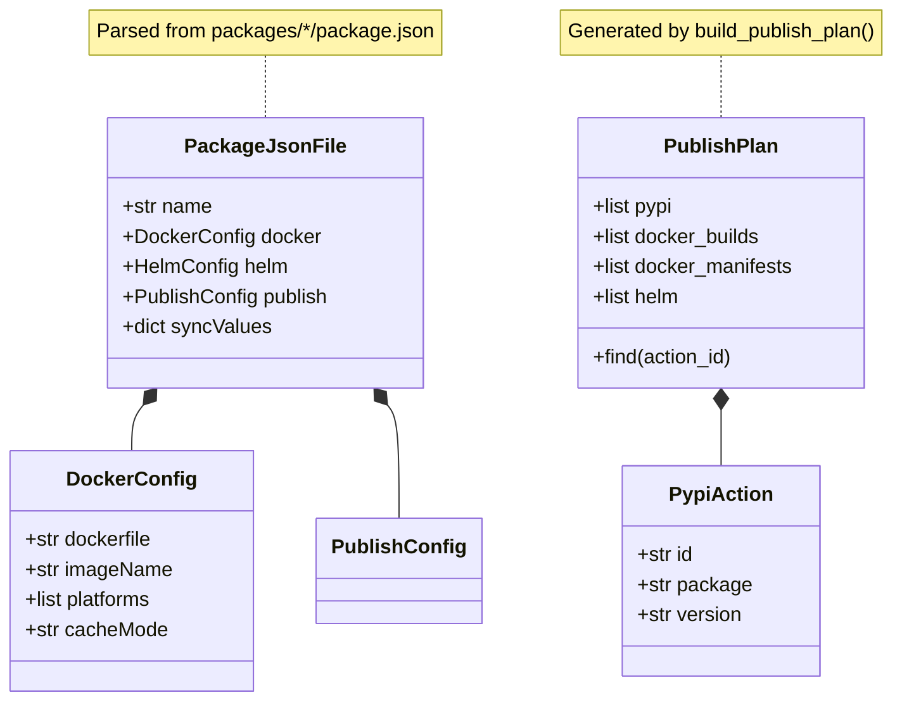

<!-- source: DeepWiki mcp.deepwiki.com · repo run-llama/llama-agents · page 8.1 Release Pipeline and Changeset Publishing · fetched 2026-10-26 -->

# Release Pipeline and Changeset Publishing

<details>
<summary>Relevant source files</summary>

The following files were used as context for generating this wiki page:

- [.changeset/config.json](.changeset/config.json)
- [.github/actions/setup-publish/action.yml](.github/actions/setup-publish/action.yml)
- [.github/workflows/lockfile.yml](.github/workflows/lockfile.yml)
- [.github/workflows/publish_changesets.yml](.github/workflows/publish_changesets.yml)
- [operator/CHANGELOG.md](operator/CHANGELOG.md)
- [operator/package.json](operator/package.json)
- [package.json](package.json)
- [packages/llama-agents-server/tests/server/test_sse_heartbeat.py](packages/llama-agents-server/tests/server/test_sse_heartbeat.py)
- [pnpm-lock.yaml](pnpm-lock.yaml)
- [src/dev_cli/changesets.py](src/dev_cli/changesets.py)
- [src/dev_cli/commands/changesets_cmd.py](src/dev_cli/commands/changesets_cmd.py)
- [src/dev_cli/commands/publish_cmd.py](src/dev_cli/commands/publish_cmd.py)
- [src/dev_cli/gha.py](src/dev_cli/gha.py)
- [tests/dev_cli/test_changesets.py](tests/dev_cli/test_changesets.py)

</details>


The llama-agents repository utilizes an automated release pipeline to manage its mixed TypeScript/Python monorepo structure. The pipeline is designed to synchronize versions across different package managers, generate multi-architecture Docker images, and publish artifacts to PyPI, Docker Hub, and Helm registries.

## Overview

The release process is governed by the `.github/workflows/publish_changesets.yml` workflow and the internal `dev` CLI tool. It follows a reconcile-loop pattern where the system compares the current state of the workspace against remote registries to determine what needs to be published.

### Key Components
- **Changesets**: Manages the versioning and changelog generation for the monorepo [package.json:12]().
- **Publish Plan**: A JSON manifest generated by `dev changeset-plan` that identifies missing versions in remote registries [.github/workflows/publish_changesets.yml:103-105]().
- **SyncValues Engine**: A templating system that propagates versions and metadata across different file types (e.g., from `package.json` to `pyproject.toml` or Helm `values.yaml`) [src/dev_cli/changesets.py:169-172]().
- **Multi-Arch Build System**: Parallelized GitHub Actions jobs that build Docker images on native `amd64` and `arm64` runners without QEMU emulation [.github/workflows/publish_changesets.yml:137-146]().

---

## Release Pipeline Architecture

The pipeline consists of a planning phase followed by a parallelized execution phase (fan-out).

### 1. Planning Phase
The `plan` job identifies pending changesets and builds the `publish-plan.json`.

- **Changeset Action**: If changesets exist, it creates or updates a "version packages" Pull Request [.github/workflows/publish_changesets.yml:75-84]().
- **Plan Generation**: The `dev changeset-plan` command scans all packages in the `pnpm` workspace [src/dev_cli/commands/publish_cmd.py:45-46](). It checks:
    - **PyPI**: If the package has a `pyproject.toml` and the version is not on PyPI [src/dev_cli/changesets.py:300-305]().
    - **Docker**: If `package.json` contains a `docker` key and the tag is missing from Docker Hub [src/dev_cli/changesets.py:105-115]().
    - **Helm**: If `package.json` contains a `helm` key and the version is missing from the registry [src/dev_cli/changesets.py:118-120]().

### 2. Execution Phase (Fan-out)
The plan is exported as GitHub Action outputs, which are used to drive matrix strategies for parallel execution [.github/workflows/publish_changesets.yml:34-39]().

#### Pipeline Flow Diagram
The following diagram illustrates the flow from code change to published artifact, highlighting the internal `dev_cli` entities.


**Sources:** [.github/workflows/publish_changesets.yml:29-170](), [src/dev_cli/changesets.py:461-480](), [src/dev_cli/commands/publish_cmd.py:29-48]().

---

## Version Synchronization (SyncValues)

Because the repository is a hybrid of TypeScript (via `pnpm`) and Python (via `uv`), the `package.json` file serves as the "source of truth" for versioning. The `SyncValues` engine propagates these versions to other files.

### Template Resolution
Templates use the syntax `{package-name:property}` or `{self:property}` [src/dev_cli/changesets.py:172]().
Supported properties include:
- `version`: The raw SemVer string.
- `pep440Version`: The version converted for Python compatibility.
- `dockerTag`: The version string used for container images.

### Implementation Detail: `apply_sync_values`
The function `apply_sync_values` performs the following steps:
1. Iterates through the `syncValues` configuration in a package's `package.json` [src/dev_cli/changesets.py:234-235]().
2. Resolves templates using the `_resolve_template` function [src/dev_cli/changesets.py:175-180]().
3. Updates target files (YAML, TOML, or JSON) using dot-path notation (e.g., `project.version`) [src/dev_cli/changesets.py:212-220]().

### SemVer to PEP 440 Conversion
Python packages require PEP 440 compliant versions. The `semver_to_pep440` function handles this mapping:
- `1.2.3-a.4` $\rightarrow$ `1.2.3a4`
- `1.2.3-rc.2` $\rightarrow$ `1.2.3rc2`

**Sources:** [src/dev_cli/changesets.py:63-84](), [src/dev_cli/changesets.py:175-210](), [src/dev_cli/changesets.py:234-260]().

---

## Docker and Helm Publishing

### Multi-Architecture Docker Builds
To avoid slow QEMU emulation, the pipeline splits Docker builds into two stages:
1. **`docker-build`**: Runs in parallel on `ubuntu-latest` (amd64) and `ubuntu-24.04-arm` (arm64) runners [.github/workflows/publish_changesets.yml:137-141](). Each build pushes a platform-specific tag (e.g., `image:version-amd64`).
2. **`docker-manifest`**: Uses `docker buildx imagetools create` to stitch the platform-specific tags into a single multi-arch manifest [.github/workflows/publish_changesets.yml:160-175]().

### Helm Chart Processing
Helm charts are published using the `HelmAction`. The process includes:
- Updating `Chart.yaml` version and `appVersion` via `syncValues`.
- Running `helm-docs` to regenerate documentation [.github/workflows/publish_changesets.yml:70-74]().
- Packaging and pushing to the OCI registry defined in the package's `HelmConfig` [src/dev_cli/changesets.py:118-120]().

### Configuration Example: `operator/package.json`
The operator package demonstrates how Docker and Helm publishing are configured in the monorepo.

```json
{
  "name": "llama-agents-operator",
  "version": "0.11.1",
  "docker": {
    "dockerfile": "docker/operator.Dockerfile",
    "imageName": "llamaindex/llama-agents-operator",
    "platforms": ["linux/amd64", "linux/arm64"],
    "cacheMode": "min"
  }
}
```
**Sources:** [operator/package.json:1-14](), [.github/workflows/publish_changesets.yml:137-175](), [src/dev_cli/changesets.py:105-115]().

---

## Data Structures and Flow

The following diagram maps the configuration keys in `package.json` to the internal Python classes that process them.


**Sources:** [src/dev_cli/changesets.py:105-158](), [src/dev_cli/changesets.py:461-480]().

### Publish Action Dispatch
The `publish-action` command is the entry point for each CI matrix shard. It validates the plan and executes the specific action identified by the `--id` flag [src/dev_cli/commands/publish_cmd.py:83-92]().

| Action Type | Implementation Function | Side Effect |
| :--- | :--- | :--- |
| `PypiAction` | `execute_action` | `uv build` & `uv publish` |
| `DockerBuildAction` | `execute_action` | `docker buildx build --push` |
| `DockerManifestAction` | `execute_action` | `docker buildx imagetools create` |
| `HelmAction` | `execute_action` | `helm package` & `helm push` |

**Sources:** [src/dev_cli/changesets.py:590-650](), [src/dev_cli/commands/publish_cmd.py:68-92]().

---

