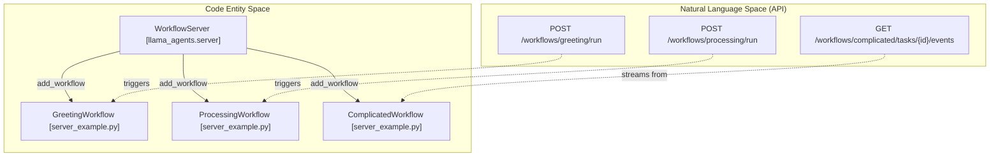
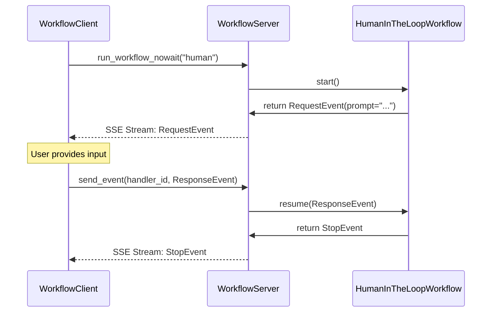

<!-- source: DeepWiki mcp.deepwiki.com · repo run-llama/llama-agents · page 9.1 Workflow Examples · fetched 2026-10-26 -->

# Workflow Examples

<details>
<summary>Relevant source files</summary>

The following files were used as context for generating this wiki page:

- [.pre-commit-config.yaml](.pre-commit-config.yaml)
- [examples/agent.ipynb](examples/agent.ipynb)
- [examples/client/base/workflow_client.py](examples/client/base/workflow_client.py)
- [examples/client/base/workflow_server.py](examples/client/base/workflow_server.py)
- [examples/client/human_in_the_loop/workflow_client_hitl.py](examples/client/human_in_the_loop/workflow_client_hitl.py)
- [examples/client/human_in_the_loop/workflow_server_hitl.py](examples/client/human_in_the_loop/workflow_server_hitl.py)
- [examples/dbos/_replica.py](examples/dbos/_replica.py)
- [examples/dbos/durable_workflow.py](examples/dbos/durable_workflow.py)
- [examples/dbos/idle_release_demo.py](examples/dbos/idle_release_demo.py)
- [examples/dbos/server_quickstart.py](examples/dbos/server_quickstart.py)
- [examples/dbos/server_replicas.py](examples/dbos/server_replicas.py)
- [examples/document_processing.ipynb](examples/document_processing.ipynb)
- [examples/feature_walkthrough.ipynb](examples/feature_walkthrough.ipynb)
- [examples/server/fastapi_server_example.ipynb](examples/server/fastapi_server_example.ipynb)
- [examples/server/server_example.ipynb](examples/server/server_example.ipynb)
- [examples/server/server_example.py](examples/server/server_example.py)

</details>


This section provides a technical deep dive into the practical implementations and usage patterns of the `llama-agents` ecosystem. The examples demonstrate how to bridge the gap between local workflow execution and distributed, durable service architectures using the server, client, and DBOS integration layers.

## Server-Side Workflow Deployment

The `WorkflowServer` is the primary entry point for exposing `llama-index-workflows` as HTTP services. It wraps workflows in a service layer that handles request routing, event streaming, and state persistence.

### Basic Server Implementation
In a typical server setup, multiple `Workflow` classes are registered to a single `WorkflowServer` instance. Each workflow can define custom `StartEvent` and `StopEvent` subclasses to enforce strict input/output schemas.



Key implementation details from `examples/server/server_example.py`:
- **Streaming Events**: Steps use `ctx.write_event_to_stream()` to emit intermediate progress without terminating the workflow [examples/server/server_example.py:37, 90]().
- **Complex Branching**: The `ComplicatedWorkflow` demonstrates returning union types (e.g., `ChildTerrestrialEvent | AdultTerrestrialEvent`) to route execution dynamically based on logic in `first_step` [examples/server/server_example.py:152-197]().
- **Async Execution**: Steps are defined as `async def` and can include `await asyncio.sleep()` to simulate long-running tasks or I/O [examples/server/server_example.py:38, 101]().

**Sources:** [examples/server/server_example.py:3-219](), [llama_agents/server/__init__.py]()

---

## Client Interaction Patterns

The `WorkflowClient` provides a high-level async interface to interact with a remote `WorkflowServer`. It abstracts the underlying HTTP and SSE (Server-Sent Events) communication.

### Execution and Event Streaming
The client supports both blocking runs and "fire-and-forget" patterns via `run_workflow_nowait`. The latter returns a `handler_id` used to poll results or stream events.

```python
# From examples/client/base/workflow_client.py
client = WorkflowClient(base_url="http://localhost:8000")
handler = await client.run_workflow_nowait(
    "add_or_subtract",
    start_event=InputNumbers(a=1, b=3, operation="addition")
)

async for event in client.get_workflow_events(handler_id=handler.handler_id):
    print(f"Received {event.type}: {event.value}")
```

**Sources:** [examples/client/base/workflow_client.py:16-35](), [llama_agents/client/__init__.py]()

---

## Human-in-the-Loop (HITL)

HITL patterns are implemented using `InputRequiredEvent` and `HumanResponseEvent`. These special events signal the server to pause execution and wait for external input.

### HITL Data Flow
1. **Workflow Side**: A step returns an `InputRequiredEvent` (or subclass). The workflow engine pauses execution for that specific `run_id`.
2. **Client Side**: The client listens to the event stream. Upon detecting an event of type `RequestEvent`, it prompts the user.
3. **Resumption**: The client calls `client.send_event()`, passing a `HumanResponseEvent`. This triggers the workflow to resume from the next step configured to handle that event type.



**Sources:** [examples/client/human_in_the_loop/workflow_server_hitl.py:12-32](), [examples/client/human_in_the_loop/workflow_client_hitl.py:20-39]()

---

## Durable Workflows with DBOS

Durable execution ensures that workflows can survive process crashes and resume exactly where they left off. This is achieved using the `DBOSRuntime`.

### Multi-Replica Durability
In a distributed environment, multiple server replicas can share a single Postgres database. If Replica A crashes while executing a workflow, Replica B can pick up the task using the shared state and the DBOS `TaskJournal`.

| Component | Role | File Reference |
| :--- | :--- | :--- |
| `DBOSRuntime` | Orchestrates the durable runtime and state reconstruction. | [llama_agents/dbos/__init__.py]() |
| `PostgresWorkflowStore` | Persists workflow ticks and events using LISTEN/NOTIFY. | [llama_agents/server/stores/postgres.py]() |
| `_replica.py` | A standalone server instance configured with a shared `POSTGRES_DSN`. | [examples/dbos/_replica.py:23, 84-88]() |
| `server_replicas.py` | Demo script that launches two replicas and tests failover. | [examples/dbos/server_replicas.py:178-218]() |

### Implementation Example: Durable Counter
The `CounterWorkflow` in `examples/dbos/durable_workflow.py` demonstrates a loop that increments a counter. By using `DBOSRuntime`, the `run_id` is persisted. If the script is interrupted (Ctrl+C), running it again with the `--resume` flag allows the `DBOSRuntime` to recover the `WorkflowHandler` and continue from the last successful tick [examples/dbos/durable_workflow.py:79-84]().

**Sources:** [examples/dbos/durable_workflow.py:42-92](), [examples/dbos/_replica.py:38-96](), [examples/dbos/server_replicas.py:9-18]()

---

## Specialized Agentic Workflows

Beyond simple logic, the examples include advanced notebooks for agentic behavior and document processing.

### Function Calling Agent
The `examples/agent.ipynb` notebook implements a full agentic loop:
1. **State Management**: Uses `ctx.store` to persist `ChatMemoryBuffer` and `sources` across steps [examples/agent.ipynb:135-151]().
2. **Tool Execution Loop**: The `handle_llm_input` step determines if tool calls are needed. If so, it emits a `ToolCallEvent` which routes to `handle_tool_calls`, eventually looping back to the LLM with the results [examples/agent.ipynb:158-185]().

### Iterative Document Extraction
The `examples/document_processing.ipynb` notebook demonstrates a multi-service workflow:
- **LlamaParse**: Converts raw documents to markdown [examples/document_processing.ipynb:61]().
- **Schema Generation**: Uses OpenAI to propose a JSON schema based on user prompts [examples/document_processing.ipynb:119-134]().
- **Validation**: Uses `jsonschema` to validate LLM output before passing it to `LlamaExtract` [examples/document_processing.ipynb:158]().

**Sources:** [examples/agent.ipynb:119-200](), [examples/document_processing.ipynb:50-160]()

---

