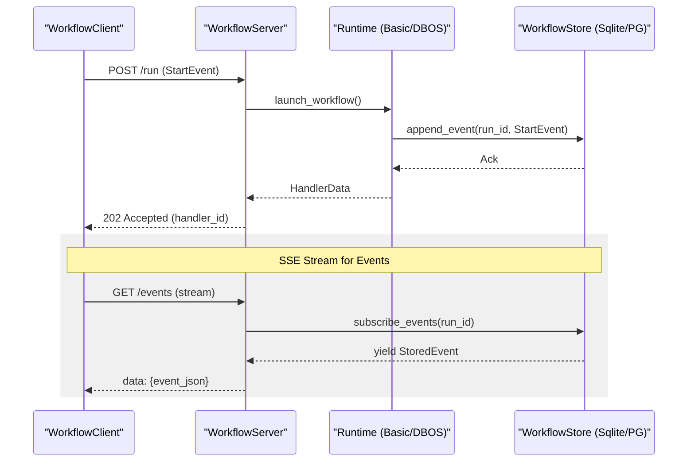
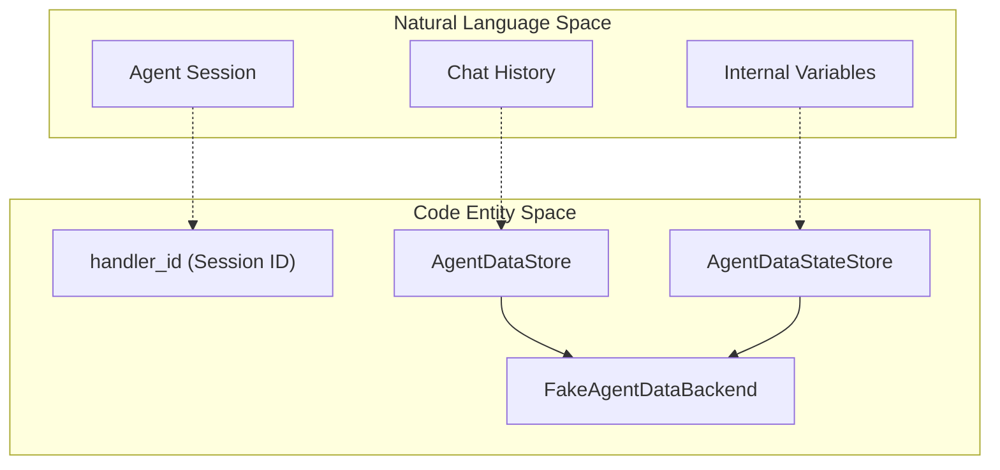

<!-- source: DeepWiki mcp.deepwiki.com · repo run-llama/llama-agents · page 9.3 Integration Test Matrix · fetched 2026-10-26 -->

# Integration Test Matrix

Relevant source files

The following files were used as context for generating this wiki page:

- [packages/llama-agents-agentcore/src/llama_agents/agentcore/entrypoint.py](packages/llama-agents-agentcore/src/llama_agents/agentcore/entrypoint.py)
- [packages/llama-agents-integration-tests/pyproject.toml](packages/llama-agents-integration-tests/pyproject.toml)
- [packages/llama-agents-integration-tests/src/llama_agents_integration_tests/server_test_utils.py](packages/llama-agents-integration-tests/src/llama_agents_integration_tests/server_test_utils.py)
- [packages/llama-agents-integration-tests/tests/test_runtime_matrix.py](packages/llama-agents-integration-tests/tests/test_runtime_matrix.py)
- [packages/llama-agents-integration-tests/tests/test_server_http_matrix.py](packages/llama-agents-integration-tests/tests/test_server_http_matrix.py)
- [packages/llama-agents-integration-tests/tests/test_server_store_matrix.py](packages/llama-agents-integration-tests/tests/test_server_store_matrix.py)
- [packages/llama-agents-server/src/llama_agents/server/_store/agent_data_state_store.py](packages/llama-agents-server/src/llama_agents/server/_store/agent_data_state_store.py)
- [packages/llama-agents-server/src/llama_agents/server/_store/postgres_state_store.py](packages/llama-agents-server/src/llama_agents/server/_store/postgres_state_store.py)
- [packages/llama-agents-server/src/llama_agents/server/_store/sqlite/sqlite_state_store.py](packages/llama-agents-server/src/llama_agents/server/_store/sqlite/sqlite_state_store.py)
- [packages/llama-agents-server/src/llama_agents/server/_store/sqlite/sqlite_workflow_store.py](packages/llama-agents-server/src/llama_agents/server/_store/sqlite/sqlite_workflow_store.py)
- [packages/llama-agents-server/tests/server/test_agent_data_store.py](packages/llama-agents-server/tests/server/test_agent_data_store.py)
- [packages/llama-agents-server/tests/server/test_durable_runtime.py](packages/llama-agents-server/tests/server/test_durable_runtime.py)
- [packages/llama-agents-server/tests/server/test_workflow_store_events.py](packages/llama-agents-server/tests/server/test_workflow_store_events.py)
- [packages/llama-index-workflows/tests/test_workflow_internal_events.py](packages/llama-index-workflows/tests/test_workflow_internal_events.py)
- [src/dev_cli/cli.py](src/dev_cli/cli.py)
- [src/dev_cli/commands/__init__.py](src/dev_cli/commands/__init__.py)
- [src/dev_cli/commands/pytest_cmd.py](src/dev_cli/commands/pytest_cmd.py)
- [src/dev_cli/commands/skills_cmd.py](src/dev_cli/commands/skills_cmd.py)
- [tests/dev_cli/test_pytest_cmd.py](tests/dev_cli/test_pytest_cmd.py)

The `llama-agents-integration-tests` package provides a comprehensive testing suite designed to validate the interoperability of different storage backends, runtimes, and HTTP server configurations. It ensures that core workflow logic remains consistent whether running in-memory, via SQLite, or within a durable PostgreSQL/DBOS environment.

## Overview and Purpose

The integration test matrix is structured to verify three primary dimensions of the system:
1.  **Storage Backends**: Consistency across `MemoryWorkflowStore`, `SqliteWorkflowStore`, and `PostgresWorkflowStore`.
2.  **Runtimes**: Behavioral parity between the synchronous `BasicRuntime` and the durable, distributed `DBOSRuntime`.
3.  **Communication**: End-to-end validation of the `WorkflowServer` (HTTP/SSE) and `WorkflowClient` interaction.

Sources: [packages/llama-agents-integration-tests/tests/test_server_http_matrix.py:4-35](), [packages/llama-agents-integration-tests/tests/test_runtime_matrix.py:4-11]()

## Server HTTP Matrix Tests

The HTTP matrix tests validate the `WorkflowServer` by running a live Uvicorn instance for every supported backend. These tests use `WorkflowClient` to perform operations, ensuring the network layer and serialization logic are functional.

### Test Architecture

The `live_server` utility is used to spin up ephemeral server instances. For PostgreSQL tests, a `PostgresContainer` is managed via `testcontainers` to provide a real database environment.

| Component | Code Entity | Role |
| :--- | :--- | :--- |
| **Server** | `WorkflowServer` | Exposes the Workflow API over HTTP. |
| **Client** | `WorkflowClient` | Communicates with the server using the protocol. |
| **Runner** | `uvicorn.Server` | Hosts the Starlette app in a background task. |
| **Backend** | `AbstractWorkflowStore` | Persists handler states and events. |

### Data Flow: HTTP Integration

Sources: [packages/llama-agents-integration-tests/tests/test_server_http_matrix.py:96-150](), [packages/llama-agents-integration-tests/tests/test_server_http_matrix.py:178-212]()

## Runtime Matrix Tests

The runtime matrix ensures that workflows behave identically across different execution engines. It specifically tests `BasicRuntime` against `DBOSRuntime` (both SQLite and PostgreSQL flavors).

### Key Test Workflows
*   **SimpleWorkflow**: Validates basic step transitions and `StopEvent` results.
*   **SlowWorkflow**: Tests timeouts and asynchronous execution using `asyncio.sleep`.
*   **EventTrackingWorkflow**: Verifies that state changes and side effects are correctly recorded during execution.
*   **SyncAsyncWorkflow**: Ensures parity when mixing synchronous and asynchronous step definitions.

### DBOS Lifecycle Management
Because `DBOS` is a singleton, the test suite uses fixtures to carefully initialize and destroy the `DBOS` instance between tests to avoid state leakage, particularly regarding the global `ThreadPoolExecutor`.

Sources: [packages/llama-agents-integration-tests/tests/test_runtime_matrix.py:43-59](), [packages/llama-agents-integration-tests/tests/test_runtime_matrix.py:73-106](), [packages/llama-agents-integration-tests/tests/test_runtime_matrix.py:180-215]()

## Store Matrix Tests

The store matrix validates the implementation of `AbstractWorkflowStore` across different persistence layers. It focuses on the durability of events and the accuracy of the `HandlerQuery` filtering logic.

### Handler CRUD and Querying
Tests verify that `update()` correctly handles `ON CONFLICT` scenarios (upserts) and that `query()` respects filters for `status`, `workflow_name`, and `run_id`.

### Event Persistence
The `append_event` and `query_events` methods are tested for:
*   **Sequence Integrity**: Ensuring events are assigned monotonically increasing sequence numbers.
*   **Isolation**: Verifying that events from `run-a` do not appear in queries for `run-b`.
*   **Subscription**: Testing that `subscribe_events` correctly wakes up and yields new events as they are appended to the store.

Sources: [packages/llama-agents-server/src/llama_agents/server/_store/sqlite/sqlite_workflow_store.py:118-168](), [packages/llama-agents-server/tests/server/test_workflow_store_events.py:107-130](), [packages/llama-agents-server/tests/server/test_workflow_store_events.py:185-200]()

## Agent Data Store Integration

The `AgentDataStore` is a specialized implementation used in environments like AWS Bedrock AgentCore. It integrates a custom backend (e.g., `FakeAgentDataBackend` in tests) with the standard workflow persistence requirements.

### Implementation Details
*   **State Management**: Uses `AgentDataStateStore` to map workflow context state to the underlying agent data backend.
*   **Event Handling**: Implements an in-memory subscription queue (`_subscriber_queues`) to support real-time event streaming even when the primary backend is a simple key-value or document store.

### Entity Mapping: AgentCore to Code

Sources: [packages/llama-agents-server/tests/server/test_agent_data_store.py:17-22](), [packages/llama-agents-agentcore/src/llama_agents/agentcore/entrypoint.py:7-26](), [packages/llama-agents-server/tests/server/test_agent_data_store.py:70-90]()

## Test Utilities and Dev CLI

The repository includes developer tooling to run these complex matrices efficiently.

### `dev pytest` Command
The `dev_cli` provides a `pytest` wrapper that discovers all packages containing a `tests/` directory and runs them in parallel or sequence.

*   **Discovery**: `discover_test_packages()` searches the `packages/` directory for `pyproject.toml` and `tests/` folders.
*   **Output Parsing**: `extract_test_counts()` and `extract_failures_section()` parse raw pytest output to provide a clean summary in the terminal using the `rich` library.

### Common Test Fixtures
The `server_test_utils` and `server_test_fixtures` provide:
*   `wait_for_passing`: A polling utility for assertions that may take time (e.g., waiting for a handler to reach `completed` status).
*   `InteractiveWorkflow`: A workflow designed to test `ctx.wait_for_event()` and human-in-the-loop patterns.

Sources: [src/dev_cli/commands/pytest_cmd.py:58-84](), [src/dev_cli/commands/pytest_cmd.py:180-200](), [packages/llama-agents-server/tests/server/test_durable_runtime.py:66-81](), [packages/llama-agents-integration-tests/src/llama_agents_integration_tests/server_test_utils.py:20-28]()

---

