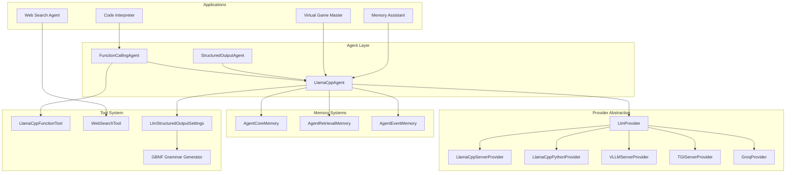
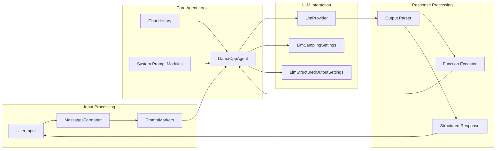

<!-- source: DeepWiki mcp.deepwiki.com · repo Maximilian-Winter/llama-cpp-agent · page 1 Overview · fetched 2026-10-26 -->

# Overview

Relevant source files

The following files were used as context for generating this wiki page:

- [ReadMe.md](ReadMe.md)
- [pyproject.toml](pyproject.toml)

This document provides a comprehensive overview of the llama-cpp-agent framework, its architecture, core components, and capabilities. The framework is designed to simplify interactions with Large Language Models (LLMs) through a unified interface that supports chat, function calling, structured output generation, and retrieval-augmented generation.

For detailed implementation guides of specific components, see [Core Framework](#3), [Provider System](#4), [Memory System](#5), and [Tools and Function Calling](#6). For practical usage examples, see [Examples and Applications](#7).

## Framework Purpose and Scope

The llama-cpp-agent framework serves as a comprehensive abstraction layer for building LLM-based AI agents. It provides guided sampling capabilities that enable models not specifically fine-tuned for function calling or JSON output to perform these tasks reliably through grammar constraints and structured output generation.

The framework supports multiple LLM backends including llama.cpp server, llama-cpp-python, TGI (Text Generation Inference), vLLM, and commercial APIs like Groq. It implements a modular architecture where agents, providers, memory systems, and tools can be combined to create sophisticated AI applications.

**Sources:** [pyproject.toml:5-8](), [ReadMe.md:12-18]()

## High-Level System Architecture

The framework follows a layered architecture with clear separation between the agent layer, provider abstraction, memory systems, and application examples.

### Core System Architecture

**Sources:** [ReadMe.md:19-28](), [pyproject.toml:26-32]()

## Core Framework Flow

The framework processes user interactions through a structured pipeline that handles message formatting, prompt generation, LLM interaction, and response processing.

### Agent Processing Pipeline

**Sources:** [ReadMe.md:116-155](), [ReadMe.md:20-22]()

## Key Components

### Agent Classes

The framework provides three primary agent classes, each specialized for different use cases:

| Agent Class | Purpose | Key Features |
|-------------|---------|--------------|
| `LlamaCppAgent` | Basic chat and conversation | Message formatting, chat history, system prompts |
| `FunctionCallingAgent` | Tool integration and function execution | Parallel function calling, tool management |
| `StructuredOutputAgent` | Structured data generation | Pydantic model output, JSON schema validation |

### Provider System

The `LlmProvider` abstract interface enables seamless switching between different LLM backends:

- **Local Providers**: `LlamaCppServerProvider`, `LlamaCppPythonProvider`
- **Server Providers**: `VLLMServerProvider`, `TGIServerProvider`  
- **Commercial APIs**: `GroqProvider`

### Memory Architecture

The framework implements three types of persistent memory:

- **Core Memory** (`AgentCoreMemory`): Essential context and persona information
- **Retrieval Memory** (`AgentRetrievalMemory`): Searchable knowledge base with vector embeddings
- **Event Memory** (`AgentEventMemory`): Conversation history and event tracking

**Sources:** [ReadMe.md:20-28](), [pyproject.toml:11-16]()

## Optional Dependencies and Features

The framework uses optional dependencies to provide modular functionality:

| Feature Group | Dependencies | Functionality |
|---------------|--------------|---------------|
| `agent_memory` | chromadb, SQLAlchemy, numpy, scipy | Persistent memory systems |
| `rag` | ragatouille | Retrieval-augmented generation with ColBERT reranking |
| `vllm_provider` | openai, transformers | vLLM server integration |
| `groq_provider` | groq | Groq API integration |
| `web_search_summarization` | duckduckgo_search, trafilatura, googlesearch-python | Web search and content extraction |

**Sources:** [pyproject.toml:26-32]()

## Application Examples

The framework supports building complex AI applications through composition of core components:

### Example Applications

```mermaid
graph TB
    subgraph "Virtual Game Master"
        VGM["Game Master Agent"]
        GamePrompts["Game-specific Prompts"]
        GameMemory["Game State Memory"]
        EventTracking["Story Event Tracking"]
    end
    
    subgraph "Memory Assistant"
        MA["Memory Assistant"]
        PersonalContext["Personal Context"]
        KnowledgeBase["Knowledge Archive"]
        ConversationLog["Conversation History"]
    end
    
    subgraph "Web Search Agent"
        WSA["Web Search Agent"]
        SearchProviders["DuckDuckGo, Google"]
        ContentExtraction["Web Scraping"]
        Summarization["Content Summarization"]
    end
    
    subgraph "Code Interpreter"
        CI["Code Interpreter"]
        PythonExecution["Python Code Execution"]
        EnvironmentIsolation["Virtual Environment"]
        ResultProcessing["Output Processing"]
    end
    
    subgraph "Shared Infrastructure"
        SharedAgent["LlamaCppAgent"]
        SharedMemory["Memory Systems"]
        SharedTools["Function Tools"]
    end
    
    VGM --> SharedAgent
    GameMemory --> SharedMemory
    EventTracking --> SharedMemory
    
    MA --> SharedAgent
    PersonalContext --> SharedMemory
    KnowledgeBase --> SharedMemory
    ConversationLog --> SharedMemory
    
    WSA --> SharedAgent
    SearchProviders --> SharedTools
    ContentExtraction --> SharedTools
    
    CI --> SharedAgent
    PythonExecution --> SharedTools
```

**Sources:** [ReadMe.md:70-111](), [ReadMe.md:88-96]()

## Framework Benefits

The llama-cpp-agent framework provides several key advantages:

- **Guided Sampling**: Enables function calling and structured output for models not specifically fine-tuned for these tasks
- **Provider Agnostic**: Unified interface across different LLM backends
- **Memory Persistence**: Built-in support for different types of agent memory
- **Tool Integration**: Seamless integration with Python functions, Pydantic models, and OpenAI tool schemas
- **Modular Design**: Components can be mixed and matched for different use cases

The framework requires Python 3.10+ and uses MIT licensing for open-source development and community contributions.

**Sources:** [ReadMe.md:14-15](), [ReadMe.md:25-28](), [pyproject.toml:19-20](), [ReadMe.md:169-170]()

---

