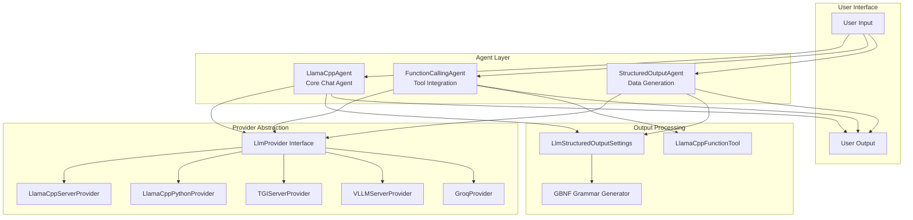
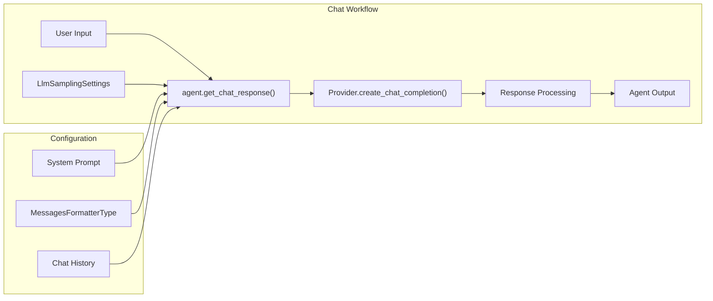
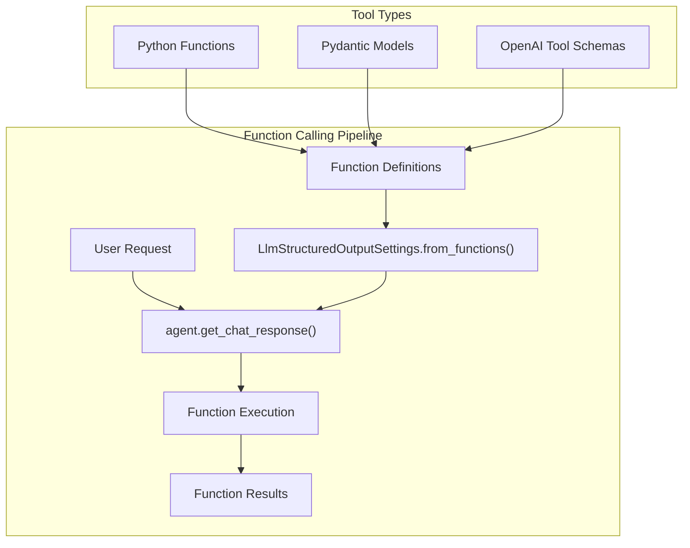

<!-- source: DeepWiki mcp.deepwiki.com · repo Maximilian-Winter/llama-cpp-agent · page 2 Getting Started · fetched 2026-10-26 -->

# Getting Started

<details>
<summary>Relevant source files</summary>

The following files were used as context for generating this wiki page:

- [docs/chat_history-api-reference.md](docs/chat_history-api-reference.md)
- [docs/get-started.md](docs/get-started.md)
- [examples/01_Basics/chatbot_using_llama_cpp_server.py](examples/01_Basics/chatbot_using_llama_cpp_server.py)
- [examples/02_Structured_Output/book_dataset_creation.py](examples/02_Structured_Output/book_dataset_creation.py)
- [examples/02_Structured_Output/dataframe_creation.py](examples/02_Structured_Output/dataframe_creation.py)
- [examples/03_Tools_And_Function_Calling/duck_duck_go_websearch_agent.py](examples/03_Tools_And_Function_Calling/duck_duck_go_websearch_agent.py)
- [examples/03_Tools_And_Function_Calling/experimental_code_interpreter.py](examples/03_Tools_And_Function_Calling/experimental_code_interpreter.py)
- [tests/providers.py](tests/providers.py)

</details>


This guide provides installation instructions, basic usage examples, and a quick start tutorial for new users of the llama-cpp-agent framework. It covers the essential steps to set up your first agent, connect to LLM providers, and perform basic operations including chat, function calling, and structured output generation.

For detailed information about specific framework components, see [Core Framework](#3). For advanced memory and retrieval capabilities, see [Memory System](#5). For comprehensive tool integration patterns, see [Tools and Function Calling](#6).

## Installation

Install the llama-cpp-agent framework using pip:

```bash
pip install llama-cpp-agent
```

The framework requires Python and automatically installs necessary dependencies for core functionality. Additional dependencies may be required for specific providers or advanced features.

Sources: [docs/get-started.md:31-37]()

## Framework Overview

The llama-cpp-agent framework provides a unified interface for working with Large Language Models through multiple providers and specialized agent classes.

### Core Components Architecture



Sources: [docs/get-started.md:39-79](), [examples/01_Basics/chatbot_using_llama_cpp_server.py:1-24](), [tests/providers.py:17-43]()

## Provider Setup

The framework supports multiple LLM providers through a unified interface. Each provider implements the `LlmProvider` interface for consistent behavior across different backends.

### Provider Configuration Examples

| Provider Type | Class | Primary Use Case |
|---------------|-------|------------------|
| llama-cpp-python | `LlamaCppPythonProvider` | Local model execution with Python bindings |
| llama.cpp server | `LlamaCppServerProvider` | HTTP server-based inference |
| Text Generation Inference | `TGIServerProvider` | HuggingFace TGI server integration |
| vLLM | `VLLMServerProvider` | High-performance OpenAI-compatible serving |
| Groq | `GroqProvider` | Commercial API service |

### llama-cpp-python Provider

```python
from llama_cpp import Llama
from llama_cpp_agent.providers import LlamaCppPythonProvider

llama_model = Llama(
    r"C:\gguf-models\mistral-7b-instruct-v0.2.Q6_K.gguf", 
    n_batch=1024, 
    n_threads=10, 
    n_gpu_layers=40
)
provider = LlamaCppPythonProvider(llama_model)
```

### llama.cpp Server Provider

```python
from llama_cpp_agent.providers import LlamaCppServerProvider

provider = LlamaCppServerProvider("http://127.0.0.1:8080")
```

### TGI Server Provider

```python
from llama_cpp_agent.providers import TGIServerProvider

provider = TGIServerProvider("http://localhost:8080")
```

### vLLM Server Provider

```python
from llama_cpp_agent.providers import VLLMServerProvider

provider = VLLMServerProvider(
    "http://localhost:8000/v1", 
    "TheBloke/Llama-2-7b-Chat-AWQ", 
    "token-abc123"
)
```

Sources: [docs/get-started.md:40-78](), [tests/providers.py:24-33]()

## Basic Agent Creation

### Simple Agent Setup

```python
from llama_cpp_agent import LlamaCppAgent

# Create provider (using any provider from above)
provider = LlamaCppServerProvider("http://127.0.0.1:8080")

# Create basic agent
agent = LlamaCppAgent(provider)
```

### Customized Agent Configuration

```python
from llama_cpp_agent import LlamaCppAgent, MessagesFormatterType

agent = LlamaCppAgent(
    provider,
    system_prompt="You are a helpful assistant.",
    predefined_messages_formatter_type=MessagesFormatterType.CHATML
)
```

Sources: [docs/get-started.md:80-110](), [examples/01_Basics/chatbot_using_llama_cpp_server.py:7-12]()

## Core Usage Workflows

### Basic Chat Interaction Flow



### Simple Chat Example

```python
# Basic chat interaction
agent_output = agent.get_chat_response("Hello, World!")
print(f"Agent: {agent_output.strip()}")

# Chat with custom sampling settings
settings = provider.get_provider_default_settings()
settings.temperature = 0.65
settings.n_predict = 512

agent_output = agent.get_chat_response(
    "Hello, World!", 
    llm_sampling_settings=settings
)
```

Sources: [docs/get-started.md:112-135](), [examples/01_Basics/chatbot_using_llama_cpp_server.py:14-23]()

### Function Calling Workflow

Function calling enables agents to execute tools and external functions. The framework supports Python functions, Pydantic models, and OpenAI tool schemas.



### Function Calling Example

```python
import math
from llama_cpp_agent.llm_output_settings import LlmStructuredOutputSettings

def calculate_a_to_the_power_b(a: Union[int, float], b: Union[int, float]):
    """
    Calculates a to the power of b
    
    Args:
        a: number
        b: exponent
    """
    return f"Result: {math.pow(a, b)}"

# Create structured output settings for function calling
output_settings = LlmStructuredOutputSettings.from_functions(
    [calculate_a_to_the_power_b], 
    allow_parallel_function_calling=True
)

# Execute function call
response = agent.get_chat_response(
    "Calculate 2 to the power of 3",
    structured_output_settings=output_settings
)
```

Sources: [docs/get-started.md:164-219](), [tests/providers.py:56-169]()

### Structured Output Generation

The framework can generate structured data objects based on Pydantic models, ensuring type-safe and validated outputs.

```python
from enum import Enum
from typing import List
from pydantic import BaseModel, Field
from llama_cpp_agent.llm_output_settings import LlmStructuredOutputSettings, LlmStructuredOutputType

class Category(Enum):
    Fiction = "Fiction"
    NonFiction = "Non-Fiction"

class Book(BaseModel):
    """Represents an entry about a book."""
    title: str = Field(..., description="Title of the book.")
    author: str = Field(..., description="Author of the book.")
    published_year: int = Field(..., description="Publishing year of the book.")
    keywords: List[str] = Field(..., description="A list of keywords.")
    category: Category = Field(..., description="Category of the book.")
    summary: str = Field(..., description="Summary of the book.")

# Configure structured output
output_settings = LlmStructuredOutputSettings.from_pydantic_models(
    [Book], 
    output_type=LlmStructuredOutputType.list_of_objects
)

# Generate structured data
text = """The Feynman Lectures on Physics is a physics textbook..."""
book_entry = agent.get_chat_response(text, structured_output_settings=output_settings)
```

Sources: [docs/get-started.md:301-368](), [examples/02_Structured_Output/book_dataset_creation.py:16-55]()

## Specialized Agent Classes

### FunctionCallingAgent

The `FunctionCallingAgent` provides automatic function execution and response generation:

```python
from llama_cpp_agent import FunctionCallingAgent, LlamaCppFunctionTool

# Create function tools
function_tools = [LlamaCppFunctionTool(Calculator)]

# Create function calling agent
function_call_agent = FunctionCallingAgent(
    provider,
    llama_cpp_function_tools=function_tools,
    allow_parallel_function_calling=True,
    messages_formatter_type=MessagesFormatterType.CHATML
)

# Generate response with automatic function handling
function_call_agent.generate_response("Calculate 42 * 42")
```

### StructuredOutputAgent

The `StructuredOutputAgent` simplifies structured data generation:

```python
from llama_cpp_agent import StructuredOutputAgent

structured_output_agent = StructuredOutputAgent(
    provider,
    messages_formatter_type=MessagesFormatterType.CHATML
)

# Create structured object directly
book = structured_output_agent.create_object(Book, text)
```

Sources: [docs/get-started.md:222-417](), [tests/providers.py:344-353]()

## Next Steps

### Advanced Features

- **Memory Systems**: Implement persistent memory with core, retrieval, and event memory. See [Memory System](#5).
- **Custom Tools**: Create sophisticated function tools and web search capabilities. See [Tools and Function Calling](#6).
- **Complex Applications**: Build complete applications like Virtual Game Masters and Memory Assistants. See [Examples and Applications](#7).

### Configuration Options

- **Chat History**: Customize conversation management with `BasicChatHistory` and `BasicChatMessageStore`
- **Sampling Settings**: Fine-tune generation parameters using `LlmSamplingSettings`
- **Message Formatting**: Choose appropriate formatters for different model types using `MessagesFormatterType`

### Provider-Specific Features

Each provider supports different capabilities and configuration options. Refer to [Provider System](#4) for detailed provider-specific documentation and advanced configuration patterns.

Sources: [docs/get-started.md:137-162](), [examples/03_Tools_And_Function_Calling/experimental_code_interpreter.py:240-271](), [examples/03_Tools_And_Function_Calling/duck_duck_go_websearch_agent.py:65-90]()

---

