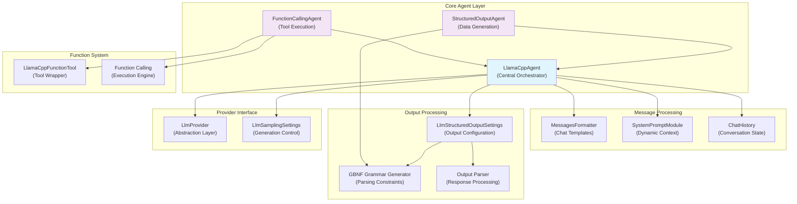
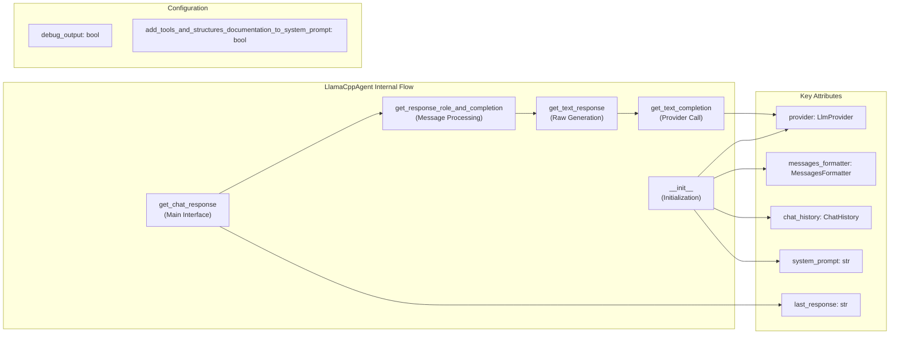
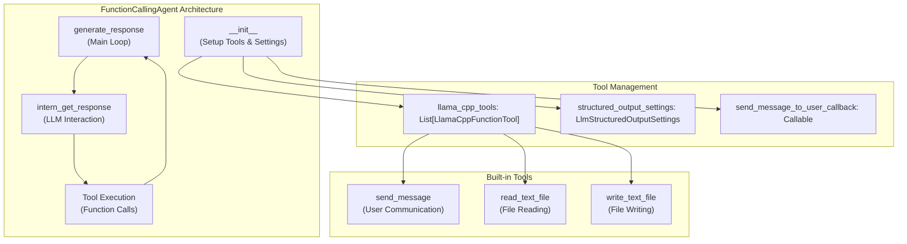
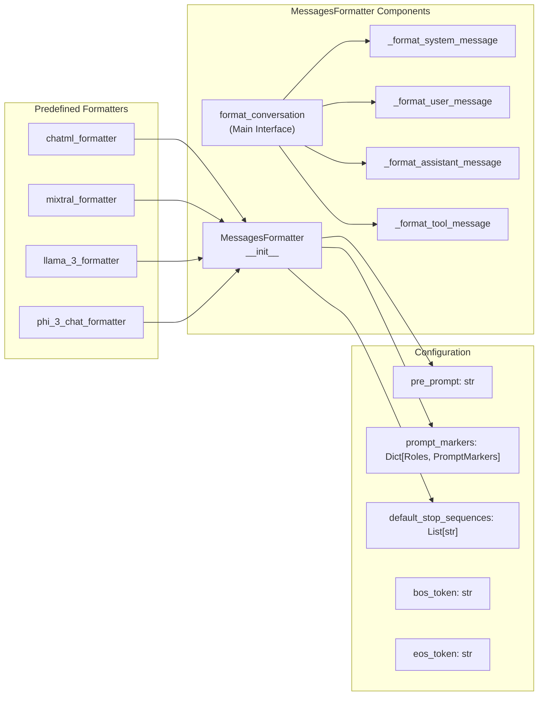
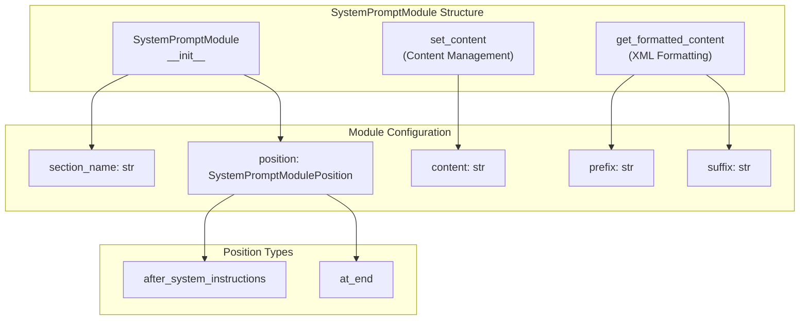
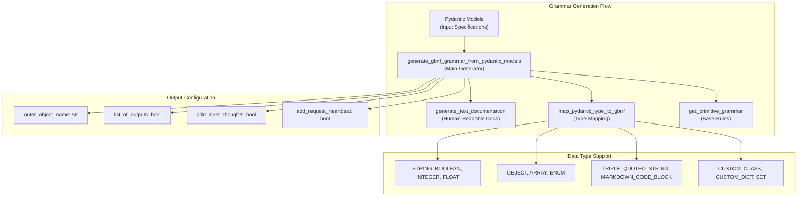
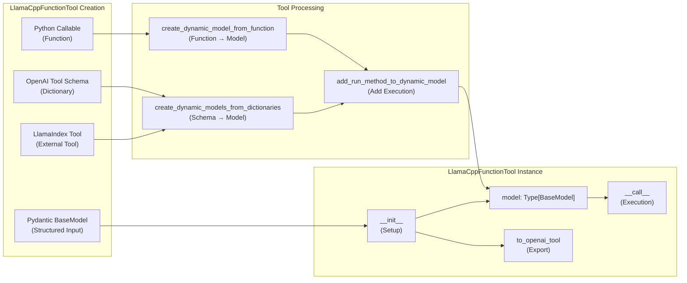
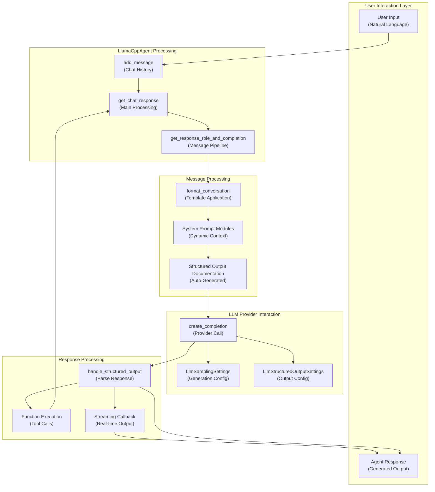

<!-- source: DeepWiki mcp.deepwiki.com · repo Maximilian-Winter/llama-cpp-agent · page 3 Core Framework · fetched 2026-10-26 -->

# Core Framework

Relevant source files

The following files were used as context for generating this wiki page:

- [src/llama_cpp_agent/function_calling.py](src/llama_cpp_agent/function_calling.py)
- [src/llama_cpp_agent/function_calling_agent.py](src/llama_cpp_agent/function_calling_agent.py)
- [src/llama_cpp_agent/gbnf_grammar_generator/gbnf_grammar_from_pydantic_models.py](src/llama_cpp_agent/gbnf_grammar_generator/gbnf_grammar_from_pydantic_models.py)
- [src/llama_cpp_agent/llm_agent.py](src/llama_cpp_agent/llm_agent.py)
- [src/llama_cpp_agent/messages_formatter.py](src/llama_cpp_agent/messages_formatter.py)

This document covers the fundamental components and architecture of the llama-cpp-agent framework, including the central agent orchestrator, specialized agent types, message processing pipeline, and output handling systems. For information about specific LLM provider implementations, see [Provider System](#4). For memory system integration, see [Memory System](#5). For detailed tool and function calling capabilities, see [Tools and Function Calling](#6).

## Core Architecture Overview

The Core Framework centers around the `LlamaCppAgent` class as the primary orchestrator, with specialized agent types for specific use cases and a comprehensive message processing pipeline.

### Framework Components Diagram

**Sources:** [src/llama_cpp_agent/llm_agent.py:70-662](), [src/llama_cpp_agent/function_calling_agent.py:89-301](), [src/llama_cpp_agent/messages_formatter.py:41-134]()

## LlamaCppAgent - Central Orchestrator

The `LlamaCppAgent` class serves as the primary interface for all agent interactions, handling chat responses, text generation, and structured output coordination.

### Core Agent Architecture

**Sources:** [src/llama_cpp_agent/llm_agent.py:75-117](), [src/llama_cpp_agent/llm_agent.py:237-382]()

### Key Methods and Responsibilities

| Method | Purpose | Key Parameters |
|--------|---------|----------------|
| `get_chat_response` | Primary chat interface | `message`, `structured_output_settings`, `llm_sampling_settings` |
| `get_text_response` | Raw text generation | `prompt`, `structured_output_settings`, `streaming_callback` |
| `add_message` | Chat history management | `message`, `role` |
| `get_text_completion` | Direct provider interaction | `prompt`, `structured_output_settings`, `llm_samplings_settings` |

**Sources:** [src/llama_cpp_agent/llm_agent.py:137-235](), [src/llama_cpp_agent/llm_agent.py:237-382](), [src/llama_cpp_agent/llm_agent.py:118-135](), [src/llama_cpp_agent/llm_agent.py:384-395]()

## Specialized Agent Types

### FunctionCallingAgent

The `FunctionCallingAgent` extends the core framework to provide autonomous tool execution capabilities through structured function calling.

**Sources:** [src/llama_cpp_agent/function_calling_agent.py:128-199](), [src/llama_cpp_agent/function_calling_agent.py:223-288](), [src/llama_cpp_agent/function_calling_agent.py:20-87]()

### StructuredOutputAgent

While not explicitly implemented as a separate class, structured output functionality is integrated into the core framework through `LlmStructuredOutputSettings` and GBNF grammar generation.

## Message Processing Pipeline

The message formatting system handles conversion between conversation formats and model-specific chat templates.

### Message Formatter Architecture

**Sources:** [src/llama_cpp_agent/messages_formatter.py:41-134](), [src/llama_cpp_agent/messages_formatter.py:433-454](), [src/llama_cpp_agent/messages_formatter.py:151-177]()

### System Prompt Modules

Dynamic system prompt management through modular components that can be positioned and configured independently.

**Sources:** [src/llama_cpp_agent/llm_agent.py:27-46](), [src/llama_cpp_agent/llm_agent.py:444-636]()

## Output Processing System

The framework provides sophisticated structured output capabilities through GBNF grammar generation and parsing.

### GBNF Grammar Generation Pipeline

**Sources:** [src/llama_cpp_agent/gbnf_grammar_generator/gbnf_grammar_from_pydantic_models.py:664-776](), [src/llama_cpp_agent/gbnf_grammar_generator/gbnf_grammar_from_pydantic_models.py:70-104](), [src/llama_cpp_agent/gbnf_grammar_generator/gbnf_grammar_from_pydantic_models.py:778-845]()

### Function Tool Integration

The `LlamaCppFunctionTool` class provides a unified interface for different function calling approaches.

**Sources:** [src/llama_cpp_agent/function_calling.py:142-180](), [src/llama_cpp_agent/function_calling.py:202-230](), [src/llama_cpp_agent/function_calling.py:248-255]()

## Integration and Data Flow

The complete framework integration shows how all components work together for a typical interaction.

### Complete Framework Data Flow

**Sources:** [src/llama_cpp_agent/llm_agent.py:237-382](), [src/llama_cpp_agent/llm_agent.py:397-655](), [src/llama_cpp_agent/function_calling_agent.py:223-288]()

### Framework Configuration Options

| Component | Configuration Class | Key Settings |
|-----------|-------------------|--------------|
| Agent | `LlamaCppAgent.__init__` | `provider`, `system_prompt`, `messages_formatter_type`, `debug_output` |
| Message Formatting | `MessagesFormatter` | `prompt_markers`, `default_stop_sequences`, `bos_token`, `eos_token` |
| Structured Output | `LlmStructuredOutputSettings` | `output_type`, `add_thoughts_and_reasoning_field`, `function_calling_name_field_name` |
| Function Calling | `FunctionCallingAgent` | `llama_cpp_function_tools`, `allow_parallel_function_calling`, `system_prompt` |
| System Prompts | `SystemPromptModule` | `section_name`, `position`, `prefix`, `suffix` |

**Sources:** [src/llama_cpp_agent/llm_agent.py:75-117](), [src/llama_cpp_agent/messages_formatter.py:42-61](), [src/llama_cpp_agent/function_calling_agent.py:128-199](), [src/llama_cpp_agent/llm_agent.py:32-46]()

---

