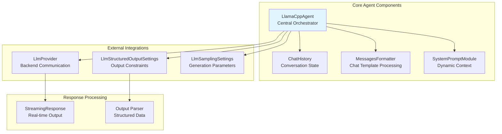
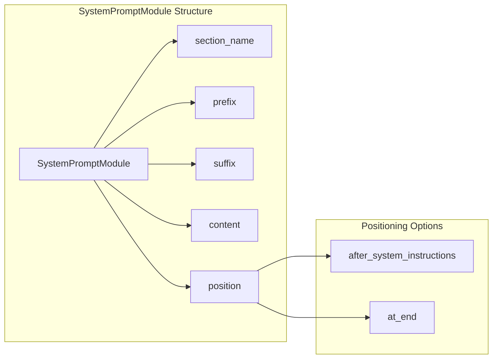
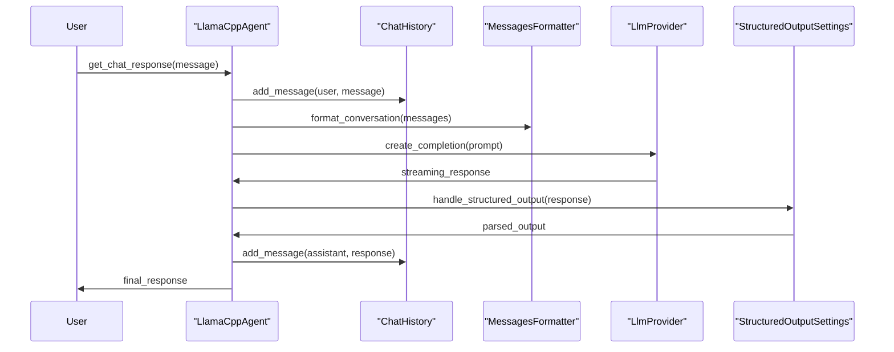
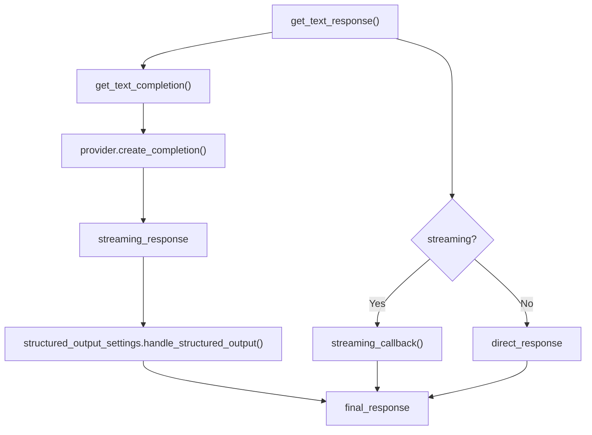
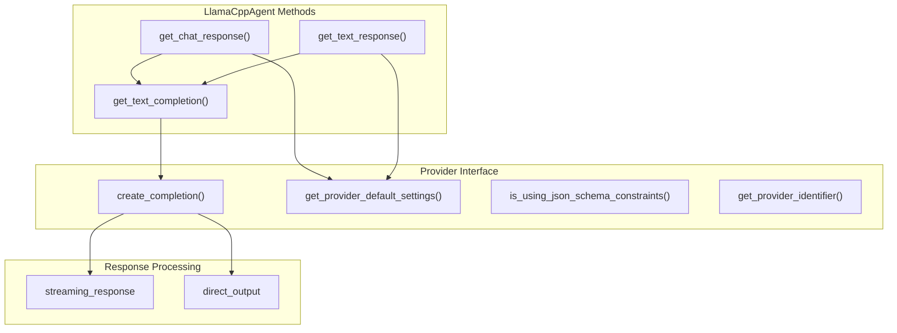
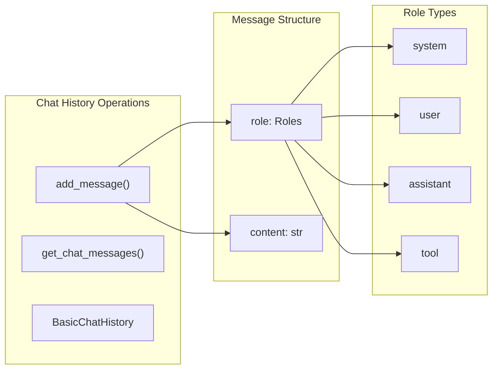
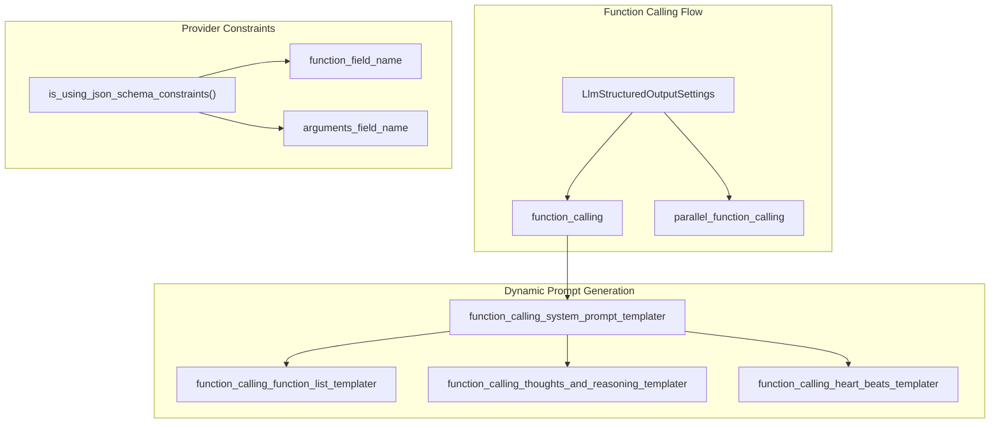
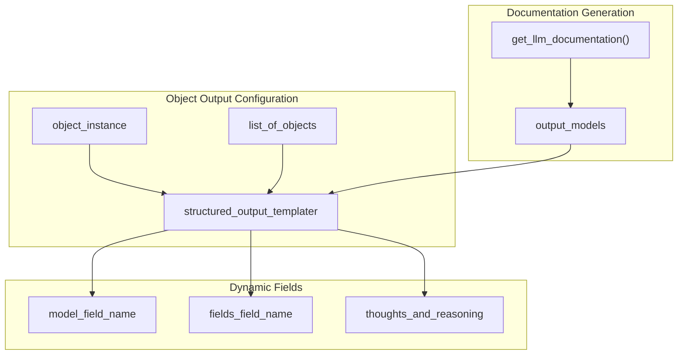
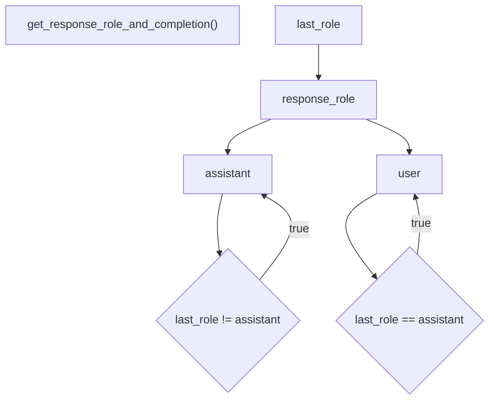

<!-- source: DeepWiki mcp.deepwiki.com · repo Maximilian-Winter/llama-cpp-agent · page 3.1 LlamaCppAgent · fetched 2026-10-26 -->

# LlamaCppAgent

<details>
<summary>Relevant source files</summary>

The following files were used as context for generating this wiki page:

- [src/llama_cpp_agent/function_calling.py](src/llama_cpp_agent/function_calling.py)
- [src/llama_cpp_agent/function_calling_agent.py](src/llama_cpp_agent/function_calling_agent.py)
- [src/llama_cpp_agent/gbnf_grammar_generator/gbnf_grammar_from_pydantic_models.py](src/llama_cpp_agent/gbnf_grammar_generator/gbnf_grammar_from_pydantic_models.py)
- [src/llama_cpp_agent/llm_agent.py](src/llama_cpp_agent/llm_agent.py)
- [src/llama_cpp_agent/messages_formatter.py](src/llama_cpp_agent/messages_formatter.py)

</details>


## Purpose and Scope

The `LlamaCppAgent` class serves as the central orchestrator for conversational AI interactions in the llama-cpp-agent framework. It manages the complete lifecycle of chat-based interactions, from message formatting and provider communication to structured output parsing and response handling.

This page covers the core `LlamaCppAgent` implementation and its direct integrations. For specialized agent implementations, see [FunctionCallingAgent](#3.2) and [StructuredOutputAgent](#3.3). For provider system details, see [Provider Architecture](#4.1). For memory system integration, see [Memory Architecture](#5.1).

## Core Architecture

The `LlamaCppAgent` acts as the central coordination point between multiple framework subsystems:



Sources: [src/llama_cpp_agent/llm_agent.py:70-117]()

## Key Components and Configuration

### Agent Initialization

The `LlamaCppAgent` constructor accepts several key configuration parameters:

| Parameter | Type | Purpose |
|-----------|------|---------|
| `provider` | `LlmProvider` | Backend LLM communication interface |
| `name` | `str` | Agent identifier (default: "llamacpp_agent") |
| `system_prompt` | `str` | Base system instructions |
| `predefined_messages_formatter_type` | `MessagesFormatterType` | Chat template selection |
| `custom_messages_formatter` | `MessagesFormatter` | Custom formatting override |
| `chat_history` | `ChatHistory` | Conversation state management |
| `debug_output` | `bool` | Debug logging control |

Sources: [src/llama_cpp_agent/llm_agent.py:75-98]()

### System Prompt Modules

The `SystemPromptModule` class enables dynamic system prompt composition:



Sources: [src/llama_cpp_agent/llm_agent.py:27-46]()

## Response Generation Flow

The agent provides two primary response generation methods with different interaction patterns:

### Chat Response Flow



Sources: [src/llama_cpp_agent/llm_agent.py:237-382]()

### Text Response Flow

The `get_text_response` method provides direct prompt-to-response functionality without chat history management:



Sources: [src/llama_cpp_agent/llm_agent.py:137-235]()

## Provider Integration

The agent interfaces with LLM providers through the standardized `LlmProvider` abstraction:

### Provider Communication Pattern



Sources: [src/llama_cpp_agent/llm_agent.py:384-395](), [src/llama_cpp_agent/llm_agent.py:647-655]()

## Message Formatting and Chat History

### Messages Formatting System

The agent uses `MessagesFormatter` to handle different chat template formats:

| Formatter Type | Template Style | Stop Sequences |
|----------------|----------------|----------------|
| `CHATML` | `<\|im_start\|>role\n...<\|im_end\|>` | `["<\|im_end\|>", "</s>"]` |
| `LLAMA_3` | `<\|start_header_id\|>role<\|end_header_id\|>` | `["assistant", "<\|eot_id\|>"]` |
| `MISTRAL` | `[INST]...[/INST]` | `["</s>"]` |
| `VICUNA` | `USER: ...ASSISTANT:` | `["</s>", "USER:"]` |

Sources: [src/llama_cpp_agent/messages_formatter.py:433-454]()

### Chat History Management



Sources: [src/llama_cpp_agent/llm_agent.py:118-135]()

## Structured Output Processing

The agent integrates deeply with structured output capabilities through dynamic system prompt modification:

### Function Calling Integration



Sources: [src/llama_cpp_agent/llm_agent.py:459-554]()

### Object Instance Generation

For structured data output, the agent modifies system prompts with model documentation:



Sources: [src/llama_cpp_agent/llm_agent.py:555-622]()

## Advanced Features

### Streaming Response Handling

The `StreamingResponse` dataclass encapsulates streaming output:

```python
@dataclass
class StreamingResponse:
    text: str
    is_last_response: bool
```

Sources: [src/llama_cpp_agent/llm_agent.py:49-67]()

### Response Role Detection

The agent automatically determines appropriate response roles based on conversation context:



Sources: [src/llama_cpp_agent/llm_agent.py:397-655]()

### Debug Output

When `debug_output=True`, the agent provides detailed logging of prompts and responses for development and troubleshooting:

```python
if self.debug_output:
    if type(prompt) is str:
        print(prompt, end="")
```

Sources: [src/llama_cpp_agent/llm_agent.py:166-168](), [src/llama_cpp_agent/llm_agent.py:644-645]()

# LlamaCppAgent

## Purpose and Scope

The `LlamaCppAgent` class serves as the central orchestrator for conversational AI interactions in the llama-cpp-agent framework. It manages the complete lifecycle of chat-based interactions, from message formatting and provider communication to structured output parsing and response handling.

This page covers the core `LlamaCppAgent` implementation and its direct integrations. For specialized agent implementations, see [FunctionCallingAgent](#3.2) and [StructuredOutputAgent](#3.3). For provider system details, see [Provider Architecture](#4.1). For memory system integration, see [Memory Architecture](#5.1).

## Core Architecture

The `LlamaCppAgent` acts as the central coordination point between multiple framework subsystems:


Sources: [src/llama_cpp_agent/llm_agent.py:70-117]()

## Key Components and Configuration

### Agent Initialization

The `LlamaCppAgent` constructor accepts several key configuration parameters:

| Parameter | Type | Purpose |
|-----------|------|---------|
| `provider` | `LlmProvider` | Backend LLM communication interface |
| `name` | `str` | Agent identifier (default: "llamacpp_agent") |
| `system_prompt` | `str` | Base system instructions |
| `predefined_messages_formatter_type` | `MessagesFormatterType` | Chat template selection |
| `custom_messages_formatter` | `MessagesFormatter` | Custom formatting override |
| `chat_history` | `ChatHistory` | Conversation state management |
| `debug_output` | `bool` | Debug logging control |

Sources: [src/llama_cpp_agent/llm_agent.py:75-98]()

### System Prompt Modules

The `SystemPromptModule` class enables dynamic system prompt composition:


Sources: [src/llama_cpp_agent/llm_agent.py:27-46]()

## Response Generation Flow

The agent provides two primary response generation methods with different interaction patterns:

### Chat Response Flow


Sources: [src/llama_cpp_agent/llm_agent.py:237-382]()

### Text Response Flow

The `get_text_response` method provides direct prompt-to-response functionality without chat history management:


Sources: [src/llama_cpp_agent/llm_agent.py:137-235]()

## Provider Integration

The agent interfaces with LLM providers through the standardized `LlmProvider` abstraction:

### Provider Communication Pattern


Sources: [src/llama_cpp_agent/llm_agent.py:384-395](), [src/llama_cpp_agent/llm_agent.py:647-655]()

## Message Formatting and Chat History

### Messages Formatting System

The agent uses `MessagesFormatter` to handle different chat template formats:

| Formatter Type | Template Style | Stop Sequences |
|----------------|----------------|----------------|
| `CHATML` | `<\|im_start\|>role\n...<\|im_end\|>` | `["<\|im_end\|>", "</s>"]` |
| `LLAMA_3` | `<\|start_header_id\|>role<\|end_header_id\|>` | `["assistant", "<\|eot_id\|>"]` |
| `MISTRAL` | `[INST]...[/INST]` | `["</s>"]` |
| `VICUNA` | `USER: ...ASSISTANT:` | `["</s>", "USER:"]` |

Sources: [src/llama_cpp_agent/messages_formatter.py:433-454]()

### Chat History Management


Sources: [src/llama_cpp_agent/llm_agent.py:118-135]()

## Structured Output Processing

The agent integrates deeply with structured output capabilities through dynamic system prompt modification:

### Function Calling Integration


Sources: [src/llama_cpp_agent/llm_agent.py:459-554]()

### Object Instance Generation

For structured data output, the agent modifies system prompts with model documentation:


Sources: [src/llama_cpp_agent/llm_agent.py:555-622]()

## Advanced Features

### Streaming Response Handling

The `StreamingResponse` dataclass encapsulates streaming output:

```python
@dataclass
class StreamingResponse:
    text: str
    is_last_response: bool
```

Sources: [src/llama_cpp_agent/llm_agent.py:49-67]()

### Response Role Detection

The agent automatically determines appropriate response roles based on conversation context:


Sources: [src/llama_cpp_agent/llm_agent.py:397-655]()

### Debug Output

When `debug_output=True`, the agent provides detailed logging of prompts and responses for development and troubleshooting:

```python
if self.debug_output:
    if type(prompt) is str:
        print(prompt, end="")
```

Sources: [src/llama_cpp_agent/llm_agent.py:166-168](), [src/llama_cpp_agent/llm_agent.py:644-645]()

---

