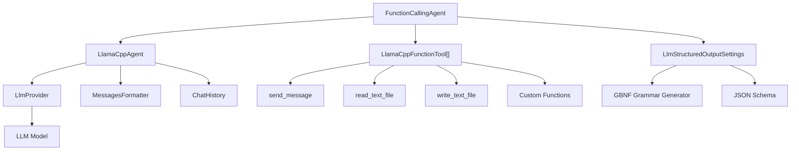
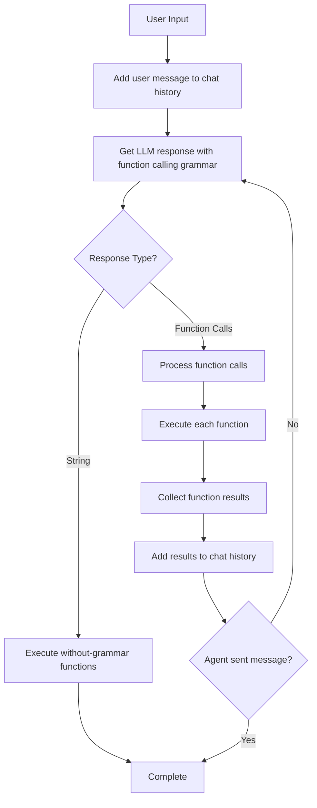
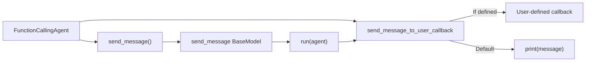
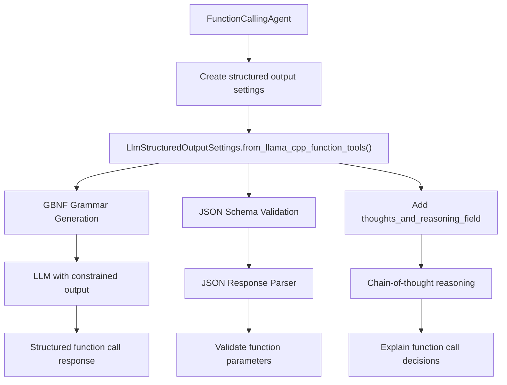

<!-- source: DeepWiki mcp.deepwiki.com · repo Maximilian-Winter/llama-cpp-agent · page 3.2 FunctionCallingAgent · fetched 2026-10-26 -->

# FunctionCallingAgent

<details>
<summary>Relevant source files</summary>

The following files were used as context for generating this wiki page:

- [examples/01_Basics/self_critique.py](examples/01_Basics/self_critique.py)
- [examples/07_Memory/agent_core_memory.py](examples/07_Memory/agent_core_memory.py)
- [examples/07_Memory/core_memory.json](examples/07_Memory/core_memory.json)
- [src/llama_cpp_agent/function_calling.py](src/llama_cpp_agent/function_calling.py)
- [src/llama_cpp_agent/function_calling_agent.py](src/llama_cpp_agent/function_calling_agent.py)
- [src/llama_cpp_agent/gbnf_grammar_generator/gbnf_grammar_from_pydantic_models.py](src/llama_cpp_agent/gbnf_grammar_generator/gbnf_grammar_from_pydantic_models.py)
- [src/llama_cpp_agent/llm_agent.py](src/llama_cpp_agent/llm_agent.py)
- [src/llama_cpp_agent/messages_formatter.py](src/llama_cpp_agent/messages_formatter.py)
- [src/llama_cpp_agent/prompt_templates.py](src/llama_cpp_agent/prompt_templates.py)
- [src/llama_cpp_agent/tools/web_search/tool.py](src/llama_cpp_agent/tools/web_search/tool.py)

</details>


The `FunctionCallingAgent` is a specialized wrapper around `LlamaCppAgent` that enables AI models to execute functions and interact with their environment through structured function calling. It provides a higher-level interface for building AI agents that can perform actions beyond text generation, such as file operations, web searches, or custom business logic.

For basic agent functionality without function calling, see [LlamaCppAgent](#3.1). For creating custom function tools, see [Function Tools Framework](#6.1).

## Purpose and Scope

The `FunctionCallingAgent` extends the base `LlamaCppAgent` with the ability to:

- Execute predefined functions based on model responses
- Handle parallel function calling when supported
- Manage function call loops and result processing
- Provide built-in utility functions for common tasks
- Integrate seamlessly with the structured output system

This agent is designed for scenarios where the AI needs to perform actions or access external data sources during conversations.

## Architecture Overview

The `FunctionCallingAgent` operates as a composition wrapper that orchestrates multiple components to enable function calling capabilities.



**Core Component Relationships:**
- `FunctionCallingAgent` wraps `LlamaCppAgent` for basic chat functionality
- `LlamaCppFunctionTool` instances represent available functions
- `LlmStructuredOutputSettings` ensures proper JSON function call format
- Built-in tools provide common functionality out-of-the-box

Sources: [src/llama_cpp_agent/function_calling_agent.py:89-199](), [src/llama_cpp_agent/function_calling.py:121-256]()

## Function Calling Process

The agent follows a structured loop to execute function calls and process their results:



**Process Details:**

1. **Input Processing**: User message added to chat history via `add_message()`
2. **Response Generation**: LLM generates structured output using function calling grammar
3. **Function Execution**: Each function call is executed with provided parameters
4. **Result Integration**: Function results are formatted and added back to chat history
5. **Loop Continuation**: Process repeats until agent sends a message or completes

Sources: [src/llama_cpp_agent/function_calling_agent.py:223-268](), [src/llama_cpp_agent/function_calling_agent.py:270-288]()

## Built-in Function Tools

The `FunctionCallingAgent` includes several built-in tools that provide common functionality:

| Tool | Purpose | Auto-Enabled | Parameters |
|------|---------|--------------|------------|
| `send_message` | Send messages to users | Yes (if `add_send_message_to_user_function=True`) | `content: str` |
| `read_text_file` | Read file contents | Optional (`basic_file_tools=True`) | `file_path: str` |
| `write_text_file` | Write content to files | Optional (`basic_file_tools=True`) | `file_path: str`, `content: str` |
| `activate_message_mode` | Switch to plain text mode | Built-in | None |

**Message Flow Architecture:**



Sources: [src/llama_cpp_agent/function_calling_agent.py:20-87](), [src/llama_cpp_agent/function_calling_agent.py:164-171]()

## Configuration and Initialization

The `FunctionCallingAgent` provides extensive configuration options for customizing behavior:

**Core Parameters:**
- `llama_llm`: LLM provider instance
- `messages_formatter_type`: Message format (default: `CHATML`)
- `system_prompt`: Agent instructions and behavior
- `llama_cpp_function_tools`: List of available function tools

**Function Calling Options:**
- `allow_parallel_function_calling`: Enable multiple simultaneous function calls
- `add_send_message_to_user_function`: Include built-in messaging capability
- `basic_file_tools`: Add file read/write functions

**Callback Configuration:**
- `send_message_to_user_callback`: Custom message handling function
- `streaming_callback`: Real-time response streaming

**Example Configuration:**
```python
agent = FunctionCallingAgent(
    llama_llm=provider,
    system_prompt="You are an AI assistant with access to tools.",
    llama_cpp_function_tools=[custom_tool1, custom_tool2],
    allow_parallel_function_calling=True,
    basic_file_tools=True,
    send_message_to_user_callback=custom_message_handler
)
```

Sources: [src/llama_cpp_agent/function_calling_agent.py:128-199]()

## Structured Output Integration

The agent automatically configures structured output settings to ensure proper function calling format:



**Key Features:**
- Automatic grammar generation from function tools
- Built-in thoughts and reasoning field for explainability
- Support for parallel function calling when enabled
- JSON schema validation for function parameters

Sources: [src/llama_cpp_agent/function_calling_agent.py:175-180](), [src/llama_cpp_agent/function_calling_agent.py:231-233]()

## Advanced Features

**Without Grammar Mode:**
The agent can temporarily disable structured output for plain text responses through `activate_message_mode()`, useful for natural conversation mixed with function calls.

**State Management:**
The agent maintains internal state for:
- `without_grammar_mode`: Flag for plain text mode
- `without_grammar_mode_function`: Functions to execute in plain text mode  
- `prompt_suffix`: Additional prompt context

**Function Result Processing:**
Function call results are formatted and integrated back into the conversation context, allowing the agent to reason about previous actions and plan subsequent steps.

Sources: [src/llama_cpp_agent/function_calling_agent.py:181-183](), [src/llama_cpp_agent/function_calling_agent.py:275-288](), [src/llama_cpp_agent/function_calling_agent.py:245-267]()

---

