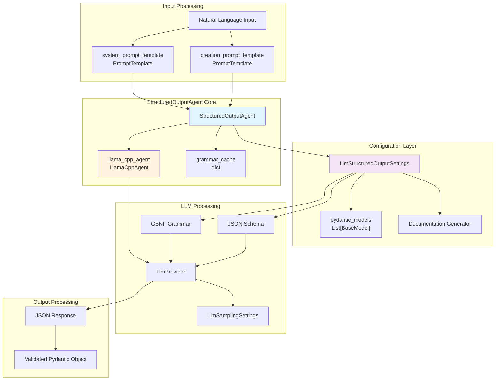
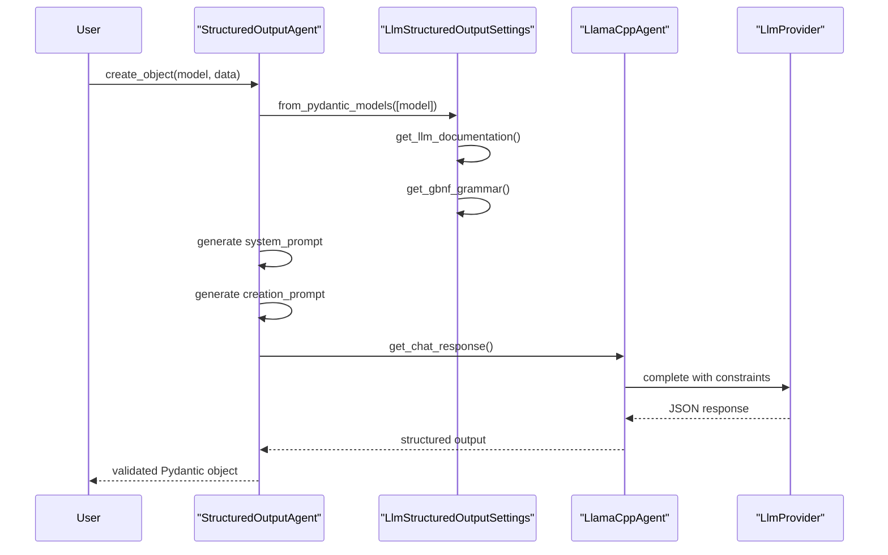
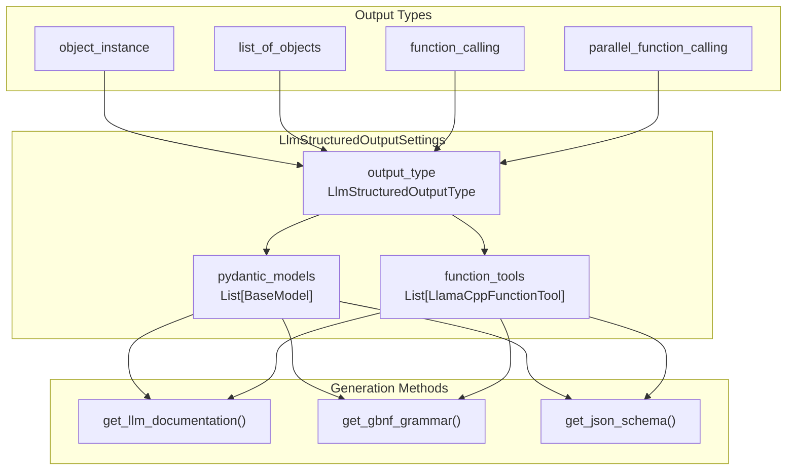
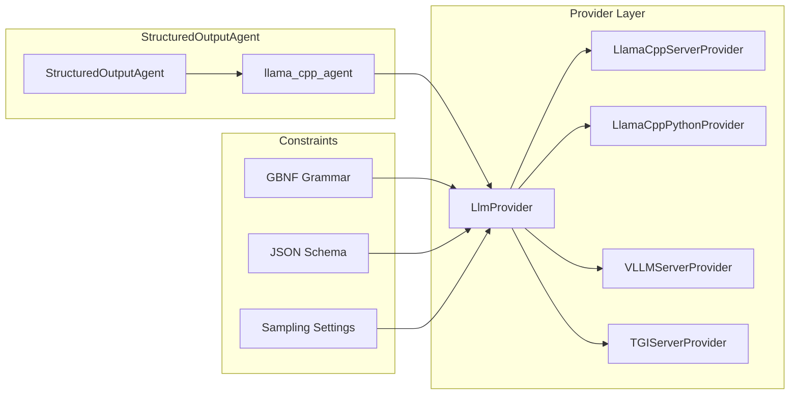
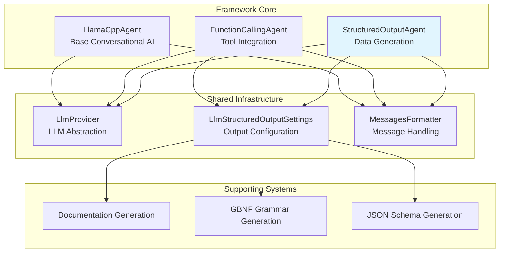

<!-- source: DeepWiki mcp.deepwiki.com · repo Maximilian-Winter/llama-cpp-agent · page 3.3 StructuredOutputAgent · fetched 2026-10-26 -->

# StructuredOutputAgent

<details>
<summary>Relevant source files</summary>

The following files were used as context for generating this wiki page:

- [src/llama_cpp_agent/json_schema_generator/schema_generator.py](src/llama_cpp_agent/json_schema_generator/schema_generator.py)
- [src/llama_cpp_agent/llm_documentation/__init__.py](src/llama_cpp_agent/llm_documentation/__init__.py)
- [src/llama_cpp_agent/llm_documentation/documentation_generation.py](src/llama_cpp_agent/llm_documentation/documentation_generation.py)
- [src/llama_cpp_agent/llm_output_settings/settings.py](src/llama_cpp_agent/llm_output_settings/settings.py)
- [src/llama_cpp_agent/structured_output_agent.py](src/llama_cpp_agent/structured_output_agent.py)

</details>


The `StructuredOutputAgent` is a specialized component within the llama-cpp-agent framework designed to generate structured data objects from unstructured text input. It converts natural language descriptions into validated Pydantic model instances using language models with enforced output schemas.

This agent focuses specifically on data generation and extraction tasks. For general conversational AI capabilities, see [LlamaCppAgent](#3.1). For function calling and tool integration, see [FunctionCallingAgent](#3.2).

## Purpose and Architecture

The `StructuredOutputAgent` serves as a bridge between natural language processing and structured data creation. It takes unstructured text input and produces validated Pydantic model instances, ensuring type safety and schema compliance.

### Core Architecture



**Sources:** [src/llama_cpp_agent/structured_output_agent.py:18-156](), [src/llama_cpp_agent/llm_output_settings/settings.py:29-119]()

### Data Flow Architecture



**Sources:** [src/llama_cpp_agent/structured_output_agent.py:113-155](), [src/llama_cpp_agent/llm_output_settings/settings.py:149-195]()

## Core Components

### StructuredOutputAgent Class

The main `StructuredOutputAgent` class [src/llama_cpp_agent/structured_output_agent.py:18-156]() provides the primary interface for structured data generation:

| Attribute | Type | Purpose |
|-----------|------|---------|
| `llama_cpp_agent` | `LlamaCppAgent` | Core LLM interaction handler |
| `grammar_cache` | `dict` | Caches generated GBNF grammars |
| `system_prompt_template` | `PromptTemplate` | Template for system instructions |
| `creation_prompt_template` | `PromptTemplate` | Template for data creation prompts |
| `streaming_callback` | `Callable` | Optional streaming response handler |

**Sources:** [src/llama_cpp_agent/structured_output_agent.py:30-37]()

### Prompt Templates

The agent uses two predefined prompt templates:

- **System Prompt Template**: Instructs the LLM on its role and provides model documentation
- **Creation Prompt Template**: Formats the user input for structured data generation

```python
# System prompt template from line 67-69
"You are an advanced AI agent. You are tasked to assist the user by creating structured output in JSON format.\n\n{documentation}"

# Creation prompt template from line 70-72  
"Create an JSON response based on the following input.\n\nInput:\n\n{user_input}"
```

**Sources:** [src/llama_cpp_agent/structured_output_agent.py:67-72]()

## Configuration and Settings

### LlmStructuredOutputSettings Integration

The `StructuredOutputAgent` relies heavily on `LlmStructuredOutputSettings` for output configuration:



**Sources:** [src/llama_cpp_agent/llm_output_settings/settings.py:17-27](), [src/llama_cpp_agent/llm_output_settings/settings.py:413-618]()

### Documentation Generation

The framework generates comprehensive documentation for Pydantic models using the documentation generation system:

| Generator | Output Format | Use Case |
|-----------|---------------|----------|
| `generate_text_documentation()` | Plain text | LLM instructions |
| `generate_markdown_documentation()` | Markdown | Human-readable docs |
| `generate_gbnf_grammar()` | GBNF grammar | llama.cpp constraints |
| `generate_json_schema()` | JSON Schema | Schema validation |

**Sources:** [src/llama_cpp_agent/llm_documentation/documentation_generation.py:217-325](), [src/llama_cpp_agent/json_schema_generator/schema_generator.py:321-358]()

## Usage Patterns

### Basic Object Creation

The primary method for generating structured data is `create_object()`:

```python
def create_object(
    self,
    model: Type[BaseModel],
    data: str = "",
    llm_sampling_settings: LlmSamplingSettings = None,
    returns_streaming_generator: bool = False,
) -> object:
```

**Process Flow:**
1. Creates `LlmStructuredOutputSettings` from the provided Pydantic model
2. Generates system prompt with model documentation  
3. Formats user input with creation prompt template
4. Calls `LlamaCppAgent.get_chat_response()` with structured output settings
5. Returns validated Pydantic object instance

**Sources:** [src/llama_cpp_agent/structured_output_agent.py:113-155]()

### Grammar Caching

The agent implements grammar caching to optimize performance for repeated model usage:

```python
self.grammar_cache = {}  # Initialized in __init__
```

This cache stores generated GBNF grammars to avoid regeneration overhead for the same Pydantic models.

**Sources:** [src/llama_cpp_agent/structured_output_agent.py:66]()

## Integration Points

### Provider System Integration



**Sources:** [src/llama_cpp_agent/structured_output_agent.py:74-80](), [src/llama_cpp_agent/llm_output_settings/settings.py:423-431]()

### Memory System Compatibility

While `StructuredOutputAgent` doesn't directly implement memory systems, it can be integrated with memory-aware agents through its underlying `LlamaCppAgent`. For memory-enhanced structured output, see [Memory System](#5).

### Framework Position

The `StructuredOutputAgent` occupies a specialized position in the framework hierarchy:



**Sources:** [src/llama_cpp_agent/structured_output_agent.py:8-16](), [src/llama_cpp_agent/llm_output_settings/settings.py:8-14]()

---

