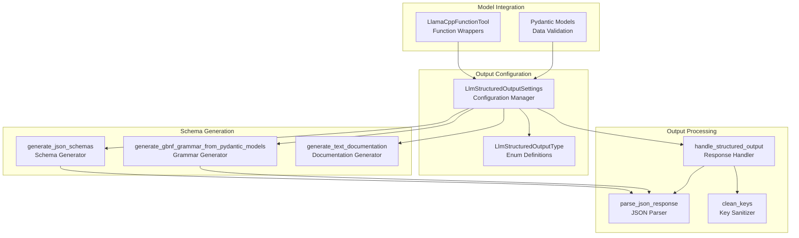
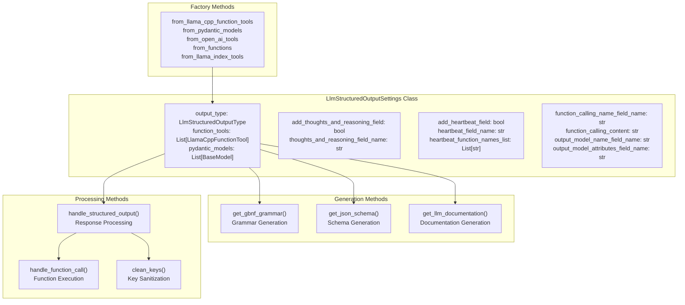
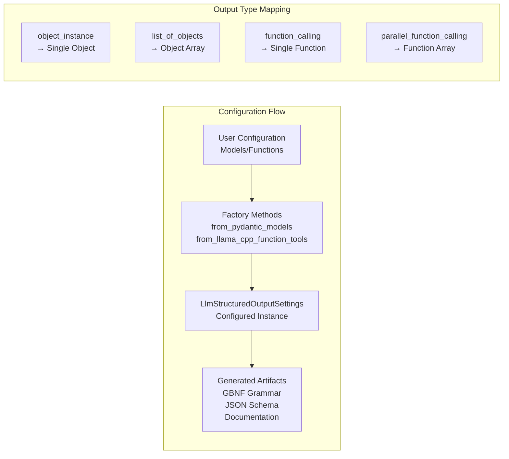
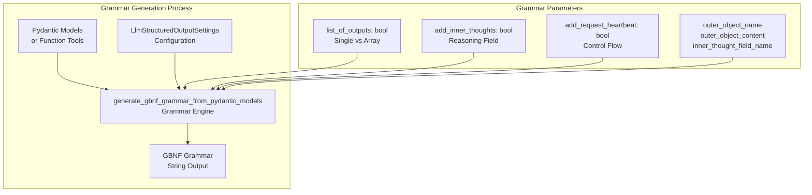
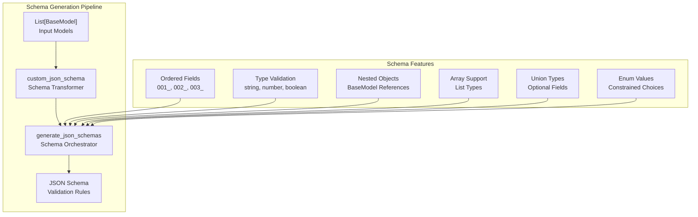
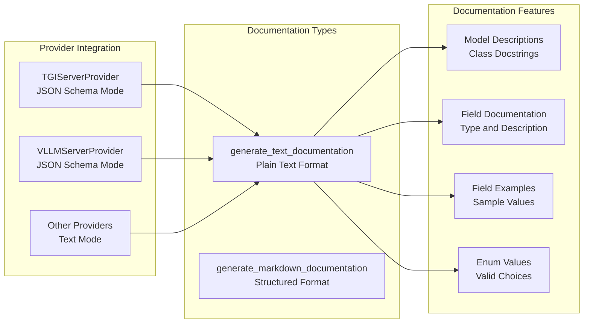
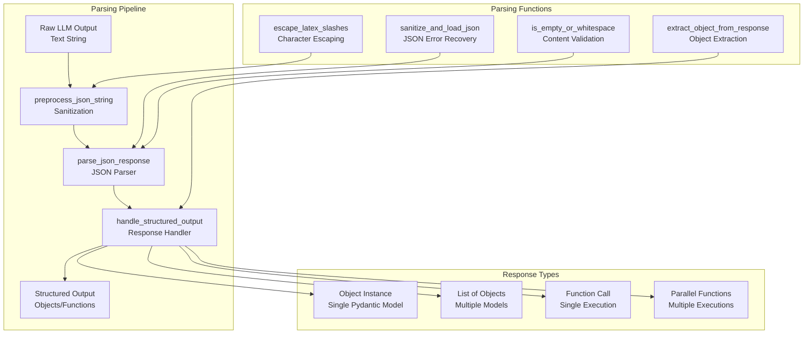
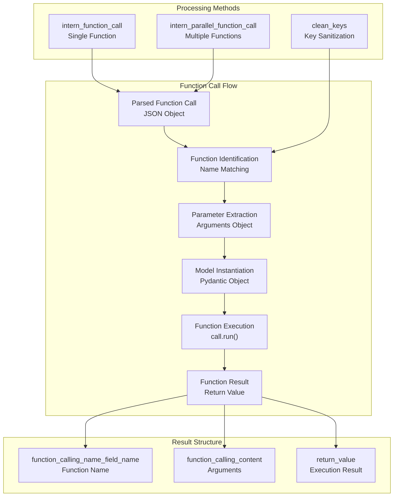

<!-- source: DeepWiki mcp.deepwiki.com · repo Maximilian-Winter/llama-cpp-agent · page 3.4 Output Processing · fetched 2026-10-26 -->

# Output Processing

Relevant source files

The following files were used as context for generating this wiki page:

- [src/llama_cpp_agent/json_schema_generator/schema_generator.py](src/llama_cpp_agent/json_schema_generator/schema_generator.py)
- [src/llama_cpp_agent/llm_documentation/__init__.py](src/llama_cpp_agent/llm_documentation/__init__.py)
- [src/llama_cpp_agent/llm_documentation/documentation_generation.py](src/llama_cpp_agent/llm_documentation/documentation_generation.py)
- [src/llama_cpp_agent/llm_output_settings/settings.py](src/llama_cpp_agent/llm_output_settings/settings.py)
- [src/llama_cpp_agent/output_parser.py](src/llama_cpp_agent/output_parser.py)

This document covers the output processing system in the llama-cpp-agent framework, which handles structured data generation, output parsing, and response formatting. The output processing system transforms LLM responses into structured formats such as JSON objects, function calls, or Pydantic model instances.

For information about the core agent framework, see [Core Framework](#3). For details about function calling capabilities, see [FunctionCallingAgent](#3.2). For structured data generation, see [StructuredOutputAgent](#3.3).

## System Overview

The output processing system consists of several interconnected components that work together to ensure LLM outputs conform to predefined structures and schemas. The system supports multiple output types and provides mechanisms for validation, parsing, and transformation of raw LLM text into structured data.

**Sources:** [src/llama_cpp_agent/llm_output_settings/settings.py:1-786](), [src/llama_cpp_agent/output_parser.py:1-126]()

## LlmStructuredOutputSettings Architecture

The `LlmStructuredOutputSettings` class serves as the central configuration manager for all structured output processing. It coordinates between different output types, manages function tools and Pydantic models, and generates the necessary schemas and documentation.

**Sources:** [src/llama_cpp_agent/llm_output_settings/settings.py:29-121](), [src/llama_cpp_agent/llm_output_settings/settings.py:122-275]()

## Output Types and Configuration

The framework supports five distinct output types through the `LlmStructuredOutputType` enum, each designed for specific use cases and structured data requirements.

| Output Type | Description | Use Case |
|-------------|-------------|----------|
| `no_structured_output` | Plain text output | Simple text generation |
| `object_instance` | Single Pydantic model instance | Creating one structured object |
| `list_of_objects` | Array of Pydantic model instances | Creating multiple structured objects |
| `function_calling` | Single function call execution | Tool usage and API calls |
| `parallel_function_calling` | Multiple concurrent function calls | Complex multi-tool operations |

**Sources:** [src/llama_cpp_agent/llm_output_settings/settings.py:17-27](), [src/llama_cpp_agent/llm_output_settings/settings.py:149-194]()

## GBNF Grammar Generation

GBNF (Grammar Backus-Naur Form) grammars constrain LLM output to valid structures. The `get_gbnf_grammar()` method generates context-aware grammars based on the configured output type and models.

The grammar generation process handles different output types with specific parameters:

- **Object Instance**: Single object with model name and attributes fields
- **List of Objects**: Array of objects with consistent structure
- **Function Calling**: Function name and arguments fields
- **Parallel Function Calling**: Array of function calls with optional heartbeat

**Sources:** [src/llama_cpp_agent/llm_output_settings/settings.py:458-537](), [src/llama_cpp_agent/gbnf_grammar_generator/gbnf_grammar_from_pydantic_models.py]()

## JSON Schema Generation

JSON schemas provide validation rules for LLM outputs. The `get_json_schema()` method creates comprehensive schemas that support complex type hierarchies and validation constraints.

**Sources:** [src/llama_cpp_agent/llm_output_settings/settings.py:538-618](), [src/llama_cpp_agent/json_schema_generator/schema_generator.py:10-152]()

## Documentation Generation

The documentation system creates human-readable descriptions of models and functions for LLM consumption. This helps models understand the expected output structure and field meanings.

The documentation generation adapts its output format based on the provider type, with cloud providers like TGI and VLLM receiving ordered JSON mode documentation.

**Sources:** [src/llama_cpp_agent/llm_output_settings/settings.py:413-456](), [src/llama_cpp_agent/llm_documentation/documentation_generation.py:217-325]()

## Output Parsing and Response Handling

The output parsing system transforms raw LLM text into structured data through a multi-stage process that handles malformed JSON, extracts structured data, and executes function calls.

**Sources:** [src/llama_cpp_agent/output_parser.py:24-65](), [src/llama_cpp_agent/llm_output_settings/settings.py:637-678]()

## Function Call Processing

Function call processing handles the execution of tool calls and manages the conversion between structured output and actual function execution.

**Sources:** [src/llama_cpp_agent/llm_output_settings/settings.py:680-768](), [src/llama_cpp_agent/llm_output_settings/settings.py:705-731]()

## Provider Integration

The output processing system integrates with different LLM providers through provider-specific adaptations and optimizations.

| Provider Type | Integration Method | Output Format |
|---------------|-------------------|---------------|
| `LlamaCppServerProvider` | GBNF Grammar | Constrained Generation |
| `LlamaCppPythonProvider` | GBNF Grammar | Constrained Generation |
| `TGIServerProvider` | JSON Schema | Schema-guided Generation |
| `VLLMServerProvider` | JSON Schema | Schema-guided Generation |
| `GroqProvider` | JSON Schema | Schema-guided Generation |

The system automatically detects the provider type and adjusts documentation generation and schema formatting accordingly.

**Sources:** [src/llama_cpp_agent/llm_output_settings/settings.py:423-430](), [src/llama_cpp_agent/providers/]()

---

