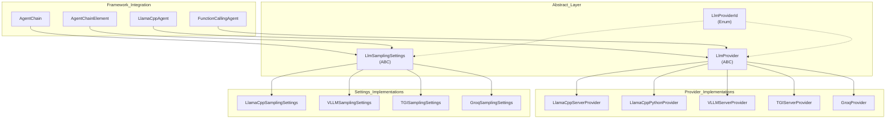
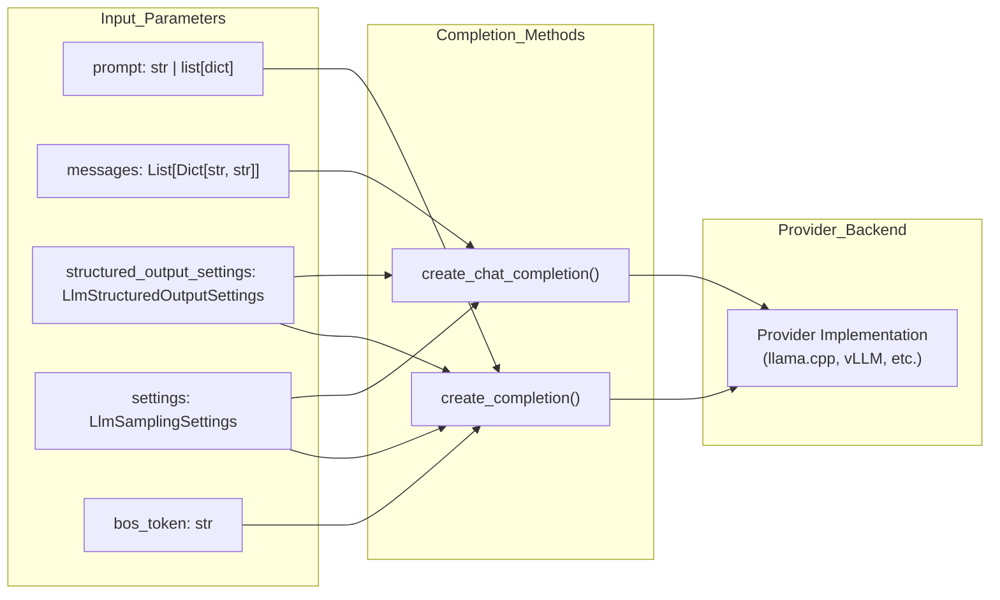
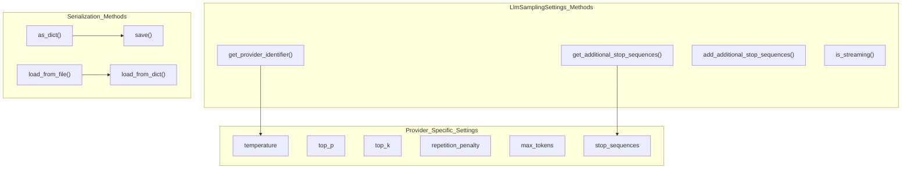
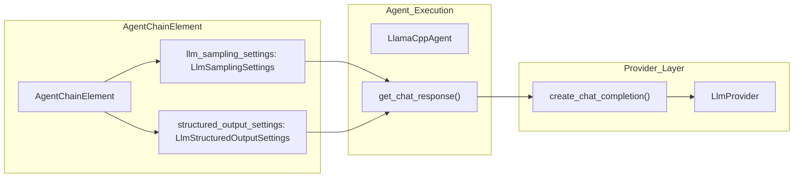
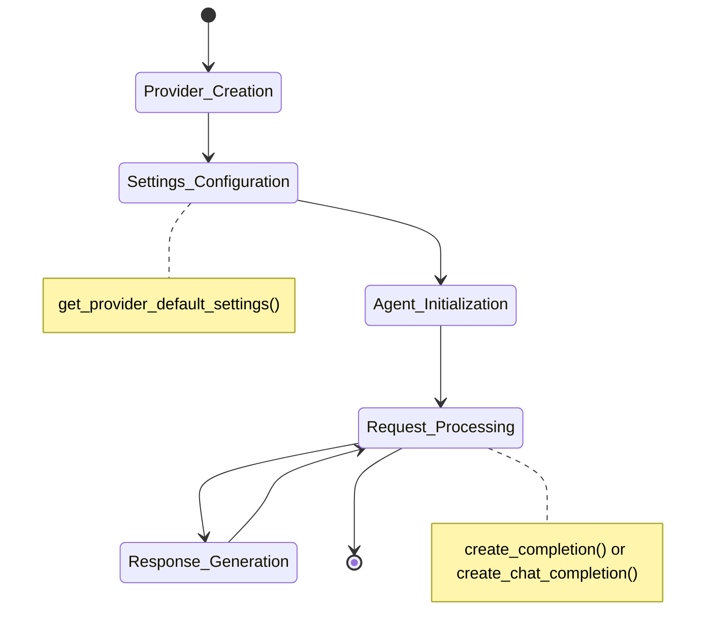

<!-- source: DeepWiki mcp.deepwiki.com · repo Maximilian-Winter/llama-cpp-agent · page 4 Provider System · fetched 2026-10-26 -->

# Provider System

<details>
<summary>Relevant source files</summary>

The following files were used as context for generating this wiki page:

- [src/llama_cpp_agent/chain.py](src/llama_cpp_agent/chain.py)
- [src/llama_cpp_agent/hermes_2_pro_agent.py](src/llama_cpp_agent/hermes_2_pro_agent.py)
- [src/llama_cpp_agent/providers/provider_base.py](src/llama_cpp_agent/providers/provider_base.py)

</details>


The Provider System serves as the abstraction layer that enables the llama-cpp-agent framework to work with different Large Language Model (LLM) backends. This system standardizes the interface for text generation, chat completion, tokenization, and structured output across various providers including local llama.cpp instances, cloud APIs, and specialized inference servers.

For information about specific provider implementations, see [Provider Implementations](#4.2). For details about provider integration with agent workflows, see [Provider Architecture](#4.1).

## Provider Architecture Overview

The provider system is built around two core abstract base classes that define the contract all providers must implement: `LlmProvider` and `LlmSamplingSettings`.



Sources: [src/llama_cpp_agent/providers/provider_base.py:20-26](), [src/llama_cpp_agent/providers/provider_base.py:119-203](), [src/llama_cpp_agent/providers/provider_base.py:28-117]()

## Core Provider Interface

The `LlmProvider` abstract base class defines the essential methods that all provider implementations must support. Each provider must identify itself, handle completions, and provide tokenization capabilities.

### Provider Identification and Configuration

| Method | Purpose | Return Type |
|--------|---------|-------------|
| `get_provider_identifier()` | Returns unique provider ID | `LlmProviderId` |
| `get_provider_default_settings()` | Returns default sampling settings | `LlmSamplingSettings` |
| `is_using_json_schema_constraints()` | Indicates JSON schema support | `bool` |

### Text Generation Interface



Sources: [src/llama_cpp_agent/providers/provider_base.py:149-189]()

### Tokenization Support

The provider interface includes a `tokenize()` method that converts text strings into token lists, enabling token counting and prompt optimization across different model tokenizers.

```python
def tokenize(self, prompt: str) -> List[int]
```

Sources: [src/llama_cpp_agent/providers/provider_base.py:192-203]()

## Sampling Settings System

The `LlmSamplingSettings` abstract base class provides a framework for managing generation parameters across different providers while maintaining type safety and serialization capabilities.

### Core Sampling Settings Interface



Sources: [src/llama_cpp_agent/providers/provider_base.py:28-117]()

### Settings Persistence

The framework provides built-in serialization for sampling settings, allowing configurations to be saved and loaded from JSON files:

| Method | Purpose |
|--------|---------|
| `save(file_path: str)` | Serialize settings to JSON file |
| `load_from_file(file_path: str)` | Deserialize settings from JSON file |
| `as_dict()` | Convert settings to dictionary |
| `load_from_dict(settings: dict)` | Create settings from dictionary |

Sources: [src/llama_cpp_agent/providers/provider_base.py:69-116]()

## Provider Integration with Agent System

The provider system integrates seamlessly with the agent framework through standardized interfaces that support both simple text generation and complex structured outputs.

### Agent Chain Integration

Agent chains utilize providers through the `LlmSamplingSettings` parameter in `AgentChainElement`:



Sources: [src/llama_cpp_agent/chain.py:35-79](), [src/llama_cpp_agent/chain.py:137-144]()

### Structured Output Support

Providers handle structured output generation through the `LlmStructuredOutputSettings` parameter, which can include:

- JSON schema constraints
- GBNF grammar specifications
- Function calling configurations
- Pydantic model validation

The provider's `is_using_json_schema_constraints()` method indicates whether the backend natively supports JSON schema validation or requires grammar-based constraints.

Sources: [src/llama_cpp_agent/providers/provider_base.py:125-126](), [src/llama_cpp_agent/providers/provider_base.py:149-189]()

## Provider Lifecycle and Usage Patterns

### Initialization and Configuration

Providers are typically instantiated with their specific configuration parameters and then passed to agent constructors. The provider's default settings can be obtained and customized as needed:



### Error Handling and Fallbacks

The abstract provider interface enables implementing robust error handling and provider fallback mechanisms at the agent level, since all providers conform to the same interface contract.

Sources: [src/llama_cpp_agent/providers/provider_base.py:139-146]()

## Provider Enumeration System

The `LlmProviderId` enum provides a standardized way to identify different provider types throughout the framework:

| Provider ID | Description |
|-------------|-------------|
| `llama_cpp_server` | HTTP server-based llama.cpp |
| `llama_cpp_python` | Python bindings for llama.cpp |
| `tgi_server` | Text Generation Inference server |
| `vllm_server` | vLLM inference server |
| `groq` | Groq cloud API |

This enumeration is used by both providers and sampling settings to maintain type consistency and enable provider-specific optimizations.

Sources: [src/llama_cpp_agent/providers/provider_base.py:20-26]()

---

