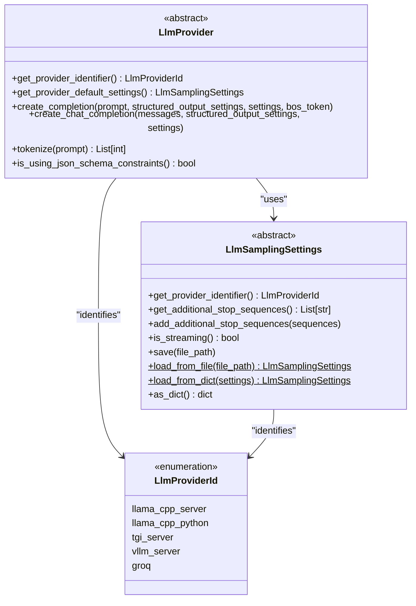
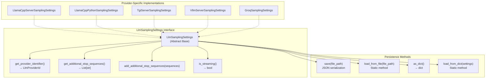
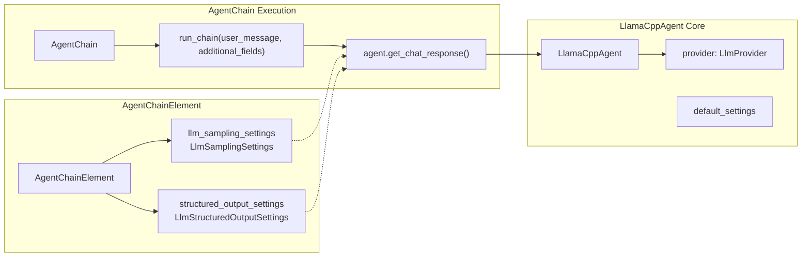
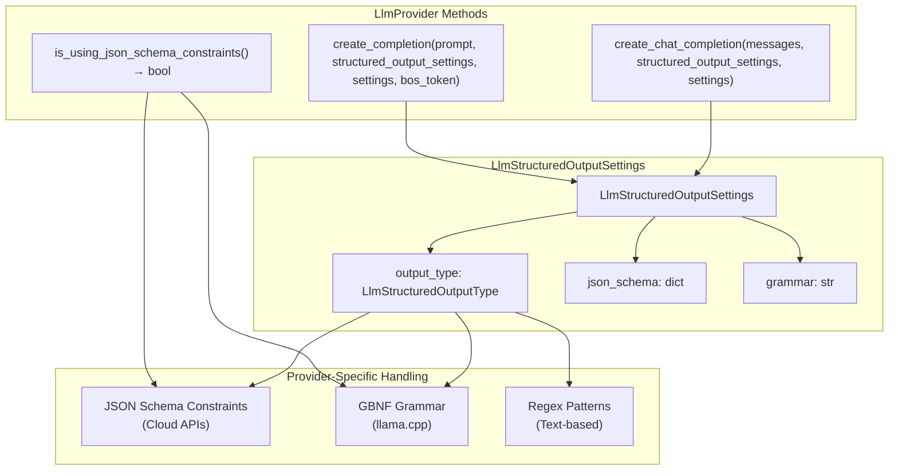
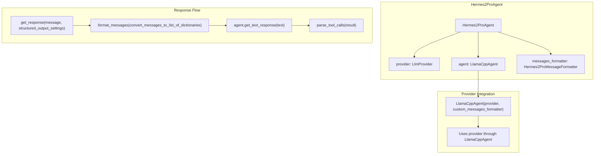

<!-- source: DeepWiki mcp.deepwiki.com · repo Maximilian-Winter/llama-cpp-agent · page 4.1 Provider Architecture · fetched 2026-10-26 -->

# Provider Architecture

<details>
<summary>Relevant source files</summary>

The following files were used as context for generating this wiki page:

- [src/llama_cpp_agent/chain.py](src/llama_cpp_agent/chain.py)
- [src/llama_cpp_agent/hermes_2_pro_agent.py](src/llama_cpp_agent/hermes_2_pro_agent.py)
- [src/llama_cpp_agent/providers/provider_base.py](src/llama_cpp_agent/providers/provider_base.py)

</details>


## Purpose and Scope

The Provider Architecture defines the abstraction layer that enables llama-cpp-agent to work with different Large Language Model (LLM) backends through a unified interface. This system allows agents to generate text and structured outputs regardless of whether they're using local models (llama.cpp), cloud APIs (Groq), or inference servers (vLLM, TGI).

For information about specific provider implementations, see [Provider Implementations](#4.2). For details on structured output configuration that works with providers, see [Output Processing](#3.4).

## Provider Interface Design

The provider architecture centers around two main abstractions: `LlmProvider` for model interaction and `LlmSamplingSettings` for generation parameters.

### Core Provider Interface



Sources: [src/llama_cpp_agent/providers/provider_base.py:119-203](), [src/llama_cpp_agent/providers/provider_base.py:28-117](), [src/llama_cpp_agent/providers/provider_base.py:20-26]()

### Provider Identification System

The `LlmProviderId` enum provides standardized identifiers for each supported LLM backend:

| Provider ID | Purpose | Backend Type |
|-------------|---------|--------------|
| `llama_cpp_server` | HTTP server interface | Local/Remote Server |
| `llama_cpp_python` | Direct Python bindings | Local Library |
| `tgi_server` | Text Generation Inference | Remote Server |
| `vllm_server` | vLLM inference engine | Remote Server |
| `groq` | Groq cloud API | Cloud Service |

Sources: [src/llama_cpp_agent/providers/provider_base.py:20-26]()

## Sampling Settings Architecture

### Settings Interface Design



Sources: [src/llama_cpp_agent/providers/provider_base.py:28-117]()

### Settings Serialization

The sampling settings provide built-in persistence through JSON serialization:

- `save(file_path)` - Serializes settings to JSON file using `as_dict()`
- `load_from_file(file_path)` - Static method to deserialize from JSON file
- `as_dict()` - Abstract method implemented by each provider for custom serialization
- `load_from_dict(settings)` - Static method for loading from dictionary

Sources: [src/llama_cpp_agent/providers/provider_base.py:69-116]()

## Provider Orchestration Through Agent Chains

### Agent Chain Integration

The provider system integrates with the agent framework through `AgentChainElement` and `AgentChain` classes, enabling complex multi-step workflows with different sampling settings per step.



Sources: [src/llama_cpp_agent/chain.py:35-80](), [src/llama_cpp_agent/chain.py:137-144]()

### Chain Element Configuration

Each `AgentChainElement` can specify its own `LlmSamplingSettings`, allowing fine-grained control over generation parameters within multi-step workflows:

```python
# From AgentChainElement.__init__
llm_sampling_settings: LlmSamplingSettings = None
```

When `run_chain()` executes, it passes the element-specific settings to `agent.get_chat_response()`, overriding the agent's default settings for that step.

Sources: [src/llama_cpp_agent/chain.py:46](), [src/llama_cpp_agent/chain.py:143]()

## Structured Output Integration

### Provider-Aware Output Processing

The provider interface includes `is_using_json_schema_constraints()` to determine how each provider handles structured output constraints:



Sources: [src/llama_cpp_agent/providers/provider_base.py:124-126](), [src/llama_cpp_agent/providers/provider_base.py:149-189]()

## Specialized Agent Integration

### Hermes2ProAgent Provider Usage

The `Hermes2ProAgent` demonstrates advanced provider integration with custom message formatting and tool calling:



Sources: [src/llama_cpp_agent/hermes_2_pro_agent.py:214-222](), [src/llama_cpp_agent/hermes_2_pro_agent.py:239-267]()

### Custom Message Formatting

The `Hermes2ProAgent` uses a specialized `Hermes2ProMessageFormatter` that extends the base `MessagesFormatter` with provider-agnostic message formatting, demonstrating how the provider architecture supports diverse conversation formats while maintaining a unified interface.

Sources: [src/llama_cpp_agent/hermes_2_pro_agent.py:54-211]()

## Provider Method Contracts

### Core Provider Methods

| Method | Purpose | Return Type | Required Parameters |
|--------|---------|-------------|-------------------|
| `get_provider_identifier()` | Returns provider enum ID | `LlmProviderId` | None |
| `get_provider_default_settings()` | Returns default sampling settings | `LlmSamplingSettings` | None |
| `create_completion()` | Text completion generation | Provider-specific | `prompt`, `structured_output_settings`, `settings`, `bos_token` |
| `create_chat_completion()` | Chat-based generation | Provider-specific | `messages`, `structured_output_settings`, `settings` |
| `tokenize()` | Convert text to tokens | `List[int]` | `prompt` |
| `is_using_json_schema_constraints()` | Check constraint support | `bool` | None |

Sources: [src/llama_cpp_agent/providers/provider_base.py:124-203]()

The provider architecture enables seamless switching between different LLM backends while maintaining consistent interfaces for generation parameters, structured output, and chat functionality across the entire llama-cpp-agent framework.

---

