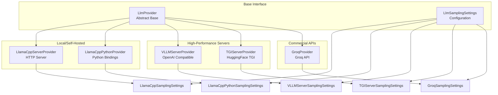
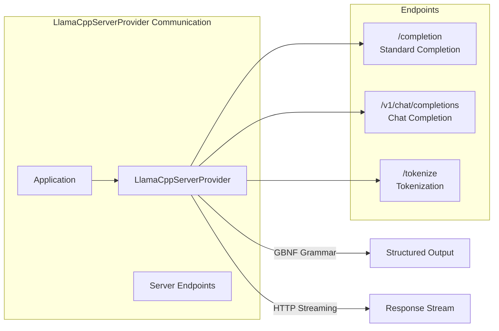
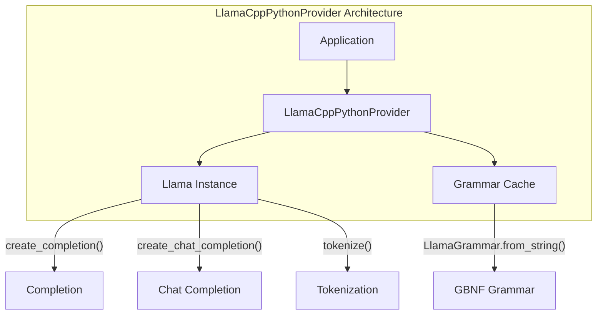
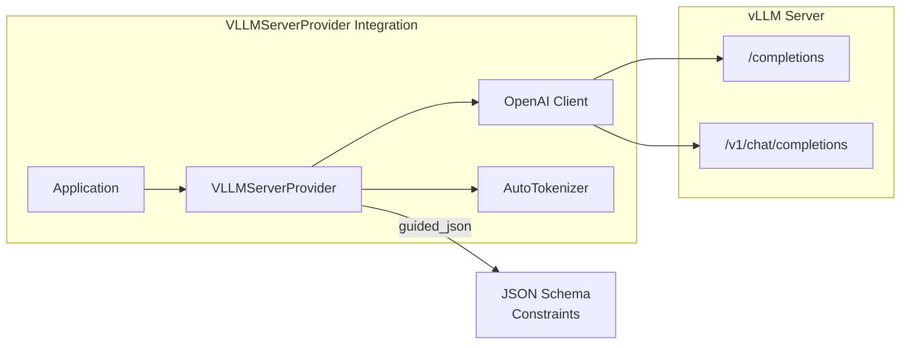
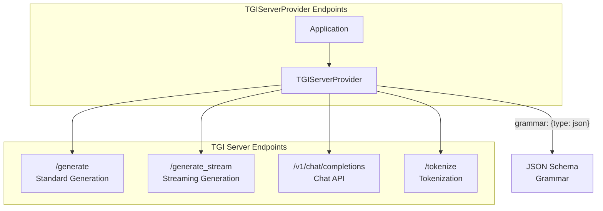
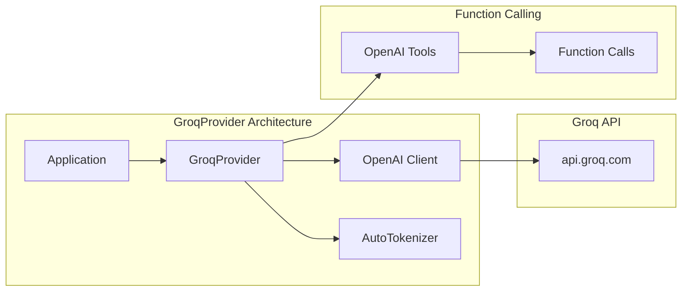

<!-- source: DeepWiki mcp.deepwiki.com · repo Maximilian-Winter/llama-cpp-agent · page 4.2 Provider Implementations · fetched 2026-10-26 -->

# Provider Implementations

<details>
<summary>Relevant source files</summary>

The following files were used as context for generating this wiki page:

- [examples/01_Basics/chatbot_using_groq.py](examples/01_Basics/chatbot_using_groq.py)
- [examples/04_Chains/article_summary.py](examples/04_Chains/article_summary.py)
- [examples/07_Memory/MemoryAssistant/core_memory.json](examples/07_Memory/MemoryAssistant/core_memory.json)
- [examples/07_Memory/MemoryAssistant/main.py](examples/07_Memory/MemoryAssistant/main.py)
- [examples/07_Memory/MemoryAssistant/memory.py](examples/07_Memory/MemoryAssistant/memory.py)
- [examples/07_Memory/MemoryAssistant/prompts.py](examples/07_Memory/MemoryAssistant/prompts.py)
- [src/llama_cpp_agent/providers/groq.py](src/llama_cpp_agent/providers/groq.py)
- [src/llama_cpp_agent/providers/llama_cpp_python.py](src/llama_cpp_agent/providers/llama_cpp_python.py)
- [src/llama_cpp_agent/providers/llama_cpp_server.py](src/llama_cpp_agent/providers/llama_cpp_server.py)
- [src/llama_cpp_agent/providers/tgi_server.py](src/llama_cpp_agent/providers/tgi_server.py)
- [src/llama_cpp_agent/providers/vllm_server.py](src/llama_cpp_agent/providers/vllm_server.py)
- [src/llama_cpp_agent/text_utils.py](src/llama_cpp_agent/text_utils.py)

</details>


This document details the specific LLM provider implementations in the llama-cpp-agent framework. These providers enable integration with various LLM backends including local servers, high-performance inference engines, and commercial APIs. For information about the abstract provider interface and architecture, see [Provider Architecture](#4.1).

## Provider Implementation Overview

The framework includes five core provider implementations, each optimized for different deployment scenarios and LLM backends:



**Sources:** [src/llama_cpp_agent/providers/vllm_server.py:75-93](), [src/llama_cpp_agent/providers/llama_cpp_server.py:140-172](), [src/llama_cpp_agent/providers/llama_cpp_python.py:124-136](), [src/llama_cpp_agent/providers/tgi_server.py:90-111](), [src/llama_cpp_agent/providers/groq.py:63-81]()

## Local and Self-Hosted Providers

### LlamaCppServerProvider

The `LlamaCppServerProvider` communicates with llama.cpp server instances via HTTP requests. It supports both the standard llama.cpp server and llama-cpp-python server modes.

**Key Features:**
- HTTP-based communication with llama.cpp servers
- GBNF grammar support for structured output
- Streaming and non-streaming completions
- API key authentication support

**Configuration:** [src/llama_cpp_agent/providers/llama_cpp_server.py:140-164]()



**Sources:** [src/llama_cpp_agent/providers/llama_cpp_server.py:140-172](), [src/llama_cpp_agent/providers/llama_cpp_server.py:174-204](), [src/llama_cpp_agent/providers/llama_cpp_server.py:206-233]()

**Sampling Settings:** [src/llama_cpp_agent/providers/llama_cpp_server.py:20-137]()

| Parameter | Default | Description |
|-----------|---------|-------------|
| `temperature` | 0.8 | Controls randomness |
| `top_k` | 40 | Top-k sampling diversity |
| `top_p` | 0.95 | Nucleus sampling threshold |
| `n_predict` | -1 | Number of tokens to generate |
| `stream` | True | Enable streaming responses |
| `repeat_penalty` | 1.1 | Repetition penalty factor |

### LlamaCppPythonProvider

The `LlamaCppPythonProvider` directly integrates with llama-cpp-python bindings for in-process model execution.

**Key Features:**
- Direct Python binding integration
- Grammar caching for performance
- In-process model execution
- Lower latency for local inference

**Configuration:** [src/llama_cpp_agent/providers/llama_cpp_python.py:124-127]()



**Sources:** [src/llama_cpp_agent/providers/llama_cpp_python.py:124-136](), [src/llama_cpp_agent/providers/llama_cpp_python.py:138-165](), [src/llama_cpp_agent/providers/llama_cpp_python.py:127]()

## High-Performance Server Providers

### VLLMServerProvider

The `VLLMServerProvider` integrates with vLLM servers using OpenAI-compatible APIs with guided JSON generation support.

**Key Features:**
- OpenAI client compatibility
- Guided JSON schema constraints
- High-throughput inference
- HuggingFace tokenizer integration

**Configuration:** [src/llama_cpp_agent/providers/vllm_server.py:76-84]()



**Sources:** [src/llama_cpp_agent/providers/vllm_server.py:75-84](), [src/llama_cpp_agent/providers/vllm_server.py:95-149](), [src/llama_cpp_agent/providers/vllm_server.py:151-204]()

**Sampling Settings:** [src/llama_cpp_agent/providers/vllm_server.py:18-72]()

| Parameter | Default | Description |
|-----------|---------|-------------|
| `temperature` | 0.7 | Generation randomness |
| `top_p` | 1.0 | Nucleus sampling |
| `top_k` | -1 | Top-k sampling |
| `max_tokens` | 16 | Maximum generation length |
| `use_beam_search` | False | Enable beam search |

### TGIServerProvider

The `TGIServerProvider` connects to Text Generation Inference servers with comprehensive parameter support and JSON schema constraints.

**Key Features:**
- HuggingFace TGI server integration
- JSON schema grammar support
- Comprehensive generation parameters
- Streaming and non-streaming modes

**Configuration:** [src/llama_cpp_agent/providers/tgi_server.py:92-102]()



**Sources:** [src/llama_cpp_agent/providers/tgi_server.py:90-102](), [src/llama_cpp_agent/providers/tgi_server.py:113-151](), [src/llama_cpp_agent/providers/tgi_server.py:153-188]()

## Commercial and Cloud Providers

### GroqProvider

The `GroqProvider` integrates with Groq's commercial API using OpenAI-compatible interfaces with function calling support.

**Key Features:**
- OpenAI client compatibility
- Function calling via tools parameter
- HuggingFace tokenizer integration
- Commercial API access

**Configuration:** [src/llama_cpp_agent/providers/groq.py:64-72]()



**Sources:** [src/llama_cpp_agent/providers/groq.py:63-72](), [src/llama_cpp_agent/providers/groq.py:83-150](), [src/llama_cpp_agent/providers/groq.py:152-205]()

## Provider Feature Comparison

| Provider | Structured Output | Streaming | Function Calling | Local/Remote |
|----------|------------------|-----------|------------------|--------------|
| `LlamaCppServerProvider` | GBNF Grammar | ✓ | Via Grammar | Remote (HTTP) |
| `LlamaCppPythonProvider` | GBNF Grammar | ✓ | Via Grammar | Local (Bindings) |
| `VLLMServerProvider` | JSON Schema | ✓ | Via Grammar | Remote (HTTP) |
| `TGIServerProvider` | JSON Schema | ✓ | Via Grammar | Remote (HTTP) |
| `GroqProvider` | JSON Schema | ✓ | Native Tools | Remote (API) |

**Constraint Types:**
- **GBNF Grammar**: Uses `is_using_json_schema_constraints() = False` [src/llama_cpp_agent/providers/llama_cpp_server.py:165-166]()
- **JSON Schema**: Uses `is_using_json_schema_constraints() = True` [src/llama_cpp_agent/providers/vllm_server.py:86-87]()

## Usage Examples

### Basic Provider Setup

```python
# Local llama.cpp server
from llama_cpp_agent.providers import LlamaCppServerProvider
provider = LlamaCppServerProvider("http://localhost:8080")

# vLLM server with API key
from llama_cpp_agent.providers.vllm_server import VLLMServerProvider
provider = VLLMServerProvider(
    base_url="http://localhost:8000",
    model="mistral-7b",
    huggingface_model="mistralai/Mistral-7B-Instruct-v0.1",
    api_key="your-key"
)
```

### Settings Configuration

```python
# Get default settings and customize
settings = provider.get_provider_default_settings()
settings.temperature = 0.7
settings.max_tokens = 512
settings.stream = True
```

**Sources:** [examples/01_Basics/chatbot_using_groq.py:5-17](), [examples/07_Memory/MemoryAssistant/main.py:13-26]()

---

