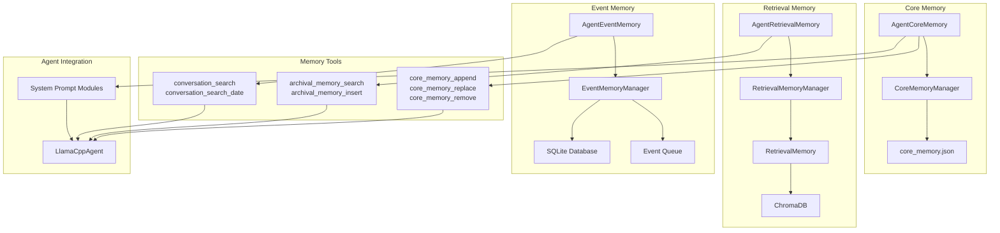
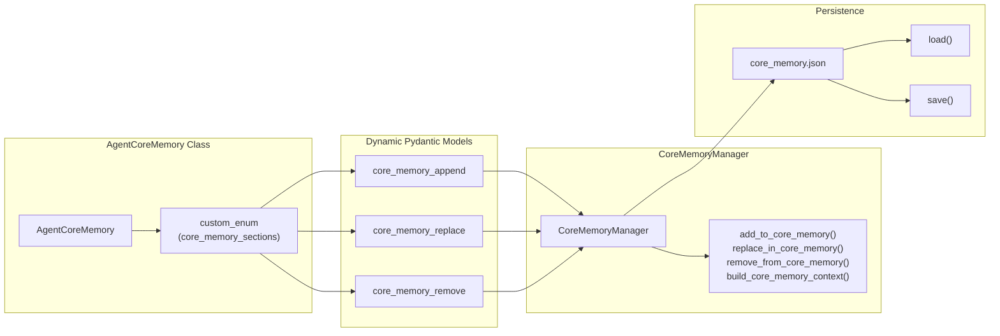
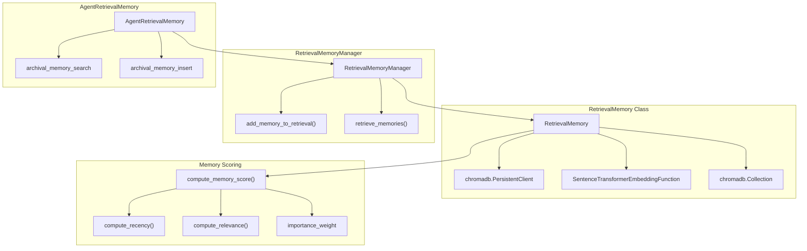
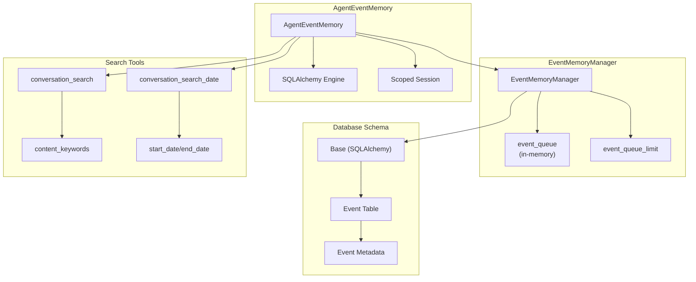

<!-- source: DeepWiki mcp.deepwiki.com · repo Maximilian-Winter/llama-cpp-agent · page 5 Memory System · fetched 2026-10-26 -->

# Memory System

<details>
<summary>Relevant source files</summary>

The following files were used as context for generating this wiki page:

- [src/llama_cpp_agent/agent_memory/core_memory_manager.py](src/llama_cpp_agent/agent_memory/core_memory_manager.py)
- [src/llama_cpp_agent/agent_memory/memory_tools.py](src/llama_cpp_agent/agent_memory/memory_tools.py)
- [src/llama_cpp_agent/agent_memory/retrieval_memory.py](src/llama_cpp_agent/agent_memory/retrieval_memory.py)
- [src/llama_cpp_agent/agent_memory/retrieval_memory_manager.py](src/llama_cpp_agent/agent_memory/retrieval_memory_manager.py)
- [src/llama_cpp_agent/llm_prompt_template.py](src/llama_cpp_agent/llm_prompt_template.py)

</details>


The Memory System provides comprehensive memory capabilities for LLM agents, enabling them to maintain context, remember past interactions, and perform semantic searches across stored information. This system consists of three distinct memory types that work together to provide short-term and long-term memory functionality.

For information about how memory integrates with agents, see [Memory Tools Integration](#5.2). For details on the underlying tool framework, see [Tools and Function Calling](#6).

## Memory Architecture Overview

The memory system is built around three complementary memory types, each serving a specific purpose in agent cognition:

### Memory Architecture Diagram



**Sources:** [src/llama_cpp_agent/agent_memory/memory_tools.py:1-296](), [src/llama_cpp_agent/agent_memory/core_memory_manager.py:1-79](), [src/llama_cpp_agent/agent_memory/retrieval_memory.py:1-145]()

| Memory Type | Purpose | Storage | Access Pattern |
|-------------|---------|---------|----------------|
| **Core Memory** | Essential agent context (persona, user info) | JSON file | Direct key-value access |
| **Retrieval Memory** | Semantic search of archived information | ChromaDB vector database | Embedding-based similarity search |
| **Event Memory** | Conversation history and temporal events | SQLite database + in-memory queue | Keyword and date-based queries |

## Core Memory System

Core Memory maintains essential agent context that should be immediately accessible. It uses a hierarchical key-value structure organized into sections like `persona` and `human`.

### Core Memory Implementation



**Sources:** [src/llama_cpp_agent/agent_memory/memory_tools.py:170-262](), [src/llama_cpp_agent/agent_memory/core_memory_manager.py:5-79]()

### Core Memory Structure

The `AgentCoreMemory` class dynamically creates Pydantic models based on provided memory sections:

- **Initialization**: Takes `core_memory_sections` list to define valid memory categories
- **Dynamic Enums**: Creates enums from section names for type safety
- **Function Tools**: Wraps operations in `LlamaCppFunctionTool` instances for agent use

The `CoreMemoryManager` handles the actual memory operations:

- `add_to_core_memory(key, child_key, value)` - Adds new entries
- `replace_in_core_memory(key, child_key, new_value)` - Updates existing entries  
- `remove_from_core_memory(key, child_key)` - Removes specific fields
- `build_core_memory_context()` - Formats memory for system prompts

**Sources:** [src/llama_cpp_agent/agent_memory/core_memory_manager.py:10-55](), [src/llama_cpp_agent/agent_memory/memory_tools.py:221-240]()

## Retrieval Memory System

Retrieval Memory provides semantic search capabilities using ChromaDB for vector storage and sentence transformers for embeddings.

### Retrieval Memory Components



**Sources:** [src/llama_cpp_agent/agent_memory/retrieval_memory.py:10-145](), [src/llama_cpp_agent/agent_memory/retrieval_memory_manager.py:6-43](), [src/llama_cpp_agent/agent_memory/memory_tools.py:136-164]()

### Memory Scoring Algorithm

The retrieval system uses a sophisticated scoring mechanism that combines:

- **Recency**: Exponential decay based on last access time using `decay_factor`
- **Relevance**: Cosine similarity between query and memory embeddings
- **Importance**: User-defined importance score (1.0-10.0)

The scoring formula: `score = α_recency × recency + α_relevance × relevance + α_importance × importance`

**Sources:** [src/llama_cpp_agent/agent_memory/retrieval_memory.py:97-114](), [src/llama_cpp_agent/agent_memory/retrieval_memory.py:121-133]()

## Event Memory System

Event Memory tracks conversation history and temporal events using SQLite for persistent storage and an in-memory queue for recent events.

### Event Memory Architecture



**Sources:** [src/llama_cpp_agent/agent_memory/memory_tools.py:264-296](), [src/llama_cpp_agent/agent_memory/event_memory.py:1-50]()

### Event Management

The `EventMemoryManager` maintains both recent and historical event data:

- **Event Queue**: In-memory storage for recent events (configurable limit)
- **SQLite Database**: Persistent storage for all events with metadata
- **Event Types**: Based on `Roles` enum (user, assistant, system, tool)

Search capabilities include:
- **Keyword Search**: Case-insensitive content matching via `conversation_search`
- **Date Range Search**: Temporal queries via `conversation_search_date`
- **Pagination**: Results can be paginated for large result sets

**Sources:** [src/llama_cpp_agent/agent_memory/memory_tools.py:22-95](), [src/llama_cpp_agent/agent_memory/event_memory_manager.py:1-100]()

## Persistence and Storage

Each memory type uses different persistence mechanisms optimized for their access patterns:

| Memory Type | Storage Format | Persistence Method | Configuration |
|-------------|---------------|-------------------|---------------|
| **Core Memory** | JSON | `core_memory.json` | File path configurable |
| **Retrieval Memory** | ChromaDB | Vector database files | Persistent DB path, embedding model |
| **Event Memory** | SQLite + JSON queue | Database + optional queue file | DB connection string, queue file |

### Memory Initialization Patterns

```python
# Core Memory
core_memory = AgentCoreMemory(
    core_memory_sections=["persona", "human", "game_progress"],
    core_memory_file="./core_memory.json"
)

# Retrieval Memory  
retrieval_memory = AgentRetrievalMemory(
    persistent_db_path="./retrieval_memory",
    embedding_model_name="all-MiniLM-L6-v2",
    collection_name="retrieval_memory_collection"
)

# Event Memory
event_memory = AgentEventMemory(
    event_queue_limit=30,
    event_queue_file="./event_queue.json", 
    db_path="sqlite:///events.db"
)
```

**Sources:** [src/llama_cpp_agent/agent_memory/memory_tools.py:136-275](), [src/llama_cpp_agent/agent_memory/core_memory_manager.py:71-78]()

---

