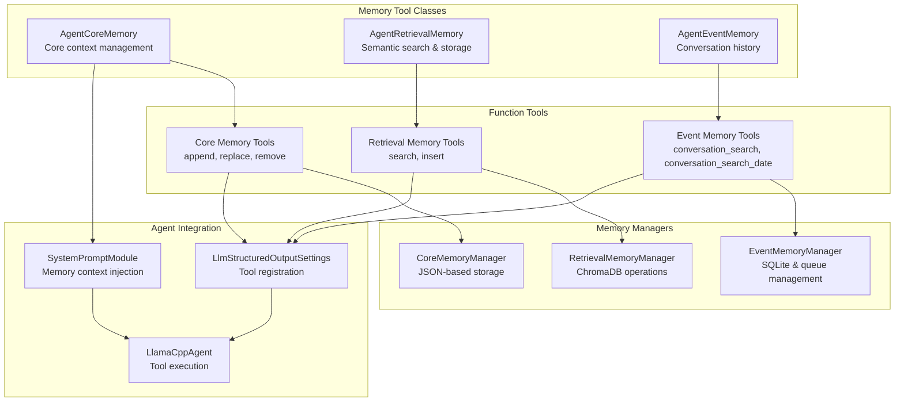
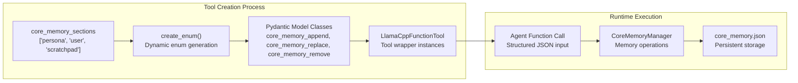
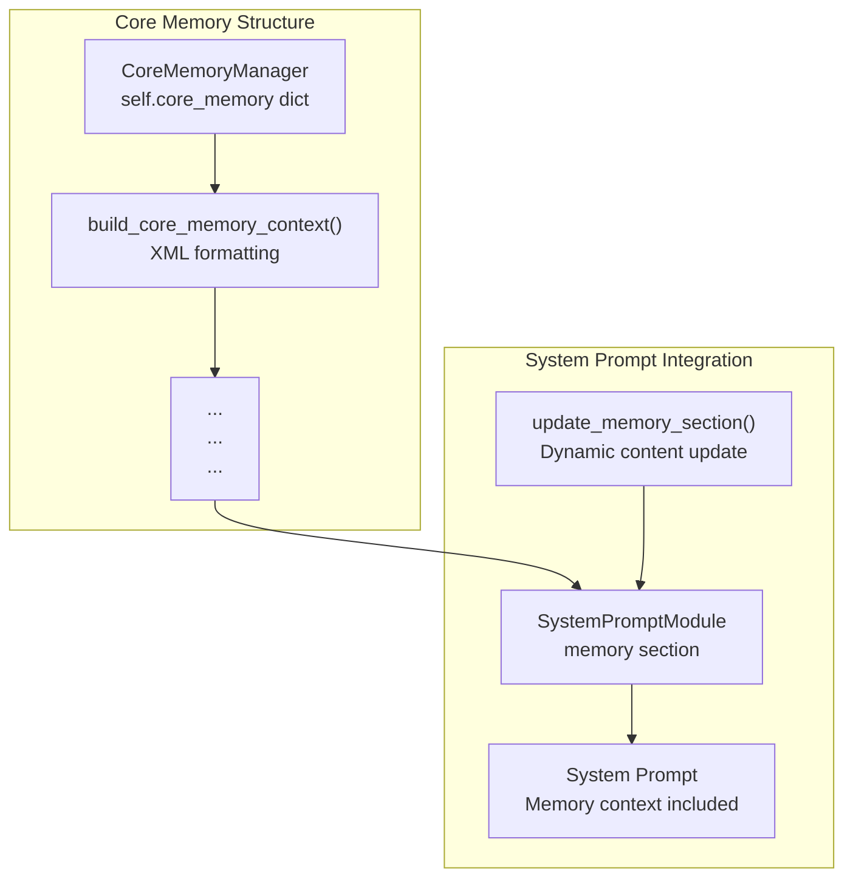
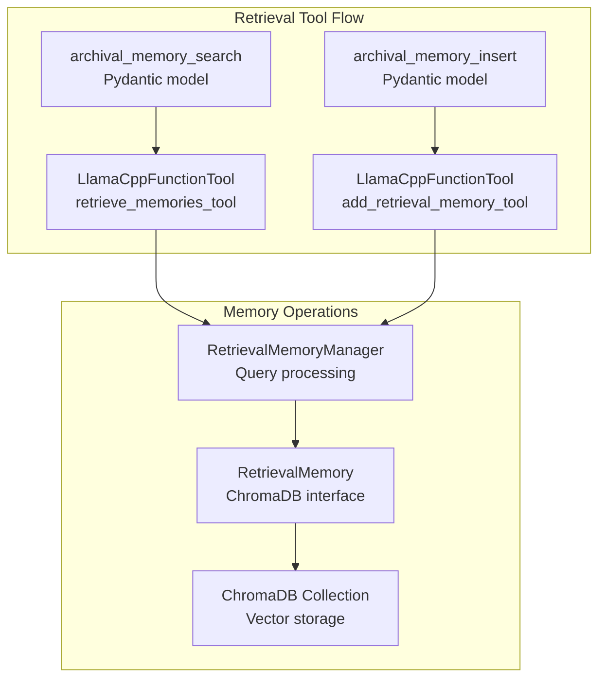
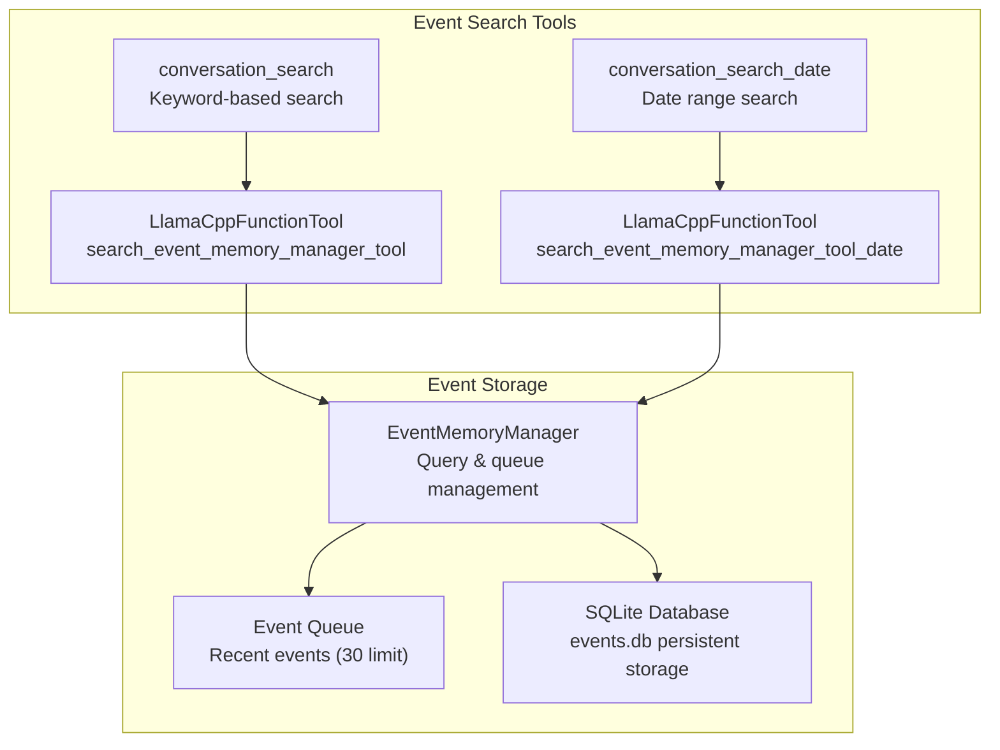
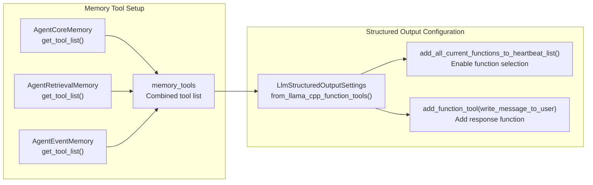
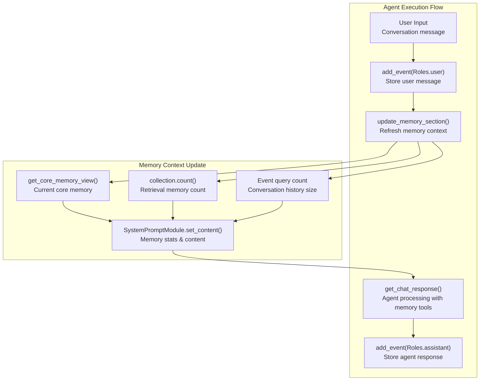

<!-- source: DeepWiki mcp.deepwiki.com · repo Maximilian-Winter/llama-cpp-agent · page 5.2 Memory Tools Integration · fetched 2026-10-26 -->

# Memory Tools Integration

Relevant source files

The following files were used as context for generating this wiki page:

- [examples/01_Basics/chatbot_using_groq.py](examples/01_Basics/chatbot_using_groq.py)
- [examples/07_Memory/MemoryAssistant/core_memory.json](examples/07_Memory/MemoryAssistant/core_memory.json)
- [examples/07_Memory/MemoryAssistant/main.py](examples/07_Memory/MemoryAssistant/main.py)
- [examples/07_Memory/MemoryAssistant/memory.py](examples/07_Memory/MemoryAssistant/memory.py)
- [examples/07_Memory/MemoryAssistant/prompts.py](examples/07_Memory/MemoryAssistant/prompts.py)
- [src/llama_cpp_agent/agent_memory/core_memory_manager.py](src/llama_cpp_agent/agent_memory/core_memory_manager.py)
- [src/llama_cpp_agent/agent_memory/memory_tools.py](src/llama_cpp_agent/agent_memory/memory_tools.py)
- [src/llama_cpp_agent/agent_memory/retrieval_memory.py](src/llama_cpp_agent/agent_memory/retrieval_memory.py)
- [src/llama_cpp_agent/agent_memory/retrieval_memory_manager.py](src/llama_cpp_agent/agent_memory/retrieval_memory_manager.py)
- [src/llama_cpp_agent/llm_prompt_template.py](src/llama_cpp_agent/llm_prompt_template.py)
- [src/llama_cpp_agent/providers/groq.py](src/llama_cpp_agent/providers/groq.py)

This document covers how the memory system integrates with agents through function tools and system prompt modules. It explains the mechanisms that allow agents to interact with core memory, retrieval memory, and event memory through structured function calls.

For information about the underlying memory architectures and storage implementations, see [Memory Architecture](#5.1). For details on the function calling framework itself, see [Function Tools Framework](#6.1).

## Memory Tool Architecture

The memory system exposes three types of memory through standardized function tools that agents can call during conversations. Each memory type provides specialized tools for different aspects of memory management.

Sources: [src/llama_cpp_agent/agent_memory/memory_tools.py:136-296](), [examples/07_Memory/MemoryAssistant/memory.py:12-25]()

## Core Memory Tool Integration

The `AgentCoreMemory` class creates function tools for managing structured core memory sections. These tools allow agents to dynamically modify essential context information during conversations.

### Core Memory Function Tools

| Tool Function | Purpose | Parameters |
|---------------|---------|------------|
| `core_memory_append` | Add new entries to core memory | `key`, `field`, `value` |
| `core_memory_replace` | Replace existing core memory entries | `key`, `field`, `new_value` |
| `core_memory_remove` | Remove entries from core memory | `key`, `field` |

The core memory tools are created dynamically based on configured memory sections:

Sources: [src/llama_cpp_agent/agent_memory/memory_tools.py:170-234](), [src/llama_cpp_agent/agent_memory/core_memory_manager.py:10-43]()

### System Prompt Integration

Core memory content is exposed to agents through the `get_core_memory_view()` method, which formats memory as XML for inclusion in system prompts:

Sources: [src/llama_cpp_agent/agent_memory/core_memory_manager.py:45-56](), [examples/07_Memory/MemoryAssistant/memory.py:27-31]()

## Retrieval Memory Tool Integration

The `AgentRetrievalMemory` class provides semantic search and storage capabilities through ChromaDB-backed function tools.

### Retrieval Memory Function Tools

| Tool Function | Purpose | Parameters |
|---------------|---------|------------|
| `archival_memory_search` | Semantic search of stored memories | `query`, `page` |
| `archival_memory_insert` | Add new memories with importance scoring | `memory`, `importance` |

Sources: [src/llama_cpp_agent/agent_memory/memory_tools.py:98-164](), [src/llama_cpp_agent/agent_memory/retrieval_memory_manager.py:6-43]()

## Event Memory Tool Integration

The `AgentEventMemory` class manages conversation history through both SQLite persistence and in-memory queues, providing search capabilities for past interactions.

### Event Memory Function Tools

| Tool Function | Purpose | Parameters |
|---------------|---------|------------|
| `conversation_search` | Search conversations by keywords | `keywords`, `page` |
| `conversation_search_date` | Search conversations by date range | `start_date`, `end_date`, `page` |

Sources: [src/llama_cpp_agent/agent_memory/memory_tools.py:22-96](), [src/llama_cpp_agent/agent_memory/memory_tools.py:264-296]()

## Agent Integration Patterns

Memory tools integrate with `LlamaCppAgent` through structured output settings and system prompt modules. The integration follows a consistent pattern across all memory types.

### Tool Registration Process

Sources: [examples/07_Memory/MemoryAssistant/memory.py:16-25]()

### Runtime Memory Management

During agent execution, memory systems are automatically updated and memory content is dynamically injected into system prompts:

Sources: [examples/07_Memory/MemoryAssistant/main.py:38-77](), [examples/07_Memory/MemoryAssistant/memory.py:27-31]()

## System Prompt Integration

Memory content is exposed to agents through `SystemPromptModule` instances that dynamically inject memory context into the system prompt before each agent response.

### Memory Context Formatting

| Memory Type | Context Format | Update Method |
|-------------|----------------|---------------|
| Core Memory | XML sections with nested fields | `get_core_memory_view()` |
| Retrieval Memory | Count of stored memories | `collection.count()` |
| Event Memory | Count of conversation entries | SQLite query count |

The memory assistant example demonstrates the complete integration pattern where memory statistics and core memory content are refreshed before each agent interaction, ensuring the agent always has current memory context available.

Sources: [examples/07_Memory/MemoryAssistant/main.py:28-36](), [examples/07_Memory/MemoryAssistant/main.py:42-49](), [src/llama_cpp_agent/agent_memory/core_memory_manager.py:45-56]()

---

