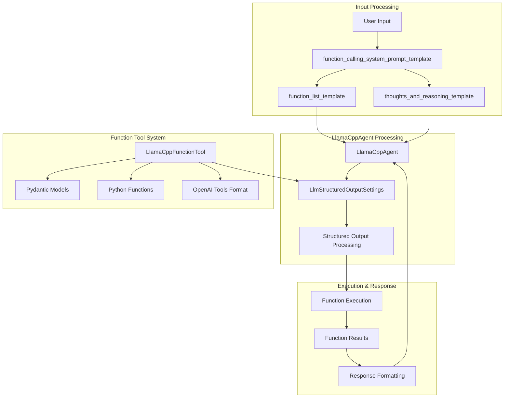
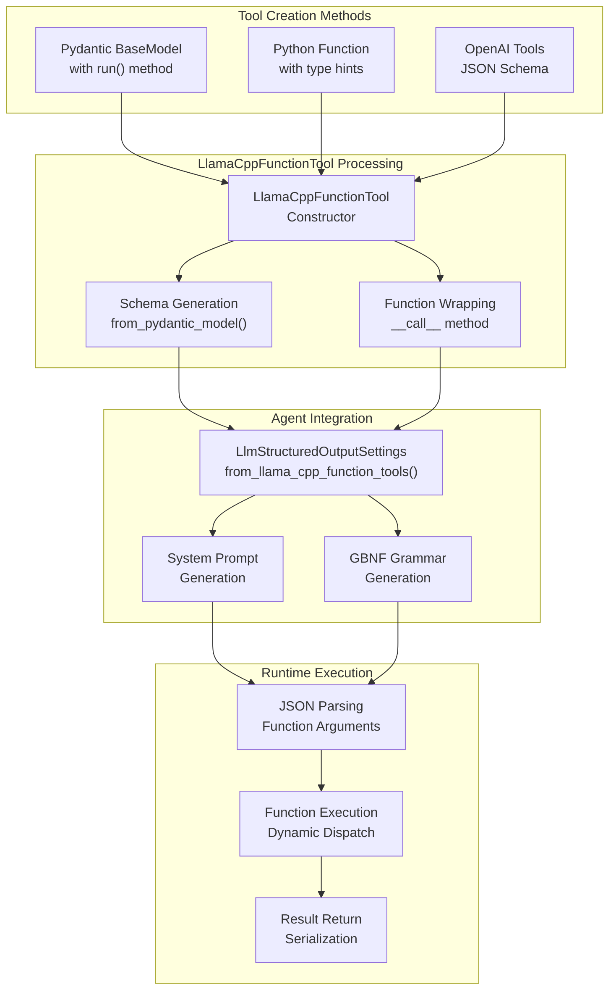
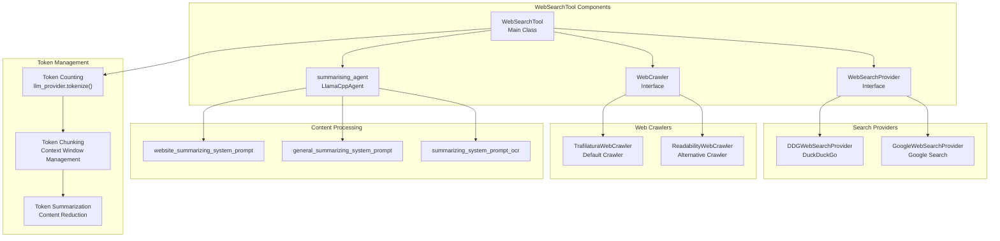
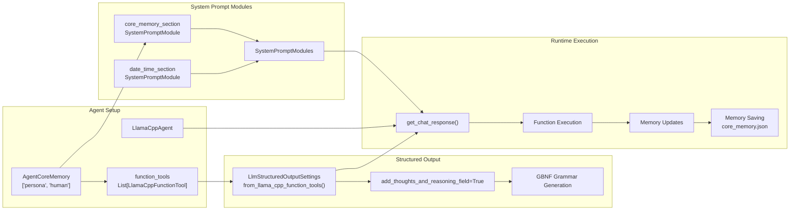

<!-- source: DeepWiki mcp.deepwiki.com · repo Maximilian-Winter/llama-cpp-agent · page 6 Tools and Function Calling · fetched 2026-10-26 -->

# Tools and Function Calling

<details>
<summary>Relevant source files</summary>

The following files were used as context for generating this wiki page:

- [examples/01_Basics/self_critique.py](examples/01_Basics/self_critique.py)
- [examples/07_Memory/agent_core_memory.py](examples/07_Memory/agent_core_memory.py)
- [examples/07_Memory/core_memory.json](examples/07_Memory/core_memory.json)
- [src/llama_cpp_agent/prompt_templates.py](src/llama_cpp_agent/prompt_templates.py)
- [src/llama_cpp_agent/tools/web_search/tool.py](src/llama_cpp_agent/tools/web_search/tool.py)

</details>


This document covers the framework's comprehensive tools and function calling system, which enables agents to execute external functions, interact with APIs, and perform complex tasks beyond text generation. The system provides a structured approach to tool integration, function calling protocols, and dynamic prompt generation for tool-enabled conversations.

For detailed information about specific tool implementations, see [Function Tools Framework](#6.1), [Web Search Tools](#6.2), and [Prompt Templates](#6.3). For information about how tools integrate with memory systems, see [Memory Tools Integration](#5.2).

## Function Calling Architecture

The framework implements function calling through a multi-layered architecture that combines prompt templates, structured output processing, and tool execution management.

### Function Calling Flow



Sources: [src/llama_cpp_agent/prompt_templates.py:3-36](), [examples/07_Memory/agent_core_memory.py:27-41]()

### Prompt Template System

The function calling system relies on dynamic prompt generation using structured templates:

| Template Component | Purpose | Key Variables |
|-------------------|---------|---------------|
| `function_calling_system_prompt_template` | Main system prompt for function calling | `system_instructions`, `function_list`, `function_field_name` |
| `thoughts_and_reasoning_template` | Adds reasoning capability | `thoughts_and_reasoning_field_name` |
| `heart_beats_template` | Enables continuous function calls | `heartbeat_field_name` |
| `function_list_template` | Formats available functions | `function_list` |

The system constructs prompts that instruct the model to respond with JSON objects containing function calls, supporting both single function calls and multiple parallel function executions.

Sources: [src/llama_cpp_agent/prompt_templates.py:3-36]()

## Tool Creation and Integration

### LlamaCppFunctionTool Wrapper System



Sources: [examples/07_Memory/agent_core_memory.py:16-27](), [examples/07_Memory/agent_core_memory.py:41]()

### Pydantic Model Integration

The framework integrates seamlessly with Pydantic models to define function schemas:

```python
class SendMessageToUser(BaseModel):
    """
    Send a message to the User.
    """
    message: str = Field(..., description="Message you want to send to the user.")
    
    def run(self):
        print("Message: " + self.message)

function_tools = [LlamaCppFunctionTool(SendMessageToUser)]
```

The `LlamaCppFunctionTool` automatically extracts schema information from Pydantic models, including field types, descriptions, and validation rules, converting them into function calling formats compatible with the LLM.

Sources: [examples/07_Memory/agent_core_memory.py:16-27]()

## Web Search Tool Implementation

### WebSearchTool Architecture



Sources: [src/llama_cpp_agent/tools/web_search/tool.py:15-54](), [src/llama_cpp_agent/tools/web_search/tool.py:55-101]()

### Search and Summarization Flow

The `WebSearchTool` implements a sophisticated pipeline for web search and content processing:

1. **Search Execution**: Uses configurable search providers (`DDGWebSearchProvider`, `GoogleWebSearchProvider`)
2. **Content Extraction**: Employs web crawlers (`TrafilaturaWebCrawler`, `ReadabilityWebCrawler`) to extract clean text
3. **Token Management**: Automatically handles context window limits through dynamic content truncation
4. **Content Summarization**: Uses specialized prompts for website, general, and OCR content summarization
5. **Result Aggregation**: Combines multiple search results into coherent summaries

The tool automatically manages token limits by tokenizing content and truncating when necessary to fit within model context windows.

Sources: [src/llama_cpp_agent/tools/web_search/tool.py:55-101](), [src/llama_cpp_agent/prompt_templates.py:86-115]()

## Agent Integration Patterns

### Memory-Enabled Function Calling



Sources: [examples/07_Memory/agent_core_memory.py:28-67]()

### Tool Registration and Configuration

The framework supports flexible tool registration through multiple patterns:

| Pattern | Usage | Example |
|---------|-------|---------|
| Direct Function Wrapping | `LlamaCppFunctionTool(function)` | Simple Python functions |
| Pydantic Model Wrapping | `LlamaCppFunctionTool(PydanticModel)` | Structured data models |
| Memory Tool Integration | `agent_memory.get_tool_list()` | Memory management functions |
| Web Search Integration | `web_search_tool.get_tool()` | External API calls |

Tools are aggregated into lists and passed to `LlmStructuredOutputSettings.from_llama_cpp_function_tools()`, which generates the necessary schemas and prompts for function calling.

Sources: [examples/07_Memory/agent_core_memory.py:27-41](), [src/llama_cpp_agent/tools/web_search/tool.py:103-104]()

## Advanced Function Calling Features

### Thoughts and Reasoning Integration

The framework supports enhanced function calling with reasoning capabilities through the `add_thoughts_and_reasoning_field` parameter. This feature instructs the model to provide step-by-step reasoning before executing functions, improving decision-making transparency and accuracy.

### Multi-Function Execution

The prompt templates support both single function calls (JSON object) and multiple parallel function calls (JSON array), enabling complex multi-step operations within a single response cycle.

### Heartbeat Mechanism

The `heart_beats_template` enables continuous function calling by allowing functions to signal when additional function calls may be needed, supporting iterative workflows and complex task decomposition.

Sources: [src/llama_cpp_agent/prompt_templates.py:17-29](), [examples/07_Memory/agent_core_memory.py:41]()

---

