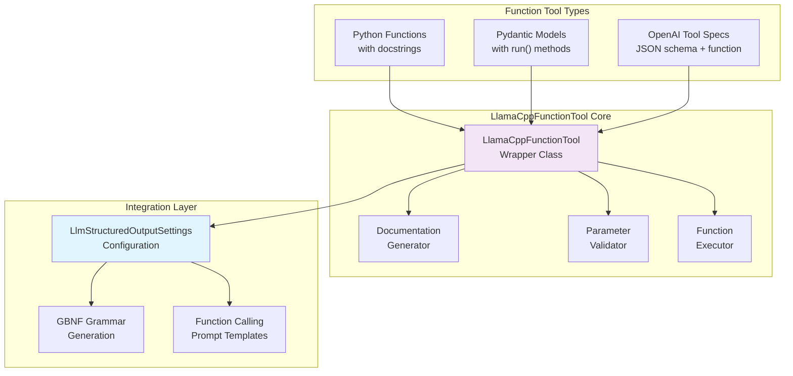
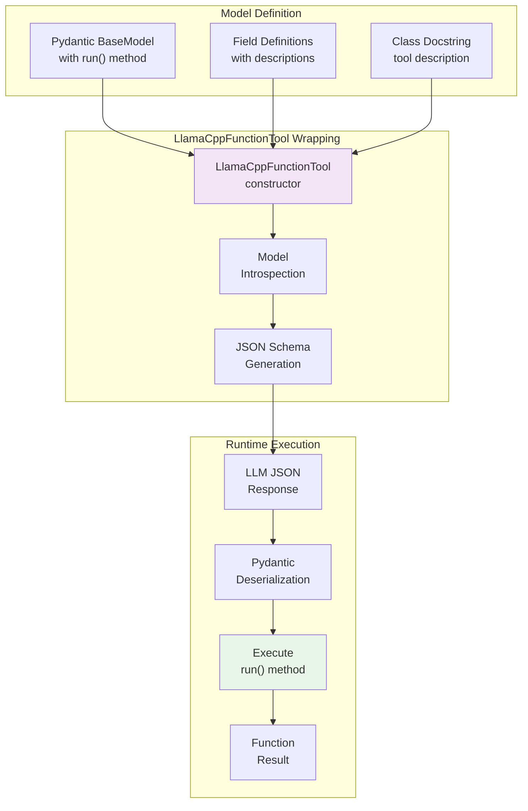
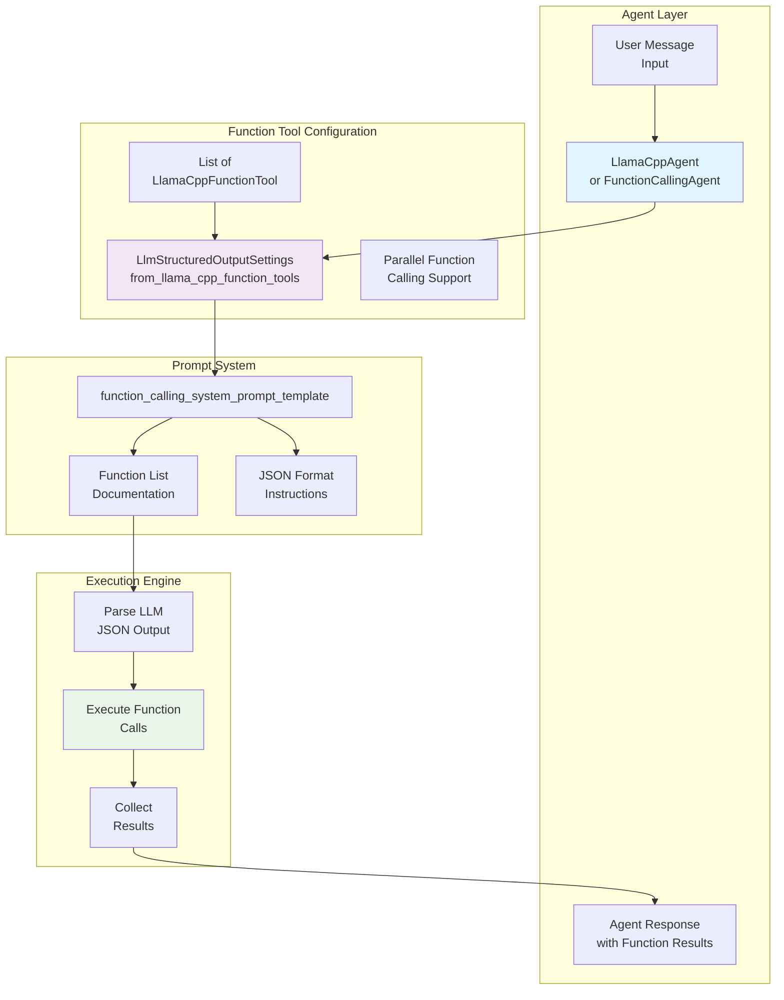

<!-- source: DeepWiki mcp.deepwiki.com · repo Maximilian-Winter/llama-cpp-agent · page 6.1 Function Tools Framework · fetched 2026-10-26 -->

# Function Tools Framework

<details>
<summary>Relevant source files</summary>

The following files were used as context for generating this wiki page:

- [docs/get-started.md](docs/get-started.md)
- [examples/01_Basics/self_critique.py](examples/01_Basics/self_critique.py)
- [examples/02_Structured_Output/book_dataset_creation.py](examples/02_Structured_Output/book_dataset_creation.py)
- [examples/02_Structured_Output/dataframe_creation.py](examples/02_Structured_Output/dataframe_creation.py)
- [examples/07_Memory/agent_core_memory.py](examples/07_Memory/agent_core_memory.py)
- [examples/07_Memory/core_memory.json](examples/07_Memory/core_memory.json)
- [src/llama_cpp_agent/prompt_templates.py](src/llama_cpp_agent/prompt_templates.py)
- [src/llama_cpp_agent/tools/web_search/tool.py](src/llama_cpp_agent/tools/web_search/tool.py)
- [tests/providers.py](tests/providers.py)

</details>


The Function Tools Framework provides a unified interface for integrating executable functions with LLM agents. This system enables agents to call Python functions, Pydantic models, and OpenAI-compatible tools through structured JSON responses. The framework handles function documentation generation, parameter validation, execution, and result processing.

For information about web search tools, see [Web Search Tools](#6.2). For prompt template configuration, see [Prompt Templates](#6.3).

## Core Components

The Function Tools Framework centers around the `LlamaCppFunctionTool` class, which wraps different types of callable functions and provides a standardized interface for LLM integration.

### LlamaCppFunctionTool Architecture



**Sources:** [src/llama_cpp_agent/prompt_templates.py:1-35](), [examples/07_Memory/agent_core_memory.py:27](), [tests/providers.py:134-141]()

### Function Tool Creation Methods

The framework supports three primary methods for creating function tools:

| Method | Input Type | Key Requirements |
|--------|------------|------------------|
| **Direct Python Function** | Callable with docstring | Comprehensive docstring with Args section |
| **Pydantic Model** | BaseModel subclass | `run()` method and field descriptions |
| **OpenAI Tool Specification** | JSON schema + function | OpenAI-compatible tool format |

```mermaid
graph LR
    subgraph "Tool Creation Flow"
        INPUT["Function Input<br/>(Function/Model/Schema)"]
        LFT["LlamaCppFunctionTool<br/>Constructor"]
        WRAPPER["Tool Wrapper<br/>Instance"]
    end
    
    subgraph "Documentation Generation"
        EXTRACT["Extract<br/>Documentation"]
        FORMAT["Format for<br/>LLM Context"]
        SCHEMA["Generate<br/>JSON Schema"]
    end
    
    subgraph "Runtime Execution"
        PARSE["Parse LLM<br/>JSON Response"]
        VALIDATE["Validate<br/>Parameters"]
        EXECUTE["Execute<br/>Function"]
        RETURN["Return<br/>Results"]
    end
    
    INPUT --> LFT
    LFT --> WRAPPER
    WRAPPER --> EXTRACT
    EXTRACT --> FORMAT
    FORMAT --> SCHEMA
    
    SCHEMA --> PARSE
    PARSE --> VALIDATE
    VALIDATE --> EXECUTE
    EXECUTE --> RETURN
    
    style LFT fill:#f3e5f5
    style EXECUTE fill:#e8f5e8
```



**Sources:** [tests/providers.py:134-141](), [examples/07_Memory/agent_core_memory.py:16-27](), [docs/get-started.md:172-191]()

## Python Function Tools

Python functions can be wrapped as tools by ensuring they have comprehensive docstrings that include parameter descriptions.

### Function Requirements

- **Docstring:** Must include general description and Args section
- **Type Hints:** Parameters should have type annotations
- **Documentation:** Each parameter must be documented in the Args section

```python
# Example from codebase
def get_current_datetime(output_format: Optional[str] = None):
    """
    Get the current date and time in the given format.

    Args:
         output_format: formatting string for the date and time, defaults to '%Y-%m-%d %H:%M:%S'
    """
    if output_format is None:
        output_format = '%Y-%m-%d %H:%M:%S'
    return datetime.datetime.now().strftime(output_format)
```

**Sources:** [tests/providers.py:56-65](), [docs/get-started.md:178-187]()

## Pydantic Model Tools

Pydantic models provide structured parameter validation and execution through a `run()` method.

### Model Structure

- **BaseModel inheritance:** Must inherit from `pydantic.BaseModel`
- **Field descriptions:** All fields require description metadata
- **Run method:** Must implement `run()` method for execution
- **Docstring:** Class-level docstring describes the tool's purpose

```python
# Example from codebase
class SendMessageToUser(BaseModel):
    """
    Send a message to the User.
    """
    
    message: str = Field(..., description="Message you want to send to the user.")
    
    def run(self):
        print("Message: " + self.message)
```

**Sources:** [examples/07_Memory/agent_core_memory.py:16-25](), [tests/providers.py:78-96]()

### Pydantic Tool Integration Flow



**Sources:** [examples/07_Memory/agent_core_memory.py:16-34](), [tests/providers.py:220-246]()

## OpenAI Tool Specifications

The framework supports OpenAI-compatible tool specifications, enabling integration with existing tool definitions.

### OpenAI Tool Format

```python
# Example from codebase
open_ai_tool_spec = {
    "type": "function",
    "function": {
        "name": "get_current_weather",
        "description": "Get the current weather in a given location",
        "parameters": {
            "type": "object",
            "properties": {
                "location": {
                    "type": "string",
                    "description": "The city and state, e.g. San Francisco, CA",
                },
                "unit": {"type": "string", "enum": ["celsius", "fahrenheit"]},
            },
            "required": ["location"],
        },
    },
}

# Convert to LlamaCppFunctionTool
get_weather_tool = LlamaCppFunctionTool.from_openai_tool(open_ai_tool_spec, get_current_weather)
```

**Sources:** [tests/providers.py:114-131](), [tests/providers.py:140]()

## Integration with Agent Framework

Function tools integrate with the agent framework through `LlmStructuredOutputSettings`, which configures how the LLM generates function calls.

### Integration Architecture



**Sources:** [src/llama_cpp_agent/prompt_templates.py:3-24](), [examples/07_Memory/agent_core_memory.py:41](), [tests/providers.py:251-252]()

## Function Calling Prompt System

The framework uses structured prompt templates to guide LLM function calling behavior.

### Prompt Template Components

The function calling system relies on several template components defined in [src/llama_cpp_agent/prompt_templates.py:3-35]():

- **`function_calling_system_prompt_template`:** Main system prompt structure
- **`function_list_template`:** Template for function documentation
- **`thoughts_and_reasoning_template`:** Optional reasoning field template
- **`heart_beats_template`:** Template for continuation flags

### Function Call Response Format

```json
{
  "thoughts_and_reasoning": "Step-by-step reasoning for function call",
  "function": "function_name",
  "arguments": {"param1": "value1", "param2": "value2"},
  "heartbeat": true
}
```

For parallel function calling:
```json
[
  {"function": "function1", "arguments": {...}},
  {"function": "function2", "arguments": {...}}
]
```

**Sources:** [src/llama_cpp_agent/prompt_templates.py:17-24](), [docs/get-started.md:217-218]()

## Usage Patterns

### Basic Function Tool Setup

```python
# Create function tools
function_tools = [LlamaCppFunctionTool(Calculator)]

# Configure structured output
output_settings = LlmStructuredOutputSettings.from_llama_cpp_function_tools(
    function_tools, 
    allow_parallel_function_calling=True
)

# Use with agent
response = agent.get_chat_response(
    user_input, 
    structured_output_settings=output_settings
)
```

### Memory Integration Example

The framework integrates seamlessly with the memory system:

```python
# Example from agent_core_memory.py
agent_core_memory = AgentCoreMemory(["persona", "human"])
function_tools = [LlamaCppFunctionTool(SendMessageToUser)]
function_tools.extend(agent_core_memory.get_tool_list())

output_settings = LlmStructuredOutputSettings.from_llama_cpp_function_tools(
    function_tools, 
    add_thoughts_and_reasoning_field=True
)
```

**Sources:** [examples/07_Memory/agent_core_memory.py:27-41](), [docs/get-started.md:284-298]()

### FunctionCallingAgent Integration

The `FunctionCallingAgent` class provides higher-level abstraction for function calling workflows:

```python
function_call_agent = FunctionCallingAgent(
    provider,
    llama_cpp_function_tools=function_tools,
    allow_parallel_function_calling=True,
    send_message_to_user_callback=send_message_callback,
    messages_formatter_type=MessagesFormatterType.CHATML
)
```

**Sources:** [docs/get-started.md:288-294](), [tests/providers.py:344-350]()

---

