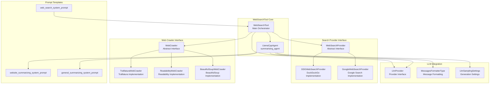
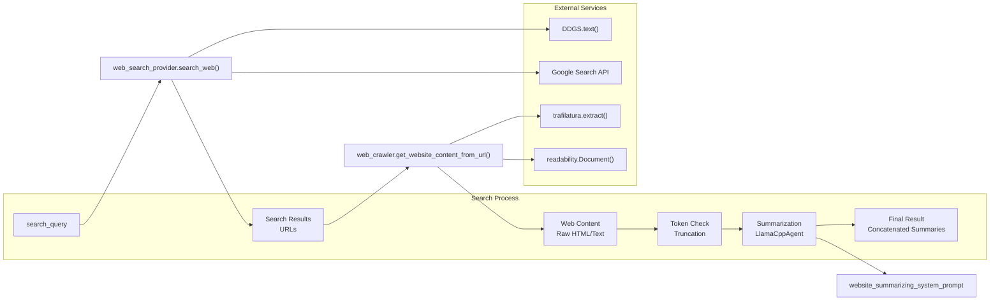
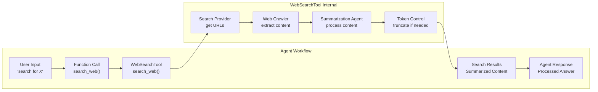

<!-- source: DeepWiki mcp.deepwiki.com · repo Maximilian-Winter/llama-cpp-agent · page 6.2 Web Search Tools · fetched 2026-10-26 -->

# Web Search Tools

<details>
<summary>Relevant source files</summary>

The following files were used as context for generating this wiki page:

- [examples/01_Basics/self_critique.py](examples/01_Basics/self_critique.py)
- [examples/03_Tools_And_Function_Calling/web_search_agent.py](examples/03_Tools_And_Function_Calling/web_search_agent.py)
- [examples/07_Memory/agent_core_memory.py](examples/07_Memory/agent_core_memory.py)
- [examples/07_Memory/core_memory.json](examples/07_Memory/core_memory.json)
- [src/llama_cpp_agent/prompt_templates.py](src/llama_cpp_agent/prompt_templates.py)
- [src/llama_cpp_agent/tools/__init__.py](src/llama_cpp_agent/tools/__init__.py)
- [src/llama_cpp_agent/tools/web_search/__init__.py](src/llama_cpp_agent/tools/web_search/__init__.py)
- [src/llama_cpp_agent/tools/web_search/default_web_crawlers.py](src/llama_cpp_agent/tools/web_search/default_web_crawlers.py)
- [src/llama_cpp_agent/tools/web_search/default_web_search_providers.py](src/llama_cpp_agent/tools/web_search/default_web_search_providers.py)
- [src/llama_cpp_agent/tools/web_search/tool.py](src/llama_cpp_agent/tools/web_search/tool.py)
- [src/llama_cpp_agent/tools/web_search/web_search_interfaces.py](src/llama_cpp_agent/tools/web_search/web_search_interfaces.py)

</details>


This document covers the web search tools system within the llama-cpp-agent framework, which provides capabilities for web search, content crawling, and intelligent summarization of web content. The system enables agents to search the internet, retrieve content from URLs, and process that content for use in conversations and decision-making.

For information about other tool types and the general function calling framework, see [Function Tools Framework](#6.1). For prompt template usage in search operations, see [Prompt Templates](#6.3).

## System Architecture

The web search tools system follows a modular architecture with clear separation between search providers, content crawlers, and the orchestrating tool class.

### Core Architecture Overview



Sources: [src/llama_cpp_agent/tools/web_search/tool.py:15-107](), [src/llama_cpp_agent/tools/web_search/web_search_interfaces.py:1-15](), [src/llama_cpp_agent/tools/web_search/default_web_crawlers.py:1-87](), [src/llama_cpp_agent/tools/web_search/default_web_search_providers.py:1-22]()

## Core Components

### WebSearchTool Class

The `WebSearchTool` class serves as the main orchestrator for web search operations. It combines search providers and web crawlers with an LLM-powered summarization agent to provide intelligent web search capabilities.

| Component | Type | Purpose |
|-----------|------|---------|
| `llm_provider` | `LlmProvider` | Provides LLM backend for summarization |
| `summarising_agent` | `LlamaCppAgent` | Handles content summarization |
| `web_crawler` | `WebCrawler` | Extracts content from URLs |
| `web_search_provider` | `WebSearchProvider` | Performs web searches |
| `settings` | `LlmSamplingSettings` | Controls LLM generation parameters |

The tool accepts configuration parameters for token limits, search result counts, and LLM sampling settings:

```python
WebSearchTool(
    llm_provider=provider,
    message_formatter_type=MessagesFormatterType.CHATML,
    temperature=0.45,
    top_p=0.95,
    top_k=40,
    model_max_context_tokens=8192,
    max_tokens_search_results=7500,
    max_tokens_per_summary=750,
    number_of_search_results=3
)
```

Sources: [src/llama_cpp_agent/tools/web_search/tool.py:15-54]()

### Web Search Flow



Sources: [src/llama_cpp_agent/tools/web_search/tool.py:55-101](), [src/llama_cpp_agent/tools/web_search/default_web_search_providers.py:7-21](), [src/llama_cpp_agent/tools/web_search/default_web_crawlers.py:14-84]()

### WebCrawler Interface and Implementations

The `WebCrawler` abstract base class defines the interface for content extraction:

```python
class WebCrawler(abc.ABC):
    @abc.abstractmethod
    def get_website_content_from_url(self, url: str):
        """Get the website content from an url."""
        pass
```

#### Available Implementations

| Implementation | Library | Strengths | Output Format |
|----------------|---------|-----------|---------------|
| `TrafilaturaWebCrawler` | trafilatura | High-quality text extraction, handles complex layouts | JSON with title, URL, and raw_text |
| `ReadabilityWebCrawler` | readability | Article-focused extraction, removes clutter | HTML with title and summary |
| `BeautifulSoupWebCrawler` | BeautifulSoup | Simple HTML parsing, broad compatibility | Plain text with title and body |

All implementations return formatted content with clear delimiters:
```
=========== Website Title: {title} ===========

=========== Website URL: {url} ===========

=========== Website Content ===========

{content}

=========== Website Content End ===========
```

Sources: [src/llama_cpp_agent/tools/web_search/web_search_interfaces.py:4-8](), [src/llama_cpp_agent/tools/web_search/default_web_crawlers.py:14-84]()

### WebSearchProvider Interface and Implementations

The `WebSearchProvider` abstract base class handles web search operations:

```python
class WebSearchProvider(abc.ABC):
    @abc.abstractmethod
    def search_web(self, query: str, number_of_results: int):
        """Searches the web and returns a list of urls of the result"""
        pass
```

#### Available Implementations

| Provider | Backend | Features | Usage Notes |
|----------|---------|----------|-------------|
| `DDGWebSearchProvider` | DuckDuckGo Search | Privacy-focused, no tracking | Default provider, uses `DDGS().text()` |
| `GoogleWebSearchProvider` | Google Search | Comprehensive results | Requires `googlesearch` package |

The `DDGWebSearchProvider` implementation:
```python
def search_web(self, search_query: str, num_results: int):
    results = DDGS().text(search_query, region='wt-wt', safesearch='off', max_results=num_results)
    return [res["href"] for res in results]
```

Sources: [src/llama_cpp_agent/tools/web_search/web_search_interfaces.py:11-15](), [src/llama_cpp_agent/tools/web_search/default_web_search_providers.py:7-21]()

## Integration with Agents

### Function Tool Integration

The `WebSearchTool` integrates with the function calling system through its `get_tool()` method, which returns the `search_web` function for use with `LlmStructuredOutputSettings`:

```python
search_tool = WebSearchTool(provider, MessagesFormatterType.MISTRAL)
output_settings = LlmStructuredOutputSettings.from_functions([search_tool.get_tool()])
```

### Agent Integration Pattern



Sources: [examples/03_Tools_And_Function_Calling/web_search_agent.py:24-35](), [src/llama_cpp_agent/tools/web_search/tool.py:103-104]()

## Configuration and Token Management

### Token Limit Handling

The `WebSearchTool` implements sophisticated token management to prevent context overflow:

1. **Per-Website Token Limiting**: Content from individual websites is truncated if it exceeds `model_max_context_tokens - 512`
2. **Total Results Limiting**: Combined search results are limited to `max_tokens_search_results`
3. **Summary Token Control**: Individual summaries are limited by provider-specific settings

The truncation algorithm:
```python
if original_prompt_token_count > (self.model_max_context_tokens - 512):
    while self.max_tokens_search_results < len(tokens):
        remove_char_count += 50
        tokens = self.llm_provider.tokenize(web_info[:remove_char_count])
```

### Provider-Specific Settings

Different LLM providers require different parameter names for token limits:

| Provider | Token Limit Parameter | Line Reference |
|----------|----------------------|----------------|
| `llama_cpp_server` | `n_predict` | [src/llama_cpp_agent/tools/web_search/tool.py:47]() |
| `tgi_server` | `max_new_tokens` | [src/llama_cpp_agent/tools/web_search/tool.py:49]() |
| Others | `max_tokens` | [src/llama_cpp_agent/tools/web_search/tool.py:51]() |

Sources: [src/llama_cpp_agent/tools/web_search/tool.py:66-101](), [src/llama_cpp_agent/tools/web_search/tool.py:40-53]()

## Prompt Templates for Search Operations

The framework includes specialized prompt templates for different search and summarization scenarios:

### Core Search Templates

| Template | Purpose | Key Features |
|----------|---------|--------------|
| `web_search_system_prompt` | Query optimization | Analyzes user intent, refines search terms |
| `website_summarizing_system_prompt` | Website content summarization | Extracts relevant info based on query |
| `general_summarizing_system_prompt` | General text summarization | Structured markdown output |

### Template Usage Pattern

The `website_summarizing_system_prompt` template is used during the summarization phase:

```python
web_info = self.summarising_agent.get_chat_response(
    web_info, 
    system_prompt=PromptTemplate.from_string(website_summarizing_system_prompt).generate_prompt({
        "QUERY": search_query, 
        "WEBSITE_URL": res
    }),
    add_response_to_chat_history=False,
    add_message_to_chat_history=False,
    llm_sampling_settings=self.settings
)
```

### Structured Output Format

All summarization templates enforce a consistent markdown structure:
```
---
Website Title: {title}
Website URL: {url}

Content: 
{relevant_information}
---
```

Sources: [src/llama_cpp_agent/prompt_templates.py:142-198](), [src/llama_cpp_agent/tools/web_search/tool.py:80-84]()

## Usage Examples and Best Practices

### Basic Usage

```python
from llama_cpp_agent.tools import WebSearchTool
from llama_cpp_agent.providers import LlamaCppServerProvider

provider = LlamaCppServerProvider("http://localhost:8080")
search_tool = WebSearchTool(
    provider, 
    MessagesFormatterType.MISTRAL,
    max_tokens_search_results=20000
)

# Get the function for agent integration
search_function = search_tool.get_tool()
```

### Custom Configuration

```python
# Custom web crawler and search provider
from llama_cpp_agent.tools import TrafilaturaWebCrawler, GoogleWebSearchProvider

custom_search_tool = WebSearchTool(
    provider,
    MessagesFormatterType.CHATML,
    web_crawler=TrafilaturaWebCrawler(),
    web_search_provider=GoogleWebSearchProvider(),
    number_of_search_results=5,
    max_tokens_per_summary=1000
)
```

Sources: [examples/03_Tools_And_Function_Calling/web_search_agent.py:25-35](), [src/llama_cpp_agent/tools/web_search/tool.py:17-24]()

---

