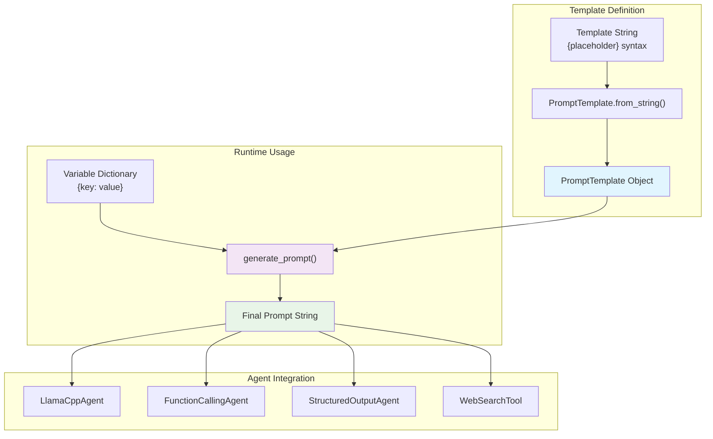
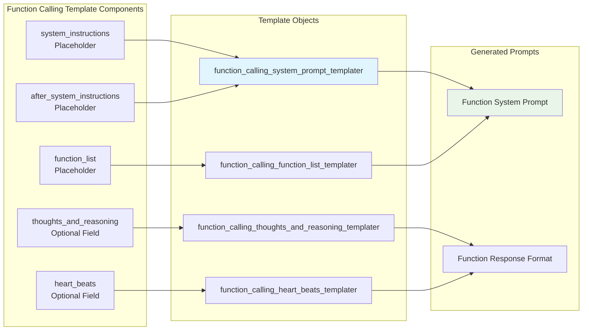
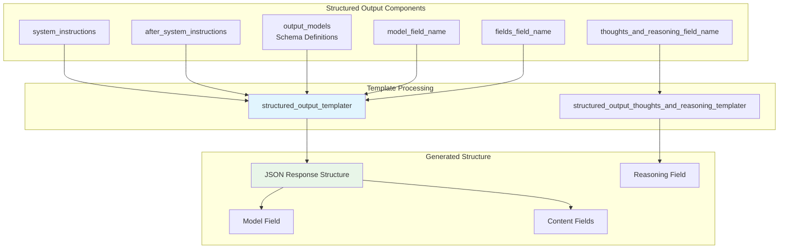
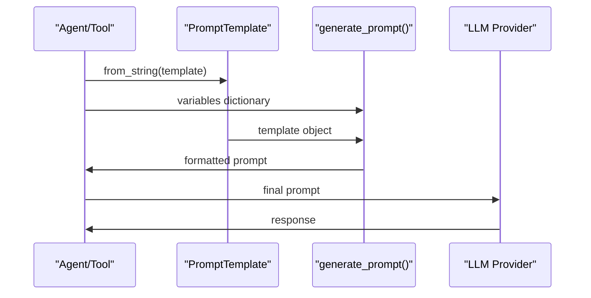
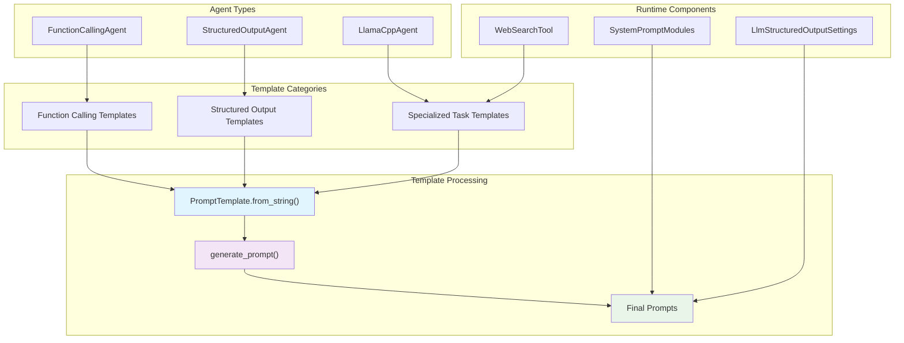

<!-- source: DeepWiki mcp.deepwiki.com · repo Maximilian-Winter/llama-cpp-agent · page 6.3 Prompt Templates · fetched 2026-10-26 -->

# Prompt Templates

<details>
<summary>Relevant source files</summary>

The following files were used as context for generating this wiki page:

- [examples/01_Basics/self_critique.py](examples/01_Basics/self_critique.py)
- [examples/07_Memory/agent_core_memory.py](examples/07_Memory/agent_core_memory.py)
- [examples/07_Memory/core_memory.json](examples/07_Memory/core_memory.json)
- [src/llama_cpp_agent/prompt_templates.py](src/llama_cpp_agent/prompt_templates.py)
- [src/llama_cpp_agent/tools/web_search/tool.py](src/llama_cpp_agent/tools/web_search/tool.py)

</details>


This page documents the prompt template system in the llama-cpp-agent framework, which provides dynamic prompt generation capabilities for various agent scenarios. Prompt templates enable standardized, reusable prompt structures with variable substitution for function calling, structured output generation, and specialized tasks.

For information about system prompt modules and dynamic prompt injection, see [Memory Tools Integration](#5.2). For details about structured output configuration, see [Output Processing](#3.4).

## Template System Architecture

The prompt template system is built around the `PromptTemplate` class and provides a collection of predefined templates for common agent scenarios. Templates use string interpolation with curly brace placeholders that are replaced with runtime values.



Sources: [src/llama_cpp_agent/prompt_templates.py:1-35](), [src/llama_cpp_agent/tools/web_search/tool.py:81]()

## Core Template Categories

The framework provides several categories of predefined prompt templates, each optimized for specific agent capabilities and use cases.

| Template Category | Purpose | Key Templates |
|-------------------|---------|---------------|
| Function Calling | Tool integration and function execution | `function_calling_system_prompt_template` |
| Structured Output | JSON schema-based response generation | `structured_output_template` |
| Content Summarization | Text processing and information extraction | `general_summarizing_system_prompt`, `website_summarizing_system_prompt` |
| Web Search | Search query optimization and result processing | `web_search_system_prompt`, `arxiv_search_system_prompt` |
| Research & Analysis | Academic and analytical tasks | `research_system_prompt`, `task_decomposition` |

Sources: [src/llama_cpp_agent/prompt_templates.py:3-214]()

## Function Calling Templates

Function calling templates provide the structure for agents to interact with tools and execute functions. The main template includes placeholders for system instructions, function lists, and response formatting.



The function calling template structure includes:

- **System Instructions**: Core behavioral guidelines for the agent
- **Function List**: Available tools and their descriptions  
- **Response Format**: JSON structure for function calls with optional reasoning
- **Field Configuration**: Customizable field names for different response components

Sources: [src/llama_cpp_agent/prompt_templates.py:3-35]()

## Structured Output Templates

Structured output templates enable agents to generate responses conforming to specific data models and JSON schemas. These templates support multi-model output scenarios and include reasoning fields.



Sources: [src/llama_cpp_agent/prompt_templates.py:37-61]()

## Specialized Task Templates

The framework includes templates optimized for specific domain tasks such as web search, content summarization, and research activities.

### Content Summarization Templates

Multiple summarization templates handle different content types:

- **General Summarization**: `general_summarizing_system_prompt` for text-based content
- **Website Summarization**: `website_summarizing_system_prompt` for web content with URL context
- **OCR Summarization**: `summarizing_system_prompt_ocr` for OCR-processed text with error correction

### Search and Research Templates

- **Web Search Optimization**: `web_search_system_prompt` for query refinement
- **Academic Search**: `arxiv_search_system_prompt` for scholarly content discovery
- **Research Report Generation**: `research_system_prompt` for comprehensive analysis
- **Task Decomposition**: `task_decomposition` for breaking complex tasks into steps

Sources: [src/llama_cpp_agent/prompt_templates.py:62-214]()

## Template Usage Patterns

Templates are typically used through a standard pattern of instantiation, variable preparation, and prompt generation.

### Basic Usage Pattern



### Integration with WebSearchTool

The `WebSearchTool` demonstrates practical template usage for content summarization:

```python
# Template instantiation and usage pattern
web_info = self.summarising_agent.get_chat_response(
    web_info, 
    system_prompt=PromptTemplate.from_string(website_summarizing_system_prompt)
                               .generate_prompt({
                                   "QUERY": search_query, 
                                   "WEBSITE_URL": res
                               }),
    add_response_to_chat_history=False, 
    add_message_to_chat_history=False,
    llm_sampling_settings=self.settings
)
```

Sources: [src/llama_cpp_agent/tools/web_search/tool.py:80-83]()

## Integration with Agent System

Prompt templates integrate with the broader agent framework through multiple touchpoints, enabling dynamic prompt generation across different agent types and scenarios.



Sources: [src/llama_cpp_agent/prompt_templates.py:1-214](), [src/llama_cpp_agent/tools/web_search/tool.py:10-12](), [examples/07_Memory/agent_core_memory.py:48-49]()

---

