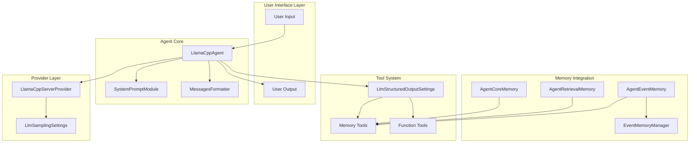
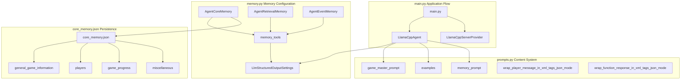
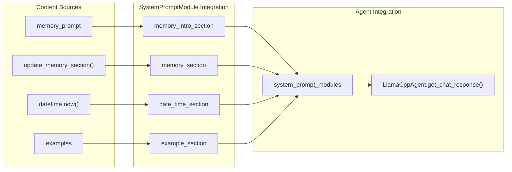
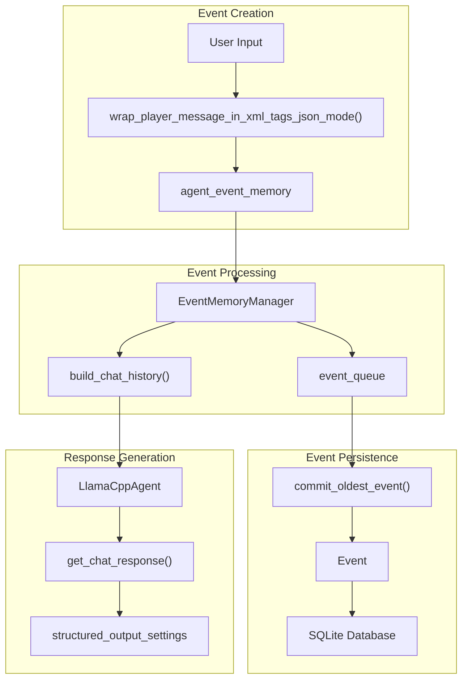

<!-- source: DeepWiki mcp.deepwiki.com · repo Maximilian-Winter/llama-cpp-agent · page 7 Examples and Applications · fetched 2026-10-26 -->

# Examples and Applications

Relevant source files

The following files were used as context for generating this wiki page:

- [examples/07_Memory/VirtualGameMaster/core_memory.json](examples/07_Memory/VirtualGameMaster/core_memory.json)
- [examples/07_Memory/VirtualGameMaster/main.py](examples/07_Memory/VirtualGameMaster/main.py)
- [examples/07_Memory/VirtualGameMaster/memory.py](examples/07_Memory/VirtualGameMaster/memory.py)
- [examples/07_Memory/VirtualGameMaster/prompts.py](examples/07_Memory/VirtualGameMaster/prompts.py)
- [src/llama_cpp_agent/agent_memory/event_memory.py](src/llama_cpp_agent/agent_memory/event_memory.py)
- [src/llama_cpp_agent/agent_memory/event_memory_manager.py](src/llama_cpp_agent/agent_memory/event_memory_manager.py)

This document demonstrates practical implementations and complete applications built using the llama-cpp-agent framework. It showcases how the core components work together in real-world scenarios, providing concrete examples of agent architectures, memory integration, and tool usage patterns.

For basic agent usage patterns and simple chatbot examples, see [Basic Examples](#7.1). For information about the core framework components used in these applications, see [Core Framework](#3). For memory system implementation details, see [Memory System](#5).

## Application Architecture Overview

The examples demonstrate how multiple framework components integrate to create sophisticated AI applications. The architecture typically follows a pattern where agents coordinate with memory systems, tool integrations, and structured output processing.

**Application Architecture Pattern**

Sources: [examples/07_Memory/VirtualGameMaster/main.py:1-83](), [examples/07_Memory/VirtualGameMaster/memory.py:1-31]()

## Virtual Game Master Application

The Virtual Game Master represents a sophisticated interactive storytelling application that demonstrates advanced memory management, dynamic prompt generation, and complex conversational flows.

### Core Application Structure

**Virtual Game Master Component Integration**

Sources: [examples/07_Memory/VirtualGameMaster/main.py:1-83](), [examples/07_Memory/VirtualGameMaster/memory.py:1-31](), [examples/07_Memory/VirtualGameMaster/prompts.py:1-58](), [examples/07_Memory/VirtualGameMaster/core_memory.json:1-21]()

### Memory System Implementation

The application uses three distinct memory types configured through `AgentCoreMemory`, `AgentRetrievalMemory`, and `AgentEventMemory` classes:

| Memory Type | Configuration | Purpose |
|-------------|---------------|---------|
| **Core Memory** | `["general_game_information", "players", "game_progress", "miscellaneous"]` | Essential game state and character information |
| **Retrieval Memory** | Default ChromaDB configuration | Searchable archive of game events and knowledge |
| **Event Memory** | SQLite-backed with event queue | Conversation history and recent interactions |

The core memory structure is defined in [examples/07_Memory/VirtualGameMaster/memory.py:12]() and persisted to [examples/07_Memory/VirtualGameMaster/core_memory.json:1-21]().

### Dynamic Prompt System

The application uses `SystemPromptModule` instances to inject contextual information:

Sources: [examples/07_Memory/VirtualGameMaster/main.py:28-40](), [examples/07_Memory/VirtualGameMaster/prompts.py:38-44]()

### Event-Driven Conversation Flow

The application maintains conversation state through the `EventMemoryManager` and `Event` classes:

**Event Memory Flow**

Sources: [examples/07_Memory/VirtualGameMaster/main.py:48-82](), [src/llama_cpp_agent/agent_memory/event_memory_manager.py:10-117](), [src/llama_cpp_agent/agent_memory/event_memory.py:15-54]()

### Function Tool Integration

The application combines memory tools with a custom `write_message_to_player` function through `LlmStructuredOutputSettings`:

The tool configuration is established in [examples/07_Memory/VirtualGameMaster/memory.py:16-24]() where memory tools from all three memory types are combined with the custom function tool.

### Structured Output Processing

The application uses a dual-phase response system:

1. **Function Selection Phase**: Uses `structured_output_settings` to determine which memory operations or message writing to perform
2. **Message Generation Phase**: When `write_message_to_player` is selected, generates natural language responses using game master examples

This pattern is implemented in the main loop [examples/07_Memory/VirtualGameMaster/main.py:60-72]() where the agent checks for the `write_message_to_player` function and handles message generation separately.

### Provider Configuration

The application uses `LlamaCppServerProvider` with specific sampling settings optimized for creative storytelling:

- **Temperature**: 0.35 for controlled creativity
- **Top-p**: 0.5 for focused token selection  
- **Top-k**: 0 (disabled)
- **N-predict**: 1024 tokens maximum

These settings are configured in [examples/07_Memory/VirtualGameMaster/main.py:22-26]().

### Application Usage Patterns

The Virtual Game Master demonstrates several key usage patterns for building complex AI applications:

1. **Multi-Memory Architecture**: Combining different memory types for comprehensive state management
2. **Dynamic Context Injection**: Using `SystemPromptModule` for real-time context updates
3. **Event-Driven Persistence**: Automatic conversation history management with database storage
4. **Structured Function Calling**: Coordinating memory operations with natural language generation
5. **Template-Based Prompting**: Using example-driven prompt engineering for consistent behavior

Sources: [examples/07_Memory/VirtualGameMaster/main.py:1-83](), [examples/07_Memory/VirtualGameMaster/memory.py:1-31](), [examples/07_Memory/VirtualGameMaster/prompts.py:1-58]()

---

