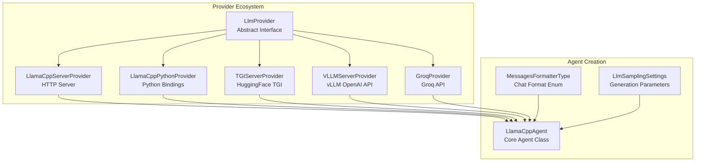
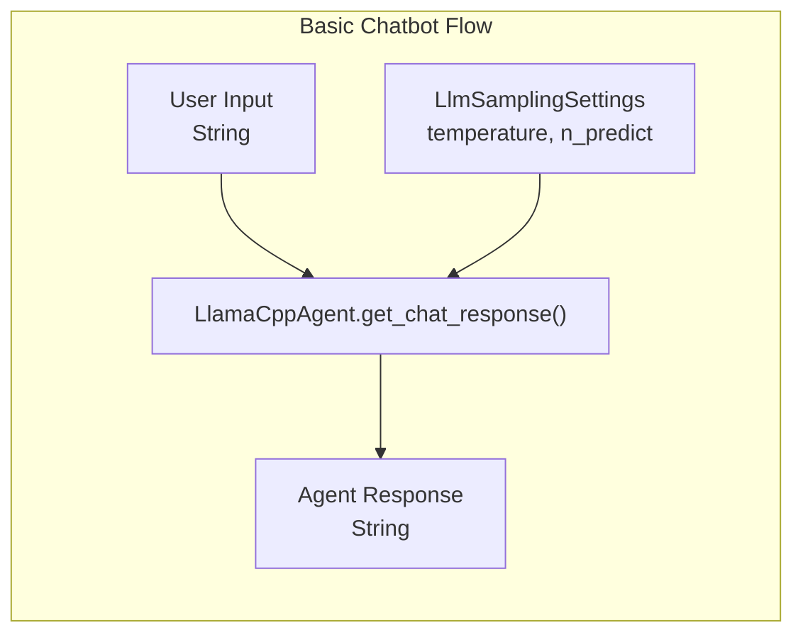
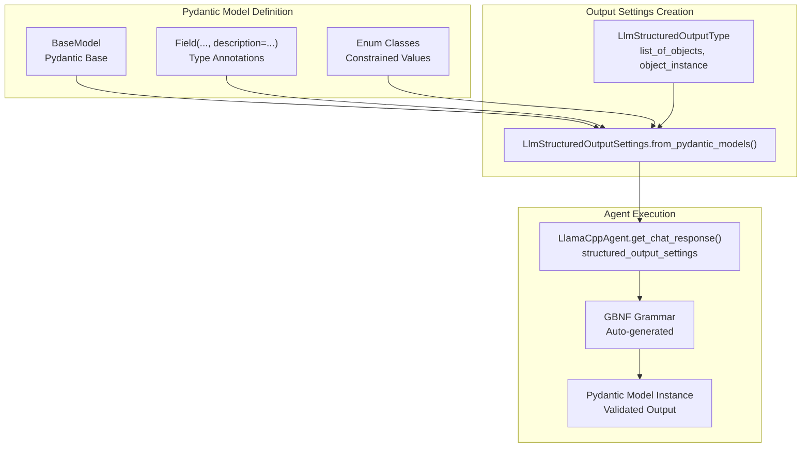
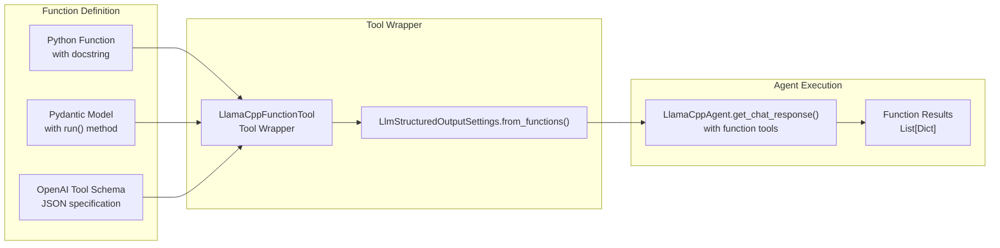
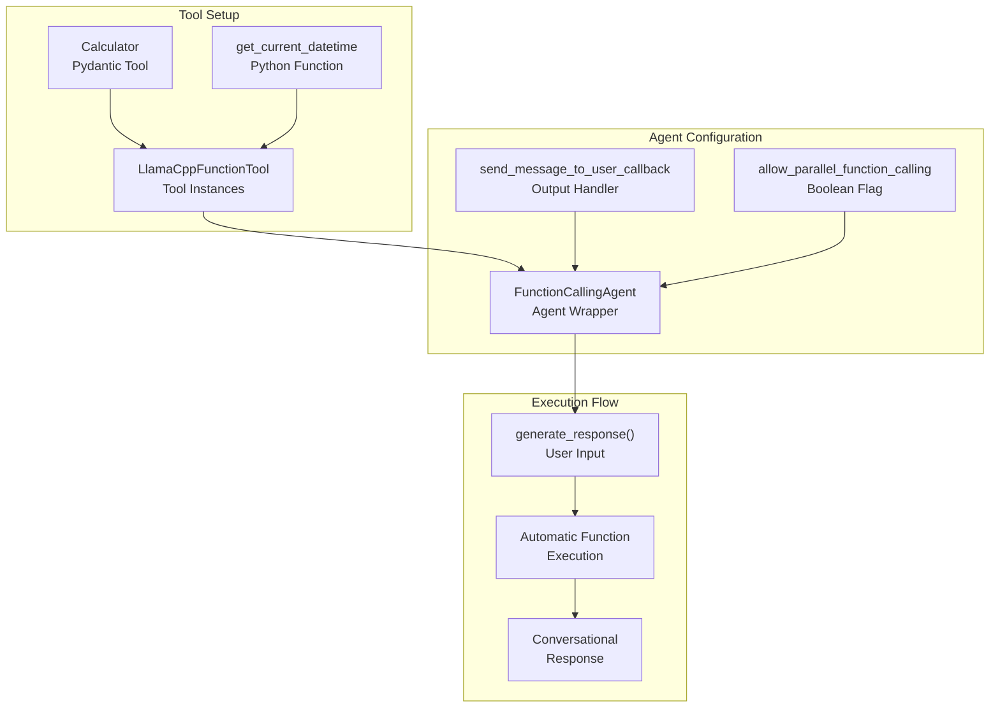
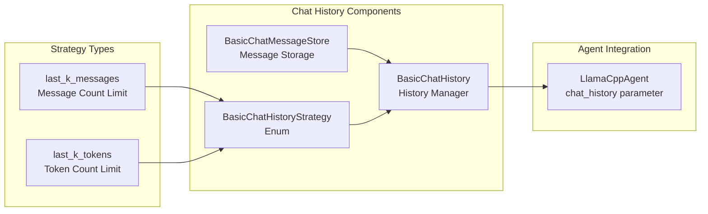

<!-- source: DeepWiki mcp.deepwiki.com · repo Maximilian-Winter/llama-cpp-agent · page 7.1 Basic Examples · fetched 2026-10-26 -->

# Basic Examples

Relevant source files

The following files were used as context for generating this wiki page:

- [docs/chat_history-api-reference.md](docs/chat_history-api-reference.md)
- [docs/get-started.md](docs/get-started.md)
- [examples/01_Basics/chatbot_using_llama_cpp_server.py](examples/01_Basics/chatbot_using_llama_cpp_server.py)
- [examples/02_Structured_Output/book_dataset_creation.py](examples/02_Structured_Output/book_dataset_creation.py)
- [examples/02_Structured_Output/dataframe_creation.py](examples/02_Structured_Output/dataframe_creation.py)
- [examples/03_Tools_And_Function_Calling/duck_duck_go_websearch_agent.py](examples/03_Tools_And_Function_Calling/duck_duck_go_websearch_agent.py)
- [examples/03_Tools_And_Function_Calling/experimental_code_interpreter.py](examples/03_Tools_And_Function_Calling/experimental_code_interpreter.py)
- [tests/providers.py](tests/providers.py)

This document provides simple, practical examples demonstrating the fundamental usage patterns of the llama-cpp-agent framework. It covers basic chatbot creation, provider setup, simple function calling, and structured output generation. These examples are designed for beginners getting started with the framework.

For advanced applications and complex use cases, see [Advanced Applications](#7.4). For detailed configuration of specific components, see [Core Framework](#3) and [Provider System](#4).

## Basic Agent Setup and Provider Configuration

The foundation of any llama-cpp-agent application starts with configuring a provider and creating an agent instance. The framework supports multiple LLM providers through a unified interface.

### Provider Architecture Overview

Sources: [docs/get-started.md:39-78](), [examples/01_Basics/chatbot_using_llama_cpp_server.py:1-24](), [tests/providers.py:17-34]()

### Simple Chatbot Example

The most basic usage pattern involves creating a provider, configuring an agent, and engaging in conversation through the `get_chat_response` method.

The basic chatbot implementation demonstrates essential patterns:
- Provider instantiation with server URL
- Agent creation with system prompt and message formatter
- Sampling settings configuration
- Interactive conversation loop with `get_chat_response`

Sources: [examples/01_Basics/chatbot_using_llama_cpp_server.py:1-24](), [docs/get-started.md:112-135]()

## Provider Setup Patterns

The framework provides consistent patterns for configuring different LLM backends through the provider abstraction layer.

### Provider Configuration Matrix

| Provider Class | Connection Type | Configuration Parameters |
|---|---|---|
| `LlamaCppServerProvider` | HTTP Server | `server_url`, optional `api_key` |
| `LlamaCppPythonProvider` | Python Bindings | `Llama` instance from llama-cpp-python |
| `TGIServerProvider` | HTTP Server | `server_url`, optional `api_key` |
| `VLLMServerProvider` | OpenAI Compatible API | `server_url`, `model_name`, optional `api_key` |
| `GroqProvider` | Cloud API | `api_key`, `model_name` |

Each provider implements the `LlmProvider` interface and provides default sampling settings through `get_provider_default_settings()`.

Sources: [docs/get-started.md:40-78](), [tests/providers.py:24-33]()

## Structured Output Generation

The framework enables type-safe structured output generation using Pydantic models and the `LlmStructuredOutputSettings` class.

### Structured Output Flow

The structured output example in the codebase demonstrates creating a `Book` model with fields like `title`, `author`, `published_year`, `keywords`, `category`, and `summary`. The agent automatically generates a JSON object conforming to the model schema.

Sources: [examples/02_Structured_Output/book_dataset_creation.py:16-55](), [docs/get-started.md:308-368]()

## Basic Function Calling

Function calling enables agents to execute Python functions and Pydantic tools through the `LlmStructuredOutputSettings.from_functions()` method.

### Function Tool Integration

The function calling pattern requires properly documented functions with type hints and descriptive docstrings. The framework automatically generates tool documentation for the LLM and handles function execution.

Sources: [docs/get-started.md:171-218](), [tests/providers.py:56-97]()

## FunctionCallingAgent for Automated Tool Use

The `FunctionCallingAgent` class provides higher-level automation for tool-based interactions, automatically handling function call results and generating conversational responses.

### FunctionCallingAgent Architecture

The `FunctionCallingAgent` handles the complete cycle of function calling, result processing, and response generation, making it ideal for interactive applications where the agent needs to use tools and provide natural language responses.

Sources: [docs/get-started.md:222-298](), [tests/providers.py:220-353]()

## Chat History Configuration

The framework provides flexible chat history management through the `BasicChatHistory` and `BasicChatMessageStore` classes.

### Chat History Strategy Options

The chat history system supports two primary strategies: `last_k_messages` for limiting by message count and `last_k_tokens` for limiting by token count. The `last_k_tokens` strategy requires passing the provider instance for token counting.

Sources: [docs/get-started.md:137-161]()

## Message Formatting

The framework supports multiple chat message formats through the `MessagesFormatterType` enum, ensuring compatibility with different model training formats.

### Available Message Formatters

| Formatter Type | Use Case | Example Models |
|---|---|---|
| `MessagesFormatterType.CHATML` | ChatML format | GPT-3.5, GPT-4 |
| `MessagesFormatterType.MISTRAL` | Mistral format | Mistral 7B |
| `MessagesFormatterType.LLAMA_2` | Llama 2 format | Llama 2 variants |
| `MessagesFormatterType.ALPACA` | Alpaca format | Alpaca models |

The message formatter is specified during agent creation through the `predefined_messages_formatter_type` parameter and affects how conversation history is structured for the LLM.

Sources: [examples/01_Basics/chatbot_using_llama_cpp_server.py:11](), [docs/get-started.md:107-109](), [tests/providers.py:175]()

---

