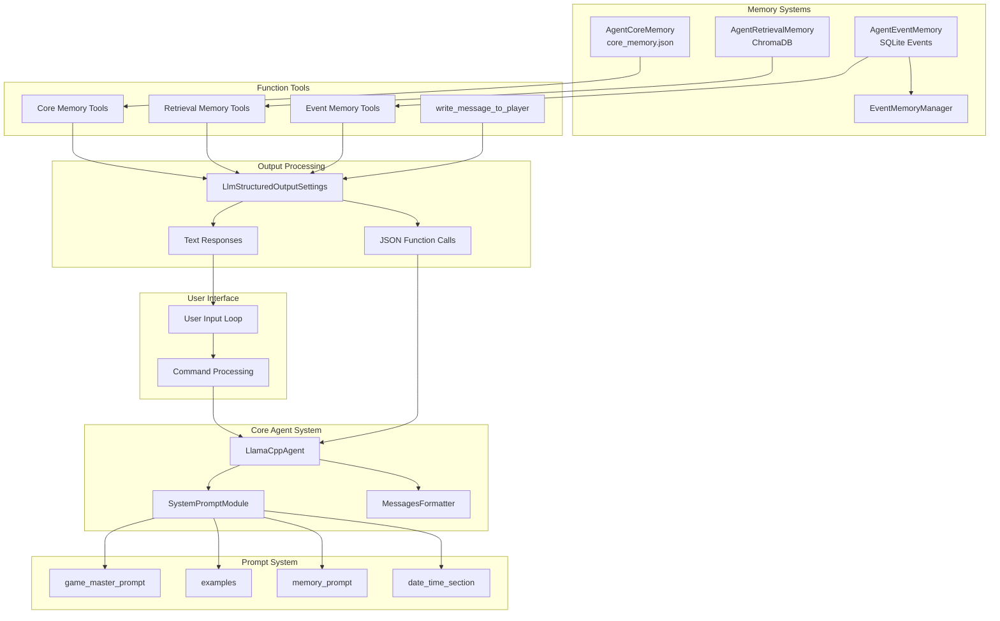
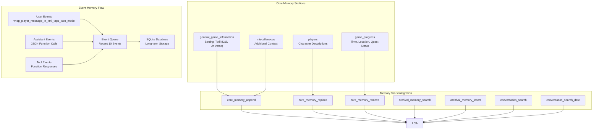
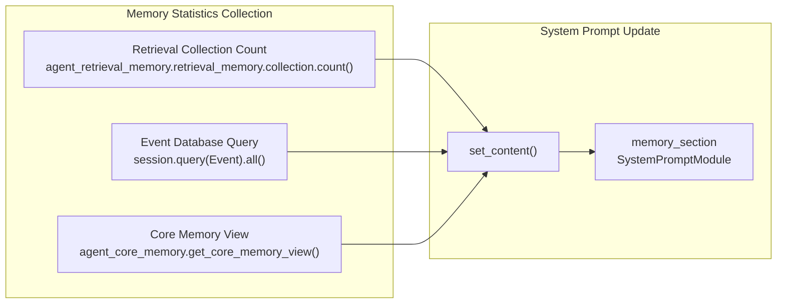
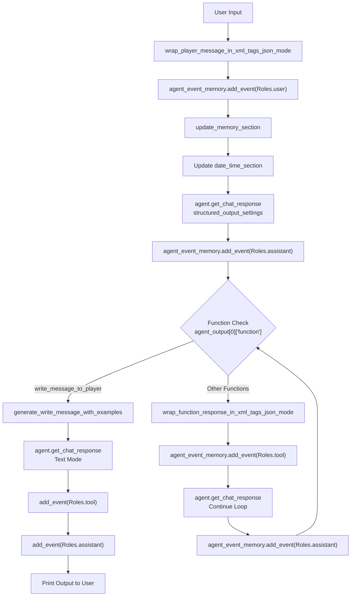
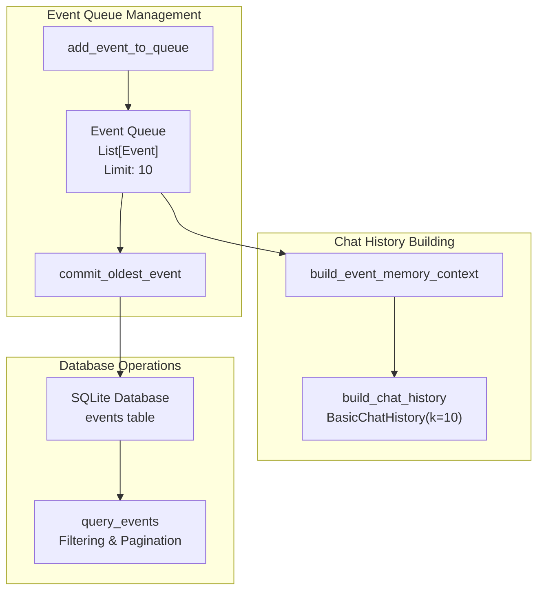
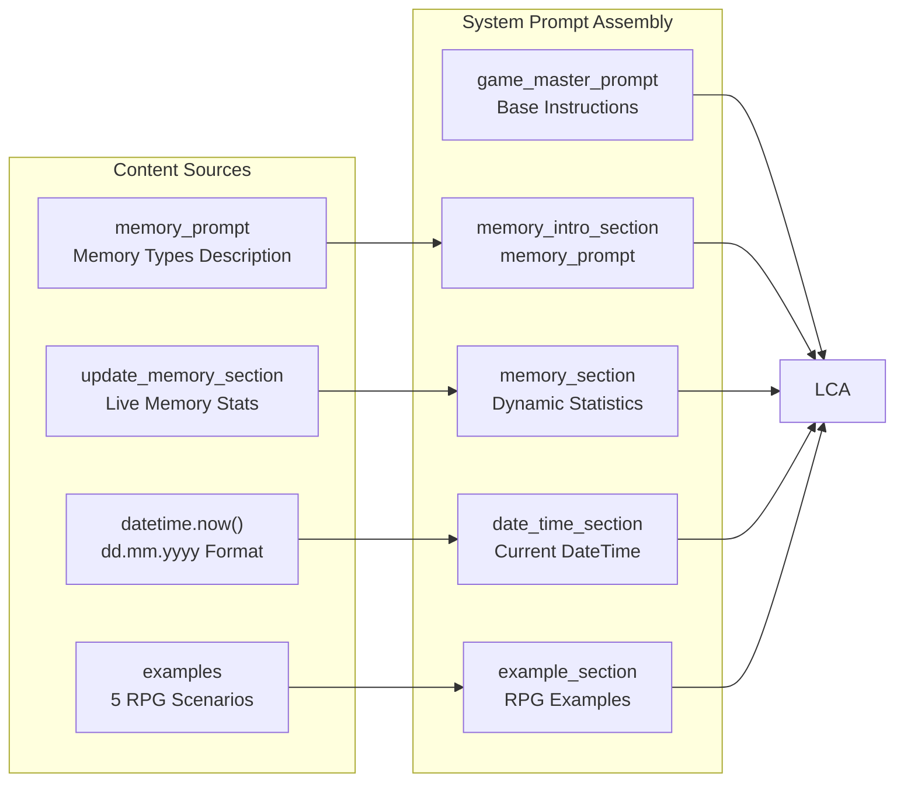
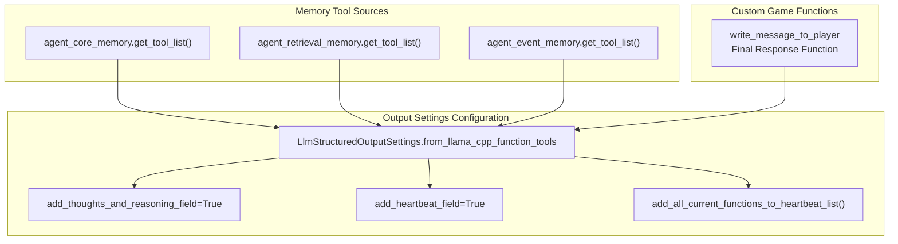

<!-- source: DeepWiki mcp.deepwiki.com · repo Maximilian-Winter/llama-cpp-agent · page 7.2 Virtual Game Master · fetched 2026-10-26 -->

# Virtual Game Master

<details>
<summary>Relevant source files</summary>

The following files were used as context for generating this wiki page:

- [examples/07_Memory/VirtualGameMaster/core_memory.json](examples/07_Memory/VirtualGameMaster/core_memory.json)
- [examples/07_Memory/VirtualGameMaster/main.py](examples/07_Memory/VirtualGameMaster/main.py)
- [examples/07_Memory/VirtualGameMaster/memory.py](examples/07_Memory/VirtualGameMaster/memory.py)
- [examples/07_Memory/VirtualGameMaster/prompts.py](examples/07_Memory/VirtualGameMaster/prompts.py)
- [src/llama_cpp_agent/agent_memory/event_memory.py](src/llama_cpp_agent/agent_memory/event_memory.py)
- [src/llama_cpp_agent/agent_memory/event_memory_manager.py](src/llama_cpp_agent/agent_memory/event_memory_manager.py)

</details>


This page documents the Virtual Game Master example application, which demonstrates a complete interactive storytelling AI system. The Virtual Game Master showcases how to build a memory-enhanced conversational AI that can maintain persistent game state, track player interactions, and generate immersive narrative content for tabletop role-playing games.

For information about the underlying memory systems, see [Memory System](#5). For basic agent usage patterns, see [Basic Examples](#7.1).

## Overview

The Virtual Game Master is a sophisticated example application that combines multiple framework capabilities to create an interactive RPG game master. It demonstrates persistent memory management, structured output generation, function calling, and dynamic prompt engineering in a real-world application context.

**Sources:** [examples/07_Memory/VirtualGameMaster/main.py:1-83]()

## Architecture Overview



**Sources:** [examples/07_Memory/VirtualGameMaster/main.py:15-83](), [examples/07_Memory/VirtualGameMaster/memory.py:1-31]()

## Memory Integration

### Three-Layer Memory Architecture

The Virtual Game Master implements all three memory types provided by the framework:

| Memory Type | Purpose | Storage | Access Pattern |
|-------------|---------|---------|----------------|
| **Core Memory** | Essential game state | `core_memory.json` | Direct read/write via tools |
| **Retrieval Memory** | Searchable game lore | ChromaDB collection | Semantic search queries |
| **Event Memory** | Conversation history | SQLite database | Temporal and content search |



**Sources:** [examples/07_Memory/VirtualGameMaster/memory.py:12-24](), [examples/07_Memory/VirtualGameMaster/core_memory.json:1-21]()

### Memory Update Mechanism

The `update_memory_section` function dynamically updates the system prompt with current memory statistics:



**Sources:** [examples/07_Memory/VirtualGameMaster/memory.py:27-31]()

## Conversation Flow Architecture

### Main Conversation Loop

The conversation flow demonstrates a sophisticated multi-step interaction pattern:



**Sources:** [examples/07_Memory/VirtualGameMaster/main.py:41-83]()

### Event Memory Management

The system uses `EventMemoryManager` to handle conversation persistence:



**Sources:** [src/llama_cpp_agent/agent_memory/event_memory_manager.py:10-117]()

## System Prompt Engineering

### Dynamic Prompt Modules

The Virtual Game Master uses multiple `SystemPromptModule` instances for dynamic content injection:

| Module | Position | Purpose |
|--------|----------|---------|
| `memory_intro_section` | After system instructions | Memory system explanation |
| `memory_section` | Default | Current memory statistics |
| `date_time_section` | Default | Current date and time |
| `example_section` | Default | Scenario examples and guidelines |



**Sources:** [examples/07_Memory/VirtualGameMaster/main.py:28-46](), [examples/07_Memory/VirtualGameMaster/prompts.py:36-44]()

## Structured Output Configuration

### Function Tool Integration

The system combines memory tools with custom game functions:



**Sources:** [examples/07_Memory/VirtualGameMaster/memory.py:16-24]()

## Message Processing Pipeline

### XML Tag Wrapping System

The application uses XML tag wrapping to provide clear context boundaries:

```mermaid
graph TB
    subgraph "Input Processing"
        UI["User Input"] --> WPMX["wrap_player_message_in_xml_tags_json_mode"]
        WPMX --> PMT["<player_message>\\nuser_input\\n</player_message>\\n<response_format>\\nJSON function call\\n</response_format>"]
    end
    
    subgraph "Function Response Processing"
        FR["Function Return Value"] --> WFRX["wrap_function_response_in_xml_tags_json_mode"]
        WFRX --> FRT["<function_response>\\nvalue\\n</function_response>\\n<response_format>\\nJSON function call\\n</response_format>"]
    end
    
    subgraph "Message Writing"
        WMP["write_message_to_player Trigger"] --> GWME["generate_write_message_with_examples"]
        GWME --> MT["<function_response>\\nWrite your message to the user\\n{examples}</function_response>\\n<response_format>\\nText\\n</response_format>"]
    end
```



**Sources:** [examples/07_Memory/VirtualGameMaster/prompts.py:46-57]()

## Game Master Prompt Design

### Core System Instructions

The `game_master_prompt` establishes the AI's role and responsibilities:

> "You are the Game Master in a virtual pen-and-paper role-playing game. As a game master, your task is to facilitate an immersive and engaging storytelling experience for your players. You are responsible for crafting the narrative, portraying non-player characters (NPCs), describing the game world, and adjudicating the rules of the game."

### Example-Driven Responses

The system includes five detailed RPG scenarios covering different adventure types:

| Example | Scenario Type | Setting | Key Elements |
|---------|---------------|---------|--------------|
| 1 | Frontier Town | Drunken Dragon Tavern | Mysterious contact, ancient tomb |
| 2 | Urban Espionage | Amaranth Bazaar | Shadow guild, cryptic message |
| 3 | Noble Intrigue | Royal Masquerade | Court conspiracy, secret meeting |
| 4 | Forest Adventure | Sylvaron Enchanted Forest | Corruption investigation, trials |
| 5 | Underground Mission | Greyhold Underbelly | Mercenary work, dangerous ruins |

**Sources:** [examples/07_Memory/VirtualGameMaster/prompts.py:1-34](), [examples/07_Memory/VirtualGameMaster/prompts.py:36-44]()

## Implementation Details

### Provider Configuration

The system uses `LlamaCppServerProvider` with specific sampling settings optimized for creative storytelling:

```
settings.n_predict = 1024
settings.temperature = 0.35
settings.top_k = 0
settings.top_p = 0.5
```

### Persistent Game State

Core memory maintains essential game information in JSON format with four sections:
- **general_game_information**: World setting (Toril, D&D Universe)
- **players**: Character descriptions and attributes
- **game_progress**: Current time, location, quest status
- **miscellaneous**: Additional context storage

**Sources:** [examples/07_Memory/VirtualGameMaster/main.py:13-27](), [examples/07_Memory/VirtualGameMaster/core_memory.json:1-21]()

---

