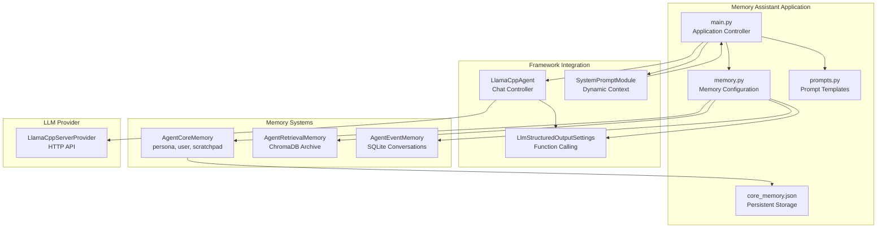
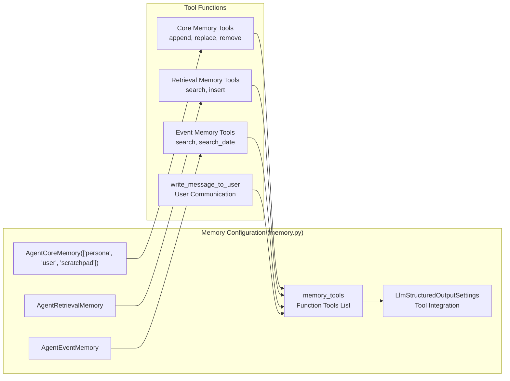
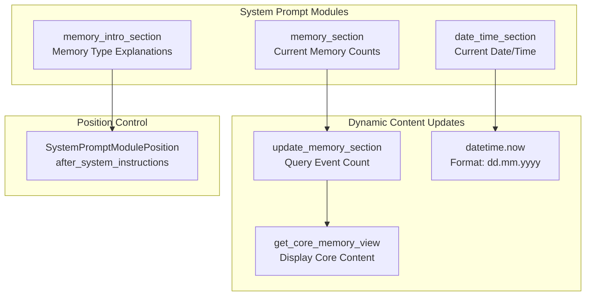
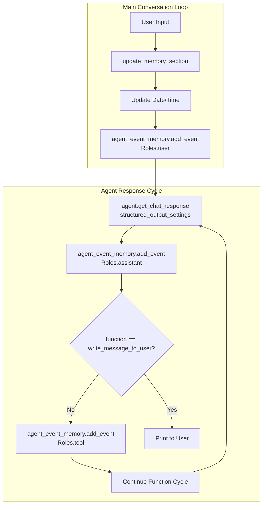

<!-- source: DeepWiki mcp.deepwiki.com · repo Maximilian-Winter/llama-cpp-agent · page 7.3 Memory Assistant · fetched 2026-10-26 -->

# Memory Assistant

<details>
<summary>Relevant source files</summary>

The following files were used as context for generating this wiki page:

- [examples/01_Basics/chatbot_using_groq.py](examples/01_Basics/chatbot_using_groq.py)
- [examples/07_Memory/MemoryAssistant/core_memory.json](examples/07_Memory/MemoryAssistant/core_memory.json)
- [examples/07_Memory/MemoryAssistant/main.py](examples/07_Memory/MemoryAssistant/main.py)
- [examples/07_Memory/MemoryAssistant/memory.py](examples/07_Memory/MemoryAssistant/memory.py)
- [examples/07_Memory/MemoryAssistant/prompts.py](examples/07_Memory/MemoryAssistant/prompts.py)
- [src/llama_cpp_agent/providers/groq.py](src/llama_cpp_agent/providers/groq.py)

</details>


This document covers the Memory Assistant example application, a complete demonstration of how to build a memory-enhanced AI assistant using the llama-cpp-agent framework. The Memory Assistant showcases the integration of all three memory types (core, retrieval, and event memory) in a practical conversational AI application.

For detailed information about the underlying memory system architecture, see [Memory System](#5). For basic agent usage patterns, see [Basic Examples](#7.1).

## Purpose and Architecture

The Memory Assistant is a conversational AI that maintains persistent memory across interactions using three distinct memory systems. It demonstrates how to create an AI assistant with a defined persona that can remember user information, store and retrieve general knowledge, and maintain conversation history.

### Core Components

The Memory Assistant consists of four main components that work together to create a memory-enhanced conversational experience:



Sources: [examples/07_Memory/MemoryAssistant/main.py:1-77](), [examples/07_Memory/MemoryAssistant/memory.py:1-31]()

## Memory System Integration

The Memory Assistant demonstrates how to integrate all three memory types provided by the framework. Each memory type serves a specific purpose in maintaining conversational context and user information.

### Memory Configuration

The memory system is configured in `memory.py` with three distinct memory components:

| Memory Type | Class | Purpose | Storage |
|-------------|-------|---------|---------|
| Core Memory | `AgentCoreMemory` | Essential context about persona, user, and current state | JSON file |
| Retrieval Memory | `AgentRetrievalMemory` | Searchable archive of general information | ChromaDB |
| Event Memory | `AgentEventMemory` | Conversation history and recent events | SQLite |



Sources: [examples/07_Memory/MemoryAssistant/memory.py:12-24]()

### Core Memory Structure

The core memory is defined with three sections that maintain essential contextual information:

```json
{
  "persona": {
    "name": "Aurora",
    "personality": "curious and enthusiastic conversationalist",
    "interests": "Science, technology, history, philosophy...",
    "communication_style": "Warm, curious, upbeat, friendly..."
  },
  "human": {},
  "scratchpad": {}
}
```

Sources: [examples/07_Memory/MemoryAssistant/core_memory.json:1-14]()

## Conversation Flow and System Prompts

The Memory Assistant uses dynamic system prompt modules to provide real-time context about memory state and current information to the AI agent.

### System Prompt Modules

Three system prompt modules provide contextual information to the agent:



Sources: [examples/07_Memory/MemoryAssistant/main.py:28-36](), [examples/07_Memory/MemoryAssistant/memory.py:27-30]()

### Conversation Loop

The main conversation loop demonstrates how to integrate memory updates, structured output, and dynamic context:



Sources: [examples/07_Memory/MemoryAssistant/main.py:38-76]()

## Function Tools and Structured Output

The Memory Assistant uses structured output with function calling to enable the AI to interact with its memory systems and communicate with the user.

### Memory Function Tools

The memory tools are automatically generated from the memory components and integrated into the structured output settings:

```python
memory_tools = agent_core_memory.get_tool_list()
memory_tools.extend(agent_retrieval_memory.get_tool_list())
memory_tools.extend(agent_event_memory.get_tool_list())

output_settings = LlmStructuredOutputSettings.from_llama_cpp_function_tools(
    memory_tools,
    add_thoughts_and_reasoning_field=True,
    add_heartbeat_field=True
)
```

Sources: [examples/07_Memory/MemoryAssistant/memory.py:16-22]()

### XML Response Formatting

The application uses XML tags to structure responses and maintain clear communication between user input, function responses, and agent output:

| Function | Purpose | XML Format |
|----------|---------|------------|
| `wrap_user_message_in_xml_tags_json_mode` | Format user input | `<user_message>` + `<response_format>JSON</response_format>` |
| `wrap_function_response_in_xml_tags_json_mode` | Format tool responses | `<function_response>` + `<response_format>JSON</response_format>` |
| `generate_write_message` | Trigger text output | `<function_response>` + `<response_format>Text</response_format>` |

Sources: [examples/07_Memory/MemoryAssistant/prompts.py:12-21]()

## Provider Configuration and Settings

The Memory Assistant uses `LlamaCppServerProvider` for LLM inference with specific sampling settings optimized for conversational AI:

```python
provider = LlamaCppServerProvider("http://localhost:8080")

settings = provider.get_provider_default_settings()
settings.n_predict = 1024
settings.temperature = 0.65
settings.top_k = 40
settings.top_p = 0.85
```

The agent is configured with `MessagesFormatterType.CHATML` for proper message formatting and includes debug output for development purposes.

Sources: [examples/07_Memory/MemoryAssistant/main.py:13-26]()

## Usage and Deployment

To run the Memory Assistant:

1. Start a llama.cpp server at `http://localhost:8080`
2. Run `python main.py` from the MemoryAssistant directory
3. Interact with the assistant through the command line interface
4. Type "exit" to terminate the session

The assistant will maintain memory between sessions through the persistent `core_memory.json` file and the SQLite/ChromaDB storage systems for event and retrieval memory.

Sources: [examples/07_Memory/MemoryAssistant/main.py:38-41]()

---

