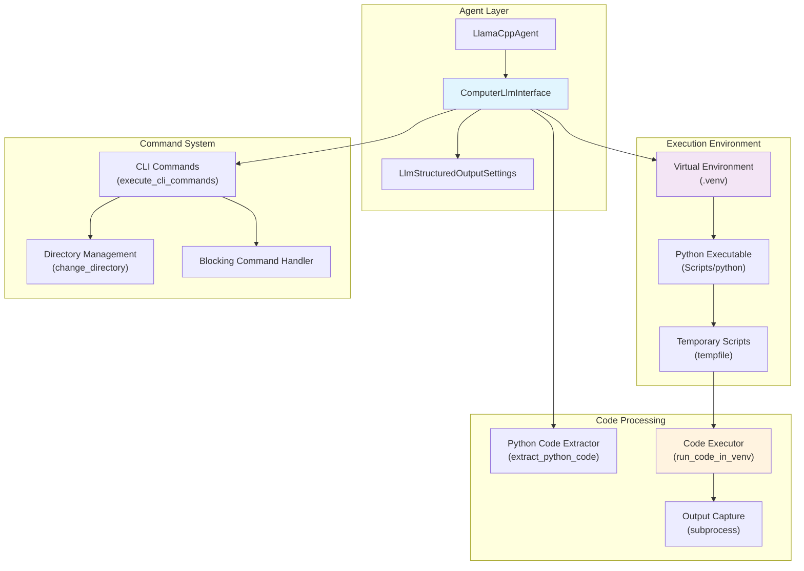
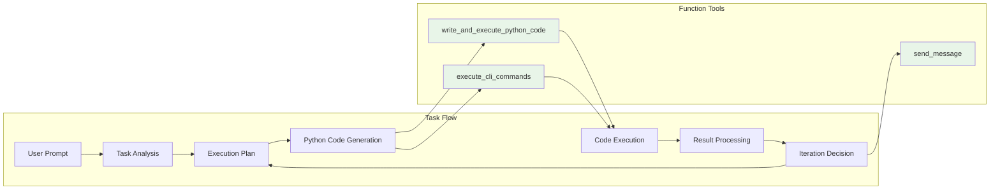
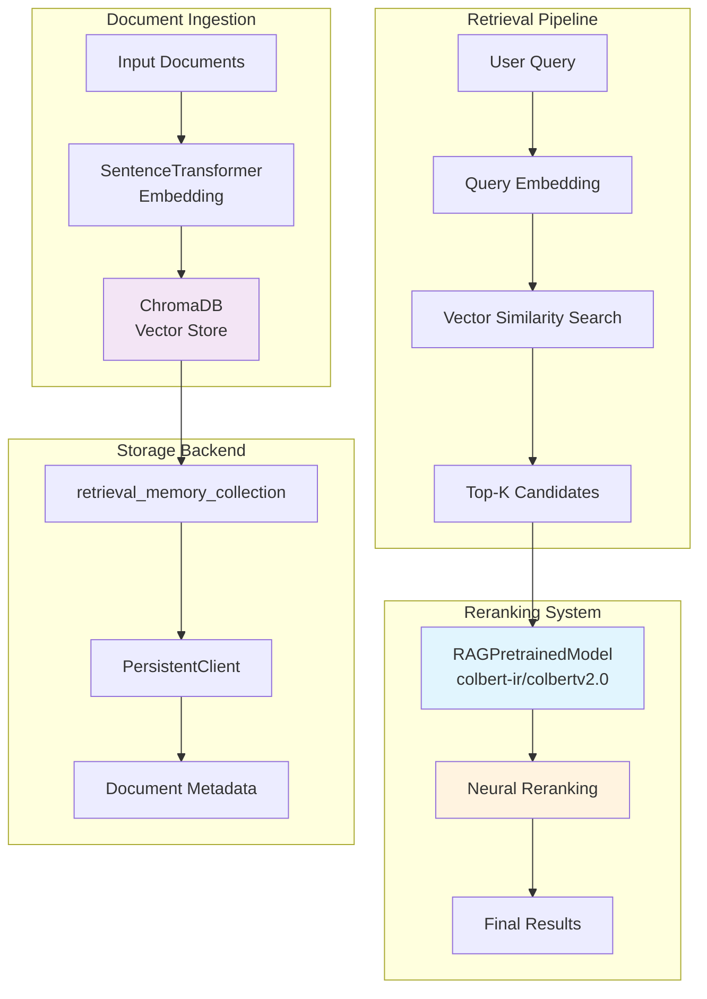
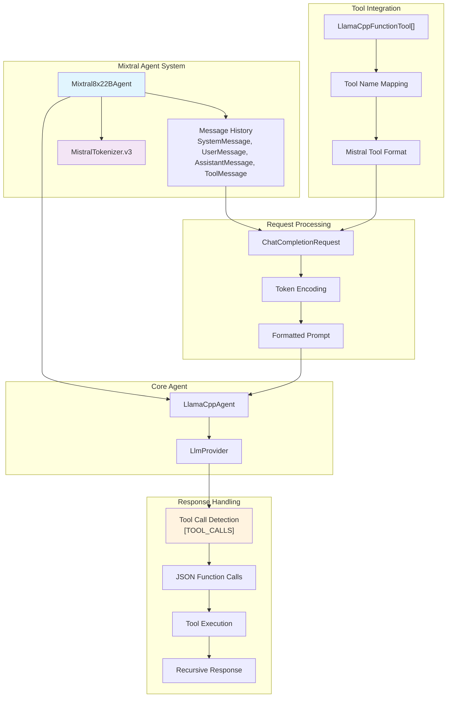
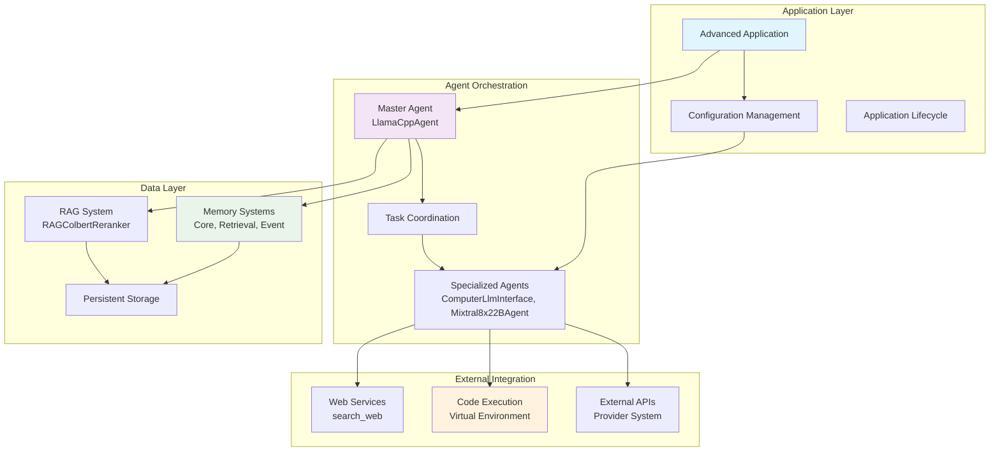

<!-- source: DeepWiki mcp.deepwiki.com · repo Maximilian-Winter/llama-cpp-agent · page 7.4 Advanced Applications · fetched 2026-10-26 -->

# Advanced Applications

<details>
<summary>Relevant source files</summary>

The following files were used as context for generating this wiki page:

- [docs/chat_history-api-reference.md](docs/chat_history-api-reference.md)
- [examples/01_Basics/chatbot_using_llama_cpp_server.py](examples/01_Basics/chatbot_using_llama_cpp_server.py)
- [examples/03_Tools_And_Function_Calling/duck_duck_go_websearch_agent.py](examples/03_Tools_And_Function_Calling/duck_duck_go_websearch_agent.py)
- [examples/03_Tools_And_Function_Calling/experimental_code_interpreter.py](examples/03_Tools_And_Function_Calling/experimental_code_interpreter.py)
- [src/llama_cpp_agent/mixtral_8x22b_agent.py](src/llama_cpp_agent/mixtral_8x22b_agent.py)
- [src/llama_cpp_agent/rag/__init__.py](src/llama_cpp_agent/rag/__init__.py)
- [src/llama_cpp_agent/rag/rag_colbert_reranker.py](src/llama_cpp_agent/rag/rag_colbert_reranker.py)

</details>


This document covers complex, production-ready applications built with the llama-cpp-agent framework. These examples demonstrate advanced integration patterns, specialized agent architectures, and real-world use cases including autonomous code execution, retrieval-augmented generation (RAG) systems, and domain-specific agent implementations.

For basic usage patterns and simple examples, see [Basic Examples](#7.1). For memory-enhanced applications, see [Virtual Game Master](#7.2) and [Memory Assistant](#7.3).

## Code Interpreter Systems

The framework supports autonomous code execution through the `ComputerLlmInterface` class, which provides a secure environment for running Python code and CLI commands. This system enables agents to perform complex computational tasks, data analysis, and file system operations.

### Code Execution Architecture



The `ComputerLlmInterface` manages virtual environments and provides methods for secure code execution:

| Method | Purpose | Security Features |
|--------|---------|-------------------|
| `run_code_in_venv` | Execute Python code | Isolated virtual environment |
| `execute_cli_commands` | Run system commands | Working directory tracking |
| `install_dependencies` | Package management | Controlled package installation |
| `is_blocking_command` | Command filtering | Prevents hanging processes |

Sources: [examples/03_Tools_And_Function_Calling/experimental_code_interpreter.py:29-248]()

### Autonomous Task Execution

The code interpreter demonstrates autonomous behavior through structured output settings that enable the agent to chain multiple operations:



Sources: [examples/03_Tools_And_Function_Calling/experimental_code_interpreter.py:250-295]()

## RAG Systems with Advanced Reranking

The framework provides sophisticated retrieval-augmented generation through the `RAGColbertReranker` class, which combines vector similarity search with ColBERT neural reranking for improved retrieval accuracy.

### RAG Architecture with ColBERT



The `RAGColbertReranker` class provides a two-stage retrieval process:

| Component | Implementation | Purpose |
|-----------|----------------|---------|
| Vector Search | `chromadb.PersistentClient` | Initial candidate retrieval |
| Embedding Model | `BAAI/bge-small-en-v1.5` | Document/query vectorization |
| Reranker | `colbert-ir/colbertv2.0` | Neural relevance scoring |
| Storage | `chromadb` collections | Persistent document storage |

Sources: [src/llama_cpp_agent/rag/rag_colbert_reranker.py:7-62]()

## Specialized Model Integration

The framework supports advanced model-specific implementations through custom agent classes. The `Mixtral8x22BAgent` demonstrates integration with Mistral's tokenization and instruction format.

### Mixtral Agent Architecture



The Mixtral integration handles specialized tokenization and tool calling formats:

```python
# Tool call detection and parsing
if result.strip().startswith("[TOOL_CALLS]"):
    result = result.replace("[TOOL_CALLS]", "")
    function_calls = json.loads(result.strip())
```

Sources: [src/llama_cpp_agent/mixtral_8x22b_agent.py:31-107]()

## Web Search and Content Extraction

The framework enables comprehensive web search capabilities through the `search_web` and `get_website_content_from_url` functions, providing agents with real-time information access.

### Web Search Agent Pipeline

```mermaid
graph LR
    subgraph "Search Process"
        QUERY["Search Query"]
        DDGS["DuckDuckGo Search<br/>DDGS()"]
        RESULTS["Search Results"]
        URLS["Result URLs"]
    end
    
    subgraph "Content Extraction"
        FETCH["fetch_url<br/>(trafilatura)"]
        EXTRACT["extract<br/>(content + formatting)"]
        PARSE["JSON Parsing"]
        FORMAT["Formatted Content"]
    end
    
    subgraph "Agent Integration"
        AGENT["LlamaCppAgent"]
        TOOLS["Function Tools<br/>search_web, send_message_to_user"]
        RESPONSE["Structured Response"]
    end
    
    QUERY --> DDGS
    DDGS --> RESULTS
    RESULTS --> URLS
    URLS --> FETCH
    FETCH --> EXTRACT
    EXTRACT --> PARSE
    PARSE --> FORMAT
    
    FORMAT --> AGENT
    AGENT --> TOOLS
    TOOLS --> RESPONSE
    
    style DDGS fill:#e8f5e8
    style EXTRACT fill:#f3e5f5
    style AGENT fill:#e1f5fe
```



The web search system combines multiple extraction techniques:

| Component | Implementation | Purpose |
|-----------|----------------|---------|
| Search Engine | `DDGS().text()` | Web search with region/safety filters |
| Content Fetcher | `trafilatura.fetch_url()` | Robust HTML downloading |
| Content Extractor | `trafilatura.extract()` | Clean text extraction with formatting |
| Response Parser | JSON format | Structured content with title/URL metadata |

Sources: [examples/03_Tools_And_Function_Calling/duck_duck_go_websearch_agent.py:14-93]()

## Integration Patterns for Advanced Applications

Advanced applications typically follow common integration patterns that combine multiple framework components:

### Multi-Component Integration Pattern



### Common Implementation Patterns

1. **Autonomous Agent Pattern**: Agents that can execute multi-step tasks independently
2. **Tool Orchestration Pattern**: Combining multiple specialized tools through structured output
3. **Memory-Enhanced Pattern**: Leveraging persistent memory for context and learning
4. **Hybrid Retrieval Pattern**: Combining vector search with neural reranking
5. **Environment Isolation Pattern**: Secure execution through virtual environments

Sources: [examples/03_Tools_And_Function_Calling/experimental_code_interpreter.py:240-295](), [examples/03_Tools_And_Function_Calling/duck_duck_go_websearch_agent.py:65-93](), [src/llama_cpp_agent/mixtral_8x22b_agent.py:31-107](), [src/llama_cpp_agent/rag/rag_colbert_reranker.py:7-62]()

---

