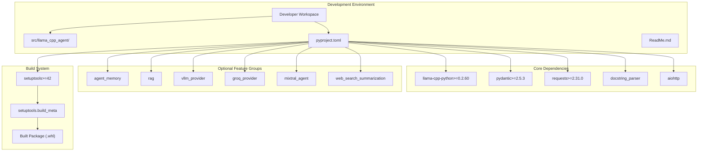
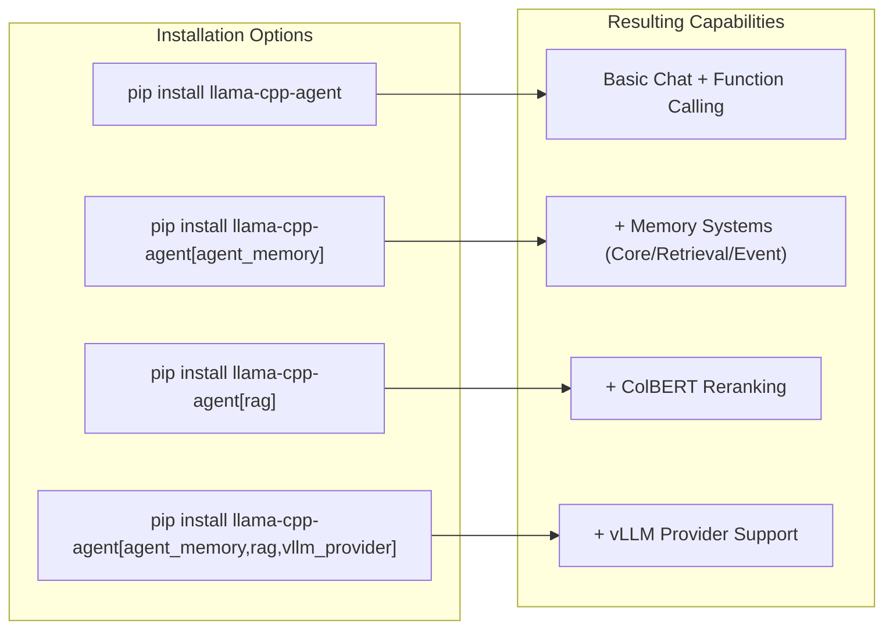
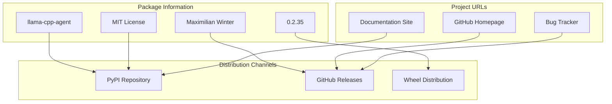
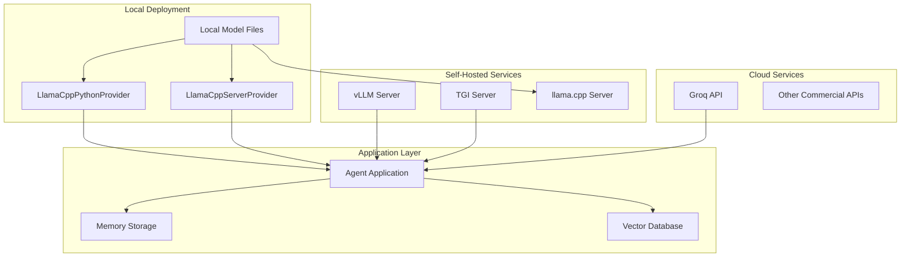

<!-- source: DeepWiki mcp.deepwiki.com · repo Maximilian-Winter/llama-cpp-agent · page 8 Development and Deployment · fetched 2026-10-26 -->

# Development and Deployment

<details>
<summary>Relevant source files</summary>

The following files were used as context for generating this wiki page:

- [ReadMe.md](ReadMe.md)
- [pyproject.toml](pyproject.toml)

</details>


This document covers the development workflow, build configuration, dependency management, and deployment considerations for the llama-cpp-agent framework. It provides essential information for developers contributing to the framework and operators deploying it in production environments.

For detailed project configuration including dependencies and build settings, see [Project Configuration](#8.1). For continuous integration and deployment workflows, see [CI/CD Pipeline](#8.2).

## Development Environment Overview

The llama-cpp-agent framework is designed as a Python package that provides abstractions for working with various LLM providers. The development environment supports both core framework development and optional feature development through a modular dependency system.

### Core Architecture



Sources: [pyproject.toml:1-41](), [ReadMe.md:1-182]()

## Dependency Architecture

The framework uses a tiered dependency system where core functionality requires minimal dependencies, while advanced features are available through optional dependency groups.

### Dependency Mapping

| Feature Group | Dependencies | Purpose |
|---------------|-------------|---------|
| **Core** | `llama-cpp-python`, `pydantic`, `requests`, `docstring_parser`, `aiohttp` | Basic agent functionality |
| **agent_memory** | `chromadb`, `SQLAlchemy`, `numpy`, `scipy` | Memory systems with vector storage |
| **rag** | `ragatouille` | Retrieval augmented generation with ColBERT |
| **vllm_provider** | `openai`, `transformers`, `sentencepiece`, `protobuf` | vLLM server integration |
| **groq_provider** | `groq` | Groq API integration |
| **mixtral_agent** | `mistral-common` | Mixtral model support |
| **web_search_summarization** | `duckduckgo_search`, `trafilatura`, `lxml-html-clean`, `googlesearch-python`, `beautifulsoup4` | Web search and content extraction |

### Installation Patterns



Sources: [pyproject.toml:26-32](), [ReadMe.md:56-62]()

## Build and Package Management

The framework uses modern Python packaging standards with setuptools and follows semantic versioning.

### Build Configuration

The build system is configured through `pyproject.toml` using the setuptools backend:

- **Build Backend**: `setuptools.build_meta`
- **Source Layout**: Source code located in `src/llama_cpp_agent/`
- **Version**: Currently `0.2.35` with semantic versioning
- **Python Requirement**: `>=3.10`
- **License**: MIT License

### Package Metadata



Sources: [pyproject.toml:5-36](), [ReadMe.md:7-8]()

## Deployment Architecture

The framework supports deployment across multiple LLM provider infrastructures, each with different deployment considerations.

### Provider Deployment Matrix



Sources: [ReadMe.md:17-17](), [ReadMe.md:26-26]()

## Environment-Specific Considerations

### Development Environment

For development setups, consider installing the framework with all optional dependencies to enable testing of all features:

```bash
pip install llama-cpp-agent[agent_memory,rag,vllm_provider,groq_provider,web_search_summarization]
```

### Production Environment

Production deployments should only include necessary optional dependencies to minimize attack surface and resource usage. The core framework provides sufficient functionality for basic chat and function calling without any optional dependencies.

### Memory System Deployment

When deploying with memory capabilities, additional infrastructure components are required:

- **ChromaDB**: For retrieval memory vector storage
- **SQLite/SQLAlchemy**: For event memory persistence  
- **File System**: For core memory JSON persistence

### Provider-Specific Infrastructure

| Provider | Infrastructure Requirements | Deployment Notes |
|----------|----------------------------|------------------|
| `LlamaCppPythonProvider` | Local compute, model files | In-process, highest memory usage |
| `LlamaCppServerProvider` | HTTP server, model files | Separate process, HTTP overhead |
| `VLLMServerProvider` | vLLM server, GPU resources | High throughput, GPU required |
| `TGIServerProvider` | TGI server, GPU resources | HuggingFace ecosystem |
| `GroqProvider` | Internet connectivity | Commercial API, lowest local resources |

Sources: [pyproject.toml:26-32](), [ReadMe.md:26-26]()

## Version and Release Management

The framework follows semantic versioning with regular releases published to PyPI. The current version `0.2.35` indicates the framework is in active development with frequent updates.

### Version Compatibility

- **Python Compatibility**: Requires Python 3.10 or higher
- **llama-cpp-python**: Minimum version 0.2.60 required for core functionality
- **Pydantic**: Version 2.5.3+ required for structured output features

### Release Channels

The framework is distributed through multiple channels:
- **PyPI**: Primary distribution channel for stable releases
- **GitHub**: Source code and development releases
- **Documentation**: Hosted documentation with examples

Sources: [pyproject.toml:6-20](), [ReadMe.md:7-8](), [ReadMe.md:62-62]()

---

