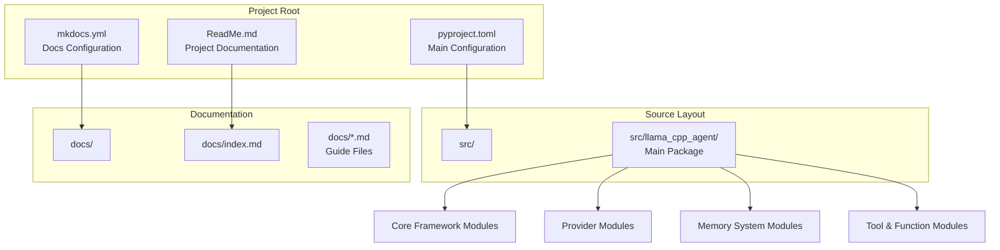
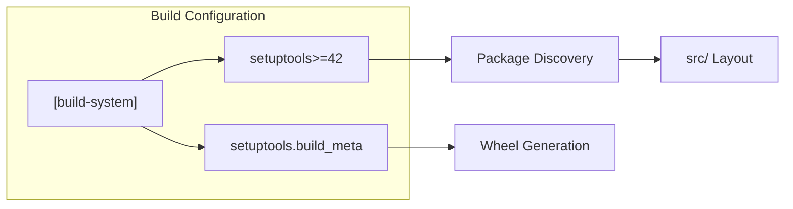
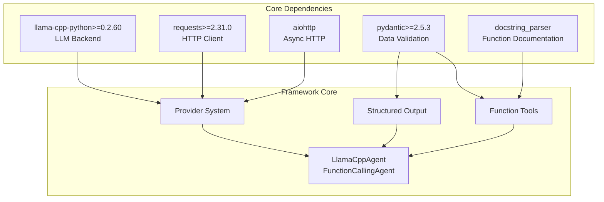
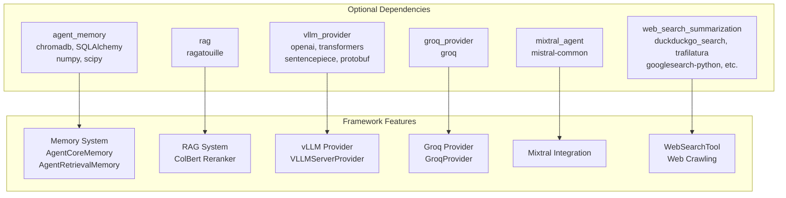
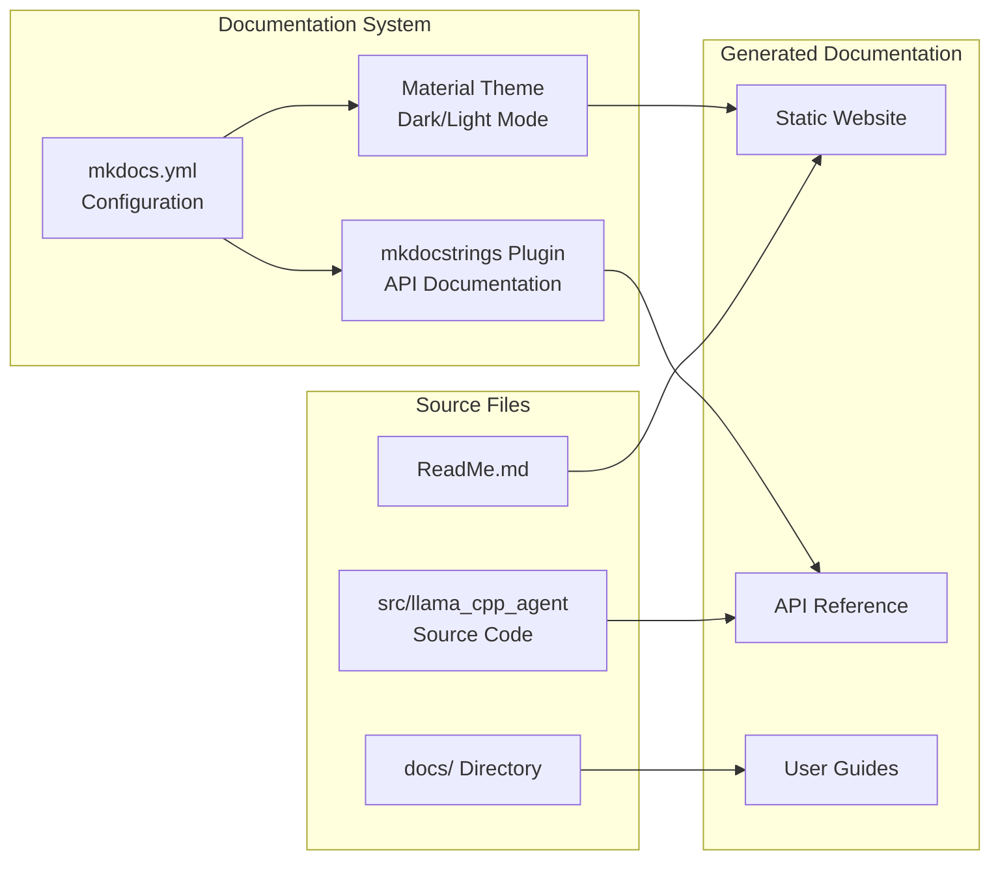

<!-- source: DeepWiki mcp.deepwiki.com · repo Maximilian-Winter/llama-cpp-agent · page 8.1 Project Configuration · fetched 2026-10-26 -->

# Project Configuration

<details>
<summary>Relevant source files</summary>

The following files were used as context for generating this wiki page:

- [ReadMe.md](ReadMe.md)
- [docs/function-calling-agent.md](docs/function-calling-agent.md)
- [docs/index.md](docs/index.md)
- [mkdocs.yml](mkdocs.yml)
- [pyproject.toml](pyproject.toml)

</details>


## Purpose and Scope

This document covers the project configuration, build system, and dependency management for the llama-cpp-agent framework. It explains the structure of configuration files, required and optional dependencies, and how the project is organized for development and distribution.

For information about CI/CD pipeline and deployment processes, see [CI/CD Pipeline](#8.2).

## Project Structure Overview

The llama-cpp-agent framework follows a standard Python package structure with configuration-driven dependency management. The project uses a source layout with modular optional dependencies to minimize installation overhead while supporting advanced features.



**Sources:** [pyproject.toml:38-39](), [mkdocs.yml:44-45](), [docs/index.md:5]()

## Core Project Configuration

The project configuration is centralized in `pyproject.toml` using modern Python packaging standards. The configuration defines the build system, project metadata, dependencies, and package discovery.

### Build System Configuration



The project uses `setuptools` as the build backend with automatic package discovery configured for the `src` directory layout at [pyproject.toml:38-39]().

**Sources:** [pyproject.toml:1-3](), [pyproject.toml:38-39]()

### Project Metadata

| Field | Value | Purpose |
|-------|-------|---------|
| `name` | `llama-cpp-agent` | Package identifier for PyPI |
| `version` | `0.2.35` | Current release version |
| `description` | Framework description | PyPI package summary |
| `readme` | `ReadMe.md` | Long description source |
| `requires-python` | `>=3.10` | Minimum Python version |
| `license` | `MIT License` | Open source license |

**Sources:** [pyproject.toml:5-20]()

## Dependency Management

The framework uses a modular dependency system with core dependencies required for basic functionality and optional dependency groups for specific features.

### Core Dependencies



**Sources:** [pyproject.toml:11-17]()

### Optional Dependency Groups

The framework provides several optional dependency groups that enable specific functionality:



**Sources:** [pyproject.toml:26-32]()

#### Dependency Group Details

| Group | Dependencies | Framework Components |
|-------|-------------|---------------------|
| `agent_memory` | `chromadb`, `SQLAlchemy`, `numpy`, `scipy` | Memory systems with vector storage and persistence |
| `rag` | `ragatouille` | Retrieval augmented generation with ColBert reranking |
| `vllm_provider` | `openai`, `transformers`, `sentencepiece`, `protobuf` | vLLM server provider integration |
| `groq_provider` | `groq` | Groq commercial API provider |
| `mixtral_agent` | `mistral-common` | Mixtral model integration |
| `web_search_summarization` | `duckduckgo_search`, `trafilatura`, `lxml`, `googlesearch-python`, `beautifulsoup4`, `readability-lxml` | Web search and content extraction tools |

**Sources:** [pyproject.toml:26-32]()

## Documentation Configuration

The project uses MkDocs with Material theme for documentation generation, configured in `mkdocs.yml`.

### Documentation Build System



The documentation system automatically generates API reference from source code docstrings and includes manually written guides and examples.

**Sources:** [mkdocs.yml:1-42](), [mkdocs.yml:47-72]()

### Documentation Structure

The navigation structure is defined in `mkdocs.yml` and maps to the framework's component architecture:

| Section | Content | Source |
|---------|---------|--------|
| Welcome | Project overview | `ReadMe.md` |
| Getting Started | Installation and basic usage | `get-started.md` |
| Guides | Component-specific examples | Individual `.md` files |
| API Reference | Auto-generated from code | Source code docstrings |

**Sources:** [mkdocs.yml:47-72]()

## Installation and Usage

The modular dependency system allows users to install only the components they need:

```bash
# Core installation
pip install llama-cpp-agent

# With memory system support
pip install llama-cpp-agent[agent_memory]

# With RAG capabilities
pip install llama-cpp-agent[rag]

# Multiple optional features
pip install llama-cpp-agent[agent_memory,rag,web_search_summarization]
```

This approach minimizes installation overhead while providing access to advanced features when needed.

**Sources:** [ReadMe.md:56-60](), [pyproject.toml:26-32]()

## Python Version Requirements

The framework requires Python 3.10 or higher, specified at [pyproject.toml:19](). This requirement enables the use of modern Python features like:

- Structural pattern matching
- Enhanced type annotations
- Improved error messages
- Performance optimizations in recent Python versions

**Sources:** [pyproject.toml:19]()

---

