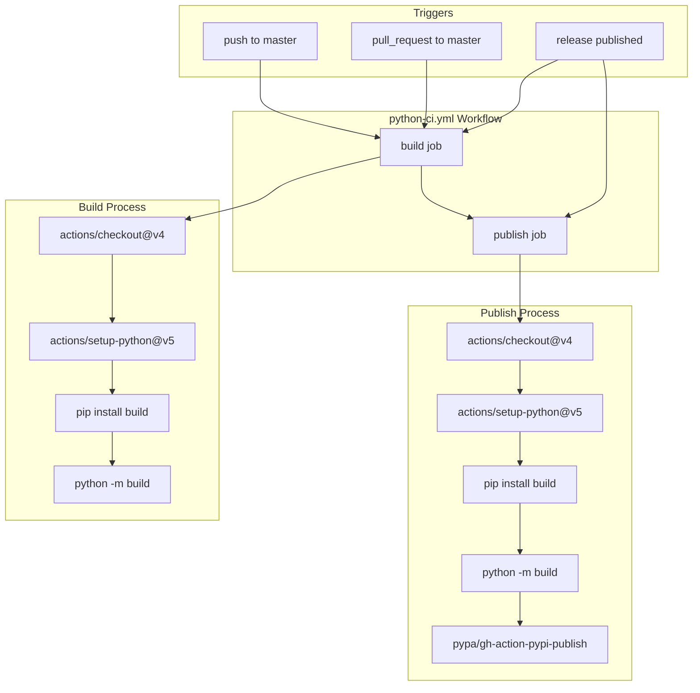
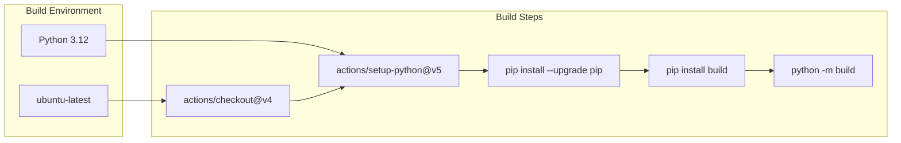
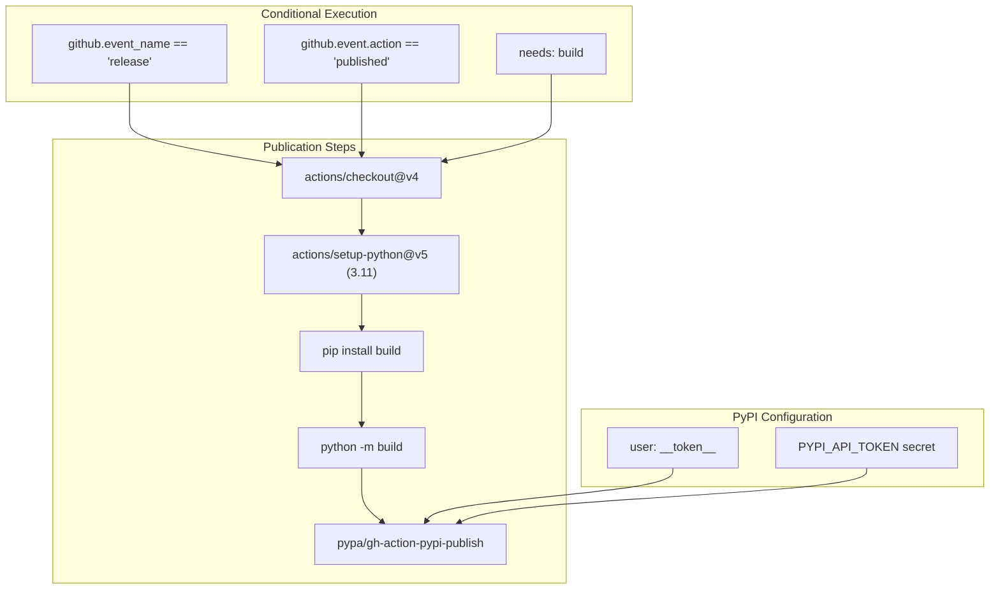

<!-- source: DeepWiki mcp.deepwiki.com · repo Maximilian-Winter/llama-cpp-agent · page 8.2 CI/CD Pipeline · fetched 2026-10-26 -->

# CI/CD Pipeline

Relevant source files

The following files were used as context for generating this wiki page:

- [.github/workflows/python-ci.yml](.github/workflows/python-ci.yml)

This document covers the continuous integration and continuous deployment (CI/CD) pipeline for the llama-cpp-agent project. The pipeline automates building, testing, and publishing the Python package to PyPI using GitHub Actions workflows.

For information about project structure and dependencies, see [Project Configuration](#8.1). For deployment examples and usage patterns, see [Examples and Applications](#7).

## Pipeline Overview

The llama-cpp-agent project uses GitHub Actions to implement a streamlined CI/CD pipeline that handles package building and PyPI publication. The pipeline consists of two main jobs: `build` for continuous integration and `publish` for automated deployment upon releases.

## CI/CD Workflow Architecture

Sources: [.github/workflows/python-ci.yml:1-51]()

## Workflow Triggers

The CI/CD pipeline is triggered by three types of events defined in the workflow configuration:

| Trigger | Branches/Conditions | Jobs Executed |
|---------|-------------------|---------------|
| `push` | `master` branch | `build` |
| `pull_request` | `master` branch | `build` |
| `release` | `published` type | `build`, `publish` |

The workflow uses event-based triggering to ensure code quality on the main branch while automatically deploying releases to PyPI.

Sources: [.github/workflows/python-ci.yml:3-9]()

## Build Process

The `build` job runs on every trigger event and validates that the package can be successfully built. It uses a matrix strategy to test against Python 3.12.

### Build Job Configuration

The build process performs the following operations:

1. **Repository Checkout**: Uses `actions/checkout@v4` to fetch the source code
2. **Python Setup**: Configures Python 3.12 environment using `actions/setup-python@v5`
3. **Dependency Installation**: Upgrades pip and installs the `build` package
4. **Package Building**: Executes `python -m build` to create distribution artifacts

Sources: [.github/workflows/python-ci.yml:11-28]()

## Publication Process

The `publish` job executes only when a GitHub release is published, providing automated deployment to PyPI. This job depends on the successful completion of the `build` job.

### Publication Job Flow

The publication process includes:

1. **Conditional Execution**: Only runs for published release events
2. **Environment Setup**: Uses Python 3.11 for the publication environment
3. **Package Building**: Rebuilds the package to ensure consistency
4. **PyPI Publication**: Uses `pypa/gh-action-pypi-publish@3fbcf7ccf443305955ce16db9de8401f7dc1c7dd` with API token authentication

Sources: [.github/workflows/python-ci.yml:30-51]()

## Configuration and Secrets

The pipeline requires minimal configuration but depends on proper secret management for PyPI access.

### Required Secrets

| Secret Name | Purpose | Usage |
|-------------|---------|-------|
| `PYPI_API_TOKEN` | PyPI authentication token | Used by `pypa/gh-action-pypi-publish` action |

### Workflow Configuration Details

The workflow configuration includes several important aspects:

- **Action Versions**: Uses pinned versions for security (`actions/checkout@v4`, `actions/setup-python@v5`)
- **Python Versions**: Build job uses Python 3.12, publish job uses Python 3.11
- **Security**: PyPI action uses a specific commit hash for enhanced security
- **Dependencies**: Minimal dependency set focusing on the `build` package

### Pipeline Security

The pipeline implements security best practices:

1. **Pinned Action Versions**: All GitHub Actions use specific version tags
2. **Commit Hash Pinning**: PyPI publish action uses commit hash instead of tag
3. **Secret Management**: PyPI token stored as encrypted GitHub secret
4. **Conditional Publishing**: Publication only occurs on explicit release events

Sources: [.github/workflows/python-ci.yml:18-50]()

## Monitoring and Troubleshooting

The CI/CD pipeline provides visibility through GitHub Actions interface, where developers can:

- Monitor build status for pull requests and pushes
- Review build logs for debugging package creation issues
- Track publication status and PyPI deployment results
- Identify dependency installation or Python environment issues

The workflow's simplicity reduces maintenance overhead while providing reliable automated deployment for the llama-cpp-agent package.

Sources: [.github/workflows/python-ci.yml:1-51]()