# Page: Overview

# Overview

<details>
<summary>Relevant source files</summary>

The following files were used as context for generating this wiki page:

- [ReadMe.md](ReadMe.md)
- [pyproject.toml](pyproject.toml)

</details>


This document provides a comprehensive overview of the llama-cpp-agent framework, its architecture, core components, and capabilities. The framework is designed to simplify interactions with Large Language Models (LLMs) through a unified interface that supports chat, function calling, structured output generation, and retrieval-augmented generation.

For detailed implementation guides of specific components, see [Core Framework](#3), [Provider System](#4), [Memory System](#5), and [Tools and Function Calling](#6). For practical usage examples, see [Examples and Applications](#7).

## Framework Purpose and Scope

The llama-cpp-agent framework serves as a comprehensive abstraction layer for building LLM-based AI agents. It provides guided sampling capabilities that enable models not specifically fine-tuned for function calling or JSON output to perform these tasks reliably through grammar constraints and structured output generation.

The framework supports multiple LLM backends including llama.cpp server, llama-cpp-python, TGI (Text Generation Inference), vLLM, and commercial APIs like Groq. It implements a modular architecture where agents, providers, memory systems, and tools can be combined to create sophisticated AI applications.

**Sources:** [pyproject.toml:5-8](), [ReadMe.md:12-18]()

## High-Level System Architecture

The framework follows a layered architecture with clear separation between the agent layer, provider abstraction, memory systems, and application examples.

### Core System Architecture

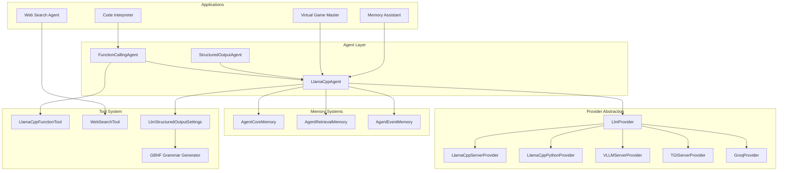

**Sources:** [ReadMe.md:19-28](), [pyproject.toml:26-32]()

## Core Framework Flow

The framework processes user interactions through a structured pipeline that handles message formatting, prompt generation, LLM interaction, and response processing.

### Agent Processing Pipeline

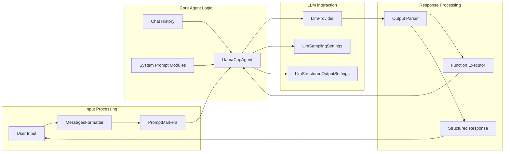

**Sources:** [ReadMe.md:116-155](), [ReadMe.md:20-22]()

## Key Components

### Agent Classes

The framework provides three primary agent classes, each specialized for different use cases:

| Agent Class | Purpose | Key Features |
|-------------|---------|--------------|
| `LlamaCppAgent` | Basic chat and conversation | Message formatting, chat history, system prompts |
| `FunctionCallingAgent` | Tool integration and function execution | Parallel function calling, tool management |
| `StructuredOutputAgent` | Structured data generation | Pydantic model output, JSON schema validation |

### Provider System

The `LlmProvider` abstract interface enables seamless switching between different LLM backends:

- **Local Providers**: `LlamaCppServerProvider`, `LlamaCppPythonProvider`
- **Server Providers**: `VLLMServerProvider`, `TGIServerProvider`  
- **Commercial APIs**: `GroqProvider`

### Memory Architecture

The framework implements three types of persistent memory:

- **Core Memory** (`AgentCoreMemory`): Essential context and persona information
- **Retrieval Memory** (`AgentRetrievalMemory`): Searchable knowledge base with vector embeddings
- **Event Memory** (`AgentEventMemory`): Conversation history and event tracking

**Sources:** [ReadMe.md:20-28](), [pyproject.toml:11-16]()

## Optional Dependencies and Features

The framework uses optional dependencies to provide modular functionality:

| Feature Group | Dependencies | Functionality |
|---------------|--------------|---------------|
| `agent_memory` | chromadb, SQLAlchemy, numpy, scipy | Persistent memory systems |
| `rag` | ragatouille | Retrieval-augmented generation with ColBERT reranking |
| `vllm_provider` | openai, transformers | vLLM server integration |
| `groq_provider` | groq | Groq API integration |
| `web_search_summarization` | duckduckgo_search, trafilatura, googlesearch-python | Web search and content extraction |

**Sources:** [pyproject.toml:26-32]()

## Application Examples

The framework supports building complex AI applications through composition of core components:

### Example Applications

```mermaid
graph TB
    subgraph "Virtual Game Master"
        VGM["Game Master Agent"]
        GamePrompts["Game-specific Prompts"]
        GameMemory["Game State Memory"]
        EventTracking["Story Event Tracking"]
    end
    
    subgraph "Memory Assistant"
        MA["Memory Assistant"]
        PersonalContext["Personal Context"]
        KnowledgeBase["Knowledge Archive"]
        ConversationLog["Conversation History"]
    end
    
    subgraph "Web Search Agent"
        WSA["Web Search Agent"]
        SearchProviders["DuckDuckGo, Google"]
        ContentExtraction["Web Scraping"]
        Summarization["Content Summarization"]
    end
    
    subgraph "Code Interpreter"
        CI["Code Interpreter"]
        PythonExecution["Python Code Execution"]
        EnvironmentIsolation["Virtual Environment"]
        ResultProcessing["Output Processing"]
    end
    
    subgraph "Shared Infrastructure"
        SharedAgent["LlamaCppAgent"]
        SharedMemory["Memory Systems"]
        SharedTools["Function Tools"]
    end
    
    VGM --> SharedAgent
    GameMemory --> SharedMemory
    EventTracking --> SharedMemory
    
    MA --> SharedAgent
    PersonalContext --> SharedMemory
    KnowledgeBase --> SharedMemory
    ConversationLog --> SharedMemory
    
    WSA --> SharedAgent
    SearchProviders --> SharedTools
    ContentExtraction --> SharedTools
    
    CI --> SharedAgent
    PythonExecution --> SharedTools
```

**Sources:** [ReadMe.md:70-111](), [ReadMe.md:88-96]()

## Framework Benefits

The llama-cpp-agent framework provides several key advantages:

- **Guided Sampling**: Enables function calling and structured output for models not specifically fine-tuned for these tasks
- **Provider Agnostic**: Unified interface across different LLM backends
- **Memory Persistence**: Built-in support for different types of agent memory
- **Tool Integration**: Seamless integration with Python functions, Pydantic models, and OpenAI tool schemas
- **Modular Design**: Components can be mixed and matched for different use cases

The framework requires Python 3.10+ and uses MIT licensing for open-source development and community contributions.

**Sources:** [ReadMe.md:14-15](), [ReadMe.md:25-28](), [pyproject.toml:19-20](), [ReadMe.md:169-170]()

---

# Page: Getting Started

# Getting Started

<details>
<summary>Relevant source files</summary>

The following files were used as context for generating this wiki page:

- [docs/chat_history-api-reference.md](docs/chat_history-api-reference.md)
- [docs/get-started.md](docs/get-started.md)
- [examples/01_Basics/chatbot_using_llama_cpp_server.py](examples/01_Basics/chatbot_using_llama_cpp_server.py)
- [examples/02_Structured_Output/book_dataset_creation.py](examples/02_Structured_Output/book_dataset_creation.py)
- [examples/02_Structured_Output/dataframe_creation.py](examples/02_Structured_Output/dataframe_creation.py)
- [examples/03_Tools_And_Function_Calling/duck_duck_go_websearch_agent.py](examples/03_Tools_And_Function_Calling/duck_duck_go_websearch_agent.py)
- [examples/03_Tools_And_Function_Calling/experimental_code_interpreter.py](examples/03_Tools_And_Function_Calling/experimental_code_interpreter.py)
- [tests/providers.py](tests/providers.py)

</details>


This guide provides installation instructions, basic usage examples, and a quick start tutorial for new users of the llama-cpp-agent framework. It covers the essential steps to set up your first agent, connect to LLM providers, and perform basic operations including chat, function calling, and structured output generation.

For detailed information about specific framework components, see [Core Framework](#3). For advanced memory and retrieval capabilities, see [Memory System](#5). For comprehensive tool integration patterns, see [Tools and Function Calling](#6).

## Installation

Install the llama-cpp-agent framework using pip:

```bash
pip install llama-cpp-agent
```

The framework requires Python and automatically installs necessary dependencies for core functionality. Additional dependencies may be required for specific providers or advanced features.

Sources: [docs/get-started.md:31-37]()

## Framework Overview

The llama-cpp-agent framework provides a unified interface for working with Large Language Models through multiple providers and specialized agent classes.

### Core Components Architecture

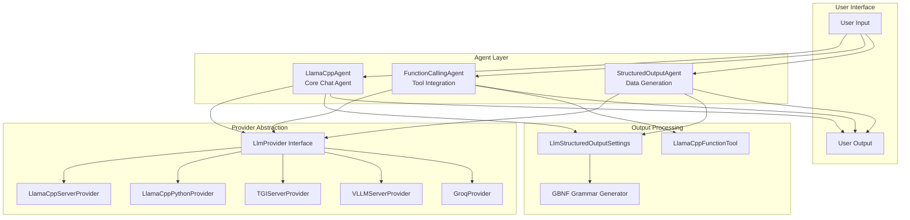

Sources: [docs/get-started.md:39-79](), [examples/01_Basics/chatbot_using_llama_cpp_server.py:1-24](), [tests/providers.py:17-43]()

## Provider Setup

The framework supports multiple LLM providers through a unified interface. Each provider implements the `LlmProvider` interface for consistent behavior across different backends.

### Provider Configuration Examples

| Provider Type | Class | Primary Use Case |
|---------------|-------|------------------|
| llama-cpp-python | `LlamaCppPythonProvider` | Local model execution with Python bindings |
| llama.cpp server | `LlamaCppServerProvider` | HTTP server-based inference |
| Text Generation Inference | `TGIServerProvider` | HuggingFace TGI server integration |
| vLLM | `VLLMServerProvider` | High-performance OpenAI-compatible serving |
| Groq | `GroqProvider` | Commercial API service |

### llama-cpp-python Provider

```python
from llama_cpp import Llama
from llama_cpp_agent.providers import LlamaCppPythonProvider

llama_model = Llama(
    r"C:\gguf-models\mistral-7b-instruct-v0.2.Q6_K.gguf", 
    n_batch=1024, 
    n_threads=10, 
    n_gpu_layers=40
)
provider = LlamaCppPythonProvider(llama_model)
```

### llama.cpp Server Provider

```python
from llama_cpp_agent.providers import LlamaCppServerProvider

provider = LlamaCppServerProvider("http://127.0.0.1:8080")
```

### TGI Server Provider

```python
from llama_cpp_agent.providers import TGIServerProvider

provider = TGIServerProvider("http://localhost:8080")
```

### vLLM Server Provider

```python
from llama_cpp_agent.providers import VLLMServerProvider

provider = VLLMServerProvider(
    "http://localhost:8000/v1", 
    "TheBloke/Llama-2-7b-Chat-AWQ", 
    "token-abc123"
)
```

Sources: [docs/get-started.md:40-78](), [tests/providers.py:24-33]()

## Basic Agent Creation

### Simple Agent Setup

```python
from llama_cpp_agent import LlamaCppAgent

# Create provider (using any provider from above)
provider = LlamaCppServerProvider("http://127.0.0.1:8080")

# Create basic agent
agent = LlamaCppAgent(provider)
```

### Customized Agent Configuration

```python
from llama_cpp_agent import LlamaCppAgent, MessagesFormatterType

agent = LlamaCppAgent(
    provider,
    system_prompt="You are a helpful assistant.",
    predefined_messages_formatter_type=MessagesFormatterType.CHATML
)
```

Sources: [docs/get-started.md:80-110](), [examples/01_Basics/chatbot_using_llama_cpp_server.py:7-12]()

## Core Usage Workflows

### Basic Chat Interaction Flow

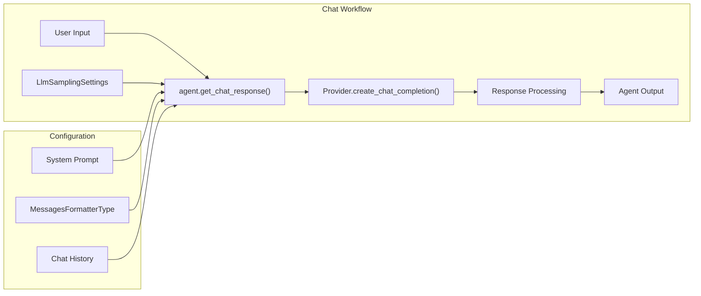

### Simple Chat Example

```python
# Basic chat interaction
agent_output = agent.get_chat_response("Hello, World!")
print(f"Agent: {agent_output.strip()}")

# Chat with custom sampling settings
settings = provider.get_provider_default_settings()
settings.temperature = 0.65
settings.n_predict = 512

agent_output = agent.get_chat_response(
    "Hello, World!", 
    llm_sampling_settings=settings
)
```

Sources: [docs/get-started.md:112-135](), [examples/01_Basics/chatbot_using_llama_cpp_server.py:14-23]()

### Function Calling Workflow

Function calling enables agents to execute tools and external functions. The framework supports Python functions, Pydantic models, and OpenAI tool schemas.

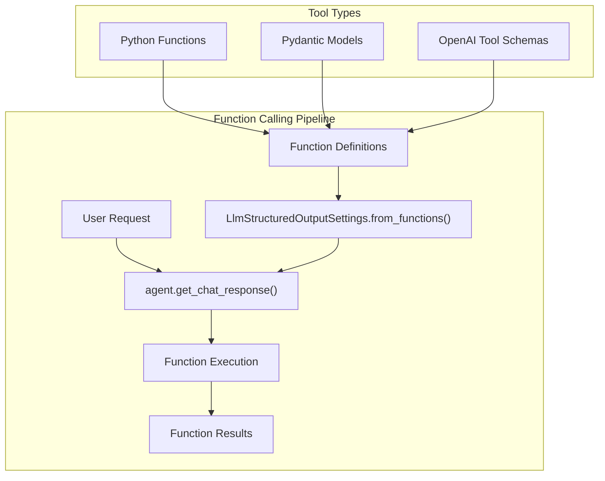

### Function Calling Example

```python
import math
from llama_cpp_agent.llm_output_settings import LlmStructuredOutputSettings

def calculate_a_to_the_power_b(a: Union[int, float], b: Union[int, float]):
    """
    Calculates a to the power of b
    
    Args:
        a: number
        b: exponent
    """
    return f"Result: {math.pow(a, b)}"

# Create structured output settings for function calling
output_settings = LlmStructuredOutputSettings.from_functions(
    [calculate_a_to_the_power_b], 
    allow_parallel_function_calling=True
)

# Execute function call
response = agent.get_chat_response(
    "Calculate 2 to the power of 3",
    structured_output_settings=output_settings
)
```

Sources: [docs/get-started.md:164-219](), [tests/providers.py:56-169]()

### Structured Output Generation

The framework can generate structured data objects based on Pydantic models, ensuring type-safe and validated outputs.

```python
from enum import Enum
from typing import List
from pydantic import BaseModel, Field
from llama_cpp_agent.llm_output_settings import LlmStructuredOutputSettings, LlmStructuredOutputType

class Category(Enum):
    Fiction = "Fiction"
    NonFiction = "Non-Fiction"

class Book(BaseModel):
    """Represents an entry about a book."""
    title: str = Field(..., description="Title of the book.")
    author: str = Field(..., description="Author of the book.")
    published_year: int = Field(..., description="Publishing year of the book.")
    keywords: List[str] = Field(..., description="A list of keywords.")
    category: Category = Field(..., description="Category of the book.")
    summary: str = Field(..., description="Summary of the book.")

# Configure structured output
output_settings = LlmStructuredOutputSettings.from_pydantic_models(
    [Book], 
    output_type=LlmStructuredOutputType.list_of_objects
)

# Generate structured data
text = """The Feynman Lectures on Physics is a physics textbook..."""
book_entry = agent.get_chat_response(text, structured_output_settings=output_settings)
```

Sources: [docs/get-started.md:301-368](), [examples/02_Structured_Output/book_dataset_creation.py:16-55]()

## Specialized Agent Classes

### FunctionCallingAgent

The `FunctionCallingAgent` provides automatic function execution and response generation:

```python
from llama_cpp_agent import FunctionCallingAgent, LlamaCppFunctionTool

# Create function tools
function_tools = [LlamaCppFunctionTool(Calculator)]

# Create function calling agent
function_call_agent = FunctionCallingAgent(
    provider,
    llama_cpp_function_tools=function_tools,
    allow_parallel_function_calling=True,
    messages_formatter_type=MessagesFormatterType.CHATML
)

# Generate response with automatic function handling
function_call_agent.generate_response("Calculate 42 * 42")
```

### StructuredOutputAgent

The `StructuredOutputAgent` simplifies structured data generation:

```python
from llama_cpp_agent import StructuredOutputAgent

structured_output_agent = StructuredOutputAgent(
    provider,
    messages_formatter_type=MessagesFormatterType.CHATML
)

# Create structured object directly
book = structured_output_agent.create_object(Book, text)
```

Sources: [docs/get-started.md:222-417](), [tests/providers.py:344-353]()

## Next Steps

### Advanced Features

- **Memory Systems**: Implement persistent memory with core, retrieval, and event memory. See [Memory System](#5).
- **Custom Tools**: Create sophisticated function tools and web search capabilities. See [Tools and Function Calling](#6).
- **Complex Applications**: Build complete applications like Virtual Game Masters and Memory Assistants. See [Examples and Applications](#7).

### Configuration Options

- **Chat History**: Customize conversation management with `BasicChatHistory` and `BasicChatMessageStore`
- **Sampling Settings**: Fine-tune generation parameters using `LlmSamplingSettings`
- **Message Formatting**: Choose appropriate formatters for different model types using `MessagesFormatterType`

### Provider-Specific Features

Each provider supports different capabilities and configuration options. Refer to [Provider System](#4) for detailed provider-specific documentation and advanced configuration patterns.

Sources: [docs/get-started.md:137-162](), [examples/03_Tools_And_Function_Calling/experimental_code_interpreter.py:240-271](), [examples/03_Tools_And_Function_Calling/duck_duck_go_websearch_agent.py:65-90]()

---

# Page: Core Framework

# Core Framework

<details>
<summary>Relevant source files</summary>

The following files were used as context for generating this wiki page:

- [src/llama_cpp_agent/function_calling.py](src/llama_cpp_agent/function_calling.py)
- [src/llama_cpp_agent/function_calling_agent.py](src/llama_cpp_agent/function_calling_agent.py)
- [src/llama_cpp_agent/gbnf_grammar_generator/gbnf_grammar_from_pydantic_models.py](src/llama_cpp_agent/gbnf_grammar_generator/gbnf_grammar_from_pydantic_models.py)
- [src/llama_cpp_agent/llm_agent.py](src/llama_cpp_agent/llm_agent.py)
- [src/llama_cpp_agent/messages_formatter.py](src/llama_cpp_agent/messages_formatter.py)

</details>


This document covers the fundamental components and architecture of the llama-cpp-agent framework, including the central agent orchestrator, specialized agent types, message processing pipeline, and output handling systems. For information about specific LLM provider implementations, see [Provider System](#4). For memory system integration, see [Memory System](#5). For detailed tool and function calling capabilities, see [Tools and Function Calling](#6).

## Core Architecture Overview

The Core Framework centers around the `LlamaCppAgent` class as the primary orchestrator, with specialized agent types for specific use cases and a comprehensive message processing pipeline.

### Framework Components Diagram

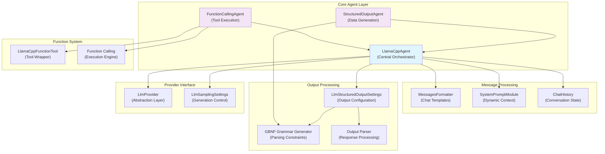

**Sources:** [src/llama_cpp_agent/llm_agent.py:70-662](), [src/llama_cpp_agent/function_calling_agent.py:89-301](), [src/llama_cpp_agent/messages_formatter.py:41-134]()

## LlamaCppAgent - Central Orchestrator

The `LlamaCppAgent` class serves as the primary interface for all agent interactions, handling chat responses, text generation, and structured output coordination.

### Core Agent Architecture

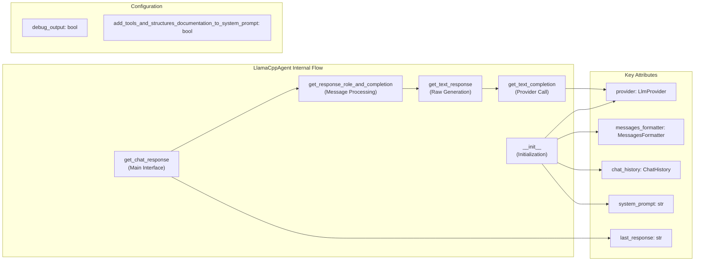

**Sources:** [src/llama_cpp_agent/llm_agent.py:75-117](), [src/llama_cpp_agent/llm_agent.py:237-382]()

### Key Methods and Responsibilities

| Method | Purpose | Key Parameters |
|--------|---------|----------------|
| `get_chat_response` | Primary chat interface | `message`, `structured_output_settings`, `llm_sampling_settings` |
| `get_text_response` | Raw text generation | `prompt`, `structured_output_settings`, `streaming_callback` |
| `add_message` | Chat history management | `message`, `role` |
| `get_text_completion` | Direct provider interaction | `prompt`, `structured_output_settings`, `llm_samplings_settings` |

**Sources:** [src/llama_cpp_agent/llm_agent.py:137-235](), [src/llama_cpp_agent/llm_agent.py:237-382](), [src/llama_cpp_agent/llm_agent.py:118-135](), [src/llama_cpp_agent/llm_agent.py:384-395]()

## Specialized Agent Types

### FunctionCallingAgent

The `FunctionCallingAgent` extends the core framework to provide autonomous tool execution capabilities through structured function calling.

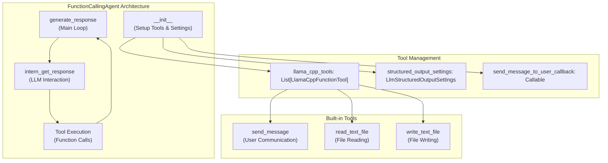

**Sources:** [src/llama_cpp_agent/function_calling_agent.py:128-199](), [src/llama_cpp_agent/function_calling_agent.py:223-288](), [src/llama_cpp_agent/function_calling_agent.py:20-87]()

### StructuredOutputAgent

While not explicitly implemented as a separate class, structured output functionality is integrated into the core framework through `LlmStructuredOutputSettings` and GBNF grammar generation.

## Message Processing Pipeline

The message formatting system handles conversion between conversation formats and model-specific chat templates.

### Message Formatter Architecture

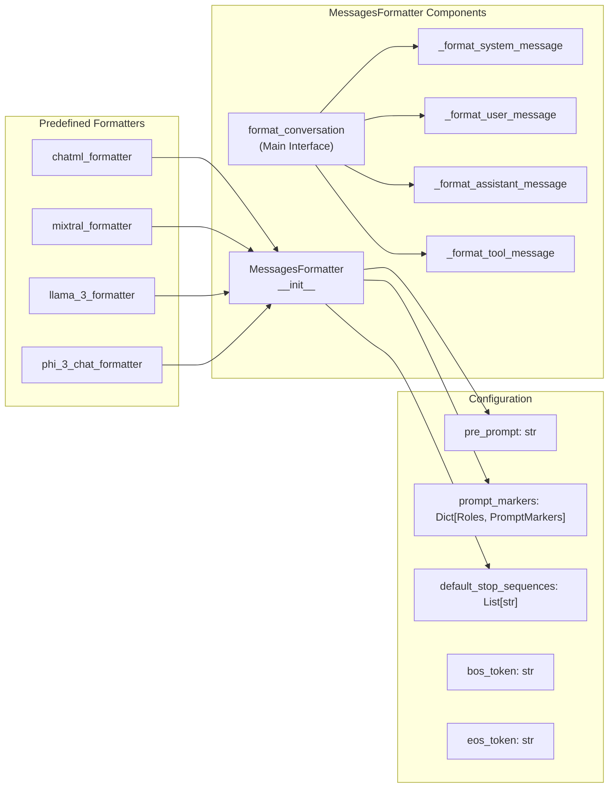

**Sources:** [src/llama_cpp_agent/messages_formatter.py:41-134](), [src/llama_cpp_agent/messages_formatter.py:433-454](), [src/llama_cpp_agent/messages_formatter.py:151-177]()

### System Prompt Modules

Dynamic system prompt management through modular components that can be positioned and configured independently.

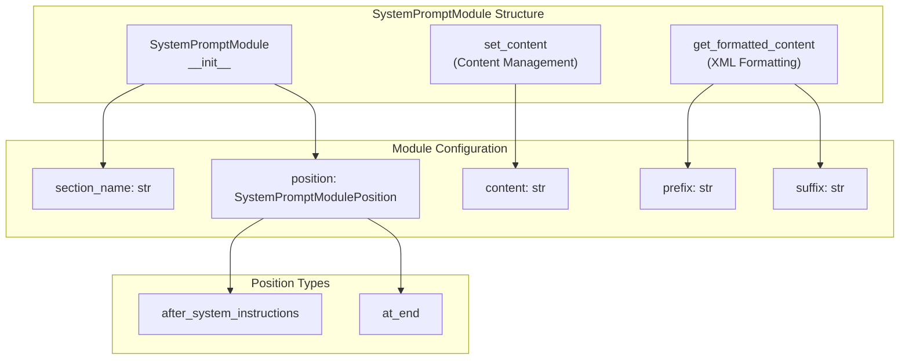

**Sources:** [src/llama_cpp_agent/llm_agent.py:27-46](), [src/llama_cpp_agent/llm_agent.py:444-636]()

## Output Processing System

The framework provides sophisticated structured output capabilities through GBNF grammar generation and parsing.

### GBNF Grammar Generation Pipeline

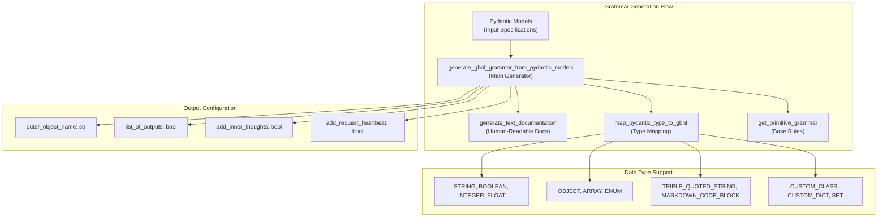

**Sources:** [src/llama_cpp_agent/gbnf_grammar_generator/gbnf_grammar_from_pydantic_models.py:664-776](), [src/llama_cpp_agent/gbnf_grammar_generator/gbnf_grammar_from_pydantic_models.py:70-104](), [src/llama_cpp_agent/gbnf_grammar_generator/gbnf_grammar_from_pydantic_models.py:778-845]()

### Function Tool Integration

The `LlamaCppFunctionTool` class provides a unified interface for different function calling approaches.

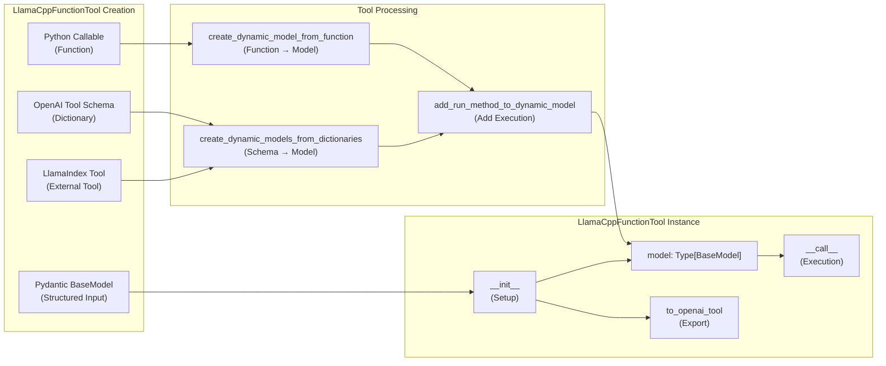

**Sources:** [src/llama_cpp_agent/function_calling.py:142-180](), [src/llama_cpp_agent/function_calling.py:202-230](), [src/llama_cpp_agent/function_calling.py:248-255]()

## Integration and Data Flow

The complete framework integration shows how all components work together for a typical interaction.

### Complete Framework Data Flow

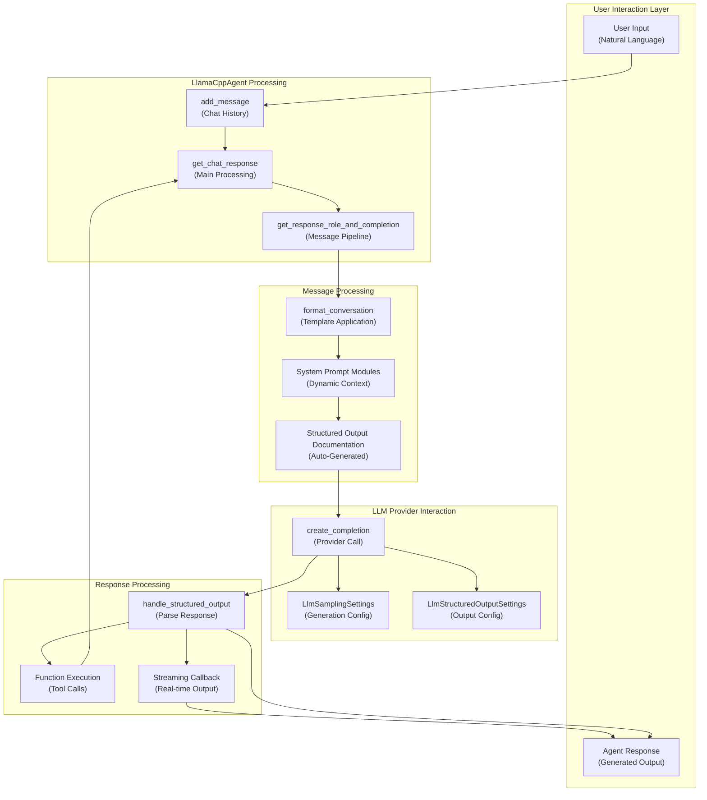

**Sources:** [src/llama_cpp_agent/llm_agent.py:237-382](), [src/llama_cpp_agent/llm_agent.py:397-655](), [src/llama_cpp_agent/function_calling_agent.py:223-288]()

### Framework Configuration Options

| Component | Configuration Class | Key Settings |
|-----------|-------------------|--------------|
| Agent | `LlamaCppAgent.__init__` | `provider`, `system_prompt`, `messages_formatter_type`, `debug_output` |
| Message Formatting | `MessagesFormatter` | `prompt_markers`, `default_stop_sequences`, `bos_token`, `eos_token` |
| Structured Output | `LlmStructuredOutputSettings` | `output_type`, `add_thoughts_and_reasoning_field`, `function_calling_name_field_name` |
| Function Calling | `FunctionCallingAgent` | `llama_cpp_function_tools`, `allow_parallel_function_calling`, `system_prompt` |
| System Prompts | `SystemPromptModule` | `section_name`, `position`, `prefix`, `suffix` |

**Sources:** [src/llama_cpp_agent/llm_agent.py:75-117](), [src/llama_cpp_agent/messages_formatter.py:42-61](), [src/llama_cpp_agent/function_calling_agent.py:128-199](), [src/llama_cpp_agent/llm_agent.py:32-46]()

---

# Page: LlamaCppAgent

# LlamaCppAgent

<details>
<summary>Relevant source files</summary>

The following files were used as context for generating this wiki page:

- [src/llama_cpp_agent/function_calling.py](src/llama_cpp_agent/function_calling.py)
- [src/llama_cpp_agent/function_calling_agent.py](src/llama_cpp_agent/function_calling_agent.py)
- [src/llama_cpp_agent/gbnf_grammar_generator/gbnf_grammar_from_pydantic_models.py](src/llama_cpp_agent/gbnf_grammar_generator/gbnf_grammar_from_pydantic_models.py)
- [src/llama_cpp_agent/llm_agent.py](src/llama_cpp_agent/llm_agent.py)
- [src/llama_cpp_agent/messages_formatter.py](src/llama_cpp_agent/messages_formatter.py)

</details>


## Purpose and Scope

The `LlamaCppAgent` class serves as the central orchestrator for conversational AI interactions in the llama-cpp-agent framework. It manages the complete lifecycle of chat-based interactions, from message formatting and provider communication to structured output parsing and response handling.

This page covers the core `LlamaCppAgent` implementation and its direct integrations. For specialized agent implementations, see [FunctionCallingAgent](#3.2) and [StructuredOutputAgent](#3.3). For provider system details, see [Provider Architecture](#4.1). For memory system integration, see [Memory Architecture](#5.1).

## Core Architecture

The `LlamaCppAgent` acts as the central coordination point between multiple framework subsystems:

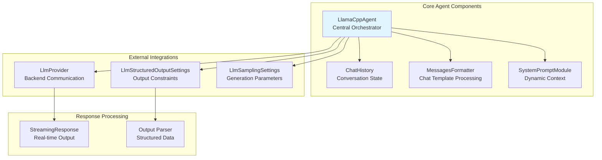

Sources: [src/llama_cpp_agent/llm_agent.py:70-117]()

## Key Components and Configuration

### Agent Initialization

The `LlamaCppAgent` constructor accepts several key configuration parameters:

| Parameter | Type | Purpose |
|-----------|------|---------|
| `provider` | `LlmProvider` | Backend LLM communication interface |
| `name` | `str` | Agent identifier (default: "llamacpp_agent") |
| `system_prompt` | `str` | Base system instructions |
| `predefined_messages_formatter_type` | `MessagesFormatterType` | Chat template selection |
| `custom_messages_formatter` | `MessagesFormatter` | Custom formatting override |
| `chat_history` | `ChatHistory` | Conversation state management |
| `debug_output` | `bool` | Debug logging control |

Sources: [src/llama_cpp_agent/llm_agent.py:75-98]()

### System Prompt Modules

The `SystemPromptModule` class enables dynamic system prompt composition:

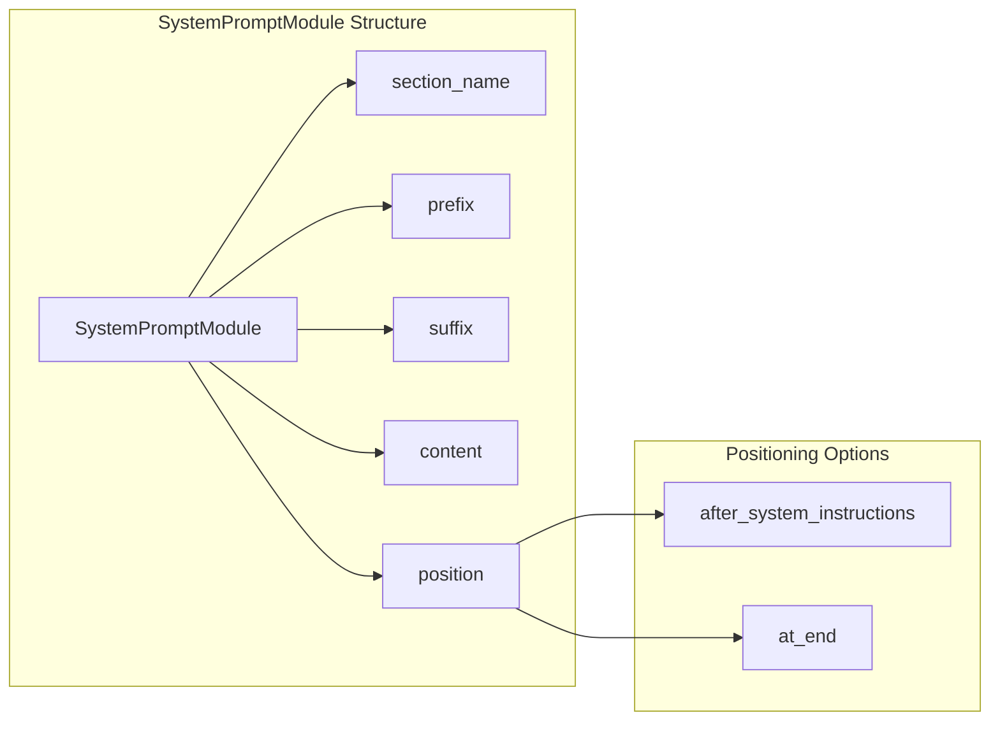

Sources: [src/llama_cpp_agent/llm_agent.py:27-46]()

## Response Generation Flow

The agent provides two primary response generation methods with different interaction patterns:

### Chat Response Flow

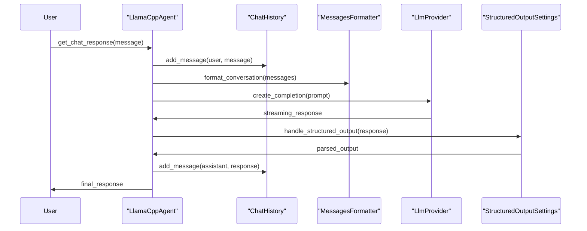

Sources: [src/llama_cpp_agent/llm_agent.py:237-382]()

### Text Response Flow

The `get_text_response` method provides direct prompt-to-response functionality without chat history management:

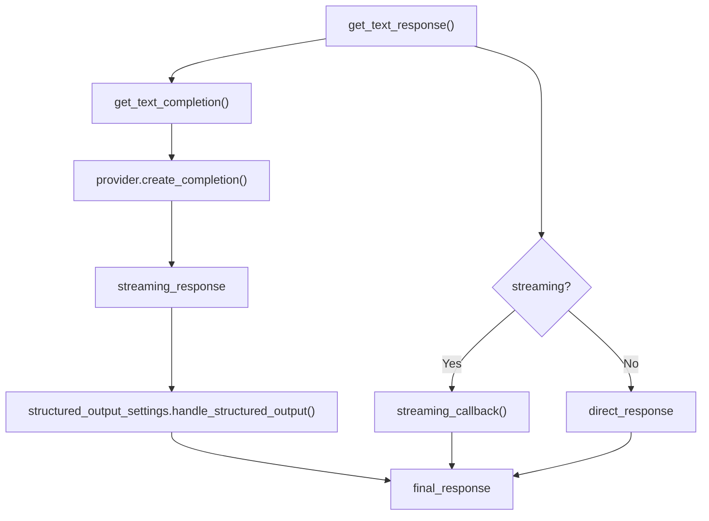

Sources: [src/llama_cpp_agent/llm_agent.py:137-235]()

## Provider Integration

The agent interfaces with LLM providers through the standardized `LlmProvider` abstraction:

### Provider Communication Pattern

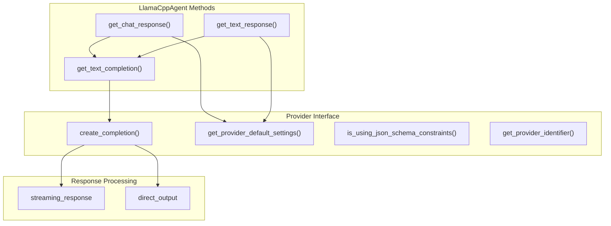

Sources: [src/llama_cpp_agent/llm_agent.py:384-395](), [src/llama_cpp_agent/llm_agent.py:647-655]()

## Message Formatting and Chat History

### Messages Formatting System

The agent uses `MessagesFormatter` to handle different chat template formats:

| Formatter Type | Template Style | Stop Sequences |
|----------------|----------------|----------------|
| `CHATML` | `<\|im_start\|>role\n...<\|im_end\|>` | `["<\|im_end\|>", "</s>"]` |
| `LLAMA_3` | `<\|start_header_id\|>role<\|end_header_id\|>` | `["assistant", "<\|eot_id\|>"]` |
| `MISTRAL` | `[INST]...[/INST]` | `["</s>"]` |
| `VICUNA` | `USER: ...ASSISTANT:` | `["</s>", "USER:"]` |

Sources: [src/llama_cpp_agent/messages_formatter.py:433-454]()

### Chat History Management

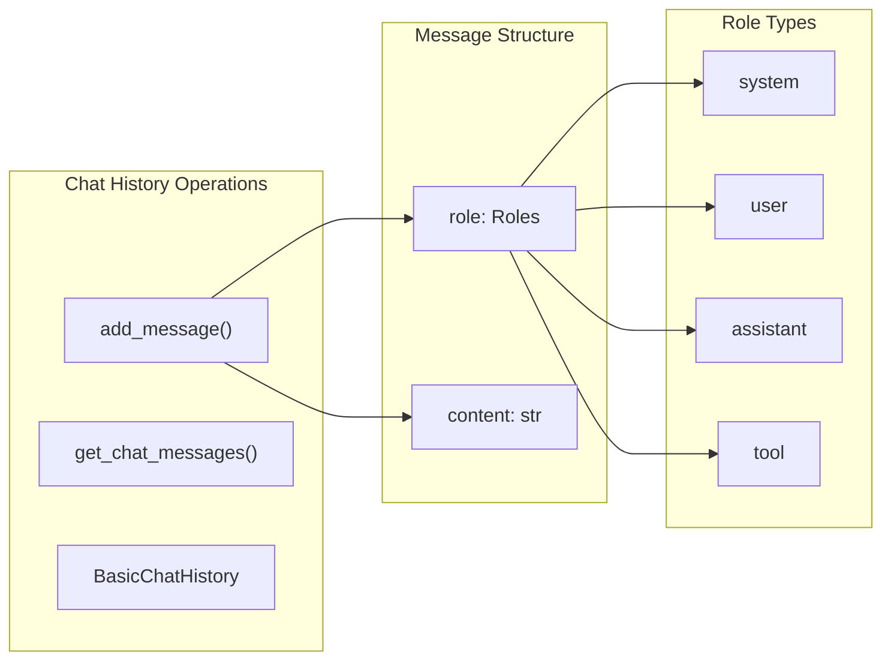

Sources: [src/llama_cpp_agent/llm_agent.py:118-135]()

## Structured Output Processing

The agent integrates deeply with structured output capabilities through dynamic system prompt modification:

### Function Calling Integration

```mermaid
graph TD
    subgraph "Function Calling Flow"
        SOS["LlmStructuredOutputSettings"]
        FC["function_calling"]
        PFC["parallel_function_calling"]
    end
    
    subgraph "Dynamic Prompt Generation"
        FCST["function_calling_system_prompt_templater"]
        FCFT["function_calling_function_list_templater"]
        FCTR["function_calling_thoughts_and_reasoning_templater"]
        FCHT["function_calling_heart_beats_templater"]
    end
    
    subgraph "Provider Constraints"
        JSC["is_using_json_schema_constraints()"]
        FN["function_field_name"]
        AN["arguments_field_name"]
    end
    
    SOS --> FC
    SOS --> PFC
    FC --> FCST
    FCST --> FCFT
    FCST --> FCTR
    FCST --> FCHT
    
    JSC --> FN
    JSC --> AN
```

Sources: [src/llama_cpp_agent/llm_agent.py:459-554]()

### Object Instance Generation

For structured data output, the agent modifies system prompts with model documentation:

```mermaid
graph TB
    subgraph "Object Output Configuration"
        OI["object_instance"]
        LOO["list_of_objects"]
        SOT["structured_output_templater"]
    end
    
    subgraph "Dynamic Fields"
        MFN["model_field_name"]
        FFN["fields_field_name"]
        TR["thoughts_and_reasoning"]
    end
    
    subgraph "Documentation Generation"
        GLD["get_llm_documentation()"]
        OM["output_models"]
    end
    
    OI --> SOT
    LOO --> SOT
    SOT --> MFN
    SOT --> FFN
    SOT --> TR
    
    GLD --> OM
    OM --> SOT
```

Sources: [src/llama_cpp_agent/llm_agent.py:555-622]()

## Advanced Features

### Streaming Response Handling

The `StreamingResponse` dataclass encapsulates streaming output:

```python
@dataclass
class StreamingResponse:
    text: str
    is_last_response: bool
```

Sources: [src/llama_cpp_agent/llm_agent.py:49-67]()

### Response Role Detection

The agent automatically determines appropriate response roles based on conversation context:

```mermaid
graph TD
    GRR["get_response_role_and_completion()"]
    LR["last_role"]
    RR["response_role"]
    
    LR --> RR
    RR --> ASS["assistant"]
    RR --> USR["user"]
    
    ASS --> COND1{"last_role != assistant"}
    USR --> COND2{"last_role == assistant"}
    
    COND1 -->|true| ASS
    COND2 -->|true| USR
```

Sources: [src/llama_cpp_agent/llm_agent.py:397-655]()

### Debug Output

When `debug_output=True`, the agent provides detailed logging of prompts and responses for development and troubleshooting:

```python
if self.debug_output:
    if type(prompt) is str:
        print(prompt, end="")
```

Sources: [src/llama_cpp_agent/llm_agent.py:166-168](), [src/llama_cpp_agent/llm_agent.py:644-645]()

# LlamaCppAgent

## Purpose and Scope

The `LlamaCppAgent` class serves as the central orchestrator for conversational AI interactions in the llama-cpp-agent framework. It manages the complete lifecycle of chat-based interactions, from message formatting and provider communication to structured output parsing and response handling.

This page covers the core `LlamaCppAgent` implementation and its direct integrations. For specialized agent implementations, see [FunctionCallingAgent](#3.2) and [StructuredOutputAgent](#3.3). For provider system details, see [Provider Architecture](#4.1). For memory system integration, see [Memory Architecture](#5.1).

## Core Architecture

The `LlamaCppAgent` acts as the central coordination point between multiple framework subsystems:

```mermaid
graph TB
    subgraph "Core Agent Components"
        LCA["LlamaCppAgent<br/>Central Orchestrator"]
        CH["ChatHistory<br/>Conversation State"]
        MF["MessagesFormatter<br/>Chat Template Processing"]
        SPM["SystemPromptModule<br/>Dynamic Context"]
    end
    
    subgraph "External Integrations"
        LP["LlmProvider<br/>Backend Communication"]
        SOS["LlmStructuredOutputSettings<br/>Output Constraints"]
        LSS["LlmSamplingSettings<br/>Generation Parameters"]
    end
    
    subgraph "Response Processing"
        SR["StreamingResponse<br/>Real-time Output"]
        OP["Output Parser<br/>Structured Data"]
    end
    
    LCA --> CH
    LCA --> MF
    LCA --> SPM
    LCA --> LP
    LCA --> SOS
    LCA --> LSS
    
    LP --> SR
    SOS --> OP
    
    style LCA fill:#e1f5fe
```

Sources: [src/llama_cpp_agent/llm_agent.py:70-117]()

## Key Components and Configuration

### Agent Initialization

The `LlamaCppAgent` constructor accepts several key configuration parameters:

| Parameter | Type | Purpose |
|-----------|------|---------|
| `provider` | `LlmProvider` | Backend LLM communication interface |
| `name` | `str` | Agent identifier (default: "llamacpp_agent") |
| `system_prompt` | `str` | Base system instructions |
| `predefined_messages_formatter_type` | `MessagesFormatterType` | Chat template selection |
| `custom_messages_formatter` | `MessagesFormatter` | Custom formatting override |
| `chat_history` | `ChatHistory` | Conversation state management |
| `debug_output` | `bool` | Debug logging control |

Sources: [src/llama_cpp_agent/llm_agent.py:75-98]()

### System Prompt Modules

The `SystemPromptModule` class enables dynamic system prompt composition:

```mermaid
graph LR
    subgraph "SystemPromptModule Structure"
        SPM["SystemPromptModule"]
        SN["section_name"]
        PFX["prefix"]
        SFX["suffix"] 
        CNT["content"]
        POS["position"]
    end
    
    subgraph "Positioning Options"
        ASI["after_system_instructions"]
        AE["at_end"]
    end
    
    SPM --> SN
    SPM --> PFX
    SPM --> SFX
    SPM --> CNT
    SPM --> POS
    
    POS --> ASI
    POS --> AE
```

Sources: [src/llama_cpp_agent/llm_agent.py:27-46]()

## Response Generation Flow

The agent provides two primary response generation methods with different interaction patterns:

### Chat Response Flow

```mermaid
sequenceDiagram
    participant User
    participant LCA as "LlamaCppAgent"
    participant CH as "ChatHistory"
    participant MF as "MessagesFormatter"
    participant LP as "LlmProvider"
    participant SOS as "StructuredOutputSettings"
    
    User->>LCA: get_chat_response(message)
    LCA->>CH: add_message(user, message)
    LCA->>MF: format_conversation(messages)
    LCA->>LP: create_completion(prompt)
    LP->>LCA: streaming_response
    LCA->>SOS: handle_structured_output(response)
    SOS->>LCA: parsed_output
    LCA->>CH: add_message(assistant, response)
    LCA->>User: final_response
```

Sources: [src/llama_cpp_agent/llm_agent.py:237-382]()

### Text Response Flow

The `get_text_response` method provides direct prompt-to-response functionality without chat history management:

```mermaid
graph TD
    TR["get_text_response()"] --> PC["get_text_completion()"]
    PC --> LP["provider.create_completion()"]
    LP --> SR["streaming_response"]
    SR --> SOS["structured_output_settings.handle_structured_output()"]
    SOS --> FR["final_response"]
    
    TR --> SSCheck{"streaming?"}
    SSCheck -->|Yes| SC["streaming_callback()"]
    SSCheck -->|No| DR["direct_response"]
    SC --> FR
    DR --> FR
```

Sources: [src/llama_cpp_agent/llm_agent.py:137-235]()

## Provider Integration

The agent interfaces with LLM providers through the standardized `LlmProvider` abstraction:

### Provider Communication Pattern

```mermaid
graph TB
    subgraph "LlamaCppAgent Methods"
        GCR["get_chat_response()"]
        GTR["get_text_response()"]
        GTC["get_text_completion()"]
    end
    
    subgraph "Provider Interface"
        CC["create_completion()"]
        GPS["get_provider_default_settings()"]
        IJC["is_using_json_schema_constraints()"]
        GPI["get_provider_identifier()"]
    end
    
    subgraph "Response Processing"
        SSS["streaming_response"]
        DOS["direct_output"]
    end
    
    GCR --> GTC
    GTR --> GTC
    GTC --> CC
    
    CC --> SSS
    CC --> DOS
    
    GCR --> GPS
    GTR --> GPS
```

Sources: [src/llama_cpp_agent/llm_agent.py:384-395](), [src/llama_cpp_agent/llm_agent.py:647-655]()

## Message Formatting and Chat History

### Messages Formatting System

The agent uses `MessagesFormatter` to handle different chat template formats:

| Formatter Type | Template Style | Stop Sequences |
|----------------|----------------|----------------|
| `CHATML` | `<\|im_start\|>role\n...<\|im_end\|>` | `["<\|im_end\|>", "</s>"]` |
| `LLAMA_3` | `<\|start_header_id\|>role<\|end_header_id\|>` | `["assistant", "<\|eot_id\|>"]` |
| `MISTRAL` | `[INST]...[/INST]` | `["</s>"]` |
| `VICUNA` | `USER: ...ASSISTANT:` | `["</s>", "USER:"]` |

Sources: [src/llama_cpp_agent/messages_formatter.py:433-454]()

### Chat History Management

```mermaid
graph LR
    subgraph "Chat History Operations"
        AM["add_message()"]
        GCM["get_chat_messages()"]
        BCH["BasicChatHistory"]
    end
    
    subgraph "Message Structure"
        MR["role: Roles"]
        MC["content: str"]
    end
    
    subgraph "Role Types"
        SYS["system"]
        USER["user"]
        ASST["assistant"]
        TOOL["tool"]
    end
    
    AM --> MR
    AM --> MC
    MR --> SYS
    MR --> USER
    MR --> ASST
    MR --> TOOL
```

Sources: [src/llama_cpp_agent/llm_agent.py:118-135]()

## Structured Output Processing

The agent integrates deeply with structured output capabilities through dynamic system prompt modification:

### Function Calling Integration

```mermaid
graph TD
    subgraph "Function Calling Flow"
        SOS["LlmStructuredOutputSettings"]
        FC["function_calling"]
        PFC["parallel_function_calling"]
    end
    
    subgraph "Dynamic Prompt Generation"
        FCST["function_calling_system_prompt_templater"]
        FCFT["function_calling_function_list_templater"]
        FCTR["function_calling_thoughts_and_reasoning_templater"]
        FCHT["function_calling_heart_beats_templater"]
    end
    
    subgraph "Provider Constraints"
        JSC["is_using_json_schema_constraints()"]
        FN["function_field_name"]
        AN["arguments_field_name"]
    end
    
    SOS --> FC
    SOS --> PFC
    FC --> FCST
    FCST --> FCFT
    FCST --> FCTR
    FCST --> FCHT
    
    JSC --> FN
    JSC --> AN
```

Sources: [src/llama_cpp_agent/llm_agent.py:459-554]()

### Object Instance Generation

For structured data output, the agent modifies system prompts with model documentation:

```mermaid
graph TB
    subgraph "Object Output Configuration"
        OI["object_instance"]
        LOO["list_of_objects"]
        SOT["structured_output_templater"]
    end
    
    subgraph "Dynamic Fields"
        MFN["model_field_name"]
        FFN["fields_field_name"]
        TR["thoughts_and_reasoning"]
    end
    
    subgraph "Documentation Generation"
        GLD["get_llm_documentation()"]
        OM["output_models"]
    end
    
    OI --> SOT
    LOO --> SOT
    SOT --> MFN
    SOT --> FFN
    SOT --> TR
    
    GLD --> OM
    OM --> SOT
```

Sources: [src/llama_cpp_agent/llm_agent.py:555-622]()

## Advanced Features

### Streaming Response Handling

The `StreamingResponse` dataclass encapsulates streaming output:

```python
@dataclass
class StreamingResponse:
    text: str
    is_last_response: bool
```

Sources: [src/llama_cpp_agent/llm_agent.py:49-67]()

### Response Role Detection

The agent automatically determines appropriate response roles based on conversation context:

```mermaid
graph TD
    GRR["get_response_role_and_completion()"]
    LR["last_role"]
    RR["response_role"]
    
    LR --> RR
    RR --> ASS["assistant"]
    RR --> USR["user"]
    
    ASS --> COND1{"last_role != assistant"}
    USR --> COND2{"last_role == assistant"}
    
    COND1 -->|true| ASS
    COND2 -->|true| USR
```

Sources: [src/llama_cpp_agent/llm_agent.py:397-655]()

### Debug Output

When `debug_output=True`, the agent provides detailed logging of prompts and responses for development and troubleshooting:

```python
if self.debug_output:
    if type(prompt) is str:
        print(prompt, end="")
```

Sources: [src/llama_cpp_agent/llm_agent.py:166-168](), [src/llama_cpp_agent/llm_agent.py:644-645]()

---

# Page: FunctionCallingAgent

# FunctionCallingAgent

<details>
<summary>Relevant source files</summary>

The following files were used as context for generating this wiki page:

- [examples/01_Basics/self_critique.py](examples/01_Basics/self_critique.py)
- [examples/07_Memory/agent_core_memory.py](examples/07_Memory/agent_core_memory.py)
- [examples/07_Memory/core_memory.json](examples/07_Memory/core_memory.json)
- [src/llama_cpp_agent/function_calling.py](src/llama_cpp_agent/function_calling.py)
- [src/llama_cpp_agent/function_calling_agent.py](src/llama_cpp_agent/function_calling_agent.py)
- [src/llama_cpp_agent/gbnf_grammar_generator/gbnf_grammar_from_pydantic_models.py](src/llama_cpp_agent/gbnf_grammar_generator/gbnf_grammar_from_pydantic_models.py)
- [src/llama_cpp_agent/llm_agent.py](src/llama_cpp_agent/llm_agent.py)
- [src/llama_cpp_agent/messages_formatter.py](src/llama_cpp_agent/messages_formatter.py)
- [src/llama_cpp_agent/prompt_templates.py](src/llama_cpp_agent/prompt_templates.py)
- [src/llama_cpp_agent/tools/web_search/tool.py](src/llama_cpp_agent/tools/web_search/tool.py)

</details>


The `FunctionCallingAgent` is a specialized wrapper around `LlamaCppAgent` that enables AI models to execute functions and interact with their environment through structured function calling. It provides a higher-level interface for building AI agents that can perform actions beyond text generation, such as file operations, web searches, or custom business logic.

For basic agent functionality without function calling, see [LlamaCppAgent](#3.1). For creating custom function tools, see [Function Tools Framework](#6.1).

## Purpose and Scope

The `FunctionCallingAgent` extends the base `LlamaCppAgent` with the ability to:

- Execute predefined functions based on model responses
- Handle parallel function calling when supported
- Manage function call loops and result processing
- Provide built-in utility functions for common tasks
- Integrate seamlessly with the structured output system

This agent is designed for scenarios where the AI needs to perform actions or access external data sources during conversations.

## Architecture Overview

The `FunctionCallingAgent` operates as a composition wrapper that orchestrates multiple components to enable function calling capabilities.

```mermaid
graph TD
    FCA["FunctionCallingAgent"] --> LCA["LlamaCppAgent"]
    FCA --> LFT["LlamaCppFunctionTool[]"]
    FCA --> SOS["LlmStructuredOutputSettings"]
    
    LCA --> Provider["LlmProvider"]
    LCA --> MF["MessagesFormatter"]
    LCA --> CH["ChatHistory"]
    
    LFT --> BF1["send_message"]
    LFT --> BF2["read_text_file"] 
    LFT --> BF3["write_text_file"]
    LFT --> CF["Custom Functions"]
    
    SOS --> GBNF["GBNF Grammar Generator"]
    SOS --> JSON["JSON Schema"]
    
    Provider --> Model["LLM Model"]
```

**Core Component Relationships:**
- `FunctionCallingAgent` wraps `LlamaCppAgent` for basic chat functionality
- `LlamaCppFunctionTool` instances represent available functions
- `LlmStructuredOutputSettings` ensures proper JSON function call format
- Built-in tools provide common functionality out-of-the-box

Sources: [src/llama_cpp_agent/function_calling_agent.py:89-199](), [src/llama_cpp_agent/function_calling.py:121-256]()

## Function Calling Process

The agent follows a structured loop to execute function calls and process their results:

```mermaid
graph TD
    Start["User Input"] --> AddMsg["Add user message to chat history"]
    AddMsg --> GetResp["Get LLM response with function calling grammar"]
    GetResp --> CheckType{"Response Type?"}
    
    CheckType -->|"String"| WithoutGrammar["Execute without-grammar functions"]
    CheckType -->|"Function Calls"| ProcessFuncs["Process function calls"]
    
    ProcessFuncs --> ExecFunc["Execute each function"]
    ExecFunc --> CollectResults["Collect function results"]
    CollectResults --> AddResults["Add results to chat history"]
    AddResults --> CheckMessage{"Agent sent message?"}
    
    CheckMessage -->|"Yes"| End["Complete"]
    CheckMessage -->|"No"| GetResp
    
    WithoutGrammar --> End
```

**Process Details:**

1. **Input Processing**: User message added to chat history via `add_message()`
2. **Response Generation**: LLM generates structured output using function calling grammar
3. **Function Execution**: Each function call is executed with provided parameters
4. **Result Integration**: Function results are formatted and added back to chat history
5. **Loop Continuation**: Process repeats until agent sends a message or completes

Sources: [src/llama_cpp_agent/function_calling_agent.py:223-268](), [src/llama_cpp_agent/function_calling_agent.py:270-288]()

## Built-in Function Tools

The `FunctionCallingAgent` includes several built-in tools that provide common functionality:

| Tool | Purpose | Auto-Enabled | Parameters |
|------|---------|--------------|------------|
| `send_message` | Send messages to users | Yes (if `add_send_message_to_user_function=True`) | `content: str` |
| `read_text_file` | Read file contents | Optional (`basic_file_tools=True`) | `file_path: str` |
| `write_text_file` | Write content to files | Optional (`basic_file_tools=True`) | `file_path: str`, `content: str` |
| `activate_message_mode` | Switch to plain text mode | Built-in | None |

**Message Flow Architecture:**

```mermaid
graph LR
    Agent["FunctionCallingAgent"] --> SM["send_message()"]
    Agent --> Callback["send_message_to_user_callback"]
    
    SM --> SMM["send_message BaseModel"]
    SMM --> Run["run(agent)"]
    Run --> Callback
    
    Callback -->|"If defined"| UserFunc["User-defined callback"]
    Callback -->|"Default"| Print["print(message)"]
```

Sources: [src/llama_cpp_agent/function_calling_agent.py:20-87](), [src/llama_cpp_agent/function_calling_agent.py:164-171]()

## Configuration and Initialization

The `FunctionCallingAgent` provides extensive configuration options for customizing behavior:

**Core Parameters:**
- `llama_llm`: LLM provider instance
- `messages_formatter_type`: Message format (default: `CHATML`)
- `system_prompt`: Agent instructions and behavior
- `llama_cpp_function_tools`: List of available function tools

**Function Calling Options:**
- `allow_parallel_function_calling`: Enable multiple simultaneous function calls
- `add_send_message_to_user_function`: Include built-in messaging capability
- `basic_file_tools`: Add file read/write functions

**Callback Configuration:**
- `send_message_to_user_callback`: Custom message handling function
- `streaming_callback`: Real-time response streaming

**Example Configuration:**
```python
agent = FunctionCallingAgent(
    llama_llm=provider,
    system_prompt="You are an AI assistant with access to tools.",
    llama_cpp_function_tools=[custom_tool1, custom_tool2],
    allow_parallel_function_calling=True,
    basic_file_tools=True,
    send_message_to_user_callback=custom_message_handler
)
```

Sources: [src/llama_cpp_agent/function_calling_agent.py:128-199]()

## Structured Output Integration

The agent automatically configures structured output settings to ensure proper function calling format:

```mermaid
graph TB
    FCA["FunctionCallingAgent"] --> Create["Create structured output settings"]
    Create --> Settings["LlmStructuredOutputSettings.from_llama_cpp_function_tools()"]
    
    Settings --> Grammar["GBNF Grammar Generation"]
    Settings --> Schema["JSON Schema Validation"] 
    Settings --> Thoughts["Add thoughts_and_reasoning_field"]
    
    Grammar --> Model["LLM with constrained output"]
    Schema --> Parser["JSON Response Parser"]
    Thoughts --> Reasoning["Chain-of-thought reasoning"]
    
    Model --> Response["Structured function call response"]
    Parser --> Validation["Validate function parameters"]
    Reasoning --> Explanation["Explain function call decisions"]
```

**Key Features:**
- Automatic grammar generation from function tools
- Built-in thoughts and reasoning field for explainability
- Support for parallel function calling when enabled
- JSON schema validation for function parameters

Sources: [src/llama_cpp_agent/function_calling_agent.py:175-180](), [src/llama_cpp_agent/function_calling_agent.py:231-233]()

## Advanced Features

**Without Grammar Mode:**
The agent can temporarily disable structured output for plain text responses through `activate_message_mode()`, useful for natural conversation mixed with function calls.

**State Management:**
The agent maintains internal state for:
- `without_grammar_mode`: Flag for plain text mode
- `without_grammar_mode_function`: Functions to execute in plain text mode  
- `prompt_suffix`: Additional prompt context

**Function Result Processing:**
Function call results are formatted and integrated back into the conversation context, allowing the agent to reason about previous actions and plan subsequent steps.

Sources: [src/llama_cpp_agent/function_calling_agent.py:181-183](), [src/llama_cpp_agent/function_calling_agent.py:275-288](), [src/llama_cpp_agent/function_calling_agent.py:245-267]()

---

# Page: StructuredOutputAgent

# StructuredOutputAgent

<details>
<summary>Relevant source files</summary>

The following files were used as context for generating this wiki page:

- [src/llama_cpp_agent/json_schema_generator/schema_generator.py](src/llama_cpp_agent/json_schema_generator/schema_generator.py)
- [src/llama_cpp_agent/llm_documentation/__init__.py](src/llama_cpp_agent/llm_documentation/__init__.py)
- [src/llama_cpp_agent/llm_documentation/documentation_generation.py](src/llama_cpp_agent/llm_documentation/documentation_generation.py)
- [src/llama_cpp_agent/llm_output_settings/settings.py](src/llama_cpp_agent/llm_output_settings/settings.py)
- [src/llama_cpp_agent/structured_output_agent.py](src/llama_cpp_agent/structured_output_agent.py)

</details>


The `StructuredOutputAgent` is a specialized component within the llama-cpp-agent framework designed to generate structured data objects from unstructured text input. It converts natural language descriptions into validated Pydantic model instances using language models with enforced output schemas.

This agent focuses specifically on data generation and extraction tasks. For general conversational AI capabilities, see [LlamaCppAgent](#3.1). For function calling and tool integration, see [FunctionCallingAgent](#3.2).

## Purpose and Architecture

The `StructuredOutputAgent` serves as a bridge between natural language processing and structured data creation. It takes unstructured text input and produces validated Pydantic model instances, ensuring type safety and schema compliance.

### Core Architecture

```mermaid
graph TB
    subgraph "Input Processing"
        NLI["Natural Language Input"]
        SPT["system_prompt_template<br/>PromptTemplate"]
        CPT["creation_prompt_template<br/>PromptTemplate"]
    end
    
    subgraph "StructuredOutputAgent Core"
        SOA["StructuredOutputAgent"]
        LCA["llama_cpp_agent<br/>LlamaCppAgent"]
        GC["grammar_cache<br/>dict"]
    end
    
    subgraph "Configuration Layer"
        SOS["LlmStructuredOutputSettings"]
        PM["pydantic_models<br/>List[BaseModel]"]
        DOC["Documentation Generator"]
    end
    
    subgraph "LLM Processing"
        LP["LlmProvider"]
        LSS["LlmSamplingSettings"] 
        GBNF["GBNF Grammar"]
        JS["JSON Schema"]
    end
    
    subgraph "Output Processing"
        JSON["JSON Response"]
        OBJ["Validated Pydantic Object"]
    end
    
    NLI --> SPT
    NLI --> CPT
    SPT --> SOA
    CPT --> SOA
    SOA --> LCA
    SOA --> GC
    
    SOA --> SOS
    SOS --> PM
    SOS --> DOC
    SOS --> GBNF
    SOS --> JS
    
    LCA --> LP
    LP --> LSS
    GBNF --> LP
    JS --> LP
    
    LP --> JSON
    JSON --> OBJ
    
    style SOA fill:#e1f5fe
    style SOS fill:#f3e5f5
    style LCA fill:#fff3e0
```

**Sources:** [src/llama_cpp_agent/structured_output_agent.py:18-156](), [src/llama_cpp_agent/llm_output_settings/settings.py:29-119]()

### Data Flow Architecture

```mermaid
sequenceDiagram
    participant User
    participant SOA as "StructuredOutputAgent"
    participant SOS as "LlmStructuredOutputSettings"
    participant LCA as "LlamaCppAgent"
    participant LP as "LlmProvider"
    
    User->>SOA: create_object(model, data)
    SOA->>SOS: from_pydantic_models([model])
    SOS->>SOS: get_llm_documentation()
    SOS->>SOS: get_gbnf_grammar()
    SOA->>SOA: generate system_prompt
    SOA->>SOA: generate creation_prompt
    SOA->>LCA: get_chat_response()
    LCA->>LP: complete with constraints
    LP-->>LCA: JSON response
    LCA-->>SOA: structured output
    SOA-->>User: validated Pydantic object
```

**Sources:** [src/llama_cpp_agent/structured_output_agent.py:113-155](), [src/llama_cpp_agent/llm_output_settings/settings.py:149-195]()

## Core Components

### StructuredOutputAgent Class

The main `StructuredOutputAgent` class [src/llama_cpp_agent/structured_output_agent.py:18-156]() provides the primary interface for structured data generation:

| Attribute | Type | Purpose |
|-----------|------|---------|
| `llama_cpp_agent` | `LlamaCppAgent` | Core LLM interaction handler |
| `grammar_cache` | `dict` | Caches generated GBNF grammars |
| `system_prompt_template` | `PromptTemplate` | Template for system instructions |
| `creation_prompt_template` | `PromptTemplate` | Template for data creation prompts |
| `streaming_callback` | `Callable` | Optional streaming response handler |

**Sources:** [src/llama_cpp_agent/structured_output_agent.py:30-37]()

### Prompt Templates

The agent uses two predefined prompt templates:

- **System Prompt Template**: Instructs the LLM on its role and provides model documentation
- **Creation Prompt Template**: Formats the user input for structured data generation

```python
# System prompt template from line 67-69
"You are an advanced AI agent. You are tasked to assist the user by creating structured output in JSON format.\n\n{documentation}"

# Creation prompt template from line 70-72  
"Create an JSON response based on the following input.\n\nInput:\n\n{user_input}"
```

**Sources:** [src/llama_cpp_agent/structured_output_agent.py:67-72]()

## Configuration and Settings

### LlmStructuredOutputSettings Integration

The `StructuredOutputAgent` relies heavily on `LlmStructuredOutputSettings` for output configuration:

```mermaid
graph TB
    subgraph "Output Types"
        OI["object_instance"]
        LO["list_of_objects"]
        FC["function_calling"]
        PFC["parallel_function_calling"]
    end
    
    subgraph "LlmStructuredOutputSettings"
        OT["output_type<br/>LlmStructuredOutputType"]
        PM["pydantic_models<br/>List[BaseModel]"]
        FT["function_tools<br/>List[LlamaCppFunctionTool]"]
    end
    
    subgraph "Generation Methods"
        DOC["get_llm_documentation()"]
        GBNF["get_gbnf_grammar()"]
        JS["get_json_schema()"]
    end
    
    OI --> OT
    LO --> OT
    FC --> OT
    PFC --> OT
    
    OT --> PM
    OT --> FT
    
    PM --> DOC
    PM --> GBNF
    PM --> JS
    FT --> DOC
    FT --> GBNF
    FT --> JS
```

**Sources:** [src/llama_cpp_agent/llm_output_settings/settings.py:17-27](), [src/llama_cpp_agent/llm_output_settings/settings.py:413-618]()

### Documentation Generation

The framework generates comprehensive documentation for Pydantic models using the documentation generation system:

| Generator | Output Format | Use Case |
|-----------|---------------|----------|
| `generate_text_documentation()` | Plain text | LLM instructions |
| `generate_markdown_documentation()` | Markdown | Human-readable docs |
| `generate_gbnf_grammar()` | GBNF grammar | llama.cpp constraints |
| `generate_json_schema()` | JSON Schema | Schema validation |

**Sources:** [src/llama_cpp_agent/llm_documentation/documentation_generation.py:217-325](), [src/llama_cpp_agent/json_schema_generator/schema_generator.py:321-358]()

## Usage Patterns

### Basic Object Creation

The primary method for generating structured data is `create_object()`:

```python
def create_object(
    self,
    model: Type[BaseModel],
    data: str = "",
    llm_sampling_settings: LlmSamplingSettings = None,
    returns_streaming_generator: bool = False,
) -> object:
```

**Process Flow:**
1. Creates `LlmStructuredOutputSettings` from the provided Pydantic model
2. Generates system prompt with model documentation  
3. Formats user input with creation prompt template
4. Calls `LlamaCppAgent.get_chat_response()` with structured output settings
5. Returns validated Pydantic object instance

**Sources:** [src/llama_cpp_agent/structured_output_agent.py:113-155]()

### Grammar Caching

The agent implements grammar caching to optimize performance for repeated model usage:

```python
self.grammar_cache = {}  # Initialized in __init__
```

This cache stores generated GBNF grammars to avoid regeneration overhead for the same Pydantic models.

**Sources:** [src/llama_cpp_agent/structured_output_agent.py:66]()

## Integration Points

### Provider System Integration

```mermaid
graph LR
    subgraph "StructuredOutputAgent"
        SOA["StructuredOutputAgent"]
        LCA["llama_cpp_agent"]
    end
    
    subgraph "Provider Layer"
        LP["LlmProvider"]
        LCSP["LlamaCppServerProvider"]
        LCPP["LlamaCppPythonProvider"]
        VLLM["VLLMServerProvider"] 
        TGI["TGIServerProvider"]
    end
    
    subgraph "Constraints"
        GBNF["GBNF Grammar"]
        JS["JSON Schema"]
        SS["Sampling Settings"]
    end
    
    SOA --> LCA
    LCA --> LP
    LP --> LCSP
    LP --> LCPP
    LP --> VLLM
    LP --> TGI
    
    GBNF --> LP
    JS --> LP
    SS --> LP
```

**Sources:** [src/llama_cpp_agent/structured_output_agent.py:74-80](), [src/llama_cpp_agent/llm_output_settings/settings.py:423-431]()

### Memory System Compatibility

While `StructuredOutputAgent` doesn't directly implement memory systems, it can be integrated with memory-aware agents through its underlying `LlamaCppAgent`. For memory-enhanced structured output, see [Memory System](#5).

### Framework Position

The `StructuredOutputAgent` occupies a specialized position in the framework hierarchy:

```mermaid
graph TB
    subgraph "Framework Core"
        LCA["LlamaCppAgent<br/>Base Conversational AI"]
        FCA["FunctionCallingAgent<br/>Tool Integration"] 
        SOA["StructuredOutputAgent<br/>Data Generation"]
    end
    
    subgraph "Shared Infrastructure"
        LP["LlmProvider<br/>LLM Abstraction"]
        SOS["LlmStructuredOutputSettings<br/>Output Configuration"]
        MF["MessagesFormatter<br/>Message Handling"]
    end
    
    subgraph "Supporting Systems"
        DOC["Documentation Generation"]
        GBNF["GBNF Grammar Generation"]
        JSON["JSON Schema Generation"]
    end
    
    LCA --> LP
    FCA --> LP
    SOA --> LP
    
    FCA --> SOS
    SOA --> SOS
    
    LCA --> MF
    FCA --> MF
    SOA --> MF
    
    SOS --> DOC
    SOS --> GBNF
    SOS --> JSON
    
    style SOA fill:#e1f5fe
```

**Sources:** [src/llama_cpp_agent/structured_output_agent.py:8-16](), [src/llama_cpp_agent/llm_output_settings/settings.py:8-14]()

---

# Page: Output Processing

# Output Processing

<details>
<summary>Relevant source files</summary>

The following files were used as context for generating this wiki page:

- [src/llama_cpp_agent/json_schema_generator/schema_generator.py](src/llama_cpp_agent/json_schema_generator/schema_generator.py)
- [src/llama_cpp_agent/llm_documentation/__init__.py](src/llama_cpp_agent/llm_documentation/__init__.py)
- [src/llama_cpp_agent/llm_documentation/documentation_generation.py](src/llama_cpp_agent/llm_documentation/documentation_generation.py)
- [src/llama_cpp_agent/llm_output_settings/settings.py](src/llama_cpp_agent/llm_output_settings/settings.py)
- [src/llama_cpp_agent/output_parser.py](src/llama_cpp_agent/output_parser.py)

</details>


This document covers the output processing system in the llama-cpp-agent framework, which handles structured data generation, output parsing, and response formatting. The output processing system transforms LLM responses into structured formats such as JSON objects, function calls, or Pydantic model instances.

For information about the core agent framework, see [Core Framework](#3). For details about function calling capabilities, see [FunctionCallingAgent](#3.2). For structured data generation, see [StructuredOutputAgent](#3.3).

## System Overview

The output processing system consists of several interconnected components that work together to ensure LLM outputs conform to predefined structures and schemas. The system supports multiple output types and provides mechanisms for validation, parsing, and transformation of raw LLM text into structured data.

```mermaid
graph TB
    subgraph "Output Configuration"
        LSOS["LlmStructuredOutputSettings<br/>Configuration Manager"]
        LSOT["LlmStructuredOutputType<br/>Enum Definitions"]
    end
    
    subgraph "Schema Generation"
        GBNF["generate_gbnf_grammar_from_pydantic_models<br/>Grammar Generator"]
        JSON["generate_json_schemas<br/>Schema Generator"]
        DOC["generate_text_documentation<br/>Documentation Generator"]
    end
    
    subgraph "Output Processing"
        PARSER["parse_json_response<br/>JSON Parser"]
        HANDLER["handle_structured_output<br/>Response Handler"]
        CLEAN["clean_keys<br/>Key Sanitizer"]
    end
    
    subgraph "Model Integration"
        PYDANTIC["Pydantic Models<br/>Data Validation"]
        TOOLS["LlamaCppFunctionTool<br/>Function Wrappers"]
    end
    
    LSOS --> LSOT
    LSOS --> GBNF
    LSOS --> JSON
    LSOS --> DOC
    LSOS --> HANDLER
    
    HANDLER --> PARSER
    HANDLER --> CLEAN
    
    PYDANTIC --> LSOS
    TOOLS --> LSOS
    
    GBNF --> PARSER
    JSON --> PARSER
```

**Sources:** [src/llama_cpp_agent/llm_output_settings/settings.py:1-786](), [src/llama_cpp_agent/output_parser.py:1-126]()

## LlmStructuredOutputSettings Architecture

The `LlmStructuredOutputSettings` class serves as the central configuration manager for all structured output processing. It coordinates between different output types, manages function tools and Pydantic models, and generates the necessary schemas and documentation.

```mermaid
graph TD
    subgraph "LlmStructuredOutputSettings Class"
        CONFIG["output_type: LlmStructuredOutputType<br/>function_tools: List[LlamaCppFunctionTool]<br/>pydantic_models: List[BaseModel]"]
        THOUGHTS["add_thoughts_and_reasoning_field: bool<br/>thoughts_and_reasoning_field_name: str"]
        HEARTBEAT["add_heartbeat_field: bool<br/>heartbeat_field_name: str<br/>heartbeat_function_names_list: List[str]"]
        FIELDS["function_calling_name_field_name: str<br/>function_calling_content: str<br/>output_model_name_field_name: str<br/>output_model_attributes_field_name: str"]
    end
    
    subgraph "Factory Methods"
        FROM_TOOLS["from_llama_cpp_function_tools<br/>from_pydantic_models<br/>from_open_ai_tools<br/>from_functions<br/>from_llama_index_tools"]
    end
    
    subgraph "Generation Methods"
        GET_GRAMMAR["get_gbnf_grammar()<br/>Grammar Generation"]
        GET_SCHEMA["get_json_schema()<br/>Schema Generation"]
        GET_DOCS["get_llm_documentation()<br/>Documentation Generation"]
    end
    
    subgraph "Processing Methods"
        HANDLE["handle_structured_output()<br/>Response Processing"]
        FUNCTION_CALL["handle_function_call()<br/>Function Execution"]
        CLEAN_KEYS["clean_keys()<br/>Key Sanitization"]
    end
    
    CONFIG --> GET_GRAMMAR
    CONFIG --> GET_SCHEMA
    CONFIG --> GET_DOCS
    CONFIG --> HANDLE
    
    FROM_TOOLS --> CONFIG
    HANDLE --> FUNCTION_CALL
    HANDLE --> CLEAN_KEYS
```

**Sources:** [src/llama_cpp_agent/llm_output_settings/settings.py:29-121](), [src/llama_cpp_agent/llm_output_settings/settings.py:122-275]()

## Output Types and Configuration

The framework supports five distinct output types through the `LlmStructuredOutputType` enum, each designed for specific use cases and structured data requirements.

| Output Type | Description | Use Case |
|-------------|-------------|----------|
| `no_structured_output` | Plain text output | Simple text generation |
| `object_instance` | Single Pydantic model instance | Creating one structured object |
| `list_of_objects` | Array of Pydantic model instances | Creating multiple structured objects |
| `function_calling` | Single function call execution | Tool usage and API calls |
| `parallel_function_calling` | Multiple concurrent function calls | Complex multi-tool operations |

```mermaid
graph LR
    subgraph "Configuration Flow"
        INPUT["User Configuration<br/>Models/Functions"]
        FACTORY["Factory Methods<br/>from_pydantic_models<br/>from_llama_cpp_function_tools"]
        SETTINGS["LlmStructuredOutputSettings<br/>Configured Instance"]
        OUTPUT["Generated Artifacts<br/>GBNF Grammar<br/>JSON Schema<br/>Documentation"]
    end
    
    INPUT --> FACTORY
    FACTORY --> SETTINGS
    SETTINGS --> OUTPUT
    
    subgraph "Output Type Mapping"
        OBJECT["object_instance<br/>→ Single Object"]
        LIST["list_of_objects<br/>→ Object Array"]
        FUNC["function_calling<br/>→ Single Function"]
        PARALLEL["parallel_function_calling<br/>→ Function Array"]
    end
```

**Sources:** [src/llama_cpp_agent/llm_output_settings/settings.py:17-27](), [src/llama_cpp_agent/llm_output_settings/settings.py:149-194]()

## GBNF Grammar Generation

GBNF (Grammar Backus-Naur Form) grammars constrain LLM output to valid structures. The `get_gbnf_grammar()` method generates context-aware grammars based on the configured output type and models.

```mermaid
graph TB
    subgraph "Grammar Generation Process"
        MODELS["Pydantic Models<br/>or Function Tools"]
        SETTINGS["LlmStructuredOutputSettings<br/>Configuration"]
        GENERATOR["generate_gbnf_grammar_from_pydantic_models<br/>Grammar Engine"]
        GRAMMAR["GBNF Grammar<br/>String Output"]
    end
    
    subgraph "Grammar Parameters"
        LIST_MODE["list_of_outputs: bool<br/>Single vs Array"]
        THOUGHTS["add_inner_thoughts: bool<br/>Reasoning Field"]
        HEARTBEAT["add_request_heartbeat: bool<br/>Control Flow"]
        FIELD_NAMES["outer_object_name<br/>outer_object_content<br/>inner_thought_field_name"]
    end
    
    MODELS --> GENERATOR
    SETTINGS --> GENERATOR
    LIST_MODE --> GENERATOR
    THOUGHTS --> GENERATOR
    HEARTBEAT --> GENERATOR
    FIELD_NAMES --> GENERATOR
    GENERATOR --> GRAMMAR
```

The grammar generation process handles different output types with specific parameters:

- **Object Instance**: Single object with model name and attributes fields
- **List of Objects**: Array of objects with consistent structure
- **Function Calling**: Function name and arguments fields
- **Parallel Function Calling**: Array of function calls with optional heartbeat

**Sources:** [src/llama_cpp_agent/llm_output_settings/settings.py:458-537](), [src/llama_cpp_agent/gbnf_grammar_generator/gbnf_grammar_from_pydantic_models.py]()

## JSON Schema Generation

JSON schemas provide validation rules for LLM outputs. The `get_json_schema()` method creates comprehensive schemas that support complex type hierarchies and validation constraints.

```mermaid
graph TD
    subgraph "Schema Generation Pipeline"
        MODELS["List[BaseModel]<br/>Input Models"]
        CUSTOM["custom_json_schema<br/>Schema Transformer"]
        GENERATE["generate_json_schemas<br/>Schema Orchestrator"]
        SCHEMA["JSON Schema<br/>Validation Rules"]
    end
    
    subgraph "Schema Features"
        ORDERED["Ordered Fields<br/>001_, 002_, 003_"]
        TYPES["Type Validation<br/>string, number, boolean"]
        NESTED["Nested Objects<br/>BaseModel References"]
        ARRAYS["Array Support<br/>List Types"]
        UNIONS["Union Types<br/>Optional Fields"]
        ENUMS["Enum Values<br/>Constrained Choices"]
    end
    
    MODELS --> CUSTOM
    CUSTOM --> GENERATE
    GENERATE --> SCHEMA
    
    ORDERED --> GENERATE
    TYPES --> GENERATE
    NESTED --> GENERATE
    ARRAYS --> GENERATE
    UNIONS --> GENERATE
    ENUMS --> GENERATE
```

**Sources:** [src/llama_cpp_agent/llm_output_settings/settings.py:538-618](), [src/llama_cpp_agent/json_schema_generator/schema_generator.py:10-152]()

## Documentation Generation

The documentation system creates human-readable descriptions of models and functions for LLM consumption. This helps models understand the expected output structure and field meanings.

```mermaid
graph LR
    subgraph "Documentation Types"
        TEXT["generate_text_documentation<br/>Plain Text Format"]
        MARKDOWN["generate_markdown_documentation<br/>Structured Format"]
    end
    
    subgraph "Documentation Features"
        MODELS["Model Descriptions<br/>Class Docstrings"]
        FIELDS["Field Documentation<br/>Type and Description"]
        EXAMPLES["Field Examples<br/>Sample Values"]
        ENUMS["Enum Values<br/>Valid Choices"]
    end
    
    subgraph "Provider Integration"
        TGI["TGIServerProvider<br/>JSON Schema Mode"]
        VLLM["VLLMServerProvider<br/>JSON Schema Mode"]
        OTHER["Other Providers<br/>Text Mode"]
    end
    
    TEXT --> MODELS
    TEXT --> FIELDS
    TEXT --> EXAMPLES
    TEXT --> ENUMS
    
    TGI --> TEXT
    VLLM --> TEXT
    OTHER --> TEXT
```

The documentation generation adapts its output format based on the provider type, with cloud providers like TGI and VLLM receiving ordered JSON mode documentation.

**Sources:** [src/llama_cpp_agent/llm_output_settings/settings.py:413-456](), [src/llama_cpp_agent/llm_documentation/documentation_generation.py:217-325]()

## Output Parsing and Response Handling

The output parsing system transforms raw LLM text into structured data through a multi-stage process that handles malformed JSON, extracts structured data, and executes function calls.

```mermaid
graph TB
    subgraph "Parsing Pipeline"
        RAW["Raw LLM Output<br/>Text String"]
        CLEAN["preprocess_json_string<br/>Sanitization"]
        PARSE["parse_json_response<br/>JSON Parser"]
        HANDLE["handle_structured_output<br/>Response Handler"]
        RESULT["Structured Output<br/>Objects/Functions"]
    end
    
    subgraph "Parsing Functions"
        SANITIZE["sanitize_and_load_json<br/>JSON Error Recovery"]
        EXTRACT["extract_object_from_response<br/>Object Extraction"]
        WHITESPACE["is_empty_or_whitespace<br/>Content Validation"]
        ESCAPE["escape_latex_slashes<br/>Character Escaping"]
    end
    
    subgraph "Response Types"
        OBJECT["Object Instance<br/>Single Pydantic Model"]
        LIST["List of Objects<br/>Multiple Models"]
        FUNCTION["Function Call<br/>Single Execution"]
        PARALLEL["Parallel Functions<br/>Multiple Executions"]
    end
    
    RAW --> CLEAN
    CLEAN --> PARSE
    PARSE --> HANDLE
    HANDLE --> RESULT
    
    SANITIZE --> PARSE
    EXTRACT --> HANDLE
    WHITESPACE --> PARSE
    ESCAPE --> CLEAN
    
    HANDLE --> OBJECT
    HANDLE --> LIST
    HANDLE --> FUNCTION
    HANDLE --> PARALLEL
```

**Sources:** [src/llama_cpp_agent/output_parser.py:24-65](), [src/llama_cpp_agent/llm_output_settings/settings.py:637-678]()

## Function Call Processing

Function call processing handles the execution of tool calls and manages the conversion between structured output and actual function execution.

```mermaid
graph TD
    subgraph "Function Call Flow"
        JSON_CALL["Parsed Function Call<br/>JSON Object"]
        IDENTIFY["Function Identification<br/>Name Matching"]
        EXTRACT_PARAMS["Parameter Extraction<br/>Arguments Object"]
        INSTANTIATE["Model Instantiation<br/>Pydantic Object"]
        EXECUTE["Function Execution<br/>call.run()"]
        RESULT["Function Result<br/>Return Value"]
    end
    
    subgraph "Processing Methods"
        SINGLE["intern_function_call<br/>Single Function"]
        PARALLEL["intern_parallel_function_call<br/>Multiple Functions"]
        CLEAN["clean_keys<br/>Key Sanitization"]
    end
    
    subgraph "Result Structure"
        NAME["function_calling_name_field_name<br/>Function Name"]
        ARGS["function_calling_content<br/>Arguments"]
        RETURN["return_value<br/>Execution Result"]
    end
    
    JSON_CALL --> IDENTIFY
    IDENTIFY --> EXTRACT_PARAMS
    EXTRACT_PARAMS --> INSTANTIATE
    INSTANTIATE --> EXECUTE
    EXECUTE --> RESULT
    
    SINGLE --> JSON_CALL
    PARALLEL --> JSON_CALL
    CLEAN --> IDENTIFY
    
    RESULT --> NAME
    RESULT --> ARGS
    RESULT --> RETURN
```

**Sources:** [src/llama_cpp_agent/llm_output_settings/settings.py:680-768](), [src/llama_cpp_agent/llm_output_settings/settings.py:705-731]()

## Provider Integration

The output processing system integrates with different LLM providers through provider-specific adaptations and optimizations.

| Provider Type | Integration Method | Output Format |
|---------------|-------------------|---------------|
| `LlamaCppServerProvider` | GBNF Grammar | Constrained Generation |
| `LlamaCppPythonProvider` | GBNF Grammar | Constrained Generation |
| `TGIServerProvider` | JSON Schema | Schema-guided Generation |
| `VLLMServerProvider` | JSON Schema | Schema-guided Generation |
| `GroqProvider` | JSON Schema | Schema-guided Generation |

The system automatically detects the provider type and adjusts documentation generation and schema formatting accordingly.

**Sources:** [src/llama_cpp_agent/llm_output_settings/settings.py:423-430](), [src/llama_cpp_agent/providers/]()

---

# Page: Provider System

# Provider System

<details>
<summary>Relevant source files</summary>

The following files were used as context for generating this wiki page:

- [src/llama_cpp_agent/chain.py](src/llama_cpp_agent/chain.py)
- [src/llama_cpp_agent/hermes_2_pro_agent.py](src/llama_cpp_agent/hermes_2_pro_agent.py)
- [src/llama_cpp_agent/providers/provider_base.py](src/llama_cpp_agent/providers/provider_base.py)

</details>


The Provider System serves as the abstraction layer that enables the llama-cpp-agent framework to work with different Large Language Model (LLM) backends. This system standardizes the interface for text generation, chat completion, tokenization, and structured output across various providers including local llama.cpp instances, cloud APIs, and specialized inference servers.

For information about specific provider implementations, see [Provider Implementations](#4.2). For details about provider integration with agent workflows, see [Provider Architecture](#4.1).

## Provider Architecture Overview

The provider system is built around two core abstract base classes that define the contract all providers must implement: `LlmProvider` and `LlmSamplingSettings`.

```mermaid
graph TB
    subgraph "Abstract_Layer"
        LP["LlmProvider<br/>(ABC)"]
        LSS["LlmSamplingSettings<br/>(ABC)"]
        LPI["LlmProviderId<br/>(Enum)"]
    end
    
    subgraph "Provider_Implementations"
        LCSP["LlamaCppServerProvider"]
        LCPP["LlamaCppPythonProvider"] 
        VLLM["VLLMServerProvider"]
        TGI["TGIServerProvider"]
        GROQ["GroqProvider"]
    end
    
    subgraph "Settings_Implementations"
        LCSS["LlamaCppSamplingSettings"]
        VLLMS["VLLMSamplingSettings"]
        TGIS["TGISamplingSettings"]
        GROQS["GroqSamplingSettings"]
    end
    
    subgraph "Framework_Integration"
        LCA["LlamaCppAgent"]
        FCA["FunctionCallingAgent"]
        AC["AgentChain"]
        ACE["AgentChainElement"]
    end
    
    LP --> LCSP
    LP --> LCPP
    LP --> VLLM
    LP --> TGI
    LP --> GROQ
    
    LSS --> LCSS
    LSS --> VLLMS
    LSS --> TGIS
    LSS --> GROQS
    
    LCA --> LP
    FCA --> LP
    AC --> LSS
    ACE --> LSS
    
    LPI -.-> LP
    LPI -.-> LSS
```

Sources: [src/llama_cpp_agent/providers/provider_base.py:20-26](), [src/llama_cpp_agent/providers/provider_base.py:119-203](), [src/llama_cpp_agent/providers/provider_base.py:28-117]()

## Core Provider Interface

The `LlmProvider` abstract base class defines the essential methods that all provider implementations must support. Each provider must identify itself, handle completions, and provide tokenization capabilities.

### Provider Identification and Configuration

| Method | Purpose | Return Type |
|--------|---------|-------------|
| `get_provider_identifier()` | Returns unique provider ID | `LlmProviderId` |
| `get_provider_default_settings()` | Returns default sampling settings | `LlmSamplingSettings` |
| `is_using_json_schema_constraints()` | Indicates JSON schema support | `bool` |

### Text Generation Interface

```mermaid
graph LR
    subgraph "Completion_Methods"
        CC["create_completion()"]
        CCC["create_chat_completion()"]
    end
    
    subgraph "Input_Parameters"
        P["prompt: str | list[dict]"]
        M["messages: List[Dict[str, str]]"]
        SOS["structured_output_settings: LlmStructuredOutputSettings"]
        S["settings: LlmSamplingSettings"]
        BOS["bos_token: str"]
    end
    
    subgraph "Provider_Backend"
        PB["Provider Implementation<br/>(llama.cpp, vLLM, etc.)"]
    end
    
    P --> CC
    SOS --> CC
    S --> CC
    BOS --> CC
    
    M --> CCC
    SOS --> CCC
    S --> CCC
    
    CC --> PB
    CCC --> PB
```

Sources: [src/llama_cpp_agent/providers/provider_base.py:149-189]()

### Tokenization Support

The provider interface includes a `tokenize()` method that converts text strings into token lists, enabling token counting and prompt optimization across different model tokenizers.

```python
def tokenize(self, prompt: str) -> List[int]
```

Sources: [src/llama_cpp_agent/providers/provider_base.py:192-203]()

## Sampling Settings System

The `LlmSamplingSettings` abstract base class provides a framework for managing generation parameters across different providers while maintaining type safety and serialization capabilities.

### Core Sampling Settings Interface

```mermaid
graph TB
    subgraph "LlmSamplingSettings_Methods"
        GPI["get_provider_identifier()"]
        GASS["get_additional_stop_sequences()"]
        AASS["add_additional_stop_sequences()"]
        IS["is_streaming()"]
    end
    
    subgraph "Serialization_Methods"
        AD["as_dict()"]
        S["save()"]
        LFF["load_from_file()"]
        LFD["load_from_dict()"]
    end
    
    subgraph "Provider_Specific_Settings"
        TEMP["temperature"]
        TOP_P["top_p"]
        TOP_K["top_k"]
        REP_PEN["repetition_penalty"]
        MAX_TOK["max_tokens"]
        STOP["stop_sequences"]
    end
    
    GPI --> TEMP
    GASS --> STOP
    AD --> S
    LFF --> LFD
```

Sources: [src/llama_cpp_agent/providers/provider_base.py:28-117]()

### Settings Persistence

The framework provides built-in serialization for sampling settings, allowing configurations to be saved and loaded from JSON files:

| Method | Purpose |
|--------|---------|
| `save(file_path: str)` | Serialize settings to JSON file |
| `load_from_file(file_path: str)` | Deserialize settings from JSON file |
| `as_dict()` | Convert settings to dictionary |
| `load_from_dict(settings: dict)` | Create settings from dictionary |

Sources: [src/llama_cpp_agent/providers/provider_base.py:69-116]()

## Provider Integration with Agent System

The provider system integrates seamlessly with the agent framework through standardized interfaces that support both simple text generation and complex structured outputs.

### Agent Chain Integration

Agent chains utilize providers through the `LlmSamplingSettings` parameter in `AgentChainElement`:

```mermaid
graph LR
    subgraph "AgentChainElement"
        ACE["AgentChainElement"]
        LSS_PARAM["llm_sampling_settings: LlmSamplingSettings"]
        SOS_PARAM["structured_output_settings: LlmStructuredOutputSettings"]
    end
    
    subgraph "Agent_Execution"
        LCA["LlamaCppAgent"]
        GCR["get_chat_response()"]
    end
    
    subgraph "Provider_Layer"
        LP["LlmProvider"]
        CCC["create_chat_completion()"]
    end
    
    ACE --> LSS_PARAM
    ACE --> SOS_PARAM
    LSS_PARAM --> GCR
    SOS_PARAM --> GCR
    GCR --> CCC
    CCC --> LP
```

Sources: [src/llama_cpp_agent/chain.py:35-79](), [src/llama_cpp_agent/chain.py:137-144]()

### Structured Output Support

Providers handle structured output generation through the `LlmStructuredOutputSettings` parameter, which can include:

- JSON schema constraints
- GBNF grammar specifications
- Function calling configurations
- Pydantic model validation

The provider's `is_using_json_schema_constraints()` method indicates whether the backend natively supports JSON schema validation or requires grammar-based constraints.

Sources: [src/llama_cpp_agent/providers/provider_base.py:125-126](), [src/llama_cpp_agent/providers/provider_base.py:149-189]()

## Provider Lifecycle and Usage Patterns

### Initialization and Configuration

Providers are typically instantiated with their specific configuration parameters and then passed to agent constructors. The provider's default settings can be obtained and customized as needed:

```mermaid
stateDiagram-v2
    [*] --> Provider_Creation
    Provider_Creation --> Settings_Configuration
    Settings_Configuration --> Agent_Initialization
    Agent_Initialization --> Request_Processing
    Request_Processing --> Response_Generation
    Response_Generation --> Request_Processing
    Request_Processing --> [*]
    
    note right of Settings_Configuration : get_provider_default_settings()
    note right of Request_Processing : create_completion() or create_chat_completion()
```

### Error Handling and Fallbacks

The abstract provider interface enables implementing robust error handling and provider fallback mechanisms at the agent level, since all providers conform to the same interface contract.

Sources: [src/llama_cpp_agent/providers/provider_base.py:139-146]()

## Provider Enumeration System

The `LlmProviderId` enum provides a standardized way to identify different provider types throughout the framework:

| Provider ID | Description |
|-------------|-------------|
| `llama_cpp_server` | HTTP server-based llama.cpp |
| `llama_cpp_python` | Python bindings for llama.cpp |
| `tgi_server` | Text Generation Inference server |
| `vllm_server` | vLLM inference server |
| `groq` | Groq cloud API |

This enumeration is used by both providers and sampling settings to maintain type consistency and enable provider-specific optimizations.

Sources: [src/llama_cpp_agent/providers/provider_base.py:20-26]()

---

# Page: Provider Architecture

# Provider Architecture

<details>
<summary>Relevant source files</summary>

The following files were used as context for generating this wiki page:

- [src/llama_cpp_agent/chain.py](src/llama_cpp_agent/chain.py)
- [src/llama_cpp_agent/hermes_2_pro_agent.py](src/llama_cpp_agent/hermes_2_pro_agent.py)
- [src/llama_cpp_agent/providers/provider_base.py](src/llama_cpp_agent/providers/provider_base.py)

</details>


## Purpose and Scope

The Provider Architecture defines the abstraction layer that enables llama-cpp-agent to work with different Large Language Model (LLM) backends through a unified interface. This system allows agents to generate text and structured outputs regardless of whether they're using local models (llama.cpp), cloud APIs (Groq), or inference servers (vLLM, TGI).

For information about specific provider implementations, see [Provider Implementations](#4.2). For details on structured output configuration that works with providers, see [Output Processing](#3.4).

## Provider Interface Design

The provider architecture centers around two main abstractions: `LlmProvider` for model interaction and `LlmSamplingSettings` for generation parameters.

### Core Provider Interface

```mermaid
classDiagram
    class LlmProvider {
        <<abstract>>
        +get_provider_identifier() LlmProviderId
        +get_provider_default_settings() LlmSamplingSettings
        +create_completion(prompt, structured_output_settings, settings, bos_token)
        +create_chat_completion(messages, structured_output_settings, settings)
        +tokenize(prompt) List[int]
        +is_using_json_schema_constraints() bool
    }
    
    class LlmSamplingSettings {
        <<abstract>>
        +get_provider_identifier() LlmProviderId
        +get_additional_stop_sequences() List[str]
        +add_additional_stop_sequences(sequences)
        +is_streaming() bool
        +save(file_path)
        +load_from_file(file_path)$ LlmSamplingSettings
        +load_from_dict(settings)$ LlmSamplingSettings
        +as_dict() dict
    }
    
    class LlmProviderId {
        <<enumeration>>
        llama_cpp_server
        llama_cpp_python
        tgi_server
        vllm_server
        groq
    }
    
    LlmProvider --> LlmProviderId : "identifies"
    LlmSamplingSettings --> LlmProviderId : "identifies"
    LlmProvider --> LlmSamplingSettings : "uses"
```

Sources: [src/llama_cpp_agent/providers/provider_base.py:119-203](), [src/llama_cpp_agent/providers/provider_base.py:28-117](), [src/llama_cpp_agent/providers/provider_base.py:20-26]()

### Provider Identification System

The `LlmProviderId` enum provides standardized identifiers for each supported LLM backend:

| Provider ID | Purpose | Backend Type |
|-------------|---------|--------------|
| `llama_cpp_server` | HTTP server interface | Local/Remote Server |
| `llama_cpp_python` | Direct Python bindings | Local Library |
| `tgi_server` | Text Generation Inference | Remote Server |
| `vllm_server` | vLLM inference engine | Remote Server |
| `groq` | Groq cloud API | Cloud Service |

Sources: [src/llama_cpp_agent/providers/provider_base.py:20-26]()

## Sampling Settings Architecture

### Settings Interface Design

```mermaid
graph TB
    subgraph "LlmSamplingSettings Interface"
        LSS["LlmSamplingSettings<br/>(Abstract Base)"]
        PID["get_provider_identifier()<br/>→ LlmProviderId"]
        ASS["get_additional_stop_sequences()<br/>→ List[str]"]
        AASS["add_additional_stop_sequences(sequences)"]
        IS["is_streaming()<br/>→ bool"]
    end
    
    subgraph "Persistence Methods"
        SAVE["save(file_path)<br/>JSON serialization"]
        LOAD["load_from_file(file_path)<br/>Static method"]
        DICT["as_dict()<br/>→ dict"]
        FROMDICT["load_from_dict(settings)<br/>Static method"]
    end
    
    subgraph "Provider-Specific Implementations"
        LCSS["LlamaCppServerSamplingSettings"]
        LCPS["LlamaCppPythonSamplingSettings"]
        TGISS["TgiServerSamplingSettings"]
        VLLMSS["VllmServerSamplingSettings"]
        GROQSS["GroqSamplingSettings"]
    end
    
    LSS --> PID
    LSS --> ASS
    LSS --> AASS
    LSS --> IS
    LSS --> SAVE
    LSS --> LOAD
    LSS --> DICT
    LSS --> FROMDICT
    
    LCSS -.-> LSS
    LCPS -.-> LSS
    TGISS -.-> LSS
    VLLMSS -.-> LSS
    GROQSS -.-> LSS
```

Sources: [src/llama_cpp_agent/providers/provider_base.py:28-117]()

### Settings Serialization

The sampling settings provide built-in persistence through JSON serialization:

- `save(file_path)` - Serializes settings to JSON file using `as_dict()`
- `load_from_file(file_path)` - Static method to deserialize from JSON file
- `as_dict()` - Abstract method implemented by each provider for custom serialization
- `load_from_dict(settings)` - Static method for loading from dictionary

Sources: [src/llama_cpp_agent/providers/provider_base.py:69-116]()

## Provider Orchestration Through Agent Chains

### Agent Chain Integration

The provider system integrates with the agent framework through `AgentChainElement` and `AgentChain` classes, enabling complex multi-step workflows with different sampling settings per step.

```mermaid
graph LR
    subgraph "AgentChainElement"
        ACE["AgentChainElement"]
        LSS_FIELD["llm_sampling_settings<br/>LlmSamplingSettings"]
        SOS_FIELD["structured_output_settings<br/>LlmStructuredOutputSettings"]
    end
    
    subgraph "AgentChain Execution"
        AC["AgentChain"]
        RUN["run_chain(user_message, additional_fields)"]
        AGENT_CALL["agent.get_chat_response()"]
    end
    
    subgraph "LlamaCppAgent Core"
        LCA["LlamaCppAgent"]
        PROVIDER["provider: LlmProvider"]
        DEFAULT_SETTINGS["default_settings"]
    end
    
    ACE --> LSS_FIELD
    ACE --> SOS_FIELD
    AC --> RUN
    RUN --> AGENT_CALL
    AGENT_CALL --> LCA
    LCA --> PROVIDER
    LSS_FIELD -.-> AGENT_CALL
    SOS_FIELD -.-> AGENT_CALL
```

Sources: [src/llama_cpp_agent/chain.py:35-80](), [src/llama_cpp_agent/chain.py:137-144]()

### Chain Element Configuration

Each `AgentChainElement` can specify its own `LlmSamplingSettings`, allowing fine-grained control over generation parameters within multi-step workflows:

```python
# From AgentChainElement.__init__
llm_sampling_settings: LlmSamplingSettings = None
```

When `run_chain()` executes, it passes the element-specific settings to `agent.get_chat_response()`, overriding the agent's default settings for that step.

Sources: [src/llama_cpp_agent/chain.py:46](), [src/llama_cpp_agent/chain.py:143]()

## Structured Output Integration

### Provider-Aware Output Processing

The provider interface includes `is_using_json_schema_constraints()` to determine how each provider handles structured output constraints:

```mermaid
graph TB
    subgraph "LlmProvider Methods"
        IUJSC["is_using_json_schema_constraints()<br/>→ bool"]
        CC["create_completion(prompt, structured_output_settings, settings, bos_token)"]
        CCC["create_chat_completion(messages, structured_output_settings, settings)"]
    end
    
    subgraph "LlmStructuredOutputSettings"
        SOS["LlmStructuredOutputSettings"]
        TYPE["output_type: LlmStructuredOutputType"]
        SCHEMA["json_schema: dict"]
        GRAMMAR["grammar: str"]
    end
    
    subgraph "Provider-Specific Handling"
        JSON_SCHEMA["JSON Schema Constraints<br/>(Cloud APIs)"]
        GBNF_GRAMMAR["GBNF Grammar<br/>(llama.cpp)"]
        REGEX_PATTERN["Regex Patterns<br/>(Text-based)"]
    end
    
    IUJSC --> JSON_SCHEMA
    IUJSC --> GBNF_GRAMMAR
    CC --> SOS
    CCC --> SOS
    SOS --> TYPE
    SOS --> SCHEMA
    SOS --> GRAMMAR
    TYPE --> JSON_SCHEMA
    TYPE --> GBNF_GRAMMAR
    TYPE --> REGEX_PATTERN
```

Sources: [src/llama_cpp_agent/providers/provider_base.py:124-126](), [src/llama_cpp_agent/providers/provider_base.py:149-189]()

## Specialized Agent Integration

### Hermes2ProAgent Provider Usage

The `Hermes2ProAgent` demonstrates advanced provider integration with custom message formatting and tool calling:

```mermaid
graph TB
    subgraph "Hermes2ProAgent"
        H2PA["Hermes2ProAgent"]
        PROVIDER_FIELD["provider: LlmProvider"]
        INTERNAL_AGENT["agent: LlamaCppAgent"]
        FORMATTER["messages_formatter: Hermes2ProMessageFormatter"]
    end
    
    subgraph "Response Flow"
        GET_RESPONSE["get_response(message, structured_output_settings)"]
        FORMAT_MSGS["format_messages(convert_messages_to_list_of_dictionaries)"]
        GET_TEXT["agent.get_text_response(text)"]
        PARSE_TOOLS["parse_tool_calls(result)"]
    end
    
    subgraph "Provider Integration"
        PROVIDER_INIT["LlamaCppAgent(provider, custom_messages_formatter)"]
        TEXT_RESPONSE["Uses provider through LlamaCppAgent"]
    end
    
    H2PA --> PROVIDER_FIELD
    H2PA --> INTERNAL_AGENT
    H2PA --> FORMATTER
    GET_RESPONSE --> FORMAT_MSGS
    FORMAT_MSGS --> GET_TEXT
    GET_TEXT --> PARSE_TOOLS
    INTERNAL_AGENT --> PROVIDER_INIT
    PROVIDER_INIT --> TEXT_RESPONSE
```

Sources: [src/llama_cpp_agent/hermes_2_pro_agent.py:214-222](), [src/llama_cpp_agent/hermes_2_pro_agent.py:239-267]()

### Custom Message Formatting

The `Hermes2ProAgent` uses a specialized `Hermes2ProMessageFormatter` that extends the base `MessagesFormatter` with provider-agnostic message formatting, demonstrating how the provider architecture supports diverse conversation formats while maintaining a unified interface.

Sources: [src/llama_cpp_agent/hermes_2_pro_agent.py:54-211]()

## Provider Method Contracts

### Core Provider Methods

| Method | Purpose | Return Type | Required Parameters |
|--------|---------|-------------|-------------------|
| `get_provider_identifier()` | Returns provider enum ID | `LlmProviderId` | None |
| `get_provider_default_settings()` | Returns default sampling settings | `LlmSamplingSettings` | None |
| `create_completion()` | Text completion generation | Provider-specific | `prompt`, `structured_output_settings`, `settings`, `bos_token` |
| `create_chat_completion()` | Chat-based generation | Provider-specific | `messages`, `structured_output_settings`, `settings` |
| `tokenize()` | Convert text to tokens | `List[int]` | `prompt` |
| `is_using_json_schema_constraints()` | Check constraint support | `bool` | None |

Sources: [src/llama_cpp_agent/providers/provider_base.py:124-203]()

The provider architecture enables seamless switching between different LLM backends while maintaining consistent interfaces for generation parameters, structured output, and chat functionality across the entire llama-cpp-agent framework.

---

# Page: Provider Implementations

# Provider Implementations

<details>
<summary>Relevant source files</summary>

The following files were used as context for generating this wiki page:

- [examples/01_Basics/chatbot_using_groq.py](examples/01_Basics/chatbot_using_groq.py)
- [examples/04_Chains/article_summary.py](examples/04_Chains/article_summary.py)
- [examples/07_Memory/MemoryAssistant/core_memory.json](examples/07_Memory/MemoryAssistant/core_memory.json)
- [examples/07_Memory/MemoryAssistant/main.py](examples/07_Memory/MemoryAssistant/main.py)
- [examples/07_Memory/MemoryAssistant/memory.py](examples/07_Memory/MemoryAssistant/memory.py)
- [examples/07_Memory/MemoryAssistant/prompts.py](examples/07_Memory/MemoryAssistant/prompts.py)
- [src/llama_cpp_agent/providers/groq.py](src/llama_cpp_agent/providers/groq.py)
- [src/llama_cpp_agent/providers/llama_cpp_python.py](src/llama_cpp_agent/providers/llama_cpp_python.py)
- [src/llama_cpp_agent/providers/llama_cpp_server.py](src/llama_cpp_agent/providers/llama_cpp_server.py)
- [src/llama_cpp_agent/providers/tgi_server.py](src/llama_cpp_agent/providers/tgi_server.py)
- [src/llama_cpp_agent/providers/vllm_server.py](src/llama_cpp_agent/providers/vllm_server.py)
- [src/llama_cpp_agent/text_utils.py](src/llama_cpp_agent/text_utils.py)

</details>


This document details the specific LLM provider implementations in the llama-cpp-agent framework. These providers enable integration with various LLM backends including local servers, high-performance inference engines, and commercial APIs. For information about the abstract provider interface and architecture, see [Provider Architecture](#4.1).

## Provider Implementation Overview

The framework includes five core provider implementations, each optimized for different deployment scenarios and LLM backends:

```mermaid
graph TB
    subgraph "Local/Self-Hosted"
        LCSP["LlamaCppServerProvider<br/>HTTP Server"]
        LCPP["LlamaCppPythonProvider<br/>Python Bindings"]
    end
    
    subgraph "High-Performance Servers"
        VLLM["VLLMServerProvider<br/>OpenAI Compatible"]
        TGI["TGIServerProvider<br/>HuggingFace TGI"]
    end
    
    subgraph "Commercial APIs"
        GROQ["GroqProvider<br/>Groq API"]
    end
    
    subgraph "Base Interface"
        LP["LlmProvider<br/>Abstract Base"]
        LS["LlmSamplingSettings<br/>Configuration"]
    end
    
    LP --> LCSP
    LP --> LCPP
    LP --> VLLM
    LP --> TGI
    LP --> GROQ
    
    LS --> LCS["LlamaCppSamplingSettings"]
    LS --> LCPS["LlamaCppPythonSamplingSettings"] 
    LS --> VLS["VLLMServerSamplingSettings"]
    LS --> TLS["TGIServerSamplingSettings"]
    LS --> GLS["GroqSamplingSettings"]
    
    LCSP --> LCS
    LCPP --> LCPS
    VLLM --> VLS
    TGI --> TLS
    GROQ --> GLS
```

**Sources:** [src/llama_cpp_agent/providers/vllm_server.py:75-93](), [src/llama_cpp_agent/providers/llama_cpp_server.py:140-172](), [src/llama_cpp_agent/providers/llama_cpp_python.py:124-136](), [src/llama_cpp_agent/providers/tgi_server.py:90-111](), [src/llama_cpp_agent/providers/groq.py:63-81]()

## Local and Self-Hosted Providers

### LlamaCppServerProvider

The `LlamaCppServerProvider` communicates with llama.cpp server instances via HTTP requests. It supports both the standard llama.cpp server and llama-cpp-python server modes.

**Key Features:**
- HTTP-based communication with llama.cpp servers
- GBNF grammar support for structured output
- Streaming and non-streaming completions
- API key authentication support

**Configuration:** [src/llama_cpp_agent/providers/llama_cpp_server.py:140-164]()

```mermaid
graph LR
    subgraph "LlamaCppServerProvider Communication"
        APP["Application"]
        LCSP["LlamaCppServerProvider"]
        ENDPOINTS["Server Endpoints"]
    end
    
    subgraph "Endpoints"
        CE["/completion<br/>Standard Completion"]
        CCE["/v1/chat/completions<br/>Chat Completion"]
        TE["/tokenize<br/>Tokenization"]
    end
    
    APP --> LCSP
    LCSP --> CE
    LCSP --> CCE
    LCSP --> TE
    
    LCSP --> |"GBNF Grammar"| STRUCT["Structured Output"]
    LCSP --> |"HTTP Streaming"| STREAM["Response Stream"]
```

**Sources:** [src/llama_cpp_agent/providers/llama_cpp_server.py:140-172](), [src/llama_cpp_agent/providers/llama_cpp_server.py:174-204](), [src/llama_cpp_agent/providers/llama_cpp_server.py:206-233]()

**Sampling Settings:** [src/llama_cpp_agent/providers/llama_cpp_server.py:20-137]()

| Parameter | Default | Description |
|-----------|---------|-------------|
| `temperature` | 0.8 | Controls randomness |
| `top_k` | 40 | Top-k sampling diversity |
| `top_p` | 0.95 | Nucleus sampling threshold |
| `n_predict` | -1 | Number of tokens to generate |
| `stream` | True | Enable streaming responses |
| `repeat_penalty` | 1.1 | Repetition penalty factor |

### LlamaCppPythonProvider

The `LlamaCppPythonProvider` directly integrates with llama-cpp-python bindings for in-process model execution.

**Key Features:**
- Direct Python binding integration
- Grammar caching for performance
- In-process model execution
- Lower latency for local inference

**Configuration:** [src/llama_cpp_agent/providers/llama_cpp_python.py:124-127]()

```mermaid
graph TB
    subgraph "LlamaCppPythonProvider Architecture"
        APP["Application"]
        LCPP["LlamaCppPythonProvider"]
        LLAMA["Llama Instance"]
        CACHE["Grammar Cache"]
    end
    
    APP --> LCPP
    LCPP --> LLAMA
    LCPP --> CACHE
    
    LLAMA --> |"create_completion()"| COMP["Completion"]
    LLAMA --> |"create_chat_completion()"| CHAT["Chat Completion"]
    LLAMA --> |"tokenize()"| TOKENS["Tokenization"]
    
    CACHE --> |"LlamaGrammar.from_string()"| GRAMMAR["GBNF Grammar"]
```

**Sources:** [src/llama_cpp_agent/providers/llama_cpp_python.py:124-136](), [src/llama_cpp_agent/providers/llama_cpp_python.py:138-165](), [src/llama_cpp_agent/providers/llama_cpp_python.py:127]()

## High-Performance Server Providers

### VLLMServerProvider

The `VLLMServerProvider` integrates with vLLM servers using OpenAI-compatible APIs with guided JSON generation support.

**Key Features:**
- OpenAI client compatibility
- Guided JSON schema constraints
- High-throughput inference
- HuggingFace tokenizer integration

**Configuration:** [src/llama_cpp_agent/providers/vllm_server.py:76-84]()

```mermaid
graph LR
    subgraph "VLLMServerProvider Integration"
        APP["Application"]
        VSP["VLLMServerProvider"]
        CLIENT["OpenAI Client"]
        TOKENIZER["AutoTokenizer"]
    end
    
    subgraph "vLLM Server"
        COMP["/completions"]
        CHAT["/v1/chat/completions"]
    end
    
    APP --> VSP
    VSP --> CLIENT
    VSP --> TOKENIZER
    
    CLIENT --> COMP
    CLIENT --> CHAT
    
    VSP --> |"guided_json"| JSON["JSON Schema<br/>Constraints"]
```

**Sources:** [src/llama_cpp_agent/providers/vllm_server.py:75-84](), [src/llama_cpp_agent/providers/vllm_server.py:95-149](), [src/llama_cpp_agent/providers/vllm_server.py:151-204]()

**Sampling Settings:** [src/llama_cpp_agent/providers/vllm_server.py:18-72]()

| Parameter | Default | Description |
|-----------|---------|-------------|
| `temperature` | 0.7 | Generation randomness |
| `top_p` | 1.0 | Nucleus sampling |
| `top_k` | -1 | Top-k sampling |
| `max_tokens` | 16 | Maximum generation length |
| `use_beam_search` | False | Enable beam search |

### TGIServerProvider

The `TGIServerProvider` connects to Text Generation Inference servers with comprehensive parameter support and JSON schema constraints.

**Key Features:**
- HuggingFace TGI server integration
- JSON schema grammar support
- Comprehensive generation parameters
- Streaming and non-streaming modes

**Configuration:** [src/llama_cpp_agent/providers/tgi_server.py:92-102]()

```mermaid
graph TB
    subgraph "TGIServerProvider Endpoints"
        APP["Application"]
        TGIP["TGIServerProvider"]
    end
    
    subgraph "TGI Server Endpoints"
        GEN["/generate<br/>Standard Generation"]
        STREAM["/generate_stream<br/>Streaming Generation"] 
        CHAT["/v1/chat/completions<br/>Chat API"]
        TOK["/tokenize<br/>Tokenization"]
    end
    
    APP --> TGIP
    TGIP --> GEN
    TGIP --> STREAM
    TGIP --> CHAT
    TGIP --> TOK
    
    TGIP --> |"grammar: {type: json}"| SCHEMA["JSON Schema<br/>Grammar"]
```

**Sources:** [src/llama_cpp_agent/providers/tgi_server.py:90-102](), [src/llama_cpp_agent/providers/tgi_server.py:113-151](), [src/llama_cpp_agent/providers/tgi_server.py:153-188]()

## Commercial and Cloud Providers

### GroqProvider

The `GroqProvider` integrates with Groq's commercial API using OpenAI-compatible interfaces with function calling support.

**Key Features:**
- OpenAI client compatibility
- Function calling via tools parameter
- HuggingFace tokenizer integration
- Commercial API access

**Configuration:** [src/llama_cpp_agent/providers/groq.py:64-72]()

```mermaid
graph LR
    subgraph "GroqProvider Architecture"
        APP["Application"]
        GP["GroqProvider"]
        CLIENT["OpenAI Client"]
        TOKENIZER["AutoTokenizer"]
    end
    
    subgraph "Function Calling"
        TOOLS["OpenAI Tools"]
        FC["Function Calls"]
    end
    
    subgraph "Groq API"
        API["api.groq.com"]
    end
    
    APP --> GP
    GP --> CLIENT
    GP --> TOKENIZER
    GP --> TOOLS
    
    CLIENT --> API
    TOOLS --> FC
```

**Sources:** [src/llama_cpp_agent/providers/groq.py:63-72](), [src/llama_cpp_agent/providers/groq.py:83-150](), [src/llama_cpp_agent/providers/groq.py:152-205]()

## Provider Feature Comparison

| Provider | Structured Output | Streaming | Function Calling | Local/Remote |
|----------|------------------|-----------|------------------|--------------|
| `LlamaCppServerProvider` | GBNF Grammar | ✓ | Via Grammar | Remote (HTTP) |
| `LlamaCppPythonProvider` | GBNF Grammar | ✓ | Via Grammar | Local (Bindings) |
| `VLLMServerProvider` | JSON Schema | ✓ | Via Grammar | Remote (HTTP) |
| `TGIServerProvider` | JSON Schema | ✓ | Via Grammar | Remote (HTTP) |
| `GroqProvider` | JSON Schema | ✓ | Native Tools | Remote (API) |

**Constraint Types:**
- **GBNF Grammar**: Uses `is_using_json_schema_constraints() = False` [src/llama_cpp_agent/providers/llama_cpp_server.py:165-166]()
- **JSON Schema**: Uses `is_using_json_schema_constraints() = True` [src/llama_cpp_agent/providers/vllm_server.py:86-87]()

## Usage Examples

### Basic Provider Setup

```python
# Local llama.cpp server
from llama_cpp_agent.providers import LlamaCppServerProvider
provider = LlamaCppServerProvider("http://localhost:8080")

# vLLM server with API key
from llama_cpp_agent.providers.vllm_server import VLLMServerProvider
provider = VLLMServerProvider(
    base_url="http://localhost:8000",
    model="mistral-7b",
    huggingface_model="mistralai/Mistral-7B-Instruct-v0.1",
    api_key="your-key"
)
```

### Settings Configuration

```python
# Get default settings and customize
settings = provider.get_provider_default_settings()
settings.temperature = 0.7
settings.max_tokens = 512
settings.stream = True
```

**Sources:** [examples/01_Basics/chatbot_using_groq.py:5-17](), [examples/07_Memory/MemoryAssistant/main.py:13-26]()

---

# Page: Memory System

# Memory System

<details>
<summary>Relevant source files</summary>

The following files were used as context for generating this wiki page:

- [src/llama_cpp_agent/agent_memory/core_memory_manager.py](src/llama_cpp_agent/agent_memory/core_memory_manager.py)
- [src/llama_cpp_agent/agent_memory/memory_tools.py](src/llama_cpp_agent/agent_memory/memory_tools.py)
- [src/llama_cpp_agent/agent_memory/retrieval_memory.py](src/llama_cpp_agent/agent_memory/retrieval_memory.py)
- [src/llama_cpp_agent/agent_memory/retrieval_memory_manager.py](src/llama_cpp_agent/agent_memory/retrieval_memory_manager.py)
- [src/llama_cpp_agent/llm_prompt_template.py](src/llama_cpp_agent/llm_prompt_template.py)

</details>


The Memory System provides comprehensive memory capabilities for LLM agents, enabling them to maintain context, remember past interactions, and perform semantic searches across stored information. This system consists of three distinct memory types that work together to provide short-term and long-term memory functionality.

For information about how memory integrates with agents, see [Memory Tools Integration](#5.2). For details on the underlying tool framework, see [Tools and Function Calling](#6).

## Memory Architecture Overview

The memory system is built around three complementary memory types, each serving a specific purpose in agent cognition:

### Memory Architecture Diagram

```mermaid
graph TB
    subgraph "Core Memory"
        CM["AgentCoreMemory"]
        CMM["CoreMemoryManager"]
        CMJ["core_memory.json"]
    end
    
    subgraph "Retrieval Memory" 
        ARM["AgentRetrievalMemory"]
        RMM["RetrievalMemoryManager"]
        RM["RetrievalMemory"]
        CDB["ChromaDB"]
    end
    
    subgraph "Event Memory"
        AEM["AgentEventMemory"]
        EMM["EventMemoryManager"] 
        SQLDB["SQLite Database"]
        EQ["Event Queue"]
    end
    
    subgraph "Memory Tools"
        CMTOOLS["core_memory_append<br/>core_memory_replace<br/>core_memory_remove"]
        RMTOOLS["archival_memory_search<br/>archival_memory_insert"]
        EMTOOLS["conversation_search<br/>conversation_search_date"]
    end
    
    subgraph "Agent Integration"
        LCA["LlamaCppAgent"]
        SPM["System Prompt Modules"]
    end
    
    CM --> CMM
    CMM --> CMJ
    CM --> CMTOOLS
    
    ARM --> RMM
    RMM --> RM
    RM --> CDB
    ARM --> RMTOOLS
    
    AEM --> EMM
    EMM --> SQLDB
    EMM --> EQ
    AEM --> EMTOOLS
    
    CMTOOLS --> LCA
    RMTOOLS --> LCA  
    EMTOOLS --> LCA
    
    CM --> SPM
    SPM --> LCA
```

**Sources:** [src/llama_cpp_agent/agent_memory/memory_tools.py:1-296](), [src/llama_cpp_agent/agent_memory/core_memory_manager.py:1-79](), [src/llama_cpp_agent/agent_memory/retrieval_memory.py:1-145]()

| Memory Type | Purpose | Storage | Access Pattern |
|-------------|---------|---------|----------------|
| **Core Memory** | Essential agent context (persona, user info) | JSON file | Direct key-value access |
| **Retrieval Memory** | Semantic search of archived information | ChromaDB vector database | Embedding-based similarity search |
| **Event Memory** | Conversation history and temporal events | SQLite database + in-memory queue | Keyword and date-based queries |

## Core Memory System

Core Memory maintains essential agent context that should be immediately accessible. It uses a hierarchical key-value structure organized into sections like `persona` and `human`.

### Core Memory Implementation

```mermaid
graph LR
    subgraph "AgentCoreMemory Class"
        ACM["AgentCoreMemory"]
        ENUM["custom_enum<br/>(core_memory_sections)"]
    end
    
    subgraph "Dynamic Pydantic Models"
        CMA["core_memory_append"]
        CMR["core_memory_replace"] 
        CMREM["core_memory_remove"]
    end
    
    subgraph "CoreMemoryManager"
        CMM["CoreMemoryManager"]
        METHODS["add_to_core_memory()<br/>replace_in_core_memory()<br/>remove_from_core_memory()<br/>build_core_memory_context()"]
    end
    
    subgraph "Persistence"
        JSON["core_memory.json"]
        LOAD["load()"]
        SAVE["save()"]
    end
    
    ACM --> ENUM
    ENUM --> CMA
    ENUM --> CMR
    ENUM --> CMREM
    
    CMA --> CMM
    CMR --> CMM
    CMREM --> CMM
    
    CMM --> METHODS
    CMM --> JSON
    JSON --> LOAD
    JSON --> SAVE
```

**Sources:** [src/llama_cpp_agent/agent_memory/memory_tools.py:170-262](), [src/llama_cpp_agent/agent_memory/core_memory_manager.py:5-79]()

### Core Memory Structure

The `AgentCoreMemory` class dynamically creates Pydantic models based on provided memory sections:

- **Initialization**: Takes `core_memory_sections` list to define valid memory categories
- **Dynamic Enums**: Creates enums from section names for type safety
- **Function Tools**: Wraps operations in `LlamaCppFunctionTool` instances for agent use

The `CoreMemoryManager` handles the actual memory operations:

- `add_to_core_memory(key, child_key, value)` - Adds new entries
- `replace_in_core_memory(key, child_key, new_value)` - Updates existing entries  
- `remove_from_core_memory(key, child_key)` - Removes specific fields
- `build_core_memory_context()` - Formats memory for system prompts

**Sources:** [src/llama_cpp_agent/agent_memory/core_memory_manager.py:10-55](), [src/llama_cpp_agent/agent_memory/memory_tools.py:221-240]()

## Retrieval Memory System

Retrieval Memory provides semantic search capabilities using ChromaDB for vector storage and sentence transformers for embeddings.

### Retrieval Memory Components

```mermaid
graph TB
    subgraph "RetrievalMemory Class"
        RM["RetrievalMemory"]
        CLIENT["chromadb.PersistentClient"]
        EMBED["SentenceTransformerEmbeddingFunction"]
        COLLECTION["chromadb.Collection"]
    end
    
    subgraph "Memory Scoring"
        SCORE["compute_memory_score()"]
        RECENCY["compute_recency()"]
        RELEVANCE["compute_relevance()"] 
        IMPORTANCE["importance_weight"]
    end
    
    subgraph "RetrievalMemoryManager"
        RMM["RetrievalMemoryManager"]
        ADD["add_memory_to_retrieval()"]
        RETRIEVE["retrieve_memories()"]
    end
    
    subgraph "AgentRetrievalMemory"
        ARM["AgentRetrievalMemory"]
        SEARCH_TOOL["archival_memory_search"]
        INSERT_TOOL["archival_memory_insert"]
    end
    
    RM --> CLIENT
    RM --> EMBED
    RM --> COLLECTION
    
    RM --> SCORE
    SCORE --> RECENCY
    SCORE --> RELEVANCE
    SCORE --> IMPORTANCE
    
    RMM --> RM
    RMM --> ADD
    RMM --> RETRIEVE
    
    ARM --> RMM
    ARM --> SEARCH_TOOL
    ARM --> INSERT_TOOL
```

**Sources:** [src/llama_cpp_agent/agent_memory/retrieval_memory.py:10-145](), [src/llama_cpp_agent/agent_memory/retrieval_memory_manager.py:6-43](), [src/llama_cpp_agent/agent_memory/memory_tools.py:136-164]()

### Memory Scoring Algorithm

The retrieval system uses a sophisticated scoring mechanism that combines:

- **Recency**: Exponential decay based on last access time using `decay_factor`
- **Relevance**: Cosine similarity between query and memory embeddings
- **Importance**: User-defined importance score (1.0-10.0)

The scoring formula: `score = α_recency × recency + α_relevance × relevance + α_importance × importance`

**Sources:** [src/llama_cpp_agent/agent_memory/retrieval_memory.py:97-114](), [src/llama_cpp_agent/agent_memory/retrieval_memory.py:121-133]()

## Event Memory System

Event Memory tracks conversation history and temporal events using SQLite for persistent storage and an in-memory queue for recent events.

### Event Memory Architecture

```mermaid
graph TB
    subgraph "AgentEventMemory"
        AEM["AgentEventMemory"]
        ENGINE["SQLAlchemy Engine"]
        SESSION["Scoped Session"]
    end
    
    subgraph "EventMemoryManager"
        EMM["EventMemoryManager"]
        QUEUE["event_queue<br/>(in-memory)"]
        LIMIT["event_queue_limit"]
    end
    
    subgraph "Database Schema"
        BASE["Base (SQLAlchemy)"]
        EVENTS["Event Table"]
        METADATA["Event Metadata"]
    end
    
    subgraph "Search Tools"
        CS["conversation_search"]
        CSD["conversation_search_date"]
        KEYWORDS["content_keywords"]
        DATERANGE["start_date/end_date"]
    end
    
    AEM --> ENGINE
    AEM --> SESSION
    AEM --> EMM
    
    EMM --> QUEUE
    EMM --> LIMIT
    EMM --> BASE
    
    BASE --> EVENTS
    EVENTS --> METADATA
    
    AEM --> CS
    AEM --> CSD
    CS --> KEYWORDS
    CSD --> DATERANGE
```

**Sources:** [src/llama_cpp_agent/agent_memory/memory_tools.py:264-296](), [src/llama_cpp_agent/agent_memory/event_memory.py:1-50]()

### Event Management

The `EventMemoryManager` maintains both recent and historical event data:

- **Event Queue**: In-memory storage for recent events (configurable limit)
- **SQLite Database**: Persistent storage for all events with metadata
- **Event Types**: Based on `Roles` enum (user, assistant, system, tool)

Search capabilities include:
- **Keyword Search**: Case-insensitive content matching via `conversation_search`
- **Date Range Search**: Temporal queries via `conversation_search_date`
- **Pagination**: Results can be paginated for large result sets

**Sources:** [src/llama_cpp_agent/agent_memory/memory_tools.py:22-95](), [src/llama_cpp_agent/agent_memory/event_memory_manager.py:1-100]()

## Persistence and Storage

Each memory type uses different persistence mechanisms optimized for their access patterns:

| Memory Type | Storage Format | Persistence Method | Configuration |
|-------------|---------------|-------------------|---------------|
| **Core Memory** | JSON | `core_memory.json` | File path configurable |
| **Retrieval Memory** | ChromaDB | Vector database files | Persistent DB path, embedding model |
| **Event Memory** | SQLite + JSON queue | Database + optional queue file | DB connection string, queue file |

### Memory Initialization Patterns

```python
# Core Memory
core_memory = AgentCoreMemory(
    core_memory_sections=["persona", "human", "game_progress"],
    core_memory_file="./core_memory.json"
)

# Retrieval Memory  
retrieval_memory = AgentRetrievalMemory(
    persistent_db_path="./retrieval_memory",
    embedding_model_name="all-MiniLM-L6-v2",
    collection_name="retrieval_memory_collection"
)

# Event Memory
event_memory = AgentEventMemory(
    event_queue_limit=30,
    event_queue_file="./event_queue.json", 
    db_path="sqlite:///events.db"
)
```

**Sources:** [src/llama_cpp_agent/agent_memory/memory_tools.py:136-275](), [src/llama_cpp_agent/agent_memory/core_memory_manager.py:71-78]()

---

# Page: Memory Architecture

# Memory Architecture

<details>
<summary>Relevant source files</summary>

The following files were used as context for generating this wiki page:

- [examples/07_Memory/VirtualGameMaster/core_memory.json](examples/07_Memory/VirtualGameMaster/core_memory.json)
- [examples/07_Memory/VirtualGameMaster/main.py](examples/07_Memory/VirtualGameMaster/main.py)
- [examples/07_Memory/VirtualGameMaster/memory.py](examples/07_Memory/VirtualGameMaster/memory.py)
- [examples/07_Memory/VirtualGameMaster/prompts.py](examples/07_Memory/VirtualGameMaster/prompts.py)
- [src/llama_cpp_agent/agent_memory/core_memory_manager.py](src/llama_cpp_agent/agent_memory/core_memory_manager.py)
- [src/llama_cpp_agent/agent_memory/event_memory.py](src/llama_cpp_agent/agent_memory/event_memory.py)
- [src/llama_cpp_agent/agent_memory/event_memory_manager.py](src/llama_cpp_agent/agent_memory/event_memory_manager.py)
- [src/llama_cpp_agent/agent_memory/memory_tools.py](src/llama_cpp_agent/agent_memory/memory_tools.py)
- [src/llama_cpp_agent/agent_memory/retrieval_memory.py](src/llama_cpp_agent/agent_memory/retrieval_memory.py)
- [src/llama_cpp_agent/agent_memory/retrieval_memory_manager.py](src/llama_cpp_agent/agent_memory/retrieval_memory_manager.py)
- [src/llama_cpp_agent/llm_prompt_template.py](src/llama_cpp_agent/llm_prompt_template.py)

</details>


This document explains the three-tier memory system that enables llama-cpp-agent to maintain persistent context, recall past conversations, and store important information for long-term use. The memory architecture consists of Core Memory for essential structured context, Retrieval Memory for semantic search of archived information, and Event Memory for conversation history persistence.

For information about integrating memory systems with agents through function tools, see [Memory Tools Integration](#5.2).

## Memory System Overview

The llama-cpp-agent framework implements a three-tier memory architecture designed to provide different types of information storage and retrieval capabilities:

```mermaid
graph TB
    subgraph "Memory Types"
        CM[CoreMemory<br/>"Structured essential context"]
        RM[RetrievalMemory<br/>"Semantic searchable archive"] 
        EM[EventMemory<br/>"Conversation history"]
    end
    
    subgraph "Management Layer"
        CMM[CoreMemoryManager<br/>"CRUD operations"]
        RMM[RetrievalMemoryManager<br/>"Add/search operations"]
        EMM[EventMemoryManager<br/>"Queue + DB persistence"]
    end
    
    subgraph "Agent Integration"
        ACM[AgentCoreMemory<br/>"Function tool wrapper"]
        ARM[AgentRetrievalMemory<br/>"Function tool wrapper"]
        AEM[AgentEventMemory<br/>"Function tool wrapper"]
    end
    
    subgraph "Storage Layer"
        JSON[core_memory.json<br/>"File persistence"]
        CDB[(ChromaDB<br/>"Vector database")]
        SQLite[(SQLite<br/>"events.db")]
    end
    
    CM --> CMM
    RM --> RMM  
    EM --> EMM
    
    CMM --> ACM
    RMM --> ARM
    EMM --> AEM
    
    CMM --> JSON
    RMM --> CDB
    EMM --> SQLite
```

**Sources:** [src/llama_cpp_agent/agent_memory/memory_tools.py:136-296](), [src/llama_cpp_agent/agent_memory/core_memory_manager.py:5-79](), [src/llama_cpp_agent/agent_memory/event_memory_manager.py:10-117](), [src/llama_cpp_agent/agent_memory/retrieval_memory_manager.py:6-43]()

## Core Memory Architecture

Core Memory provides structured storage for essential agent context that needs to be immediately accessible. It organizes information into configurable sections with key-value pairs.

### Core Memory Structure

```mermaid
graph TD
    subgraph "CoreMemoryManager"
        CMM[CoreMemoryManager<br/>"core_memory: dict"]
        ADD[add_to_core_memory<br/>"key, child_key, value"]
        REPLACE[replace_in_core_memory<br/>"key, child_key, new_value"]
        REMOVE[remove_from_core_memory<br/>"key, child_key"]
        BUILD[build_core_memory_context<br/>"XML formatted output"]
    end
    
    subgraph "Memory Structure"
        SECTIONS["Core Memory Sections<br/>persona, human, game_progress"]
        KV["Key-Value Pairs<br/>child_key: value"]
        XML["XML Context Output<br/>&lt;section&gt;&lt;field&gt;value&lt;/field&gt;&lt;/section&gt;"]
    end
    
    subgraph "Persistence"
        LOAD[load<br/>"from JSON file"]
        SAVE[save<br/>"to JSON file"] 
        JSON_FILE[core_memory.json]
    end
    
    CMM --> ADD
    CMM --> REPLACE
    CMM --> REMOVE
    CMM --> BUILD
    
    ADD --> SECTIONS
    REPLACE --> SECTIONS
    REMOVE --> SECTIONS
    BUILD --> XML
    
    SECTIONS --> KV
    
    LOAD --> JSON_FILE
    SAVE --> JSON_FILE
    CMM --> LOAD
    CMM --> SAVE
```

**Sources:** [src/llama_cpp_agent/agent_memory/core_memory_manager.py:10-79](), [examples/07_Memory/VirtualGameMaster/core_memory.json:1-21]()

### Core Memory Operations

| Operation | Method | Purpose |
|-----------|--------|---------|
| Add/Update | `add_to_core_memory(key, child_key, value)` | Creates or updates a field in a memory section |
| Replace | `replace_in_core_memory(key, child_key, new_value)` | Replaces existing field value if it exists |
| Remove | `remove_from_core_memory(key, child_key)` | Deletes a specific field from a section |
| Context | `build_core_memory_context()` | Generates XML-formatted context for system prompts |

The core memory structure follows a two-level hierarchy: sections contain multiple fields. For example:

```json
{
  "persona": {
    "name": "Virtual Game Master",
    "role": "Interactive storytelling AI"
  },
  "game_progress": {
    "location": "Waterdeep Inn",
    "quest": "Find the missing artifact"
  }
}
```

**Sources:** [src/llama_cpp_agent/agent_memory/core_memory_manager.py:10-44](), [src/llama_cpp_agent/agent_memory/core_memory_manager.py:45-70]()

## Event Memory Architecture

Event Memory manages conversation history through a dual-layer system: an in-memory queue for recent events and SQLite database for long-term storage.

### Event Memory Flow

```mermaid
graph LR
    subgraph "Event Creation"
        USER[User Message]
        ASST[Assistant Response]
        TOOL[Tool Result]
        SYS[System Message]
    end
    
    subgraph "EventMemoryManager"
        QUEUE[event_queue<br/>"List[Event]"]
        LIMIT[event_queue_limit<br/>"default: 30"]
        ADD[add_event_to_queue<br/>"role, content, metadata"]
    end
    
    subgraph "Event Model"
        EVENT[Event<br/>"SQLAlchemy model"]
        FIELDS["id, event_type, timestamp<br/>content, event_keywords"]
        ROLES[Roles<br/>"user, assistant, tool, system"]
    end
    
    subgraph "Persistence"
        COMMIT[commit_oldest_event<br/>"queue overflow"]
        SQLDB[(events.db<br/>"SQLite database")]
        QUERY[query_events<br/>"search by date/keywords")]
    end
    
    USER --> ADD
    ASST --> ADD
    TOOL --> ADD
    SYS --> ADD
    
    ADD --> QUEUE
    QUEUE --> LIMIT
    LIMIT --> COMMIT
    
    ADD --> EVENT
    EVENT --> FIELDS
    EVENT --> ROLES
    
    COMMIT --> SQLDB
    SQLDB --> QUERY
```

**Sources:** [src/llama_cpp_agent/agent_memory/event_memory_manager.py:10-52](), [src/llama_cpp_agent/agent_memory/event_memory.py:15-54]()

### Event Memory Operations

The `EventMemoryManager` provides several key operations:

| Operation | Method | Purpose |
|-----------|--------|---------|
| Add Event | `add_event_to_queue(event_type, content, metadata)` | Adds new event to queue |
| Build History | `build_chat_history()` | Converts queue to `BasicChatHistory` format |
| Query Events | `query_events(event_types, start_date, end_date, keywords, page)` | Searches database with filters |
| Commit Event | `commit_oldest_event()` | Moves oldest queue item to database |

The system maintains a configurable queue limit (default 30 events). When the limit is exceeded, the oldest event is automatically committed to the SQLite database.

**Sources:** [src/llama_cpp_agent/agent_memory/event_memory_manager.py:29-52](), [src/llama_cpp_agent/agent_memory/event_memory_manager.py:68-106]()

## Retrieval Memory Architecture

Retrieval Memory implements semantic search using ChromaDB and sentence transformers for embedding-based information retrieval.

### Retrieval Memory Components

```mermaid
graph TB
    subgraph "RetrievalMemory"
        RM[RetrievalMemory<br/>"ChromaDB client"]
        EMB[SentenceTransformerEmbeddingFunction<br/>"all-MiniLM-L6-v2"]
        COLL[collection<br/>"retrieval_memory_collection"]
    end
    
    subgraph "Memory Operations"
        ADD[add_memory<br/>"description, importance, date"]
        RETRIEVE[retrieve_memories<br/>"query, k, scoring params"]
        SCORE[compute_memory_score<br/>"recency + relevance + importance"]
    end
    
    subgraph "Scoring Components"
        RECENCY[compute_recency<br/>"decay_factor^hours_diff"]
        RELEVANCE[compute_relevance<br/>"1 - cosine_distance"]
        IMPORTANCE[importance<br/>"user-defined 1.0-10.0"]
    end
    
    subgraph "Storage"
        PERSIST[PersistentClient<br/>"./retrieval_memory"]
        META[Metadata<br/>"memory_id, importance, timestamps"]
        EMBED[Embeddings<br/>"vector representations"]
    end
    
    RM --> EMB
    RM --> COLL
    RM --> ADD
    RM --> RETRIEVE
    
    RETRIEVE --> SCORE
    SCORE --> RECENCY
    SCORE --> RELEVANCE  
    SCORE --> IMPORTANCE
    
    ADD --> PERSIST
    RETRIEVE --> PERSIST
    PERSIST --> META
    PERSIST --> EMBED
```

**Sources:** [src/llama_cpp_agent/agent_memory/retrieval_memory.py:10-145]()

### Memory Scoring Algorithm

The retrieval system uses a sophisticated scoring algorithm that combines three factors:

1. **Recency**: How recently the memory was accessed
   - Formula: `decay_factor^hours_since_last_access`
   - Default decay factor: 0.99

2. **Relevance**: Semantic similarity to the query
   - Formula: `1 - cosine_distance(memory_embedding, query_embedding)`

3. **Importance**: User-assigned importance score (1.0-10.0)

Final score: `alpha_recency * recency + alpha_relevance * relevance + alpha_importance * importance`

**Sources:** [src/llama_cpp_agent/agent_memory/retrieval_memory.py:97-144]()

## Memory Integration with Agents

The memory systems integrate with agents through wrapper classes that expose memory operations as function tools.

### Agent Memory Wrapper Classes

```mermaid
graph TB
    subgraph "Agent Wrappers"
        ACM[AgentCoreMemory]
        ARM[AgentRetrievalMemory] 
        AEM[AgentEventMemory]
    end
    
    subgraph "Function Tools"
        CORE_TOOLS["core_memory_append<br/>core_memory_replace<br/>core_memory_remove"]
        RETR_TOOLS["archival_memory_search<br/>archival_memory_insert"]
        EVENT_TOOLS["conversation_search<br/>conversation_search_date"]
    end
    
    subgraph "Pydantic Models"
        CORE_MODELS["core_memory_append(key, field, value)<br/>core_memory_replace(key, field, new_value)<br/>core_memory_remove(key, field)"]
        RETR_MODELS["archival_memory_search(query, page)<br/>archival_memory_insert(memory, importance)"]
        EVENT_MODELS["conversation_search(keywords, page)<br/>conversation_search_date(start_date, end_date, page)"]
    end
    
    subgraph "LlamaCppFunctionTool"
        LFT[LlamaCppFunctionTool<br/>"Pydantic model wrapper"]
    end
    
    ACM --> CORE_TOOLS
    ARM --> RETR_TOOLS
    AEM --> EVENT_TOOLS
    
    CORE_TOOLS --> CORE_MODELS
    RETR_TOOLS --> RETR_MODELS
    EVENT_TOOLS --> EVENT_MODELS
    
    CORE_MODELS --> LFT
    RETR_MODELS --> LFT
    EVENT_MODELS --> LFT
```

**Sources:** [src/llama_cpp_agent/agent_memory/memory_tools.py:170-296](), [src/llama_cpp_agent/agent_memory/memory_tools.py:22-96](), [src/llama_cpp_agent/agent_memory/memory_tools.py:98-134]()

### Memory Tool Integration Example

The Virtual Game Master example demonstrates how all three memory types work together:

```python
# Initialize memory systems
agent_core_memory = AgentCoreMemory(
    ["general_game_information", "players", "game_progress", "miscellaneous"], 
    core_memory_file="core_memory.json"
)
agent_retrieval_memory = AgentRetrievalMemory()
agent_event_memory = AgentEventMemory()

# Combine all memory tools
memory_tools = agent_core_memory.get_tool_list()
memory_tools.extend(agent_retrieval_memory.get_tool_list())
memory_tools.extend(agent_event_memory.get_tool_list())
```

**Sources:** [examples/07_Memory/VirtualGameMaster/memory.py:12-18](), [examples/07_Memory/VirtualGameMaster/main.py:48-55]()

---

# Page: Memory Tools Integration

# Memory Tools Integration

<details>
<summary>Relevant source files</summary>

The following files were used as context for generating this wiki page:

- [examples/01_Basics/chatbot_using_groq.py](examples/01_Basics/chatbot_using_groq.py)
- [examples/07_Memory/MemoryAssistant/core_memory.json](examples/07_Memory/MemoryAssistant/core_memory.json)
- [examples/07_Memory/MemoryAssistant/main.py](examples/07_Memory/MemoryAssistant/main.py)
- [examples/07_Memory/MemoryAssistant/memory.py](examples/07_Memory/MemoryAssistant/memory.py)
- [examples/07_Memory/MemoryAssistant/prompts.py](examples/07_Memory/MemoryAssistant/prompts.py)
- [src/llama_cpp_agent/agent_memory/core_memory_manager.py](src/llama_cpp_agent/agent_memory/core_memory_manager.py)
- [src/llama_cpp_agent/agent_memory/memory_tools.py](src/llama_cpp_agent/agent_memory/memory_tools.py)
- [src/llama_cpp_agent/agent_memory/retrieval_memory.py](src/llama_cpp_agent/agent_memory/retrieval_memory.py)
- [src/llama_cpp_agent/agent_memory/retrieval_memory_manager.py](src/llama_cpp_agent/agent_memory/retrieval_memory_manager.py)
- [src/llama_cpp_agent/llm_prompt_template.py](src/llama_cpp_agent/llm_prompt_template.py)
- [src/llama_cpp_agent/providers/groq.py](src/llama_cpp_agent/providers/groq.py)

</details>


This document covers how the memory system integrates with agents through function tools and system prompt modules. It explains the mechanisms that allow agents to interact with core memory, retrieval memory, and event memory through structured function calls.

For information about the underlying memory architectures and storage implementations, see [Memory Architecture](#5.1). For details on the function calling framework itself, see [Function Tools Framework](#6.1).

## Memory Tool Architecture

The memory system exposes three types of memory through standardized function tools that agents can call during conversations. Each memory type provides specialized tools for different aspects of memory management.

```mermaid
graph TB
    subgraph "Memory Tool Classes"
        ACM["AgentCoreMemory<br/>Core context management"]
        ARM["AgentRetrievalMemory<br/>Semantic search & storage"]
        AEM["AgentEventMemory<br/>Conversation history"]
    end
    
    subgraph "Function Tools"
        CMT["Core Memory Tools<br/>append, replace, remove"]
        RMT["Retrieval Memory Tools<br/>search, insert"]
        EMT["Event Memory Tools<br/>conversation_search, conversation_search_date"]
    end
    
    subgraph "Memory Managers"
        CMGR["CoreMemoryManager<br/>JSON-based storage"]
        RMGR["RetrievalMemoryManager<br/>ChromaDB operations"]
        EMGR["EventMemoryManager<br/>SQLite & queue management"]
    end
    
    subgraph "Agent Integration"
        LSOS["LlmStructuredOutputSettings<br/>Tool registration"]
        SPM["SystemPromptModule<br/>Memory context injection"]
        LCA["LlamaCppAgent<br/>Tool execution"]
    end
    
    ACM --> CMT
    ARM --> RMT
    AEM --> EMT
    
    CMT --> CMGR
    RMT --> RMGR
    EMT --> EMGR
    
    CMT --> LSOS
    RMT --> LSOS
    EMT --> LSOS
    
    ACM --> SPM
    LSOS --> LCA
    SPM --> LCA
```

Sources: [src/llama_cpp_agent/agent_memory/memory_tools.py:136-296](), [examples/07_Memory/MemoryAssistant/memory.py:12-25]()

## Core Memory Tool Integration

The `AgentCoreMemory` class creates function tools for managing structured core memory sections. These tools allow agents to dynamically modify essential context information during conversations.

### Core Memory Function Tools

| Tool Function | Purpose | Parameters |
|---------------|---------|------------|
| `core_memory_append` | Add new entries to core memory | `key`, `field`, `value` |
| `core_memory_replace` | Replace existing core memory entries | `key`, `field`, `new_value` |
| `core_memory_remove` | Remove entries from core memory | `key`, `field` |

The core memory tools are created dynamically based on configured memory sections:

```mermaid
graph LR
    subgraph "Tool Creation Process"
        CMS["core_memory_sections<br/>['persona', 'user', 'scratchpad']"]
        DE["create_enum()<br/>Dynamic enum generation"]
        PMC["Pydantic Model Classes<br/>core_memory_append, core_memory_replace, core_memory_remove"]
        LFT["LlamaCppFunctionTool<br/>Tool wrapper instances"]
    end
    
    subgraph "Runtime Execution"
        AFC["Agent Function Call<br/>Structured JSON input"]
        CMM["CoreMemoryManager<br/>Memory operations"]
        JSON["core_memory.json<br/>Persistent storage"]
    end
    
    CMS --> DE
    DE --> PMC
    PMC --> LFT
    
    LFT --> AFC
    AFC --> CMM
    CMM --> JSON
```

Sources: [src/llama_cpp_agent/agent_memory/memory_tools.py:170-234](), [src/llama_cpp_agent/agent_memory/core_memory_manager.py:10-43]()

### System Prompt Integration

Core memory content is exposed to agents through the `get_core_memory_view()` method, which formats memory as XML for inclusion in system prompts:

```mermaid
graph TB
    subgraph "Core Memory Structure"
        CMM["CoreMemoryManager<br/>self.core_memory dict"]
        BCMC["build_core_memory_context()<br/>XML formatting"]
        XML["<persona><name>...</name></persona><br/><user>...</user><br/><scratchpad>...</scratchpad>"]
    end
    
    subgraph "System Prompt Integration"
        SPM["SystemPromptModule<br/>memory section"]
        UMS["update_memory_section()<br/>Dynamic content update"]
        SYS["System Prompt<br/>Memory context included"]
    end
    
    CMM --> BCMC
    BCMC --> XML
    XML --> SPM
    UMS --> SPM
    SPM --> SYS
```

Sources: [src/llama_cpp_agent/agent_memory/core_memory_manager.py:45-56](), [examples/07_Memory/MemoryAssistant/memory.py:27-31]()

## Retrieval Memory Tool Integration

The `AgentRetrievalMemory` class provides semantic search and storage capabilities through ChromaDB-backed function tools.

### Retrieval Memory Function Tools

| Tool Function | Purpose | Parameters |
|---------------|---------|------------|
| `archival_memory_search` | Semantic search of stored memories | `query`, `page` |
| `archival_memory_insert` | Add new memories with importance scoring | `memory`, `importance` |

```mermaid
graph TB
    subgraph "Retrieval Tool Flow"
        AMSearch["archival_memory_search<br/>Pydantic model"]
        AMInsert["archival_memory_insert<br/>Pydantic model"]
        LFTSearch["LlamaCppFunctionTool<br/>retrieve_memories_tool"]
        LFTInsert["LlamaCppFunctionTool<br/>add_retrieval_memory_tool"]
    end
    
    subgraph "Memory Operations"
        RMM["RetrievalMemoryManager<br/>Query processing"]
        RM["RetrievalMemory<br/>ChromaDB interface"]
        CDB["ChromaDB Collection<br/>Vector storage"]
    end
    
    AMSearch --> LFTSearch
    AMInsert --> LFTInsert
    LFTSearch --> RMM
    LFTInsert --> RMM
    RMM --> RM
    RM --> CDB
```

Sources: [src/llama_cpp_agent/agent_memory/memory_tools.py:98-164](), [src/llama_cpp_agent/agent_memory/retrieval_memory_manager.py:6-43]()

## Event Memory Tool Integration

The `AgentEventMemory` class manages conversation history through both SQLite persistence and in-memory queues, providing search capabilities for past interactions.

### Event Memory Function Tools

| Tool Function | Purpose | Parameters |
|---------------|---------|------------|
| `conversation_search` | Search conversations by keywords | `keywords`, `page` |
| `conversation_search_date` | Search conversations by date range | `start_date`, `end_date`, `page` |

```mermaid
graph TB
    subgraph "Event Search Tools"
        CS["conversation_search<br/>Keyword-based search"]
        CSD["conversation_search_date<br/>Date range search"]
        LFTCS["LlamaCppFunctionTool<br/>search_event_memory_manager_tool"]
        LFTCSD["LlamaCppFunctionTool<br/>search_event_memory_manager_tool_date"]
    end
    
    subgraph "Event Storage"
        EMM["EventMemoryManager<br/>Query & queue management"]
        EQ["Event Queue<br/>Recent events (30 limit)"]
        SQLDB["SQLite Database<br/>events.db persistent storage"]
    end
    
    CS --> LFTCS
    CSD --> LFTCSD
    LFTCS --> EMM
    LFTCSD --> EMM
    EMM --> EQ
    EMM --> SQLDB
```

Sources: [src/llama_cpp_agent/agent_memory/memory_tools.py:22-96](), [src/llama_cpp_agent/agent_memory/memory_tools.py:264-296]()

## Agent Integration Patterns

Memory tools integrate with `LlamaCppAgent` through structured output settings and system prompt modules. The integration follows a consistent pattern across all memory types.

### Tool Registration Process

```mermaid
graph LR
    subgraph "Memory Tool Setup"
        ACM["AgentCoreMemory<br/>get_tool_list()"]
        ARM["AgentRetrievalMemory<br/>get_tool_list()"]
        AEM["AgentEventMemory<br/>get_tool_list()"]
        MT["memory_tools<br/>Combined tool list"]
    end
    
    subgraph "Structured Output Configuration"
        LSOS["LlmStructuredOutputSettings<br/>from_llama_cpp_function_tools()"]
        HB["add_all_current_functions_to_heartbeat_list()<br/>Enable function selection"]
        WMU["add_function_tool(write_message_to_user)<br/>Add response function"]
    end
    
    ACM --> MT
    ARM --> MT
    AEM --> MT
    MT --> LSOS
    LSOS --> HB
    LSOS --> WMU
```

Sources: [examples/07_Memory/MemoryAssistant/memory.py:16-25]()

### Runtime Memory Management

During agent execution, memory systems are automatically updated and memory content is dynamically injected into system prompts:

```mermaid
graph TB
    subgraph "Agent Execution Flow"
        UI["User Input<br/>Conversation message"]
        AEM_ADD["add_event(Roles.user)<br/>Store user message"]
        UMS["update_memory_section()<br/>Refresh memory context"]
        RESP["get_chat_response()<br/>Agent processing with memory tools"]
        AEM_ADD2["add_event(Roles.assistant)<br/>Store agent response"]
    end
    
    subgraph "Memory Context Update"
        CMV["get_core_memory_view()<br/>Current core memory"]
        CC["collection.count()<br/>Retrieval memory count"]
        EQ_COUNT["Event query count<br/>Conversation history size"]
        SPM_UPDATE["SystemPromptModule.set_content()<br/>Memory stats & content"]
    end
    
    UI --> AEM_ADD
    AEM_ADD --> UMS
    UMS --> CMV
    UMS --> CC
    UMS --> EQ_COUNT
    CMV --> SPM_UPDATE
    CC --> SPM_UPDATE
    EQ_COUNT --> SPM_UPDATE
    SPM_UPDATE --> RESP
    RESP --> AEM_ADD2
```

Sources: [examples/07_Memory/MemoryAssistant/main.py:38-77](), [examples/07_Memory/MemoryAssistant/memory.py:27-31]()

## System Prompt Integration

Memory content is exposed to agents through `SystemPromptModule` instances that dynamically inject memory context into the system prompt before each agent response.

### Memory Context Formatting

| Memory Type | Context Format | Update Method |
|-------------|----------------|---------------|
| Core Memory | XML sections with nested fields | `get_core_memory_view()` |
| Retrieval Memory | Count of stored memories | `collection.count()` |
| Event Memory | Count of conversation entries | SQLite query count |

The memory assistant example demonstrates the complete integration pattern where memory statistics and core memory content are refreshed before each agent interaction, ensuring the agent always has current memory context available.

Sources: [examples/07_Memory/MemoryAssistant/main.py:28-36](), [examples/07_Memory/MemoryAssistant/main.py:42-49](), [src/llama_cpp_agent/agent_memory/core_memory_manager.py:45-56]()

---

# Page: Tools and Function Calling

# Tools and Function Calling

<details>
<summary>Relevant source files</summary>

The following files were used as context for generating this wiki page:

- [examples/01_Basics/self_critique.py](examples/01_Basics/self_critique.py)
- [examples/07_Memory/agent_core_memory.py](examples/07_Memory/agent_core_memory.py)
- [examples/07_Memory/core_memory.json](examples/07_Memory/core_memory.json)
- [src/llama_cpp_agent/prompt_templates.py](src/llama_cpp_agent/prompt_templates.py)
- [src/llama_cpp_agent/tools/web_search/tool.py](src/llama_cpp_agent/tools/web_search/tool.py)

</details>


This document covers the framework's comprehensive tools and function calling system, which enables agents to execute external functions, interact with APIs, and perform complex tasks beyond text generation. The system provides a structured approach to tool integration, function calling protocols, and dynamic prompt generation for tool-enabled conversations.

For detailed information about specific tool implementations, see [Function Tools Framework](#6.1), [Web Search Tools](#6.2), and [Prompt Templates](#6.3). For information about how tools integrate with memory systems, see [Memory Tools Integration](#5.2).

## Function Calling Architecture

The framework implements function calling through a multi-layered architecture that combines prompt templates, structured output processing, and tool execution management.

### Function Calling Flow

```mermaid
graph TD
    subgraph "Input Processing"
        UI["User Input"]
        FSP["function_calling_system_prompt_template"]
        FL["function_list_template"]
        TAR["thoughts_and_reasoning_template"]
    end
    
    subgraph "LlamaCppAgent Processing"
        LCA["LlamaCppAgent"]
        LSOS["LlmStructuredOutputSettings"]
        SOP["Structured Output Processing"]
    end
    
    subgraph "Function Tool System"
        LFT["LlamaCppFunctionTool"]
        PM["Pydantic Models"]
        PF["Python Functions"]
        OAI["OpenAI Tools Format"]
    end
    
    subgraph "Execution & Response"
        FE["Function Execution"]
        FR["Function Results"]
        RF["Response Formatting"]
    end
    
    UI --> FSP
    FSP --> FL
    FSP --> TAR
    FL --> LCA
    TAR --> LCA
    
    LCA --> LSOS
    LSOS --> SOP
    
    LFT --> PM
    LFT --> PF
    LFT --> OAI
    LFT --> LSOS
    
    SOP --> FE
    FE --> FR
    FR --> RF
    RF --> LCA
```

Sources: [src/llama_cpp_agent/prompt_templates.py:3-36](), [examples/07_Memory/agent_core_memory.py:27-41]()

### Prompt Template System

The function calling system relies on dynamic prompt generation using structured templates:

| Template Component | Purpose | Key Variables |
|-------------------|---------|---------------|
| `function_calling_system_prompt_template` | Main system prompt for function calling | `system_instructions`, `function_list`, `function_field_name` |
| `thoughts_and_reasoning_template` | Adds reasoning capability | `thoughts_and_reasoning_field_name` |
| `heart_beats_template` | Enables continuous function calls | `heartbeat_field_name` |
| `function_list_template` | Formats available functions | `function_list` |

The system constructs prompts that instruct the model to respond with JSON objects containing function calls, supporting both single function calls and multiple parallel function executions.

Sources: [src/llama_cpp_agent/prompt_templates.py:3-36]()

## Tool Creation and Integration

### LlamaCppFunctionTool Wrapper System

```mermaid
graph TB
    subgraph "Tool Creation Methods"
        PM["Pydantic BaseModel<br/>with run() method"]
        PF["Python Function<br/>with type hints"]
        OAI["OpenAI Tools<br/>JSON Schema"]
    end
    
    subgraph "LlamaCppFunctionTool Processing"
        LFT["LlamaCppFunctionTool<br/>Constructor"]
        SG["Schema Generation<br/>from_pydantic_model()"]
        FW["Function Wrapping<br/>__call__ method"]
    end
    
    subgraph "Agent Integration"
        LSOS["LlmStructuredOutputSettings<br/>from_llama_cpp_function_tools()"]
        SP["System Prompt<br/>Generation"]
        GG["GBNF Grammar<br/>Generation"]
    end
    
    subgraph "Runtime Execution"
        JP["JSON Parsing<br/>Function Arguments"]
        FE["Function Execution<br/>Dynamic Dispatch"]
        RR["Result Return<br/>Serialization"]
    end
    
    PM --> LFT
    PF --> LFT
    OAI --> LFT
    
    LFT --> SG
    LFT --> FW
    
    SG --> LSOS
    FW --> LSOS
    LSOS --> SP
    LSOS --> GG
    
    SP --> JP
    GG --> JP
    JP --> FE
    FE --> RR
```

Sources: [examples/07_Memory/agent_core_memory.py:16-27](), [examples/07_Memory/agent_core_memory.py:41]()

### Pydantic Model Integration

The framework integrates seamlessly with Pydantic models to define function schemas:

```python
class SendMessageToUser(BaseModel):
    """
    Send a message to the User.
    """
    message: str = Field(..., description="Message you want to send to the user.")
    
    def run(self):
        print("Message: " + self.message)

function_tools = [LlamaCppFunctionTool(SendMessageToUser)]
```

The `LlamaCppFunctionTool` automatically extracts schema information from Pydantic models, including field types, descriptions, and validation rules, converting them into function calling formats compatible with the LLM.

Sources: [examples/07_Memory/agent_core_memory.py:16-27]()

## Web Search Tool Implementation

### WebSearchTool Architecture

```mermaid
graph TD
    subgraph "WebSearchTool Components"
        WST["WebSearchTool<br/>Main Class"]
        SA["summarising_agent<br/>LlamaCppAgent"]
        WSP["WebSearchProvider<br/>Interface"]
        WC["WebCrawler<br/>Interface"]
    end
    
    subgraph "Search Providers"
        DDG["DDGWebSearchProvider<br/>DuckDuckGo"]
        GSP["GoogleWebSearchProvider<br/>Google Search"]
    end
    
    subgraph "Web Crawlers"
        TWC["TrafilaturaWebCrawler<br/>Default Crawler"]
        RWC["ReadabilityWebCrawler<br/>Alternative Crawler"]
    end
    
    subgraph "Content Processing"
        WSS["website_summarizing_system_prompt"]
        GSS["general_summarizing_system_prompt"]
        OCR["summarizing_system_prompt_ocr"]
    end
    
    subgraph "Token Management"
        TM["Token Counting<br/>llm_provider.tokenize()"]
        TC["Token Chunking<br/>Context Window Management"]
        TS["Token Summarization<br/>Content Reduction"]
    end
    
    WST --> SA
    WST --> WSP
    WST --> WC
    
    WSP --> DDG
    WSP --> GSP
    
    WC --> TWC
    WC --> RWC
    
    SA --> WSS
    SA --> GSS
    SA --> OCR
    
    WST --> TM
    TM --> TC
    TC --> TS
```

Sources: [src/llama_cpp_agent/tools/web_search/tool.py:15-54](), [src/llama_cpp_agent/tools/web_search/tool.py:55-101]()

### Search and Summarization Flow

The `WebSearchTool` implements a sophisticated pipeline for web search and content processing:

1. **Search Execution**: Uses configurable search providers (`DDGWebSearchProvider`, `GoogleWebSearchProvider`)
2. **Content Extraction**: Employs web crawlers (`TrafilaturaWebCrawler`, `ReadabilityWebCrawler`) to extract clean text
3. **Token Management**: Automatically handles context window limits through dynamic content truncation
4. **Content Summarization**: Uses specialized prompts for website, general, and OCR content summarization
5. **Result Aggregation**: Combines multiple search results into coherent summaries

The tool automatically manages token limits by tokenizing content and truncating when necessary to fit within model context windows.

Sources: [src/llama_cpp_agent/tools/web_search/tool.py:55-101](), [src/llama_cpp_agent/prompt_templates.py:86-115]()

## Agent Integration Patterns

### Memory-Enabled Function Calling

```mermaid
graph LR
    subgraph "Agent Setup"
        LCA["LlamaCppAgent"]
        ACM["AgentCoreMemory<br/>['persona', 'human']"]
        FT["function_tools<br/>List[LlamaCppFunctionTool]"]
    end
    
    subgraph "System Prompt Modules"
        SPM["SystemPromptModules"]
        CMSP["core_memory_section<br/>SystemPromptModule"]
        DTSP["date_time_section<br/>SystemPromptModule"]
    end
    
    subgraph "Structured Output"
        LSOS["LlmStructuredOutputSettings<br/>from_llama_cpp_function_tools()"]
        TAR["add_thoughts_and_reasoning_field=True"]
        GG["GBNF Grammar Generation"]
    end
    
    subgraph "Runtime Execution"
        GCR["get_chat_response()"]
        FE["Function Execution"]
        MU["Memory Updates"]
        MS["Memory Saving<br/>core_memory.json"]
    end
    
    ACM --> FT
    FT --> LSOS
    LSOS --> TAR
    TAR --> GG
    
    CMSP --> SPM
    DTSP --> SPM
    SPM --> GCR
    
    LSOS --> GCR
    GCR --> FE
    FE --> MU
    MU --> MS
    
    LCA --> GCR
    ACM --> CMSP
```

Sources: [examples/07_Memory/agent_core_memory.py:28-67]()

### Tool Registration and Configuration

The framework supports flexible tool registration through multiple patterns:

| Pattern | Usage | Example |
|---------|-------|---------|
| Direct Function Wrapping | `LlamaCppFunctionTool(function)` | Simple Python functions |
| Pydantic Model Wrapping | `LlamaCppFunctionTool(PydanticModel)` | Structured data models |
| Memory Tool Integration | `agent_memory.get_tool_list()` | Memory management functions |
| Web Search Integration | `web_search_tool.get_tool()` | External API calls |

Tools are aggregated into lists and passed to `LlmStructuredOutputSettings.from_llama_cpp_function_tools()`, which generates the necessary schemas and prompts for function calling.

Sources: [examples/07_Memory/agent_core_memory.py:27-41](), [src/llama_cpp_agent/tools/web_search/tool.py:103-104]()

## Advanced Function Calling Features

### Thoughts and Reasoning Integration

The framework supports enhanced function calling with reasoning capabilities through the `add_thoughts_and_reasoning_field` parameter. This feature instructs the model to provide step-by-step reasoning before executing functions, improving decision-making transparency and accuracy.

### Multi-Function Execution

The prompt templates support both single function calls (JSON object) and multiple parallel function calls (JSON array), enabling complex multi-step operations within a single response cycle.

### Heartbeat Mechanism

The `heart_beats_template` enables continuous function calling by allowing functions to signal when additional function calls may be needed, supporting iterative workflows and complex task decomposition.

Sources: [src/llama_cpp_agent/prompt_templates.py:17-29](), [examples/07_Memory/agent_core_memory.py:41]()

---

# Page: Function Tools Framework

# Function Tools Framework

<details>
<summary>Relevant source files</summary>

The following files were used as context for generating this wiki page:

- [docs/get-started.md](docs/get-started.md)
- [examples/01_Basics/self_critique.py](examples/01_Basics/self_critique.py)
- [examples/02_Structured_Output/book_dataset_creation.py](examples/02_Structured_Output/book_dataset_creation.py)
- [examples/02_Structured_Output/dataframe_creation.py](examples/02_Structured_Output/dataframe_creation.py)
- [examples/07_Memory/agent_core_memory.py](examples/07_Memory/agent_core_memory.py)
- [examples/07_Memory/core_memory.json](examples/07_Memory/core_memory.json)
- [src/llama_cpp_agent/prompt_templates.py](src/llama_cpp_agent/prompt_templates.py)
- [src/llama_cpp_agent/tools/web_search/tool.py](src/llama_cpp_agent/tools/web_search/tool.py)
- [tests/providers.py](tests/providers.py)

</details>


The Function Tools Framework provides a unified interface for integrating executable functions with LLM agents. This system enables agents to call Python functions, Pydantic models, and OpenAI-compatible tools through structured JSON responses. The framework handles function documentation generation, parameter validation, execution, and result processing.

For information about web search tools, see [Web Search Tools](#6.2). For prompt template configuration, see [Prompt Templates](#6.3).

## Core Components

The Function Tools Framework centers around the `LlamaCppFunctionTool` class, which wraps different types of callable functions and provides a standardized interface for LLM integration.

### LlamaCppFunctionTool Architecture

```mermaid
graph TB
    subgraph "Function Tool Types"
        PF["Python Functions<br/>with docstrings"]
        PM["Pydantic Models<br/>with run() methods"]
        OAI["OpenAI Tool Specs<br/>JSON schema + function"]
    end
    
    subgraph "LlamaCppFunctionTool Core"
        LFT["LlamaCppFunctionTool<br/>Wrapper Class"]
        DOC["Documentation<br/>Generator"]
        VAL["Parameter<br/>Validator"]
        EXEC["Function<br/>Executor"]
    end
    
    subgraph "Integration Layer"
        SOS["LlmStructuredOutputSettings<br/>Configuration"]
        GBNF["GBNF Grammar<br/>Generation"]
        PROMPT["Function Calling<br/>Prompt Templates"]
    end
    
    PF --> LFT
    PM --> LFT
    OAI --> LFT
    
    LFT --> DOC
    LFT --> VAL
    LFT --> EXEC
    
    LFT --> SOS
    SOS --> GBNF
    SOS --> PROMPT
    
    style LFT fill:#f3e5f5
    style SOS fill:#e1f5fe
```

**Sources:** [src/llama_cpp_agent/prompt_templates.py:1-35](), [examples/07_Memory/agent_core_memory.py:27](), [tests/providers.py:134-141]()

### Function Tool Creation Methods

The framework supports three primary methods for creating function tools:

| Method | Input Type | Key Requirements |
|--------|------------|------------------|
| **Direct Python Function** | Callable with docstring | Comprehensive docstring with Args section |
| **Pydantic Model** | BaseModel subclass | `run()` method and field descriptions |
| **OpenAI Tool Specification** | JSON schema + function | OpenAI-compatible tool format |

```mermaid
graph LR
    subgraph "Tool Creation Flow"
        INPUT["Function Input<br/>(Function/Model/Schema)"]
        LFT["LlamaCppFunctionTool<br/>Constructor"]
        WRAPPER["Tool Wrapper<br/>Instance"]
    end
    
    subgraph "Documentation Generation"
        EXTRACT["Extract<br/>Documentation"]
        FORMAT["Format for<br/>LLM Context"]
        SCHEMA["Generate<br/>JSON Schema"]
    end
    
    subgraph "Runtime Execution"
        PARSE["Parse LLM<br/>JSON Response"]
        VALIDATE["Validate<br/>Parameters"]
        EXECUTE["Execute<br/>Function"]
        RETURN["Return<br/>Results"]
    end
    
    INPUT --> LFT
    LFT --> WRAPPER
    WRAPPER --> EXTRACT
    EXTRACT --> FORMAT
    FORMAT --> SCHEMA
    
    SCHEMA --> PARSE
    PARSE --> VALIDATE
    VALIDATE --> EXECUTE
    EXECUTE --> RETURN
    
    style LFT fill:#f3e5f5
    style EXECUTE fill:#e8f5e8
```

**Sources:** [tests/providers.py:134-141](), [examples/07_Memory/agent_core_memory.py:16-27](), [docs/get-started.md:172-191]()

## Python Function Tools

Python functions can be wrapped as tools by ensuring they have comprehensive docstrings that include parameter descriptions.

### Function Requirements

- **Docstring:** Must include general description and Args section
- **Type Hints:** Parameters should have type annotations
- **Documentation:** Each parameter must be documented in the Args section

```python
# Example from codebase
def get_current_datetime(output_format: Optional[str] = None):
    """
    Get the current date and time in the given format.

    Args:
         output_format: formatting string for the date and time, defaults to '%Y-%m-%d %H:%M:%S'
    """
    if output_format is None:
        output_format = '%Y-%m-%d %H:%M:%S'
    return datetime.datetime.now().strftime(output_format)
```

**Sources:** [tests/providers.py:56-65](), [docs/get-started.md:178-187]()

## Pydantic Model Tools

Pydantic models provide structured parameter validation and execution through a `run()` method.

### Model Structure

- **BaseModel inheritance:** Must inherit from `pydantic.BaseModel`
- **Field descriptions:** All fields require description metadata
- **Run method:** Must implement `run()` method for execution
- **Docstring:** Class-level docstring describes the tool's purpose

```python
# Example from codebase
class SendMessageToUser(BaseModel):
    """
    Send a message to the User.
    """
    
    message: str = Field(..., description="Message you want to send to the user.")
    
    def run(self):
        print("Message: " + self.message)
```

**Sources:** [examples/07_Memory/agent_core_memory.py:16-25](), [tests/providers.py:78-96]()

### Pydantic Tool Integration Flow

```mermaid
graph TD
    subgraph "Model Definition"
        MODEL["Pydantic BaseModel<br/>with run() method"]
        FIELDS["Field Definitions<br/>with descriptions"]
        DOC["Class Docstring<br/>tool description"]
    end
    
    subgraph "LlamaCppFunctionTool Wrapping"
        WRAP["LlamaCppFunctionTool<br/>constructor"]
        INTROSPECT["Model<br/>Introspection"]
        SCHEMA_GEN["JSON Schema<br/>Generation"]
    end
    
    subgraph "Runtime Execution"
        LLM_RESP["LLM JSON<br/>Response"]
        DESERIALIZE["Pydantic<br/>Deserialization"]
        RUN["Execute<br/>run() method"]
        RESULT["Function<br/>Result"]
    end
    
    MODEL --> WRAP
    FIELDS --> WRAP
    DOC --> WRAP
    
    WRAP --> INTROSPECT
    INTROSPECT --> SCHEMA_GEN
    
    SCHEMA_GEN --> LLM_RESP
    LLM_RESP --> DESERIALIZE
    DESERIALIZE --> RUN
    RUN --> RESULT
    
    style WRAP fill:#f3e5f5
    style RUN fill:#e8f5e8
```

**Sources:** [examples/07_Memory/agent_core_memory.py:16-34](), [tests/providers.py:220-246]()

## OpenAI Tool Specifications

The framework supports OpenAI-compatible tool specifications, enabling integration with existing tool definitions.

### OpenAI Tool Format

```python
# Example from codebase
open_ai_tool_spec = {
    "type": "function",
    "function": {
        "name": "get_current_weather",
        "description": "Get the current weather in a given location",
        "parameters": {
            "type": "object",
            "properties": {
                "location": {
                    "type": "string",
                    "description": "The city and state, e.g. San Francisco, CA",
                },
                "unit": {"type": "string", "enum": ["celsius", "fahrenheit"]},
            },
            "required": ["location"],
        },
    },
}

# Convert to LlamaCppFunctionTool
get_weather_tool = LlamaCppFunctionTool.from_openai_tool(open_ai_tool_spec, get_current_weather)
```

**Sources:** [tests/providers.py:114-131](), [tests/providers.py:140]()

## Integration with Agent Framework

Function tools integrate with the agent framework through `LlmStructuredOutputSettings`, which configures how the LLM generates function calls.

### Integration Architecture

```mermaid
graph TB
    subgraph "Agent Layer"
        LCA["LlamaCppAgent<br/>or FunctionCallingAgent"]
        MSG["User Message<br/>Input"]
        RESP["Agent Response<br/>with Function Results"]
    end
    
    subgraph "Function Tool Configuration"
        TOOLS["List of<br/>LlamaCppFunctionTool"]
        SOS["LlmStructuredOutputSettings<br/>from_llama_cpp_function_tools"]
        PARALLEL["Parallel Function<br/>Calling Support"]
    end
    
    subgraph "Prompt System"
        TEMPLATE["function_calling_system_prompt_template"]
        FUNC_LIST["Function List<br/>Documentation"]
        INSTRUCT["JSON Format<br/>Instructions"]
    end
    
    subgraph "Execution Engine"
        PARSE["Parse LLM<br/>JSON Output"]
        EXEC["Execute Function<br/>Calls"]
        COLLECT["Collect<br/>Results"]
    end
    
    MSG --> LCA
    LCA --> SOS
    TOOLS --> SOS
    SOS --> TEMPLATE
    TEMPLATE --> FUNC_LIST
    TEMPLATE --> INSTRUCT
    
    FUNC_LIST --> PARSE
    PARSE --> EXEC
    EXEC --> COLLECT
    COLLECT --> RESP
    
    style LCA fill:#e1f5fe
    style SOS fill:#f3e5f5
    style EXEC fill:#e8f5e8
```

**Sources:** [src/llama_cpp_agent/prompt_templates.py:3-24](), [examples/07_Memory/agent_core_memory.py:41](), [tests/providers.py:251-252]()

## Function Calling Prompt System

The framework uses structured prompt templates to guide LLM function calling behavior.

### Prompt Template Components

The function calling system relies on several template components defined in [src/llama_cpp_agent/prompt_templates.py:3-35]():

- **`function_calling_system_prompt_template`:** Main system prompt structure
- **`function_list_template`:** Template for function documentation
- **`thoughts_and_reasoning_template`:** Optional reasoning field template
- **`heart_beats_template`:** Template for continuation flags

### Function Call Response Format

```json
{
  "thoughts_and_reasoning": "Step-by-step reasoning for function call",
  "function": "function_name",
  "arguments": {"param1": "value1", "param2": "value2"},
  "heartbeat": true
}
```

For parallel function calling:
```json
[
  {"function": "function1", "arguments": {...}},
  {"function": "function2", "arguments": {...}}
]
```

**Sources:** [src/llama_cpp_agent/prompt_templates.py:17-24](), [docs/get-started.md:217-218]()

## Usage Patterns

### Basic Function Tool Setup

```python
# Create function tools
function_tools = [LlamaCppFunctionTool(Calculator)]

# Configure structured output
output_settings = LlmStructuredOutputSettings.from_llama_cpp_function_tools(
    function_tools, 
    allow_parallel_function_calling=True
)

# Use with agent
response = agent.get_chat_response(
    user_input, 
    structured_output_settings=output_settings
)
```

### Memory Integration Example

The framework integrates seamlessly with the memory system:

```python
# Example from agent_core_memory.py
agent_core_memory = AgentCoreMemory(["persona", "human"])
function_tools = [LlamaCppFunctionTool(SendMessageToUser)]
function_tools.extend(agent_core_memory.get_tool_list())

output_settings = LlmStructuredOutputSettings.from_llama_cpp_function_tools(
    function_tools, 
    add_thoughts_and_reasoning_field=True
)
```

**Sources:** [examples/07_Memory/agent_core_memory.py:27-41](), [docs/get-started.md:284-298]()

### FunctionCallingAgent Integration

The `FunctionCallingAgent` class provides higher-level abstraction for function calling workflows:

```python
function_call_agent = FunctionCallingAgent(
    provider,
    llama_cpp_function_tools=function_tools,
    allow_parallel_function_calling=True,
    send_message_to_user_callback=send_message_callback,
    messages_formatter_type=MessagesFormatterType.CHATML
)
```

**Sources:** [docs/get-started.md:288-294](), [tests/providers.py:344-350]()

---

# Page: Web Search Tools

# Web Search Tools

<details>
<summary>Relevant source files</summary>

The following files were used as context for generating this wiki page:

- [examples/01_Basics/self_critique.py](examples/01_Basics/self_critique.py)
- [examples/03_Tools_And_Function_Calling/web_search_agent.py](examples/03_Tools_And_Function_Calling/web_search_agent.py)
- [examples/07_Memory/agent_core_memory.py](examples/07_Memory/agent_core_memory.py)
- [examples/07_Memory/core_memory.json](examples/07_Memory/core_memory.json)
- [src/llama_cpp_agent/prompt_templates.py](src/llama_cpp_agent/prompt_templates.py)
- [src/llama_cpp_agent/tools/__init__.py](src/llama_cpp_agent/tools/__init__.py)
- [src/llama_cpp_agent/tools/web_search/__init__.py](src/llama_cpp_agent/tools/web_search/__init__.py)
- [src/llama_cpp_agent/tools/web_search/default_web_crawlers.py](src/llama_cpp_agent/tools/web_search/default_web_crawlers.py)
- [src/llama_cpp_agent/tools/web_search/default_web_search_providers.py](src/llama_cpp_agent/tools/web_search/default_web_search_providers.py)
- [src/llama_cpp_agent/tools/web_search/tool.py](src/llama_cpp_agent/tools/web_search/tool.py)
- [src/llama_cpp_agent/tools/web_search/web_search_interfaces.py](src/llama_cpp_agent/tools/web_search/web_search_interfaces.py)

</details>


This document covers the web search tools system within the llama-cpp-agent framework, which provides capabilities for web search, content crawling, and intelligent summarization of web content. The system enables agents to search the internet, retrieve content from URLs, and process that content for use in conversations and decision-making.

For information about other tool types and the general function calling framework, see [Function Tools Framework](#6.1). For prompt template usage in search operations, see [Prompt Templates](#6.3).

## System Architecture

The web search tools system follows a modular architecture with clear separation between search providers, content crawlers, and the orchestrating tool class.

### Core Architecture Overview

```mermaid
graph TB
    subgraph "WebSearchTool Core"
        WST["WebSearchTool<br/>Main Orchestrator"]
        SA["LlamaCppAgent<br/>summarising_agent"]
    end
    
    subgraph "Search Provider Interface"
        WSP["WebSearchProvider<br/>Abstract Interface"]
        DDGP["DDGWebSearchProvider<br/>DuckDuckGo Implementation"]
        GSP["GoogleWebSearchProvider<br/>Google Search Implementation"]
    end
    
    subgraph "Web Crawler Interface"
        WC["WebCrawler<br/>Abstract Interface"]
        TWC["TrafilaturaWebCrawler<br/>Trafilatura Implementation"]
        RWC["ReadabilityWebCrawler<br/>Readability Implementation"]
        BSWC["BeautifulSoupWebCrawler<br/>BeautifulSoup Implementation"]
    end
    
    subgraph "LLM Integration"
        LP["LlmProvider<br/>Provider Interface"]
        MFT["MessagesFormatterType<br/>Message Formatting"]
        SS["LlmSamplingSettings<br/>Generation Settings"]
    end
    
    subgraph "Prompt Templates"
        WSS["website_summarizing_system_prompt"]
        GSS["general_summarizing_system_prompt"]
        WSSPT["web_search_system_prompt"]
    end
    
    WST --> WSP
    WST --> WC
    WST --> SA
    WST --> LP
    
    WSP --> DDGP
    WSP --> GSP
    
    WC --> TWC
    WC --> RWC
    WC --> BSWC
    
    SA --> LP
    SA --> MFT
    SA --> SS
    SA --> WSS
    SA --> GSS
    
    WSSPT --> WST
```

Sources: [src/llama_cpp_agent/tools/web_search/tool.py:15-107](), [src/llama_cpp_agent/tools/web_search/web_search_interfaces.py:1-15](), [src/llama_cpp_agent/tools/web_search/default_web_crawlers.py:1-87](), [src/llama_cpp_agent/tools/web_search/default_web_search_providers.py:1-22]()

## Core Components

### WebSearchTool Class

The `WebSearchTool` class serves as the main orchestrator for web search operations. It combines search providers and web crawlers with an LLM-powered summarization agent to provide intelligent web search capabilities.

| Component | Type | Purpose |
|-----------|------|---------|
| `llm_provider` | `LlmProvider` | Provides LLM backend for summarization |
| `summarising_agent` | `LlamaCppAgent` | Handles content summarization |
| `web_crawler` | `WebCrawler` | Extracts content from URLs |
| `web_search_provider` | `WebSearchProvider` | Performs web searches |
| `settings` | `LlmSamplingSettings` | Controls LLM generation parameters |

The tool accepts configuration parameters for token limits, search result counts, and LLM sampling settings:

```python
WebSearchTool(
    llm_provider=provider,
    message_formatter_type=MessagesFormatterType.CHATML,
    temperature=0.45,
    top_p=0.95,
    top_k=40,
    model_max_context_tokens=8192,
    max_tokens_search_results=7500,
    max_tokens_per_summary=750,
    number_of_search_results=3
)
```

Sources: [src/llama_cpp_agent/tools/web_search/tool.py:15-54]()

### Web Search Flow

```mermaid
flowchart LR
    subgraph "Search Process"
        SQ["search_query"]
        SR["Search Results<br/>URLs"]
        WC["Web Content<br/>Raw HTML/Text"]
        TS["Token Check<br/>Truncation"]
        SUM["Summarization<br/>LlamaCppAgent"]
        FR["Final Result<br/>Concatenated Summaries"]
    end
    
    subgraph "External Services"
        DDGS["DDGS.text()"]
        GAPI["Google Search API"]
        TFL["trafilatura.extract()"]
        RDL["readability.Document()"]
    end
    
    SQ --> WSP["web_search_provider.search_web()"]
    WSP --> DDGS
    WSP --> GAPI
    WSP --> SR
    
    SR --> WCR["web_crawler.get_website_content_from_url()"]
    WCR --> TFL
    WCR --> RDL
    WCR --> WC
    
    WC --> TS
    TS --> SUM
    SUM --> PT["website_summarizing_system_prompt"]
    SUM --> FR
```

Sources: [src/llama_cpp_agent/tools/web_search/tool.py:55-101](), [src/llama_cpp_agent/tools/web_search/default_web_search_providers.py:7-21](), [src/llama_cpp_agent/tools/web_search/default_web_crawlers.py:14-84]()

### WebCrawler Interface and Implementations

The `WebCrawler` abstract base class defines the interface for content extraction:

```python
class WebCrawler(abc.ABC):
    @abc.abstractmethod
    def get_website_content_from_url(self, url: str):
        """Get the website content from an url."""
        pass
```

#### Available Implementations

| Implementation | Library | Strengths | Output Format |
|----------------|---------|-----------|---------------|
| `TrafilaturaWebCrawler` | trafilatura | High-quality text extraction, handles complex layouts | JSON with title, URL, and raw_text |
| `ReadabilityWebCrawler` | readability | Article-focused extraction, removes clutter | HTML with title and summary |
| `BeautifulSoupWebCrawler` | BeautifulSoup | Simple HTML parsing, broad compatibility | Plain text with title and body |

All implementations return formatted content with clear delimiters:
```
=========== Website Title: {title} ===========

=========== Website URL: {url} ===========

=========== Website Content ===========

{content}

=========== Website Content End ===========
```

Sources: [src/llama_cpp_agent/tools/web_search/web_search_interfaces.py:4-8](), [src/llama_cpp_agent/tools/web_search/default_web_crawlers.py:14-84]()

### WebSearchProvider Interface and Implementations

The `WebSearchProvider` abstract base class handles web search operations:

```python
class WebSearchProvider(abc.ABC):
    @abc.abstractmethod
    def search_web(self, query: str, number_of_results: int):
        """Searches the web and returns a list of urls of the result"""
        pass
```

#### Available Implementations

| Provider | Backend | Features | Usage Notes |
|----------|---------|----------|-------------|
| `DDGWebSearchProvider` | DuckDuckGo Search | Privacy-focused, no tracking | Default provider, uses `DDGS().text()` |
| `GoogleWebSearchProvider` | Google Search | Comprehensive results | Requires `googlesearch` package |

The `DDGWebSearchProvider` implementation:
```python
def search_web(self, search_query: str, num_results: int):
    results = DDGS().text(search_query, region='wt-wt', safesearch='off', max_results=num_results)
    return [res["href"] for res in results]
```

Sources: [src/llama_cpp_agent/tools/web_search/web_search_interfaces.py:11-15](), [src/llama_cpp_agent/tools/web_search/default_web_search_providers.py:7-21]()

## Integration with Agents

### Function Tool Integration

The `WebSearchTool` integrates with the function calling system through its `get_tool()` method, which returns the `search_web` function for use with `LlmStructuredOutputSettings`:

```python
search_tool = WebSearchTool(provider, MessagesFormatterType.MISTRAL)
output_settings = LlmStructuredOutputSettings.from_functions([search_tool.get_tool()])
```

### Agent Integration Pattern

```mermaid
graph LR
    subgraph "Agent Workflow"
        UI["User Input<br/>'search for X'"]
        FC["Function Call<br/>search_web()"]
        WS["WebSearchTool<br/>search_web()"]
        SR["Search Results<br/>Summarized Content"]
        AR["Agent Response<br/>Processed Answer"]
    end
    
    subgraph "WebSearchTool Internal"
        SP["Search Provider<br/>get URLs"]
        WC["Web Crawler<br/>extract content"]
        SA["Summarization Agent<br/>process content"]
        TC["Token Control<br/>truncate if needed"]
    end
    
    UI --> FC
    FC --> WS
    WS --> SP
    SP --> WC
    WC --> SA
    SA --> TC
    TC --> SR
    SR --> AR
```

Sources: [examples/03_Tools_And_Function_Calling/web_search_agent.py:24-35](), [src/llama_cpp_agent/tools/web_search/tool.py:103-104]()

## Configuration and Token Management

### Token Limit Handling

The `WebSearchTool` implements sophisticated token management to prevent context overflow:

1. **Per-Website Token Limiting**: Content from individual websites is truncated if it exceeds `model_max_context_tokens - 512`
2. **Total Results Limiting**: Combined search results are limited to `max_tokens_search_results`
3. **Summary Token Control**: Individual summaries are limited by provider-specific settings

The truncation algorithm:
```python
if original_prompt_token_count > (self.model_max_context_tokens - 512):
    while self.max_tokens_search_results < len(tokens):
        remove_char_count += 50
        tokens = self.llm_provider.tokenize(web_info[:remove_char_count])
```

### Provider-Specific Settings

Different LLM providers require different parameter names for token limits:

| Provider | Token Limit Parameter | Line Reference |
|----------|----------------------|----------------|
| `llama_cpp_server` | `n_predict` | [src/llama_cpp_agent/tools/web_search/tool.py:47]() |
| `tgi_server` | `max_new_tokens` | [src/llama_cpp_agent/tools/web_search/tool.py:49]() |
| Others | `max_tokens` | [src/llama_cpp_agent/tools/web_search/tool.py:51]() |

Sources: [src/llama_cpp_agent/tools/web_search/tool.py:66-101](), [src/llama_cpp_agent/tools/web_search/tool.py:40-53]()

## Prompt Templates for Search Operations

The framework includes specialized prompt templates for different search and summarization scenarios:

### Core Search Templates

| Template | Purpose | Key Features |
|----------|---------|--------------|
| `web_search_system_prompt` | Query optimization | Analyzes user intent, refines search terms |
| `website_summarizing_system_prompt` | Website content summarization | Extracts relevant info based on query |
| `general_summarizing_system_prompt` | General text summarization | Structured markdown output |

### Template Usage Pattern

The `website_summarizing_system_prompt` template is used during the summarization phase:

```python
web_info = self.summarising_agent.get_chat_response(
    web_info, 
    system_prompt=PromptTemplate.from_string(website_summarizing_system_prompt).generate_prompt({
        "QUERY": search_query, 
        "WEBSITE_URL": res
    }),
    add_response_to_chat_history=False,
    add_message_to_chat_history=False,
    llm_sampling_settings=self.settings
)
```

### Structured Output Format

All summarization templates enforce a consistent markdown structure:
```
---
Website Title: {title}
Website URL: {url}

Content: 
{relevant_information}
---
```

Sources: [src/llama_cpp_agent/prompt_templates.py:142-198](), [src/llama_cpp_agent/tools/web_search/tool.py:80-84]()

## Usage Examples and Best Practices

### Basic Usage

```python
from llama_cpp_agent.tools import WebSearchTool
from llama_cpp_agent.providers import LlamaCppServerProvider

provider = LlamaCppServerProvider("http://localhost:8080")
search_tool = WebSearchTool(
    provider, 
    MessagesFormatterType.MISTRAL,
    max_tokens_search_results=20000
)

# Get the function for agent integration
search_function = search_tool.get_tool()
```

### Custom Configuration

```python
# Custom web crawler and search provider
from llama_cpp_agent.tools import TrafilaturaWebCrawler, GoogleWebSearchProvider

custom_search_tool = WebSearchTool(
    provider,
    MessagesFormatterType.CHATML,
    web_crawler=TrafilaturaWebCrawler(),
    web_search_provider=GoogleWebSearchProvider(),
    number_of_search_results=5,
    max_tokens_per_summary=1000
)
```

Sources: [examples/03_Tools_And_Function_Calling/web_search_agent.py:25-35](), [src/llama_cpp_agent/tools/web_search/tool.py:17-24]()

---

# Page: Prompt Templates

# Prompt Templates

<details>
<summary>Relevant source files</summary>

The following files were used as context for generating this wiki page:

- [examples/01_Basics/self_critique.py](examples/01_Basics/self_critique.py)
- [examples/07_Memory/agent_core_memory.py](examples/07_Memory/agent_core_memory.py)
- [examples/07_Memory/core_memory.json](examples/07_Memory/core_memory.json)
- [src/llama_cpp_agent/prompt_templates.py](src/llama_cpp_agent/prompt_templates.py)
- [src/llama_cpp_agent/tools/web_search/tool.py](src/llama_cpp_agent/tools/web_search/tool.py)

</details>


This page documents the prompt template system in the llama-cpp-agent framework, which provides dynamic prompt generation capabilities for various agent scenarios. Prompt templates enable standardized, reusable prompt structures with variable substitution for function calling, structured output generation, and specialized tasks.

For information about system prompt modules and dynamic prompt injection, see [Memory Tools Integration](#5.2). For details about structured output configuration, see [Output Processing](#3.4).

## Template System Architecture

The prompt template system is built around the `PromptTemplate` class and provides a collection of predefined templates for common agent scenarios. Templates use string interpolation with curly brace placeholders that are replaced with runtime values.

```mermaid
graph TD
    subgraph "Template Definition"
        TST["Template String\n{placeholder} syntax"]
        PT["PromptTemplate.from_string()"]
        PTO["PromptTemplate Object"]
    end
    
    subgraph "Runtime Usage"
        VD["Variable Dictionary\n{key: value}"]
        GP["generate_prompt()"]
        FP["Final Prompt String"]
    end
    
    subgraph "Agent Integration"
        LC["LlamaCppAgent"]
        FC["FunctionCallingAgent"]
        SO["StructuredOutputAgent"]
        WST["WebSearchTool"]
    end
    
    TST --> PT
    PT --> PTO
    VD --> GP
    PTO --> GP
    GP --> FP
    
    FP --> LC
    FP --> FC
    FP --> SO
    FP --> WST
    
    style PTO fill:#e1f5fe
    style GP fill:#f3e5f5
    style FP fill:#e8f5e8
```

Sources: [src/llama_cpp_agent/prompt_templates.py:1-35](), [src/llama_cpp_agent/tools/web_search/tool.py:81]()

## Core Template Categories

The framework provides several categories of predefined prompt templates, each optimized for specific agent capabilities and use cases.

| Template Category | Purpose | Key Templates |
|-------------------|---------|---------------|
| Function Calling | Tool integration and function execution | `function_calling_system_prompt_template` |
| Structured Output | JSON schema-based response generation | `structured_output_template` |
| Content Summarization | Text processing and information extraction | `general_summarizing_system_prompt`, `website_summarizing_system_prompt` |
| Web Search | Search query optimization and result processing | `web_search_system_prompt`, `arxiv_search_system_prompt` |
| Research & Analysis | Academic and analytical tasks | `research_system_prompt`, `task_decomposition` |

Sources: [src/llama_cpp_agent/prompt_templates.py:3-214]()

## Function Calling Templates

Function calling templates provide the structure for agents to interact with tools and execute functions. The main template includes placeholders for system instructions, function lists, and response formatting.

```mermaid
graph LR
    subgraph "Function Calling Template Components"
        SI["system_instructions\nPlaceholder"]
        ASI["after_system_instructions\nPlaceholder"]
        FL["function_list\nPlaceholder"]
        TAR["thoughts_and_reasoning\nOptional Field"]
        HB["heart_beats\nOptional Field"]
    end
    
    subgraph "Template Objects"
        FCST["function_calling_system_prompt_templater"]
        FCTAR["function_calling_thoughts_and_reasoning_templater"]
        FCHB["function_calling_heart_beats_templater"]
        FCFL["function_calling_function_list_templater"]
    end
    
    subgraph "Generated Prompts"
        FSP["Function System Prompt"]
        FRP["Function Response Format"]
    end
    
    SI --> FCST
    ASI --> FCST
    FL --> FCFL
    TAR --> FCTAR
    HB --> FCHB
    
    FCST --> FSP
    FCTAR --> FRP
    FCHB --> FRP
    FCFL --> FSP
    
    style FCST fill:#e1f5fe
    style FSP fill:#e8f5e8
```

The function calling template structure includes:

- **System Instructions**: Core behavioral guidelines for the agent
- **Function List**: Available tools and their descriptions  
- **Response Format**: JSON structure for function calls with optional reasoning
- **Field Configuration**: Customizable field names for different response components

Sources: [src/llama_cpp_agent/prompt_templates.py:3-35]()

## Structured Output Templates

Structured output templates enable agents to generate responses conforming to specific data models and JSON schemas. These templates support multi-model output scenarios and include reasoning fields.

```mermaid
graph TD
    subgraph "Structured Output Components"
        SI2["system_instructions"]
        ASI2["after_system_instructions"]
        OM["output_models\nSchema Definitions"]
        MFN["model_field_name"]
        FFN["fields_field_name"]
        TARFN["thoughts_and_reasoning_field_name"]
    end
    
    subgraph "Template Processing"
        SOT["structured_output_templater"]
        SOTAR["structured_output_thoughts_and_reasoning_templater"]
    end
    
    subgraph "Generated Structure"
        JSR["JSON Response Structure"]
        RF["Reasoning Field"]
        MF["Model Field"]
        CF["Content Fields"]
    end
    
    SI2 --> SOT
    ASI2 --> SOT
    OM --> SOT
    MFN --> SOT
    FFN --> SOT
    TARFN --> SOTAR
    
    SOT --> JSR
    SOTAR --> RF
    JSR --> MF
    JSR --> CF
    
    style SOT fill:#e1f5fe
    style JSR fill:#e8f5e8
```

Sources: [src/llama_cpp_agent/prompt_templates.py:37-61]()

## Specialized Task Templates

The framework includes templates optimized for specific domain tasks such as web search, content summarization, and research activities.

### Content Summarization Templates

Multiple summarization templates handle different content types:

- **General Summarization**: `general_summarizing_system_prompt` for text-based content
- **Website Summarization**: `website_summarizing_system_prompt` for web content with URL context
- **OCR Summarization**: `summarizing_system_prompt_ocr` for OCR-processed text with error correction

### Search and Research Templates

- **Web Search Optimization**: `web_search_system_prompt` for query refinement
- **Academic Search**: `arxiv_search_system_prompt` for scholarly content discovery
- **Research Report Generation**: `research_system_prompt` for comprehensive analysis
- **Task Decomposition**: `task_decomposition` for breaking complex tasks into steps

Sources: [src/llama_cpp_agent/prompt_templates.py:62-214]()

## Template Usage Patterns

Templates are typically used through a standard pattern of instantiation, variable preparation, and prompt generation.

### Basic Usage Pattern

```mermaid
sequenceDiagram
    participant A as "Agent/Tool"
    participant PT as "PromptTemplate"
    participant GP as "generate_prompt()"
    participant LLM as "LLM Provider"
    
    A->>PT: from_string(template)
    A->>GP: variables dictionary
    PT->>GP: template object
    GP->>A: formatted prompt
    A->>LLM: final prompt
    LLM->>A: response
```

### Integration with WebSearchTool

The `WebSearchTool` demonstrates practical template usage for content summarization:

```python
# Template instantiation and usage pattern
web_info = self.summarising_agent.get_chat_response(
    web_info, 
    system_prompt=PromptTemplate.from_string(website_summarizing_system_prompt)
                               .generate_prompt({
                                   "QUERY": search_query, 
                                   "WEBSITE_URL": res
                               }),
    add_response_to_chat_history=False, 
    add_message_to_chat_history=False,
    llm_sampling_settings=self.settings
)
```

Sources: [src/llama_cpp_agent/tools/web_search/tool.py:80-83]()

## Integration with Agent System

Prompt templates integrate with the broader agent framework through multiple touchpoints, enabling dynamic prompt generation across different agent types and scenarios.

```mermaid
graph TB
    subgraph "Agent Types"
        LCA2["LlamaCppAgent"]
        FCA2["FunctionCallingAgent"] 
        SOA2["StructuredOutputAgent"]
    end
    
    subgraph "Template Categories"
        FCT["Function Calling Templates"]
        SOT2["Structured Output Templates"]
        ST["Specialized Task Templates"]
    end
    
    subgraph "Runtime Components"
        SPM["SystemPromptModules"]
        LOS["LlmStructuredOutputSettings"]
        WST2["WebSearchTool"]
    end
    
    subgraph "Template Processing"
        PT2["PromptTemplate.from_string()"]
        GP2["generate_prompt()"]
        FP2["Final Prompts"]
    end
    
    FCA2 --> FCT
    SOA2 --> SOT2
    LCA2 --> ST
    WST2 --> ST
    
    FCT --> PT2
    SOT2 --> PT2
    ST --> PT2
    
    PT2 --> GP2
    GP2 --> FP2
    
    SPM --> FP2
    LOS --> FP2
    
    style PT2 fill:#e1f5fe
    style GP2 fill:#f3e5f5
    style FP2 fill:#e8f5e8
```

Sources: [src/llama_cpp_agent/prompt_templates.py:1-214](), [src/llama_cpp_agent/tools/web_search/tool.py:10-12](), [examples/07_Memory/agent_core_memory.py:48-49]()

---

# Page: Examples and Applications

# Examples and Applications

<details>
<summary>Relevant source files</summary>

The following files were used as context for generating this wiki page:

- [examples/07_Memory/VirtualGameMaster/core_memory.json](examples/07_Memory/VirtualGameMaster/core_memory.json)
- [examples/07_Memory/VirtualGameMaster/main.py](examples/07_Memory/VirtualGameMaster/main.py)
- [examples/07_Memory/VirtualGameMaster/memory.py](examples/07_Memory/VirtualGameMaster/memory.py)
- [examples/07_Memory/VirtualGameMaster/prompts.py](examples/07_Memory/VirtualGameMaster/prompts.py)
- [src/llama_cpp_agent/agent_memory/event_memory.py](src/llama_cpp_agent/agent_memory/event_memory.py)
- [src/llama_cpp_agent/agent_memory/event_memory_manager.py](src/llama_cpp_agent/agent_memory/event_memory_manager.py)

</details>


This document demonstrates practical implementations and complete applications built using the llama-cpp-agent framework. It showcases how the core components work together in real-world scenarios, providing concrete examples of agent architectures, memory integration, and tool usage patterns.

For basic agent usage patterns and simple chatbot examples, see [Basic Examples](#7.1). For information about the core framework components used in these applications, see [Core Framework](#3). For memory system implementation details, see [Memory System](#5).

## Application Architecture Overview

The examples demonstrate how multiple framework components integrate to create sophisticated AI applications. The architecture typically follows a pattern where agents coordinate with memory systems, tool integrations, and structured output processing.

**Application Architecture Pattern**
```mermaid
graph TB
    subgraph "User Interface Layer"
        UI["User Input"]
        UO["User Output"] 
    end
    
    subgraph "Agent Core"
        LCA["LlamaCppAgent"]
        SPM["SystemPromptModule"]
        MF["MessagesFormatter"]
    end
    
    subgraph "Memory Integration"
        ACM["AgentCoreMemory"]
        ARM["AgentRetrievalMemory"] 
        AEM["AgentEventMemory"]
        EMM["EventMemoryManager"]
    end
    
    subgraph "Tool System"
        MT["Memory Tools"]
        FT["Function Tools"]
        SOS["LlmStructuredOutputSettings"]
    end
    
    subgraph "Provider Layer"
        LCSP["LlamaCppServerProvider"]
        LS["LlmSamplingSettings"]
    end
    
    UI --> LCA
    LCA --> SPM
    LCA --> MF
    LCA --> LCSP
    LCSP --> LS
    
    LCA --> SOS
    SOS --> MT
    SOS --> FT
    
    ACM --> MT
    ARM --> MT
    AEM --> MT
    AEM --> EMM
    
    LCA --> UO
```

Sources: [examples/07_Memory/VirtualGameMaster/main.py:1-83](), [examples/07_Memory/VirtualGameMaster/memory.py:1-31]()

## Virtual Game Master Application

The Virtual Game Master represents a sophisticated interactive storytelling application that demonstrates advanced memory management, dynamic prompt generation, and complex conversational flows.

### Core Application Structure

**Virtual Game Master Component Integration**
```mermaid
graph TB
    subgraph "main.py Application Flow"
        MAIN["main.py"]
        LCA["LlamaCppAgent"]
        LCSP["LlamaCppServerProvider"] 
    end
    
    subgraph "memory.py Memory Configuration"
        ACM["AgentCoreMemory"]
        ARM["AgentRetrievalMemory"]
        AEM["AgentEventMemory"]
        MT["memory_tools"]
        SOS["LlmStructuredOutputSettings"]
    end
    
    subgraph "prompts.py Content System"
        GMP["game_master_prompt"]
        EXAMPLES["examples"]
        MP["memory_prompt"]
        WPXML["wrap_player_message_in_xml_tags_json_mode"]
        WFXML["wrap_function_response_in_xml_tags_json_mode"]
    end
    
    subgraph "core_memory.json Persistence"
        CMJ["core_memory.json"]
        GGI["general_game_information"]
        PLAYERS["players"]
        GP["game_progress"]
        MISC["miscellaneous"]
    end
    
    MAIN --> LCA
    MAIN --> LCSP
    LCA --> SOS
    
    ACM --> MT
    ARM --> MT  
    AEM --> MT
    MT --> SOS
    
    LCA --> GMP
    LCA --> EXAMPLES
    LCA --> MP
    
    ACM --> CMJ
    CMJ --> GGI
    CMJ --> PLAYERS
    CMJ --> GP
    CMJ --> MISC
```

Sources: [examples/07_Memory/VirtualGameMaster/main.py:1-83](), [examples/07_Memory/VirtualGameMaster/memory.py:1-31](), [examples/07_Memory/VirtualGameMaster/prompts.py:1-58](), [examples/07_Memory/VirtualGameMaster/core_memory.json:1-21]()

### Memory System Implementation

The application uses three distinct memory types configured through `AgentCoreMemory`, `AgentRetrievalMemory`, and `AgentEventMemory` classes:

| Memory Type | Configuration | Purpose |
|-------------|---------------|---------|
| **Core Memory** | `["general_game_information", "players", "game_progress", "miscellaneous"]` | Essential game state and character information |
| **Retrieval Memory** | Default ChromaDB configuration | Searchable archive of game events and knowledge |
| **Event Memory** | SQLite-backed with event queue | Conversation history and recent interactions |

The core memory structure is defined in [examples/07_Memory/VirtualGameMaster/memory.py:12]() and persisted to [examples/07_Memory/VirtualGameMaster/core_memory.json:1-21]().

### Dynamic Prompt System

The application uses `SystemPromptModule` instances to inject contextual information:

```mermaid
graph LR
    subgraph "SystemPromptModule Integration"
        MIS["memory_intro_section"]
        MS["memory_section"] 
        DTS["date_time_section"]
        ES["example_section"]
    end
    
    subgraph "Content Sources"
        MP["memory_prompt"]
        UMS["update_memory_section()"]
        DTN["datetime.now()"]
        EXAMPLES["examples"]
    end
    
    subgraph "Agent Integration"
        LCA["LlamaCppAgent.get_chat_response()"]
        SPM["system_prompt_modules"]
    end
    
    MP --> MIS
    UMS --> MS
    DTN --> DTS
    EXAMPLES --> ES
    
    MIS --> SPM
    MS --> SPM
    DTS --> SPM
    ES --> SPM
    
    SPM --> LCA
```

Sources: [examples/07_Memory/VirtualGameMaster/main.py:28-40](), [examples/07_Memory/VirtualGameMaster/prompts.py:38-44]()

### Event-Driven Conversation Flow

The application maintains conversation state through the `EventMemoryManager` and `Event` classes:

**Event Memory Flow**
```mermaid
graph TB
    subgraph "Event Creation"
        UI["User Input"]
        WPXML["wrap_player_message_in_xml_tags_json_mode()"]
        AEM["agent_event_memory"]
    end
    
    subgraph "Event Processing"
        EMM["EventMemoryManager"]
        EQ["event_queue"]
        BCH["build_chat_history()"]
    end
    
    subgraph "Event Persistence"
        EVENT["Event"]
        SQLDB["SQLite Database"]
        COE["commit_oldest_event()"]
    end
    
    subgraph "Response Generation"
        LCA["LlamaCppAgent"]
        GCR["get_chat_response()"]
        SOS["structured_output_settings"]
    end
    
    UI --> WPXML
    WPXML --> AEM
    AEM --> EMM
    EMM --> EQ
    EMM --> BCH
    EQ --> COE
    COE --> EVENT
    EVENT --> SQLDB
    
    BCH --> LCA
    LCA --> GCR
    GCR --> SOS
```

Sources: [examples/07_Memory/VirtualGameMaster/main.py:48-82](), [src/llama_cpp_agent/agent_memory/event_memory_manager.py:10-117](), [src/llama_cpp_agent/agent_memory/event_memory.py:15-54]()

### Function Tool Integration

The application combines memory tools with a custom `write_message_to_player` function through `LlmStructuredOutputSettings`:

The tool configuration is established in [examples/07_Memory/VirtualGameMaster/memory.py:16-24]() where memory tools from all three memory types are combined with the custom function tool.

### Structured Output Processing

The application uses a dual-phase response system:

1. **Function Selection Phase**: Uses `structured_output_settings` to determine which memory operations or message writing to perform
2. **Message Generation Phase**: When `write_message_to_player` is selected, generates natural language responses using game master examples

This pattern is implemented in the main loop [examples/07_Memory/VirtualGameMaster/main.py:60-72]() where the agent checks for the `write_message_to_player` function and handles message generation separately.

### Provider Configuration

The application uses `LlamaCppServerProvider` with specific sampling settings optimized for creative storytelling:

- **Temperature**: 0.35 for controlled creativity
- **Top-p**: 0.5 for focused token selection  
- **Top-k**: 0 (disabled)
- **N-predict**: 1024 tokens maximum

These settings are configured in [examples/07_Memory/VirtualGameMaster/main.py:22-26]().

### Application Usage Patterns

The Virtual Game Master demonstrates several key usage patterns for building complex AI applications:

1. **Multi-Memory Architecture**: Combining different memory types for comprehensive state management
2. **Dynamic Context Injection**: Using `SystemPromptModule` for real-time context updates
3. **Event-Driven Persistence**: Automatic conversation history management with database storage
4. **Structured Function Calling**: Coordinating memory operations with natural language generation
5. **Template-Based Prompting**: Using example-driven prompt engineering for consistent behavior

Sources: [examples/07_Memory/VirtualGameMaster/main.py:1-83](), [examples/07_Memory/VirtualGameMaster/memory.py:1-31](), [examples/07_Memory/VirtualGameMaster/prompts.py:1-58]()

---

# Page: Basic Examples

# Basic Examples

<details>
<summary>Relevant source files</summary>

The following files were used as context for generating this wiki page:

- [docs/chat_history-api-reference.md](docs/chat_history-api-reference.md)
- [docs/get-started.md](docs/get-started.md)
- [examples/01_Basics/chatbot_using_llama_cpp_server.py](examples/01_Basics/chatbot_using_llama_cpp_server.py)
- [examples/02_Structured_Output/book_dataset_creation.py](examples/02_Structured_Output/book_dataset_creation.py)
- [examples/02_Structured_Output/dataframe_creation.py](examples/02_Structured_Output/dataframe_creation.py)
- [examples/03_Tools_And_Function_Calling/duck_duck_go_websearch_agent.py](examples/03_Tools_And_Function_Calling/duck_duck_go_websearch_agent.py)
- [examples/03_Tools_And_Function_Calling/experimental_code_interpreter.py](examples/03_Tools_And_Function_Calling/experimental_code_interpreter.py)
- [tests/providers.py](tests/providers.py)

</details>


This document provides simple, practical examples demonstrating the fundamental usage patterns of the llama-cpp-agent framework. It covers basic chatbot creation, provider setup, simple function calling, and structured output generation. These examples are designed for beginners getting started with the framework.

For advanced applications and complex use cases, see [Advanced Applications](#7.4). For detailed configuration of specific components, see [Core Framework](#3) and [Provider System](#4).

## Basic Agent Setup and Provider Configuration

The foundation of any llama-cpp-agent application starts with configuring a provider and creating an agent instance. The framework supports multiple LLM providers through a unified interface.

### Provider Architecture Overview

```mermaid
graph TB
    subgraph "Provider Ecosystem"
        LlmProvider["LlmProvider<br/>Abstract Interface"]
        LlamaCppServerProvider["LlamaCppServerProvider<br/>HTTP Server"]
        LlamaCppPythonProvider["LlamaCppPythonProvider<br/>Python Bindings"]
        TGIServerProvider["TGIServerProvider<br/>HuggingFace TGI"]
        VLLMServerProvider["VLLMServerProvider<br/>vLLM OpenAI API"]
        GroqProvider["GroqProvider<br/>Groq API"]
    end
    
    subgraph "Agent Creation"
        LlamaCppAgent["LlamaCppAgent<br/>Core Agent Class"]
        MessagesFormatterType["MessagesFormatterType<br/>Chat Format Enum"]
        LlmSamplingSettings["LlmSamplingSettings<br/>Generation Parameters"]
    end
    
    LlmProvider --> LlamaCppServerProvider
    LlmProvider --> LlamaCppPythonProvider
    LlmProvider --> TGIServerProvider
    LlmProvider --> VLLMServerProvider
    LlmProvider --> GroqProvider
    
    LlamaCppServerProvider --> LlamaCppAgent
    LlamaCppPythonProvider --> LlamaCppAgent
    TGIServerProvider --> LlamaCppAgent
    VLLMServerProvider --> LlamaCppAgent
    GroqProvider --> LlamaCppAgent
    
    MessagesFormatterType --> LlamaCppAgent
    LlmSamplingSettings --> LlamaCppAgent
```

Sources: [docs/get-started.md:39-78](), [examples/01_Basics/chatbot_using_llama_cpp_server.py:1-24](), [tests/providers.py:17-34]()

### Simple Chatbot Example

The most basic usage pattern involves creating a provider, configuring an agent, and engaging in conversation through the `get_chat_response` method.

```mermaid
graph LR
    subgraph "Basic Chatbot Flow"
        UserInput["User Input<br/>String"]
        LlamaCppAgent_get_chat_response["LlamaCppAgent.get_chat_response()"]
        LlmSamplingSettings_config["LlmSamplingSettings<br/>temperature, n_predict"]
        AgentOutput["Agent Response<br/>String"]
    end
    
    UserInput --> LlamaCppAgent_get_chat_response
    LlmSamplingSettings_config --> LlamaCppAgent_get_chat_response
    LlamaCppAgent_get_chat_response --> AgentOutput
```

The basic chatbot implementation demonstrates essential patterns:
- Provider instantiation with server URL
- Agent creation with system prompt and message formatter
- Sampling settings configuration
- Interactive conversation loop with `get_chat_response`

Sources: [examples/01_Basics/chatbot_using_llama_cpp_server.py:1-24](), [docs/get-started.md:112-135]()

## Provider Setup Patterns

The framework provides consistent patterns for configuring different LLM backends through the provider abstraction layer.

### Provider Configuration Matrix

| Provider Class | Connection Type | Configuration Parameters |
|---|---|---|
| `LlamaCppServerProvider` | HTTP Server | `server_url`, optional `api_key` |
| `LlamaCppPythonProvider` | Python Bindings | `Llama` instance from llama-cpp-python |
| `TGIServerProvider` | HTTP Server | `server_url`, optional `api_key` |
| `VLLMServerProvider` | OpenAI Compatible API | `server_url`, `model_name`, optional `api_key` |
| `GroqProvider` | Cloud API | `api_key`, `model_name` |

Each provider implements the `LlmProvider` interface and provides default sampling settings through `get_provider_default_settings()`.

Sources: [docs/get-started.md:40-78](), [tests/providers.py:24-33]()

## Structured Output Generation

The framework enables type-safe structured output generation using Pydantic models and the `LlmStructuredOutputSettings` class.

### Structured Output Flow

```mermaid
graph TB
    subgraph "Pydantic Model Definition"
        BaseModel["BaseModel<br/>Pydantic Base"]
        Field_annotations["Field(..., description=...)<br/>Type Annotations"]
        Enum_categories["Enum Classes<br/>Constrained Values"]
    end
    
    subgraph "Output Settings Creation"
        LlmStructuredOutputSettings_from_pydantic["LlmStructuredOutputSettings.from_pydantic_models()"]
        LlmStructuredOutputType["LlmStructuredOutputType<br/>list_of_objects, object_instance"]
    end
    
    subgraph "Agent Execution"
        LlamaCppAgent_structured["LlamaCppAgent.get_chat_response()<br/>structured_output_settings"]
        GBNF_Grammar["GBNF Grammar<br/>Auto-generated"]
        Pydantic_Instance["Pydantic Model Instance<br/>Validated Output"]
    end
    
    BaseModel --> LlmStructuredOutputSettings_from_pydantic
    Field_annotations --> LlmStructuredOutputSettings_from_pydantic
    Enum_categories --> LlmStructuredOutputSettings_from_pydantic
    LlmStructuredOutputType --> LlmStructuredOutputSettings_from_pydantic
    
    LlmStructuredOutputSettings_from_pydantic --> LlamaCppAgent_structured
    LlamaCppAgent_structured --> GBNF_Grammar
    GBNF_Grammar --> Pydantic_Instance
```

The structured output example in the codebase demonstrates creating a `Book` model with fields like `title`, `author`, `published_year`, `keywords`, `category`, and `summary`. The agent automatically generates a JSON object conforming to the model schema.

Sources: [examples/02_Structured_Output/book_dataset_creation.py:16-55](), [docs/get-started.md:308-368]()

## Basic Function Calling

Function calling enables agents to execute Python functions and Pydantic tools through the `LlmStructuredOutputSettings.from_functions()` method.

### Function Tool Integration

```mermaid
graph LR
    subgraph "Function Definition"
        Python_Function["Python Function<br/>with docstring"]
        Pydantic_Tool["Pydantic Model<br/>with run() method"]
        OpenAI_Schema["OpenAI Tool Schema<br/>JSON specification"]
    end
    
    subgraph "Tool Wrapper"
        LlamaCppFunctionTool_wrapper["LlamaCppFunctionTool<br/>Tool Wrapper"]
        LlmStructuredOutputSettings_from_functions["LlmStructuredOutputSettings.from_functions()"]
    end
    
    subgraph "Agent Execution"
        LlamaCppAgent_function_call["LlamaCppAgent.get_chat_response()<br/>with function tools"]
        Function_Results["Function Results<br/>List[Dict]"]
    end
    
    Python_Function --> LlamaCppFunctionTool_wrapper
    Pydantic_Tool --> LlamaCppFunctionTool_wrapper
    OpenAI_Schema --> LlamaCppFunctionTool_wrapper
    
    LlamaCppFunctionTool_wrapper --> LlmStructuredOutputSettings_from_functions
    LlmStructuredOutputSettings_from_functions --> LlamaCppAgent_function_call
    LlamaCppAgent_function_call --> Function_Results
```

The function calling pattern requires properly documented functions with type hints and descriptive docstrings. The framework automatically generates tool documentation for the LLM and handles function execution.

Sources: [docs/get-started.md:171-218](), [tests/providers.py:56-97]()

## FunctionCallingAgent for Automated Tool Use

The `FunctionCallingAgent` class provides higher-level automation for tool-based interactions, automatically handling function call results and generating conversational responses.

### FunctionCallingAgent Architecture

```mermaid
graph TB
    subgraph "Tool Setup"
        LlamaCppFunctionTool_tools["LlamaCppFunctionTool<br/>Tool Instances"]
        Calculator_pydantic["Calculator<br/>Pydantic Tool"]
        get_current_datetime["get_current_datetime<br/>Python Function"]
    end
    
    subgraph "Agent Configuration"
        FunctionCallingAgent_init["FunctionCallingAgent<br/>Agent Wrapper"]
        send_message_to_user_callback["send_message_to_user_callback<br/>Output Handler"]
        allow_parallel_function_calling["allow_parallel_function_calling<br/>Boolean Flag"]
    end
    
    subgraph "Execution Flow"
        generate_response["generate_response()<br/>User Input"]
        Function_Execution["Automatic Function<br/>Execution"]
        Response_Generation["Conversational<br/>Response"]
    end
    
    Calculator_pydantic --> LlamaCppFunctionTool_tools
    get_current_datetime --> LlamaCppFunctionTool_tools
    LlamaCppFunctionTool_tools --> FunctionCallingAgent_init
    send_message_to_user_callback --> FunctionCallingAgent_init
    allow_parallel_function_calling --> FunctionCallingAgent_init
    
    FunctionCallingAgent_init --> generate_response
    generate_response --> Function_Execution
    Function_Execution --> Response_Generation
```

The `FunctionCallingAgent` handles the complete cycle of function calling, result processing, and response generation, making it ideal for interactive applications where the agent needs to use tools and provide natural language responses.

Sources: [docs/get-started.md:222-298](), [tests/providers.py:220-353]()

## Chat History Configuration

The framework provides flexible chat history management through the `BasicChatHistory` and `BasicChatMessageStore` classes.

### Chat History Strategy Options

```mermaid
graph LR
    subgraph "Chat History Components"
        BasicChatMessageStore["BasicChatMessageStore<br/>Message Storage"]
        BasicChatHistory["BasicChatHistory<br/>History Manager"]
        BasicChatHistoryStrategy["BasicChatHistoryStrategy<br/>Enum"]
    end
    
    subgraph "Strategy Types"
        last_k_messages["last_k_messages<br/>Message Count Limit"]
        last_k_tokens["last_k_tokens<br/>Token Count Limit"]
    end
    
    subgraph "Agent Integration"
        LlamaCppAgent_history["LlamaCppAgent<br/>chat_history parameter"]
    end
    
    BasicChatMessageStore --> BasicChatHistory
    BasicChatHistoryStrategy --> BasicChatHistory
    last_k_messages --> BasicChatHistoryStrategy
    last_k_tokens --> BasicChatHistoryStrategy
    
    BasicChatHistory --> LlamaCppAgent_history
```

The chat history system supports two primary strategies: `last_k_messages` for limiting by message count and `last_k_tokens` for limiting by token count. The `last_k_tokens` strategy requires passing the provider instance for token counting.

Sources: [docs/get-started.md:137-161]()

## Message Formatting

The framework supports multiple chat message formats through the `MessagesFormatterType` enum, ensuring compatibility with different model training formats.

### Available Message Formatters

| Formatter Type | Use Case | Example Models |
|---|---|---|
| `MessagesFormatterType.CHATML` | ChatML format | GPT-3.5, GPT-4 |
| `MessagesFormatterType.MISTRAL` | Mistral format | Mistral 7B |
| `MessagesFormatterType.LLAMA_2` | Llama 2 format | Llama 2 variants |
| `MessagesFormatterType.ALPACA` | Alpaca format | Alpaca models |

The message formatter is specified during agent creation through the `predefined_messages_formatter_type` parameter and affects how conversation history is structured for the LLM.

Sources: [examples/01_Basics/chatbot_using_llama_cpp_server.py:11](), [docs/get-started.md:107-109](), [tests/providers.py:175]()

---

# Page: Virtual Game Master

# Virtual Game Master

<details>
<summary>Relevant source files</summary>

The following files were used as context for generating this wiki page:

- [examples/07_Memory/VirtualGameMaster/core_memory.json](examples/07_Memory/VirtualGameMaster/core_memory.json)
- [examples/07_Memory/VirtualGameMaster/main.py](examples/07_Memory/VirtualGameMaster/main.py)
- [examples/07_Memory/VirtualGameMaster/memory.py](examples/07_Memory/VirtualGameMaster/memory.py)
- [examples/07_Memory/VirtualGameMaster/prompts.py](examples/07_Memory/VirtualGameMaster/prompts.py)
- [src/llama_cpp_agent/agent_memory/event_memory.py](src/llama_cpp_agent/agent_memory/event_memory.py)
- [src/llama_cpp_agent/agent_memory/event_memory_manager.py](src/llama_cpp_agent/agent_memory/event_memory_manager.py)

</details>


This page documents the Virtual Game Master example application, which demonstrates a complete interactive storytelling AI system. The Virtual Game Master showcases how to build a memory-enhanced conversational AI that can maintain persistent game state, track player interactions, and generate immersive narrative content for tabletop role-playing games.

For information about the underlying memory systems, see [Memory System](#5). For basic agent usage patterns, see [Basic Examples](#7.1).

## Overview

The Virtual Game Master is a sophisticated example application that combines multiple framework capabilities to create an interactive RPG game master. It demonstrates persistent memory management, structured output generation, function calling, and dynamic prompt engineering in a real-world application context.

**Sources:** [examples/07_Memory/VirtualGameMaster/main.py:1-83]()

## Architecture Overview

```mermaid
graph TD
    subgraph "User Interface"
        UI["User Input Loop"]
        CMD["Command Processing"]
    end
    
    subgraph "Core Agent System"
        LCA["LlamaCppAgent"]
        SPM["SystemPromptModule"]
        MS["MessagesFormatter"]
    end
    
    subgraph "Memory Systems"
        CM["AgentCoreMemory<br/>core_memory.json"]
        RM["AgentRetrievalMemory<br/>ChromaDB"]
        EM["AgentEventMemory<br/>SQLite Events"]
        EMM["EventMemoryManager"]
    end
    
    subgraph "Prompt System"
        GMP["game_master_prompt"]
        EX["examples"]
        MP["memory_prompt"]
        DT["date_time_section"]
    end
    
    subgraph "Function Tools"
        CMT["Core Memory Tools"]
        RMT["Retrieval Memory Tools"]
        EMT["Event Memory Tools"]
        WMP["write_message_to_player"]
    end
    
    subgraph "Output Processing"
        SOS["LlmStructuredOutputSettings"]
        JSON["JSON Function Calls"]
        TEXT["Text Responses"]
    end
    
    UI --> CMD
    CMD --> LCA
    LCA --> SPM
    LCA --> MS
    
    CM --> CMT
    RM --> RMT
    EM --> EMT
    EM --> EMM
    
    SPM --> GMP
    SPM --> EX
    SPM --> MP
    SPM --> DT
    
    CMT --> SOS
    RMT --> SOS
    EMT --> SOS
    WMP --> SOS
    
    SOS --> JSON
    SOS --> TEXT
    
    JSON --> LCA
    TEXT --> UI
```

**Sources:** [examples/07_Memory/VirtualGameMaster/main.py:15-83](), [examples/07_Memory/VirtualGameMaster/memory.py:1-31]()

## Memory Integration

### Three-Layer Memory Architecture

The Virtual Game Master implements all three memory types provided by the framework:

| Memory Type | Purpose | Storage | Access Pattern |
|-------------|---------|---------|----------------|
| **Core Memory** | Essential game state | `core_memory.json` | Direct read/write via tools |
| **Retrieval Memory** | Searchable game lore | ChromaDB collection | Semantic search queries |
| **Event Memory** | Conversation history | SQLite database | Temporal and content search |

```mermaid
graph TB
    subgraph "Core Memory Sections"
        GI["general_game_information<br/>Setting: Toril (D&D Universe)"]
        P["players<br/>Character Descriptions"]
        GP["game_progress<br/>Time, Location, Quest Status"]
        M["miscellaneous<br/>Additional Context"]
    end
    
    subgraph "Memory Tools Integration"
        CMA["core_memory_append"]
        CMR["core_memory_replace"]
        CMRM["core_memory_remove"]
        AMS["archival_memory_search"]
        AMI["archival_memory_insert"]
        CS["conversation_search"]
        CSD["conversation_search_date"]
    end
    
    subgraph "Event Memory Flow"
        UE["User Events<br/>wrap_player_message_in_xml_tags_json_mode"]
        AE["Assistant Events<br/>JSON Function Calls"]
        TE["Tool Events<br/>Function Responses"]
        EMQ["Event Queue<br/>Recent 10 Events"]
        SQLDB["SQLite Database<br/>Long-term Storage"]
    end
    
    GI --> CMA
    P --> CMR
    GP --> CMRM
    M --> CMA
    
    CMA --> LCA
    CMR --> LCA
    CMRM --> LCA
    AMS --> LCA
    AMI --> LCA
    CS --> LCA
    CSD --> LCA
    
    UE --> EMQ
    AE --> EMQ
    TE --> EMQ
    EMQ --> SQLDB
```

**Sources:** [examples/07_Memory/VirtualGameMaster/memory.py:12-24](), [examples/07_Memory/VirtualGameMaster/core_memory.json:1-21]()

### Memory Update Mechanism

The `update_memory_section` function dynamically updates the system prompt with current memory statistics:

```mermaid
graph LR
    subgraph "Memory Statistics Collection"
        RC["Retrieval Collection Count<br/>agent_retrieval_memory.retrieval_memory.collection.count()"]
        EC["Event Database Query<br/>session.query(Event).all()"]
        CMV["Core Memory View<br/>agent_core_memory.get_core_memory_view()"]
    end
    
    subgraph "System Prompt Update"
        MS["memory_section<br/>SystemPromptModule"]
        MSC["set_content()"]
    end
    
    RC --> MSC
    EC --> MSC
    CMV --> MSC
    MSC --> MS
```

**Sources:** [examples/07_Memory/VirtualGameMaster/memory.py:27-31]()

## Conversation Flow Architecture

### Main Conversation Loop

The conversation flow demonstrates a sophisticated multi-step interaction pattern:

```mermaid
graph TD
    UI["User Input"] --> WPM["wrap_player_message_in_xml_tags_json_mode"]
    WPM --> AEE1["agent_event_memory.add_event(Roles.user)"]
    AEE1 --> UMS["update_memory_section"]
    UMS --> UDT["Update date_time_section"]
    UDT --> GCR1["agent.get_chat_response<br/>structured_output_settings"]
    
    GCR1 --> AEE2["agent_event_memory.add_event(Roles.assistant)"]
    AEE2 --> FC{"Function Check<br/>agent_output[0]['function']"}
    
    FC -->|"write_message_to_player"| GWME["generate_write_message_with_examples"]
    GWME --> GCR2["agent.get_chat_response<br/>Text Mode"]
    GCR2 --> AEE3["add_event(Roles.tool)"]
    AEE3 --> AEE4["add_event(Roles.assistant)"]
    AEE4 --> OUT["Print Output to User"]
    
    FC -->|"Other Functions"| WFR["wrap_function_response_in_xml_tags_json_mode"]
    WFR --> AEE5["agent_event_memory.add_event(Roles.tool)"]
    AEE5 --> GCR3["agent.get_chat_response<br/>Continue Loop"]
    GCR3 --> AEE6["agent_event_memory.add_event(Roles.assistant)"]
    AEE6 --> FC
```

**Sources:** [examples/07_Memory/VirtualGameMaster/main.py:41-83]()

### Event Memory Management

The system uses `EventMemoryManager` to handle conversation persistence:

```mermaid
graph TB
    subgraph "Event Queue Management"
        EQ["Event Queue<br/>List[Event]<br/>Limit: 10"]
        AE["add_event_to_queue"]
        COE["commit_oldest_event"]
    end
    
    subgraph "Chat History Building"
        BEMC["build_event_memory_context"]
        BCH["build_chat_history<br/>BasicChatHistory(k=10)"]
    end
    
    subgraph "Database Operations"
        SQLDB["SQLite Database<br/>events table"]
        QE["query_events<br/>Filtering & Pagination"]
    end
    
    AE --> EQ
    EQ --> COE
    COE --> SQLDB
    
    EQ --> BEMC
    BEMC --> BCH
    
    SQLDB --> QE
```

**Sources:** [src/llama_cpp_agent/agent_memory/event_memory_manager.py:10-117]()

## System Prompt Engineering

### Dynamic Prompt Modules

The Virtual Game Master uses multiple `SystemPromptModule` instances for dynamic content injection:

| Module | Position | Purpose |
|--------|----------|---------|
| `memory_intro_section` | After system instructions | Memory system explanation |
| `memory_section` | Default | Current memory statistics |
| `date_time_section` | Default | Current date and time |
| `example_section` | Default | Scenario examples and guidelines |

```mermaid
graph LR
    subgraph "System Prompt Assembly"
        GSP["game_master_prompt<br/>Base Instructions"]
        MIS["memory_intro_section<br/>memory_prompt"]
        MS["memory_section<br/>Dynamic Statistics"]
        DTS["date_time_section<br/>Current DateTime"]
        ES["example_section<br/>RPG Examples"]
    end
    
    subgraph "Content Sources"
        MP["memory_prompt<br/>Memory Types Description"]
        EX["examples<br/>5 RPG Scenarios"]
        UMS["update_memory_section<br/>Live Memory Stats"]
        DN["datetime.now()<br/>dd.mm.yyyy Format"]
    end
    
    MP --> MIS
    EX --> ES
    UMS --> MS
    DN --> DTS
    
    GSP --> LCA
    MIS --> LCA
    MS --> LCA
    DTS --> LCA
    ES --> LCA
```

**Sources:** [examples/07_Memory/VirtualGameMaster/main.py:28-46](), [examples/07_Memory/VirtualGameMaster/prompts.py:36-44]()

## Structured Output Configuration

### Function Tool Integration

The system combines memory tools with custom game functions:

```mermaid
graph TD
    subgraph "Memory Tool Sources"
        CMT["agent_core_memory.get_tool_list()"]
        RMT["agent_retrieval_memory.get_tool_list()"]
        EMT["agent_event_memory.get_tool_list()"]
    end
    
    subgraph "Custom Game Functions"
        WMP["write_message_to_player<br/>Final Response Function"]
    end
    
    subgraph "Output Settings Configuration"
        SOS["LlmStructuredOutputSettings.from_llama_cpp_function_tools"]
        TRF["add_thoughts_and_reasoning_field=True"]
        HBF["add_heartbeat_field=True"]
        HBL["add_all_current_functions_to_heartbeat_list()"]
    end
    
    CMT --> SOS
    RMT --> SOS
    EMT --> SOS
    WMP --> SOS
    
    SOS --> TRF
    SOS --> HBF
    SOS --> HBL
```

**Sources:** [examples/07_Memory/VirtualGameMaster/memory.py:16-24]()

## Message Processing Pipeline

### XML Tag Wrapping System

The application uses XML tag wrapping to provide clear context boundaries:

```mermaid
graph TB
    subgraph "Input Processing"
        UI["User Input"] --> WPMX["wrap_player_message_in_xml_tags_json_mode"]
        WPMX --> PMT["<player_message>\\nuser_input\\n</player_message>\\n<response_format>\\nJSON function call\\n</response_format>"]
    end
    
    subgraph "Function Response Processing"
        FR["Function Return Value"] --> WFRX["wrap_function_response_in_xml_tags_json_mode"]
        WFRX --> FRT["<function_response>\\nvalue\\n</function_response>\\n<response_format>\\nJSON function call\\n</response_format>"]
    end
    
    subgraph "Message Writing"
        WMP["write_message_to_player Trigger"] --> GWME["generate_write_message_with_examples"]
        GWME --> MT["<function_response>\\nWrite your message to the user\\n{examples}</function_response>\\n<response_format>\\nText\\n</response_format>"]
    end
```

**Sources:** [examples/07_Memory/VirtualGameMaster/prompts.py:46-57]()

## Game Master Prompt Design

### Core System Instructions

The `game_master_prompt` establishes the AI's role and responsibilities:

> "You are the Game Master in a virtual pen-and-paper role-playing game. As a game master, your task is to facilitate an immersive and engaging storytelling experience for your players. You are responsible for crafting the narrative, portraying non-player characters (NPCs), describing the game world, and adjudicating the rules of the game."

### Example-Driven Responses

The system includes five detailed RPG scenarios covering different adventure types:

| Example | Scenario Type | Setting | Key Elements |
|---------|---------------|---------|--------------|
| 1 | Frontier Town | Drunken Dragon Tavern | Mysterious contact, ancient tomb |
| 2 | Urban Espionage | Amaranth Bazaar | Shadow guild, cryptic message |
| 3 | Noble Intrigue | Royal Masquerade | Court conspiracy, secret meeting |
| 4 | Forest Adventure | Sylvaron Enchanted Forest | Corruption investigation, trials |
| 5 | Underground Mission | Greyhold Underbelly | Mercenary work, dangerous ruins |

**Sources:** [examples/07_Memory/VirtualGameMaster/prompts.py:1-34](), [examples/07_Memory/VirtualGameMaster/prompts.py:36-44]()

## Implementation Details

### Provider Configuration

The system uses `LlamaCppServerProvider` with specific sampling settings optimized for creative storytelling:

```
settings.n_predict = 1024
settings.temperature = 0.35
settings.top_k = 0
settings.top_p = 0.5
```

### Persistent Game State

Core memory maintains essential game information in JSON format with four sections:
- **general_game_information**: World setting (Toril, D&D Universe)
- **players**: Character descriptions and attributes
- **game_progress**: Current time, location, quest status
- **miscellaneous**: Additional context storage

**Sources:** [examples/07_Memory/VirtualGameMaster/main.py:13-27](), [examples/07_Memory/VirtualGameMaster/core_memory.json:1-21]()

---

# Page: Memory Assistant

# Memory Assistant

<details>
<summary>Relevant source files</summary>

The following files were used as context for generating this wiki page:

- [examples/01_Basics/chatbot_using_groq.py](examples/01_Basics/chatbot_using_groq.py)
- [examples/07_Memory/MemoryAssistant/core_memory.json](examples/07_Memory/MemoryAssistant/core_memory.json)
- [examples/07_Memory/MemoryAssistant/main.py](examples/07_Memory/MemoryAssistant/main.py)
- [examples/07_Memory/MemoryAssistant/memory.py](examples/07_Memory/MemoryAssistant/memory.py)
- [examples/07_Memory/MemoryAssistant/prompts.py](examples/07_Memory/MemoryAssistant/prompts.py)
- [src/llama_cpp_agent/providers/groq.py](src/llama_cpp_agent/providers/groq.py)

</details>


This document covers the Memory Assistant example application, a complete demonstration of how to build a memory-enhanced AI assistant using the llama-cpp-agent framework. The Memory Assistant showcases the integration of all three memory types (core, retrieval, and event memory) in a practical conversational AI application.

For detailed information about the underlying memory system architecture, see [Memory System](#5). For basic agent usage patterns, see [Basic Examples](#7.1).

## Purpose and Architecture

The Memory Assistant is a conversational AI that maintains persistent memory across interactions using three distinct memory systems. It demonstrates how to create an AI assistant with a defined persona that can remember user information, store and retrieve general knowledge, and maintain conversation history.

### Core Components

The Memory Assistant consists of four main components that work together to create a memory-enhanced conversational experience:

```mermaid
graph TB
    subgraph "Memory Assistant Application"
        MA[main.py<br/>Application Controller]
        MEM[memory.py<br/>Memory Configuration]
        PROM[prompts.py<br/>Prompt Templates]
        CM_JSON[core_memory.json<br/>Persistent Storage]
    end
    
    subgraph "Framework Integration"
        LCA[LlamaCppAgent<br/>Chat Controller]
        SPM[SystemPromptModule<br/>Dynamic Context]
        SOS[LlmStructuredOutputSettings<br/>Function Calling]
    end
    
    subgraph "Memory Systems"
        ACM[AgentCoreMemory<br/>persona, user, scratchpad]
        ARM[AgentRetrievalMemory<br/>ChromaDB Archive]
        AEM[AgentEventMemory<br/>SQLite Conversations]
    end
    
    subgraph "LLM Provider"
        LCSP[LlamaCppServerProvider<br/>HTTP API]
    end
    
    MA --> LCA
    MA --> SPM
    MA --> MEM
    MA --> PROM
    
    MEM --> ACM
    MEM --> ARM
    MEM --> AEM
    MEM --> SOS
    
    LCA --> LCSP
    LCA --> SOS
    
    ACM --> CM_JSON
    
    SPM --> MA
```

Sources: [examples/07_Memory/MemoryAssistant/main.py:1-77](), [examples/07_Memory/MemoryAssistant/memory.py:1-31]()

## Memory System Integration

The Memory Assistant demonstrates how to integrate all three memory types provided by the framework. Each memory type serves a specific purpose in maintaining conversational context and user information.

### Memory Configuration

The memory system is configured in `memory.py` with three distinct memory components:

| Memory Type | Class | Purpose | Storage |
|-------------|-------|---------|---------|
| Core Memory | `AgentCoreMemory` | Essential context about persona, user, and current state | JSON file |
| Retrieval Memory | `AgentRetrievalMemory` | Searchable archive of general information | ChromaDB |
| Event Memory | `AgentEventMemory` | Conversation history and recent events | SQLite |

```mermaid
graph LR
    subgraph "Memory Configuration (memory.py)"
        ACM_CONFIG["AgentCoreMemory(['persona', 'user', 'scratchpad'])"]
        ARM_CONFIG[AgentRetrievalMemory]
        AEM_CONFIG[AgentEventMemory]
        
        TOOLS[memory_tools<br/>Function Tools List]
        OUTPUT[LlmStructuredOutputSettings<br/>Tool Integration]
    end
    
    subgraph "Tool Functions"
        CMT[Core Memory Tools<br/>append, replace, remove]
        RMT[Retrieval Memory Tools<br/>search, insert]
        EMT[Event Memory Tools<br/>search, search_date]
        WMT[write_message_to_user<br/>User Communication]
    end
    
    ACM_CONFIG --> CMT
    ARM_CONFIG --> RMT
    AEM_CONFIG --> EMT
    
    CMT --> TOOLS
    RMT --> TOOLS
    EMT --> TOOLS
    WMT --> TOOLS
    
    TOOLS --> OUTPUT
```

Sources: [examples/07_Memory/MemoryAssistant/memory.py:12-24]()

### Core Memory Structure

The core memory is defined with three sections that maintain essential contextual information:

```json
{
  "persona": {
    "name": "Aurora",
    "personality": "curious and enthusiastic conversationalist",
    "interests": "Science, technology, history, philosophy...",
    "communication_style": "Warm, curious, upbeat, friendly..."
  },
  "human": {},
  "scratchpad": {}
}
```

Sources: [examples/07_Memory/MemoryAssistant/core_memory.json:1-14]()

## Conversation Flow and System Prompts

The Memory Assistant uses dynamic system prompt modules to provide real-time context about memory state and current information to the AI agent.

### System Prompt Modules

Three system prompt modules provide contextual information to the agent:

```mermaid
graph TB
    subgraph "System Prompt Modules"
        INTRO[memory_intro_section<br/>Memory Type Explanations]
        MEM_SEC[memory_section<br/>Current Memory Counts]
        DATE_SEC[date_time_section<br/>Current Date/Time]
    end
    
    subgraph "Dynamic Content Updates"
        UMS[update_memory_section<br/>Query Event Count]
        DTS[datetime.now<br/>Format: dd.mm.yyyy]
        MV[get_core_memory_view<br/>Display Core Content]
    end
    
    subgraph "Position Control"
        AFTER[SystemPromptModulePosition<br/>after_system_instructions]
    end
    
    MEM_SEC --> UMS
    DATE_SEC --> DTS
    UMS --> MV
    
    INTRO --> AFTER
```

Sources: [examples/07_Memory/MemoryAssistant/main.py:28-36](), [examples/07_Memory/MemoryAssistant/memory.py:27-30]()

### Conversation Loop

The main conversation loop demonstrates how to integrate memory updates, structured output, and dynamic context:

```mermaid
graph TB
    subgraph "Main Conversation Loop"
        UI[User Input]
        UMS[update_memory_section]
        DT[Update Date/Time]
        AE_USER[agent_event_memory.add_event<br/>Roles.user]
    end
    
    subgraph "Agent Response Cycle"
        GCR[agent.get_chat_response<br/>structured_output_settings]
        AE_ASSIST[agent_event_memory.add_event<br/>Roles.assistant]
        
        FUNC_CHECK{function == write_message_to_user?}
        
        TOOL_RESP[agent_event_memory.add_event<br/>Roles.tool]
        CONTINUE[Continue Function Cycle]
        OUTPUT[Print to User]
    end
    
    UI --> UMS
    UMS --> DT
    DT --> AE_USER
    AE_USER --> GCR
    GCR --> AE_ASSIST
    AE_ASSIST --> FUNC_CHECK
    
    FUNC_CHECK -->|Yes| OUTPUT
    FUNC_CHECK -->|No| TOOL_RESP
    TOOL_RESP --> CONTINUE
    CONTINUE --> GCR
```

Sources: [examples/07_Memory/MemoryAssistant/main.py:38-76]()

## Function Tools and Structured Output

The Memory Assistant uses structured output with function calling to enable the AI to interact with its memory systems and communicate with the user.

### Memory Function Tools

The memory tools are automatically generated from the memory components and integrated into the structured output settings:

```python
memory_tools = agent_core_memory.get_tool_list()
memory_tools.extend(agent_retrieval_memory.get_tool_list())
memory_tools.extend(agent_event_memory.get_tool_list())

output_settings = LlmStructuredOutputSettings.from_llama_cpp_function_tools(
    memory_tools,
    add_thoughts_and_reasoning_field=True,
    add_heartbeat_field=True
)
```

Sources: [examples/07_Memory/MemoryAssistant/memory.py:16-22]()

### XML Response Formatting

The application uses XML tags to structure responses and maintain clear communication between user input, function responses, and agent output:

| Function | Purpose | XML Format |
|----------|---------|------------|
| `wrap_user_message_in_xml_tags_json_mode` | Format user input | `<user_message>` + `<response_format>JSON</response_format>` |
| `wrap_function_response_in_xml_tags_json_mode` | Format tool responses | `<function_response>` + `<response_format>JSON</response_format>` |
| `generate_write_message` | Trigger text output | `<function_response>` + `<response_format>Text</response_format>` |

Sources: [examples/07_Memory/MemoryAssistant/prompts.py:12-21]()

## Provider Configuration and Settings

The Memory Assistant uses `LlamaCppServerProvider` for LLM inference with specific sampling settings optimized for conversational AI:

```python
provider = LlamaCppServerProvider("http://localhost:8080")

settings = provider.get_provider_default_settings()
settings.n_predict = 1024
settings.temperature = 0.65
settings.top_k = 40
settings.top_p = 0.85
```

The agent is configured with `MessagesFormatterType.CHATML` for proper message formatting and includes debug output for development purposes.

Sources: [examples/07_Memory/MemoryAssistant/main.py:13-26]()

## Usage and Deployment

To run the Memory Assistant:

1. Start a llama.cpp server at `http://localhost:8080`
2. Run `python main.py` from the MemoryAssistant directory
3. Interact with the assistant through the command line interface
4. Type "exit" to terminate the session

The assistant will maintain memory between sessions through the persistent `core_memory.json` file and the SQLite/ChromaDB storage systems for event and retrieval memory.

Sources: [examples/07_Memory/MemoryAssistant/main.py:38-41]()

---

# Page: Advanced Applications

# Advanced Applications

<details>
<summary>Relevant source files</summary>

The following files were used as context for generating this wiki page:

- [docs/chat_history-api-reference.md](docs/chat_history-api-reference.md)
- [examples/01_Basics/chatbot_using_llama_cpp_server.py](examples/01_Basics/chatbot_using_llama_cpp_server.py)
- [examples/03_Tools_And_Function_Calling/duck_duck_go_websearch_agent.py](examples/03_Tools_And_Function_Calling/duck_duck_go_websearch_agent.py)
- [examples/03_Tools_And_Function_Calling/experimental_code_interpreter.py](examples/03_Tools_And_Function_Calling/experimental_code_interpreter.py)
- [src/llama_cpp_agent/mixtral_8x22b_agent.py](src/llama_cpp_agent/mixtral_8x22b_agent.py)
- [src/llama_cpp_agent/rag/__init__.py](src/llama_cpp_agent/rag/__init__.py)
- [src/llama_cpp_agent/rag/rag_colbert_reranker.py](src/llama_cpp_agent/rag/rag_colbert_reranker.py)

</details>


This document covers complex, production-ready applications built with the llama-cpp-agent framework. These examples demonstrate advanced integration patterns, specialized agent architectures, and real-world use cases including autonomous code execution, retrieval-augmented generation (RAG) systems, and domain-specific agent implementations.

For basic usage patterns and simple examples, see [Basic Examples](#7.1). For memory-enhanced applications, see [Virtual Game Master](#7.2) and [Memory Assistant](#7.3).

## Code Interpreter Systems

The framework supports autonomous code execution through the `ComputerLlmInterface` class, which provides a secure environment for running Python code and CLI commands. This system enables agents to perform complex computational tasks, data analysis, and file system operations.

### Code Execution Architecture

```mermaid
graph TB
    subgraph "Agent Layer"
        CLIA["ComputerLlmInterface"]
        LCA["LlamaCppAgent"]
        SOS["LlmStructuredOutputSettings"]
    end
    
    subgraph "Execution Environment"
        VENV["Virtual Environment<br/>(.venv)"]
        PYTHON["Python Executable<br/>(Scripts/python)"]
        TEMP["Temporary Scripts<br/>(tempfile)"]
    end
    
    subgraph "Command System"
        CLI["CLI Commands<br/>(execute_cli_commands)"]
        CD["Directory Management<br/>(change_directory)"]
        BLOCK["Blocking Command Handler"]
    end
    
    subgraph "Code Processing"
        EXTRACT["Python Code Extractor<br/>(extract_python_code)"]
        EXEC["Code Executor<br/>(run_code_in_venv)"]
        OUT["Output Capture<br/>(subprocess)"]
    end
    
    LCA --> CLIA
    CLIA --> SOS
    CLIA --> VENV
    CLIA --> CLI
    CLIA --> EXTRACT
    
    VENV --> PYTHON
    PYTHON --> TEMP
    TEMP --> EXEC
    EXEC --> OUT
    
    CLI --> CD
    CLI --> BLOCK
    
    style CLIA fill:#e1f5fe
    style VENV fill:#f3e5f5
    style EXEC fill:#fff3e0
```

The `ComputerLlmInterface` manages virtual environments and provides methods for secure code execution:

| Method | Purpose | Security Features |
|--------|---------|-------------------|
| `run_code_in_venv` | Execute Python code | Isolated virtual environment |
| `execute_cli_commands` | Run system commands | Working directory tracking |
| `install_dependencies` | Package management | Controlled package installation |
| `is_blocking_command` | Command filtering | Prevents hanging processes |

Sources: [examples/03_Tools_And_Function_Calling/experimental_code_interpreter.py:29-248]()

### Autonomous Task Execution

The code interpreter demonstrates autonomous behavior through structured output settings that enable the agent to chain multiple operations:

```mermaid
graph LR
    subgraph "Task Flow"
        PROMPT["User Prompt"]
        ANALYZE["Task Analysis"]
        PLAN["Execution Plan"]
        CODE["Python Code Generation"]
        EXEC["Code Execution"]
        RESULT["Result Processing"]
        ITERATE["Iteration Decision"]
    end
    
    subgraph "Function Tools"
        PYEXEC["write_and_execute_python_code"]
        CLIEXEC["execute_cli_commands"]
        MSGFUNC["send_message"]
    end
    
    PROMPT --> ANALYZE
    ANALYZE --> PLAN
    PLAN --> CODE
    CODE --> PYEXEC
    CODE --> CLIEXEC
    PYEXEC --> EXEC
    CLIEXEC --> EXEC
    EXEC --> RESULT
    RESULT --> ITERATE
    ITERATE --> MSGFUNC
    ITERATE --> PLAN
    
    style PYEXEC fill:#e8f5e8
    style CLIEXEC fill:#e8f5e8
    style MSGFUNC fill:#e8f5e8
```

Sources: [examples/03_Tools_And_Function_Calling/experimental_code_interpreter.py:250-295]()

## RAG Systems with Advanced Reranking

The framework provides sophisticated retrieval-augmented generation through the `RAGColbertReranker` class, which combines vector similarity search with ColBERT neural reranking for improved retrieval accuracy.

### RAG Architecture with ColBERT

```mermaid
graph TB
    subgraph "Document Ingestion"
        DOCS["Input Documents"]
        EMBED["SentenceTransformer<br/>Embedding"]
        STORE["ChromaDB<br/>Vector Store"]
    end
    
    subgraph "Retrieval Pipeline"
        QUERY["User Query"]
        QEMBED["Query Embedding"]
        VSEARCH["Vector Similarity Search"]
        CANDIDATES["Top-K Candidates"]
    end
    
    subgraph "Reranking System"
        COLBERT["RAGPretrainedModel<br/>colbert-ir/colbertv2.0"]
        RERANK["Neural Reranking"]
        FINAL["Final Results"]
    end
    
    subgraph "Storage Backend"
        PERSISTENT["PersistentClient"]
        COLLECTION["retrieval_memory_collection"]
        METADATA["Document Metadata"]
    end
    
    DOCS --> EMBED
    EMBED --> STORE
    STORE --> COLLECTION
    
    QUERY --> QEMBED
    QEMBED --> VSEARCH
    VSEARCH --> CANDIDATES
    CANDIDATES --> COLBERT
    COLBERT --> RERANK
    RERANK --> FINAL
    
    COLLECTION --> PERSISTENT
    PERSISTENT --> METADATA
    
    style COLBERT fill:#e1f5fe
    style STORE fill:#f3e5f5
    style RERANK fill:#fff3e0
```

The `RAGColbertReranker` class provides a two-stage retrieval process:

| Component | Implementation | Purpose |
|-----------|----------------|---------|
| Vector Search | `chromadb.PersistentClient` | Initial candidate retrieval |
| Embedding Model | `BAAI/bge-small-en-v1.5` | Document/query vectorization |
| Reranker | `colbert-ir/colbertv2.0` | Neural relevance scoring |
| Storage | `chromadb` collections | Persistent document storage |

Sources: [src/llama_cpp_agent/rag/rag_colbert_reranker.py:7-62]()

## Specialized Model Integration

The framework supports advanced model-specific implementations through custom agent classes. The `Mixtral8x22BAgent` demonstrates integration with Mistral's tokenization and instruction format.

### Mixtral Agent Architecture

```mermaid
graph TB
    subgraph "Mixtral Agent System"
        M8A["Mixtral8x22BAgent"]
        MESSAGES["Message History<br/>SystemMessage, UserMessage, AssistantMessage, ToolMessage"]
        TOKENIZER["MistralTokenizer.v3"]
    end
    
    subgraph "Request Processing"
        REQUEST["ChatCompletionRequest"]
        TOKENIZE["Token Encoding"]
        PROMPT["Formatted Prompt"]
    end
    
    subgraph "Tool Integration"
        TOOLS["LlamaCppFunctionTool[]"]
        MAPPING["Tool Name Mapping"]
        MISTRAL_TOOLS["Mistral Tool Format"]
    end
    
    subgraph "Response Handling"
        DETECT["Tool Call Detection<br/>[TOOL_CALLS]"]
        PARSE["JSON Function Calls"]
        EXECUTE["Tool Execution"]
        RECURSIVE["Recursive Response"]
    end
    
    subgraph "Core Agent"
        LCA["LlamaCppAgent"]
        PROVIDER["LlmProvider"]
    end
    
    M8A --> MESSAGES
    M8A --> TOKENIZER
    M8A --> LCA
    
    MESSAGES --> REQUEST
    REQUEST --> TOKENIZE
    TOKENIZE --> PROMPT
    
    TOOLS --> MAPPING
    MAPPING --> MISTRAL_TOOLS
    MISTRAL_TOOLS --> REQUEST
    
    PROMPT --> LCA
    LCA --> PROVIDER
    PROVIDER --> DETECT
    DETECT --> PARSE
    PARSE --> EXECUTE
    EXECUTE --> RECURSIVE
    
    style M8A fill:#e1f5fe
    style TOKENIZER fill:#f3e5f5
    style DETECT fill:#fff3e0
```

The Mixtral integration handles specialized tokenization and tool calling formats:

```python
# Tool call detection and parsing
if result.strip().startswith("[TOOL_CALLS]"):
    result = result.replace("[TOOL_CALLS]", "")
    function_calls = json.loads(result.strip())
```

Sources: [src/llama_cpp_agent/mixtral_8x22b_agent.py:31-107]()

## Web Search and Content Extraction

The framework enables comprehensive web search capabilities through the `search_web` and `get_website_content_from_url` functions, providing agents with real-time information access.

### Web Search Agent Pipeline

```mermaid
graph LR
    subgraph "Search Process"
        QUERY["Search Query"]
        DDGS["DuckDuckGo Search<br/>DDGS()"]
        RESULTS["Search Results"]
        URLS["Result URLs"]
    end
    
    subgraph "Content Extraction"
        FETCH["fetch_url<br/>(trafilatura)"]
        EXTRACT["extract<br/>(content + formatting)"]
        PARSE["JSON Parsing"]
        FORMAT["Formatted Content"]
    end
    
    subgraph "Agent Integration"
        AGENT["LlamaCppAgent"]
        TOOLS["Function Tools<br/>search_web, send_message_to_user"]
        RESPONSE["Structured Response"]
    end
    
    QUERY --> DDGS
    DDGS --> RESULTS
    RESULTS --> URLS
    URLS --> FETCH
    FETCH --> EXTRACT
    EXTRACT --> PARSE
    PARSE --> FORMAT
    
    FORMAT --> AGENT
    AGENT --> TOOLS
    TOOLS --> RESPONSE
    
    style DDGS fill:#e8f5e8
    style EXTRACT fill:#f3e5f5
    style AGENT fill:#e1f5fe
```

The web search system combines multiple extraction techniques:

| Component | Implementation | Purpose |
|-----------|----------------|---------|
| Search Engine | `DDGS().text()` | Web search with region/safety filters |
| Content Fetcher | `trafilatura.fetch_url()` | Robust HTML downloading |
| Content Extractor | `trafilatura.extract()` | Clean text extraction with formatting |
| Response Parser | JSON format | Structured content with title/URL metadata |

Sources: [examples/03_Tools_And_Function_Calling/duck_duck_go_websearch_agent.py:14-93]()

## Integration Patterns for Advanced Applications

Advanced applications typically follow common integration patterns that combine multiple framework components:

### Multi-Component Integration Pattern

```mermaid
graph TB
    subgraph "Application Layer"
        APP["Advanced Application"]
        CONFIG["Configuration Management"]
        LIFECYCLE["Application Lifecycle"]
    end
    
    subgraph "Agent Orchestration"
        MASTER["Master Agent<br/>LlamaCppAgent"]
        WORKERS["Specialized Agents<br/>ComputerLlmInterface, Mixtral8x22BAgent"]
        COORDINATION["Task Coordination"]
    end
    
    subgraph "Data Layer"
        MEMORY["Memory Systems<br/>Core, Retrieval, Event"]
        RAG["RAG System<br/>RAGColbertReranker"]
        PERSISTENCE["Persistent Storage"]
    end
    
    subgraph "External Integration"
        WEB["Web Services<br/>search_web"]
        EXEC["Code Execution<br/>Virtual Environment"]
        API["External APIs<br/>Provider System"]
    end
    
    APP --> CONFIG
    APP --> MASTER
    CONFIG --> WORKERS
    MASTER --> COORDINATION
    COORDINATION --> WORKERS
    
    MASTER --> MEMORY
    MASTER --> RAG
    MEMORY --> PERSISTENCE
    RAG --> PERSISTENCE
    
    WORKERS --> WEB
    WORKERS --> EXEC
    WORKERS --> API
    
    style APP fill:#e1f5fe
    style MASTER fill:#f3e5f5
    style MEMORY fill:#e8f5e8
    style EXEC fill:#fff3e0
```

### Common Implementation Patterns

1. **Autonomous Agent Pattern**: Agents that can execute multi-step tasks independently
2. **Tool Orchestration Pattern**: Combining multiple specialized tools through structured output
3. **Memory-Enhanced Pattern**: Leveraging persistent memory for context and learning
4. **Hybrid Retrieval Pattern**: Combining vector search with neural reranking
5. **Environment Isolation Pattern**: Secure execution through virtual environments

Sources: [examples/03_Tools_And_Function_Calling/experimental_code_interpreter.py:240-295](), [examples/03_Tools_And_Function_Calling/duck_duck_go_websearch_agent.py:65-93](), [src/llama_cpp_agent/mixtral_8x22b_agent.py:31-107](), [src/llama_cpp_agent/rag/rag_colbert_reranker.py:7-62]()

---

# Page: Development and Deployment

# Development and Deployment

<details>
<summary>Relevant source files</summary>

The following files were used as context for generating this wiki page:

- [ReadMe.md](ReadMe.md)
- [pyproject.toml](pyproject.toml)

</details>


This document covers the development workflow, build configuration, dependency management, and deployment considerations for the llama-cpp-agent framework. It provides essential information for developers contributing to the framework and operators deploying it in production environments.

For detailed project configuration including dependencies and build settings, see [Project Configuration](#8.1). For continuous integration and deployment workflows, see [CI/CD Pipeline](#8.2).

## Development Environment Overview

The llama-cpp-agent framework is designed as a Python package that provides abstractions for working with various LLM providers. The development environment supports both core framework development and optional feature development through a modular dependency system.

### Core Architecture

```mermaid
graph TB
    subgraph "Development Environment"
        DEV["Developer Workspace"]
        SRC["src/llama_cpp_agent/"]
        PYPROJECT["pyproject.toml"]
        README["ReadMe.md"]
    end
    
    subgraph "Core Dependencies"
        LLAMA_CPP["llama-cpp-python>=0.2.60"]
        PYDANTIC["pydantic>=2.5.3"]
        REQUESTS["requests>=2.31.0"]
        DOCSTRING["docstring_parser"]
        AIOHTTP["aiohttp"]
    end
    
    subgraph "Optional Feature Groups"
        MEMORY["agent_memory"]
        RAG["rag"] 
        VLLM["vllm_provider"]
        GROQ["groq_provider"]
        MIXTRAL["mixtral_agent"]
        WEB["web_search_summarization"]
    end
    
    subgraph "Build System"
        SETUPTOOLS["setuptools>=42"]
        BUILD["setuptools.build_meta"]
        WHEEL["Built Package (.whl)"]
    end
    
    DEV --> SRC
    DEV --> PYPROJECT
    PYPROJECT --> LLAMA_CPP
    PYPROJECT --> PYDANTIC
    PYPROJECT --> REQUESTS
    PYPROJECT --> DOCSTRING
    PYPROJECT --> AIOHTTP
    
    PYPROJECT --> MEMORY
    PYPROJECT --> RAG
    PYPROJECT --> VLLM
    PYPROJECT --> GROQ
    PYPROJECT --> MIXTRAL
    PYPROJECT --> WEB
    
    PYPROJECT --> SETUPTOOLS
    SETUPTOOLS --> BUILD
    BUILD --> WHEEL
```

Sources: [pyproject.toml:1-41](), [ReadMe.md:1-182]()

## Dependency Architecture

The framework uses a tiered dependency system where core functionality requires minimal dependencies, while advanced features are available through optional dependency groups.

### Dependency Mapping

| Feature Group | Dependencies | Purpose |
|---------------|-------------|---------|
| **Core** | `llama-cpp-python`, `pydantic`, `requests`, `docstring_parser`, `aiohttp` | Basic agent functionality |
| **agent_memory** | `chromadb`, `SQLAlchemy`, `numpy`, `scipy` | Memory systems with vector storage |
| **rag** | `ragatouille` | Retrieval augmented generation with ColBERT |
| **vllm_provider** | `openai`, `transformers`, `sentencepiece`, `protobuf` | vLLM server integration |
| **groq_provider** | `groq` | Groq API integration |
| **mixtral_agent** | `mistral-common` | Mixtral model support |
| **web_search_summarization** | `duckduckgo_search`, `trafilatura`, `lxml-html-clean`, `googlesearch-python`, `beautifulsoup4` | Web search and content extraction |

### Installation Patterns

```mermaid
graph LR
    subgraph "Installation Options"
        BASE["pip install llama-cpp-agent"]
        MEMORY["pip install llama-cpp-agent[agent_memory]"]
        RAG["pip install llama-cpp-agent[rag]"]
        FULL["pip install llama-cpp-agent[agent_memory,rag,vllm_provider]"]
    end
    
    subgraph "Resulting Capabilities"
        BASIC["Basic Chat + Function Calling"]
        MEM_CAPS["+ Memory Systems (Core/Retrieval/Event)"]
        RAG_CAPS["+ ColBERT Reranking"]
        FULL_CAPS["+ vLLM Provider Support"]
    end
    
    BASE --> BASIC
    MEMORY --> MEM_CAPS
    RAG --> RAG_CAPS
    FULL --> FULL_CAPS
```

Sources: [pyproject.toml:26-32](), [ReadMe.md:56-62]()

## Build and Package Management

The framework uses modern Python packaging standards with setuptools and follows semantic versioning.

### Build Configuration

The build system is configured through `pyproject.toml` using the setuptools backend:

- **Build Backend**: `setuptools.build_meta`
- **Source Layout**: Source code located in `src/llama_cpp_agent/`
- **Version**: Currently `0.2.35` with semantic versioning
- **Python Requirement**: `>=3.10`
- **License**: MIT License

### Package Metadata

```mermaid
graph TB
    subgraph "Package Information"
        NAME["llama-cpp-agent"]
        VERSION["0.2.35"]
        AUTHOR["Maximilian Winter"]
        LICENSE["MIT License"]
    end
    
    subgraph "Distribution Channels"
        PYPI["PyPI Repository"]
        GITHUB["GitHub Releases"]
        WHEEL["Wheel Distribution"]
    end
    
    subgraph "Project URLs"
        HOMEPAGE["GitHub Homepage"]
        ISSUES["Bug Tracker"]
        DOCS["Documentation Site"]
    end
    
    NAME --> PYPI
    VERSION --> WHEEL
    AUTHOR --> GITHUB
    LICENSE --> PYPI
    
    HOMEPAGE --> GITHUB
    ISSUES --> GITHUB
    DOCS --> PYPI
```

Sources: [pyproject.toml:5-36](), [ReadMe.md:7-8]()

## Deployment Architecture

The framework supports deployment across multiple LLM provider infrastructures, each with different deployment considerations.

### Provider Deployment Matrix

```mermaid
graph TB
    subgraph "Local Deployment"
        LCPP["LlamaCppPythonProvider"]
        LCPS["LlamaCppServerProvider"]
        LOCAL_MODEL["Local Model Files"]
    end
    
    subgraph "Self-Hosted Services"
        VLLM_SERVER["vLLM Server"]
        TGI_SERVER["TGI Server"]
        LLAMACPP_SERVER["llama.cpp Server"]
    end
    
    subgraph "Cloud Services"
        GROQ_API["Groq API"]
        COMMERCIAL_APIS["Other Commercial APIs"]
    end
    
    subgraph "Application Layer"
        AGENT_APP["Agent Application"]
        MEMORY_STORE["Memory Storage"]
        VECTOR_DB["Vector Database"]
    end
    
    LOCAL_MODEL --> LCPP
    LOCAL_MODEL --> LCPS
    LOCAL_MODEL --> LLAMACPP_SERVER
    
    LCPP --> AGENT_APP
    LCPS --> AGENT_APP
    VLLM_SERVER --> AGENT_APP
    TGI_SERVER --> AGENT_APP
    GROQ_API --> AGENT_APP
    
    AGENT_APP --> MEMORY_STORE
    AGENT_APP --> VECTOR_DB
```

Sources: [ReadMe.md:17-17](), [ReadMe.md:26-26]()

## Environment-Specific Considerations

### Development Environment

For development setups, consider installing the framework with all optional dependencies to enable testing of all features:

```bash
pip install llama-cpp-agent[agent_memory,rag,vllm_provider,groq_provider,web_search_summarization]
```

### Production Environment

Production deployments should only include necessary optional dependencies to minimize attack surface and resource usage. The core framework provides sufficient functionality for basic chat and function calling without any optional dependencies.

### Memory System Deployment

When deploying with memory capabilities, additional infrastructure components are required:

- **ChromaDB**: For retrieval memory vector storage
- **SQLite/SQLAlchemy**: For event memory persistence  
- **File System**: For core memory JSON persistence

### Provider-Specific Infrastructure

| Provider | Infrastructure Requirements | Deployment Notes |
|----------|----------------------------|------------------|
| `LlamaCppPythonProvider` | Local compute, model files | In-process, highest memory usage |
| `LlamaCppServerProvider` | HTTP server, model files | Separate process, HTTP overhead |
| `VLLMServerProvider` | vLLM server, GPU resources | High throughput, GPU required |
| `TGIServerProvider` | TGI server, GPU resources | HuggingFace ecosystem |
| `GroqProvider` | Internet connectivity | Commercial API, lowest local resources |

Sources: [pyproject.toml:26-32](), [ReadMe.md:26-26]()

## Version and Release Management

The framework follows semantic versioning with regular releases published to PyPI. The current version `0.2.35` indicates the framework is in active development with frequent updates.

### Version Compatibility

- **Python Compatibility**: Requires Python 3.10 or higher
- **llama-cpp-python**: Minimum version 0.2.60 required for core functionality
- **Pydantic**: Version 2.5.3+ required for structured output features

### Release Channels

The framework is distributed through multiple channels:
- **PyPI**: Primary distribution channel for stable releases
- **GitHub**: Source code and development releases
- **Documentation**: Hosted documentation with examples

Sources: [pyproject.toml:6-20](), [ReadMe.md:7-8](), [ReadMe.md:62-62]()

---

# Page: Project Configuration

# Project Configuration

<details>
<summary>Relevant source files</summary>

The following files were used as context for generating this wiki page:

- [ReadMe.md](ReadMe.md)
- [docs/function-calling-agent.md](docs/function-calling-agent.md)
- [docs/index.md](docs/index.md)
- [mkdocs.yml](mkdocs.yml)
- [pyproject.toml](pyproject.toml)

</details>


## Purpose and Scope

This document covers the project configuration, build system, and dependency management for the llama-cpp-agent framework. It explains the structure of configuration files, required and optional dependencies, and how the project is organized for development and distribution.

For information about CI/CD pipeline and deployment processes, see [CI/CD Pipeline](#8.2).

## Project Structure Overview

The llama-cpp-agent framework follows a standard Python package structure with configuration-driven dependency management. The project uses a source layout with modular optional dependencies to minimize installation overhead while supporting advanced features.

```mermaid
graph TB
    subgraph "Project Root"
        pyproject["pyproject.toml<br/>Main Configuration"]
        readme["ReadMe.md<br/>Project Documentation"]
        mkdocs["mkdocs.yml<br/>Docs Configuration"]
    end
    
    subgraph "Source Layout"
        src["src/"]
        llama_pkg["src/llama_cpp_agent/<br/>Main Package"]
    end
    
    subgraph "Documentation"
        docs["docs/"]
        index_md["docs/index.md"]
        guides["docs/*.md<br/>Guide Files"]
    end
    
    pyproject --> src
    mkdocs --> docs
    readme --> index_md
    
    llama_pkg --> core_modules["Core Framework Modules"]
    llama_pkg --> provider_modules["Provider Modules"]
    llama_pkg --> memory_modules["Memory System Modules"]
    llama_pkg --> tool_modules["Tool & Function Modules"]
```

**Sources:** [pyproject.toml:38-39](), [mkdocs.yml:44-45](), [docs/index.md:5]()

## Core Project Configuration

The project configuration is centralized in `pyproject.toml` using modern Python packaging standards. The configuration defines the build system, project metadata, dependencies, and package discovery.

### Build System Configuration

```mermaid
graph LR
    subgraph "Build Configuration"
        build_system["[build-system]"]
        setuptools["setuptools>=42"]
        build_meta["setuptools.build_meta"]
    end
    
    build_system --> setuptools
    build_system --> build_meta
    
    setuptools --> package_discovery["Package Discovery"]
    build_meta --> wheel_generation["Wheel Generation"]
    
    package_discovery --> src_layout["src/ Layout"]
```

The project uses `setuptools` as the build backend with automatic package discovery configured for the `src` directory layout at [pyproject.toml:38-39]().

**Sources:** [pyproject.toml:1-3](), [pyproject.toml:38-39]()

### Project Metadata

| Field | Value | Purpose |
|-------|-------|---------|
| `name` | `llama-cpp-agent` | Package identifier for PyPI |
| `version` | `0.2.35` | Current release version |
| `description` | Framework description | PyPI package summary |
| `readme` | `ReadMe.md` | Long description source |
| `requires-python` | `>=3.10` | Minimum Python version |
| `license` | `MIT License` | Open source license |

**Sources:** [pyproject.toml:5-20]()

## Dependency Management

The framework uses a modular dependency system with core dependencies required for basic functionality and optional dependency groups for specific features.

### Core Dependencies

```mermaid
graph TB
    subgraph "Core Dependencies"
        llama_cpp["llama-cpp-python>=0.2.60<br/>LLM Backend"]
        pydantic["pydantic>=2.5.3<br/>Data Validation"]
        requests["requests>=2.31.0<br/>HTTP Client"]
        docstring["docstring_parser<br/>Function Documentation"]
        aiohttp["aiohttp<br/>Async HTTP"]
    end
    
    subgraph "Framework Core"
        agents["LlamaCppAgent<br/>FunctionCallingAgent"]
        providers["Provider System"]
        structured["Structured Output"]
        tools["Function Tools"]
    end
    
    llama_cpp --> providers
    pydantic --> structured
    pydantic --> tools
    requests --> providers
    docstring --> tools
    aiohttp --> providers
    
    providers --> agents
    structured --> agents
    tools --> agents
```

**Sources:** [pyproject.toml:11-17]()

### Optional Dependency Groups

The framework provides several optional dependency groups that enable specific functionality:

```mermaid
graph TB
    subgraph "Optional Dependencies"
        agent_memory["agent_memory<br/>chromadb, SQLAlchemy<br/>numpy, scipy"]
        rag["rag<br/>ragatouille"]
        vllm_provider["vllm_provider<br/>openai, transformers<br/>sentencepiece, protobuf"]
        groq_provider["groq_provider<br/>groq"]
        mixtral_agent["mixtral_agent<br/>mistral-common"]
        web_search["web_search_summarization<br/>duckduckgo_search, trafilatura<br/>googlesearch-python, etc."]
    end
    
    subgraph "Framework Features"
        memory_system["Memory System<br/>AgentCoreMemory<br/>AgentRetrievalMemory"]
        rag_system["RAG System<br/>ColBert Reranker"]
        vllm_support["vLLM Provider<br/>VLLMServerProvider"]
        groq_support["Groq Provider<br/>GroqProvider"]
        mixtral_support["Mixtral Integration"]
        search_tools["WebSearchTool<br/>Web Crawling"]
    end
    
    agent_memory --> memory_system
    rag --> rag_system
    vllm_provider --> vllm_support
    groq_provider --> groq_support
    mixtral_agent --> mixtral_support
    web_search --> search_tools
```

**Sources:** [pyproject.toml:26-32]()

#### Dependency Group Details

| Group | Dependencies | Framework Components |
|-------|-------------|---------------------|
| `agent_memory` | `chromadb`, `SQLAlchemy`, `numpy`, `scipy` | Memory systems with vector storage and persistence |
| `rag` | `ragatouille` | Retrieval augmented generation with ColBert reranking |
| `vllm_provider` | `openai`, `transformers`, `sentencepiece`, `protobuf` | vLLM server provider integration |
| `groq_provider` | `groq` | Groq commercial API provider |
| `mixtral_agent` | `mistral-common` | Mixtral model integration |
| `web_search_summarization` | `duckduckgo_search`, `trafilatura`, `lxml`, `googlesearch-python`, `beautifulsoup4`, `readability-lxml` | Web search and content extraction tools |

**Sources:** [pyproject.toml:26-32]()

## Documentation Configuration

The project uses MkDocs with Material theme for documentation generation, configured in `mkdocs.yml`.

### Documentation Build System

```mermaid
graph LR
    subgraph "Documentation System"
        mkdocs_yml["mkdocs.yml<br/>Configuration"]
        material_theme["Material Theme<br/>Dark/Light Mode"]
        mkdocstrings["mkdocstrings Plugin<br/>API Documentation"]
    end
    
    subgraph "Source Files"
        readme_src["ReadMe.md"]
        docs_dir["docs/ Directory"]
        src_code["src/llama_cpp_agent<br/>Source Code"]
    end
    
    subgraph "Generated Documentation"
        static_site["Static Website"]
        api_reference["API Reference"]
        guides["User Guides"]
    end
    
    mkdocs_yml --> material_theme
    mkdocs_yml --> mkdocstrings
    
    readme_src --> static_site
    docs_dir --> guides
    src_code --> api_reference
    
    material_theme --> static_site
    mkdocstrings --> api_reference
```

The documentation system automatically generates API reference from source code docstrings and includes manually written guides and examples.

**Sources:** [mkdocs.yml:1-42](), [mkdocs.yml:47-72]()

### Documentation Structure

The navigation structure is defined in `mkdocs.yml` and maps to the framework's component architecture:

| Section | Content | Source |
|---------|---------|--------|
| Welcome | Project overview | `ReadMe.md` |
| Getting Started | Installation and basic usage | `get-started.md` |
| Guides | Component-specific examples | Individual `.md` files |
| API Reference | Auto-generated from code | Source code docstrings |

**Sources:** [mkdocs.yml:47-72]()

## Installation and Usage

The modular dependency system allows users to install only the components they need:

```bash
# Core installation
pip install llama-cpp-agent

# With memory system support
pip install llama-cpp-agent[agent_memory]

# With RAG capabilities
pip install llama-cpp-agent[rag]

# Multiple optional features
pip install llama-cpp-agent[agent_memory,rag,web_search_summarization]
```

This approach minimizes installation overhead while providing access to advanced features when needed.

**Sources:** [ReadMe.md:56-60](), [pyproject.toml:26-32]()

## Python Version Requirements

The framework requires Python 3.10 or higher, specified at [pyproject.toml:19](). This requirement enables the use of modern Python features like:

- Structural pattern matching
- Enhanced type annotations
- Improved error messages
- Performance optimizations in recent Python versions

**Sources:** [pyproject.toml:19]()

---

# Page: CI/CD Pipeline

# CI/CD Pipeline

<details>
<summary>Relevant source files</summary>

The following files were used as context for generating this wiki page:

- [.github/workflows/python-ci.yml](.github/workflows/python-ci.yml)

</details>


This document covers the continuous integration and continuous deployment (CI/CD) pipeline for the llama-cpp-agent project. The pipeline automates building, testing, and publishing the Python package to PyPI using GitHub Actions workflows.

For information about project structure and dependencies, see [Project Configuration](#8.1). For deployment examples and usage patterns, see [Examples and Applications](#7).

## Pipeline Overview

The llama-cpp-agent project uses GitHub Actions to implement a streamlined CI/CD pipeline that handles package building and PyPI publication. The pipeline consists of two main jobs: `build` for continuous integration and `publish` for automated deployment upon releases.

## CI/CD Workflow Architecture

```mermaid
graph TD
    subgraph "Triggers"
        PUSH["push to master"]
        PR["pull_request to master"] 
        REL["release published"]
    end
    
    subgraph "python-ci.yml Workflow"
        BUILD["build job"]
        PUBLISH["publish job"]
    end
    
    subgraph "Build Process"
        CHECKOUT1["actions/checkout@v4"]
        PYTHON_SETUP1["actions/setup-python@v5"]
        INSTALL_DEPS1["pip install build"]
        BUILD_PKG1["python -m build"]
    end
    
    subgraph "Publish Process"
        CHECKOUT2["actions/checkout@v4"]
        PYTHON_SETUP2["actions/setup-python@v5"]
        INSTALL_DEPS2["pip install build"]
        BUILD_PKG2["python -m build"]
        PYPI_PUBLISH["pypa/gh-action-pypi-publish"]
    end
    
    PUSH --> BUILD
    PR --> BUILD
    REL --> BUILD
    REL --> PUBLISH
    
    BUILD --> CHECKOUT1
    CHECKOUT1 --> PYTHON_SETUP1
    PYTHON_SETUP1 --> INSTALL_DEPS1
    INSTALL_DEPS1 --> BUILD_PKG1
    
    PUBLISH --> CHECKOUT2
    CHECKOUT2 --> PYTHON_SETUP2
    PYTHON_SETUP2 --> INSTALL_DEPS2
    INSTALL_DEPS2 --> BUILD_PKG2
    BUILD_PKG2 --> PYPI_PUBLISH
    
    BUILD --> PUBLISH
```

Sources: [.github/workflows/python-ci.yml:1-51]()

## Workflow Triggers

The CI/CD pipeline is triggered by three types of events defined in the workflow configuration:

| Trigger | Branches/Conditions | Jobs Executed |
|---------|-------------------|---------------|
| `push` | `master` branch | `build` |
| `pull_request` | `master` branch | `build` |
| `release` | `published` type | `build`, `publish` |

The workflow uses event-based triggering to ensure code quality on the main branch while automatically deploying releases to PyPI.

Sources: [.github/workflows/python-ci.yml:3-9]()

## Build Process

The `build` job runs on every trigger event and validates that the package can be successfully built. It uses a matrix strategy to test against Python 3.12.

### Build Job Configuration

```mermaid
graph LR
    subgraph "Build Environment"
        UBUNTU["ubuntu-latest"]
        PYTHON["Python 3.12"]
    end
    
    subgraph "Build Steps"
        STEP1["actions/checkout@v4"]
        STEP2["actions/setup-python@v5"]
        STEP3["pip install --upgrade pip"]
        STEP4["pip install build"]
        STEP5["python -m build"]
    end
    
    UBUNTU --> STEP1
    PYTHON --> STEP2
    STEP1 --> STEP2
    STEP2 --> STEP3
    STEP3 --> STEP4
    STEP4 --> STEP5
```

The build process performs the following operations:

1. **Repository Checkout**: Uses `actions/checkout@v4` to fetch the source code
2. **Python Setup**: Configures Python 3.12 environment using `actions/setup-python@v5`
3. **Dependency Installation**: Upgrades pip and installs the `build` package
4. **Package Building**: Executes `python -m build` to create distribution artifacts

Sources: [.github/workflows/python-ci.yml:11-28]()

## Publication Process

The `publish` job executes only when a GitHub release is published, providing automated deployment to PyPI. This job depends on the successful completion of the `build` job.

### Publication Job Flow

```mermaid
graph TD
    subgraph "Conditional Execution"
        COND1["github.event_name == 'release'"]
        COND2["github.event.action == 'published'"]
        NEEDS["needs: build"]
    end
    
    subgraph "Publication Steps"
        CHECKOUT["actions/checkout@v4"]
        PYTHON_SETUP["actions/setup-python@v5 (3.11)"]
        DEPS["pip install build"]
        BUILD["python -m build"]
        PUBLISH["pypa/gh-action-pypi-publish"]
    end
    
    subgraph "PyPI Configuration"
        USER["user: __token__"]
        TOKEN["PYPI_API_TOKEN secret"]
    end
    
    COND1 --> CHECKOUT
    COND2 --> CHECKOUT
    NEEDS --> CHECKOUT
    
    CHECKOUT --> PYTHON_SETUP
    PYTHON_SETUP --> DEPS
    DEPS --> BUILD
    BUILD --> PUBLISH
    
    USER --> PUBLISH
    TOKEN --> PUBLISH
```

The publication process includes:

1. **Conditional Execution**: Only runs for published release events
2. **Environment Setup**: Uses Python 3.11 for the publication environment
3. **Package Building**: Rebuilds the package to ensure consistency
4. **PyPI Publication**: Uses `pypa/gh-action-pypi-publish@3fbcf7ccf443305955ce16db9de8401f7dc1c7dd` with API token authentication

Sources: [.github/workflows/python-ci.yml:30-51]()

## Configuration and Secrets

The pipeline requires minimal configuration but depends on proper secret management for PyPI access.

### Required Secrets

| Secret Name | Purpose | Usage |
|-------------|---------|-------|
| `PYPI_API_TOKEN` | PyPI authentication token | Used by `pypa/gh-action-pypi-publish` action |

### Workflow Configuration Details

The workflow configuration includes several important aspects:

- **Action Versions**: Uses pinned versions for security (`actions/checkout@v4`, `actions/setup-python@v5`)
- **Python Versions**: Build job uses Python 3.12, publish job uses Python 3.11
- **Security**: PyPI action uses a specific commit hash for enhanced security
- **Dependencies**: Minimal dependency set focusing on the `build` package

### Pipeline Security

The pipeline implements security best practices:

1. **Pinned Action Versions**: All GitHub Actions use specific version tags
2. **Commit Hash Pinning**: PyPI publish action uses commit hash instead of tag
3. **Secret Management**: PyPI token stored as encrypted GitHub secret
4. **Conditional Publishing**: Publication only occurs on explicit release events

Sources: [.github/workflows/python-ci.yml:18-50]()

## Monitoring and Troubleshooting

The CI/CD pipeline provides visibility through GitHub Actions interface, where developers can:

- Monitor build status for pull requests and pushes
- Review build logs for debugging package creation issues
- Track publication status and PyPI deployment results
- Identify dependency installation or Python environment issues

The workflow's simplicity reduces maintenance overhead while providing reliable automated deployment for the llama-cpp-agent package.

Sources: [.github/workflows/python-ci.yml:1-51]()