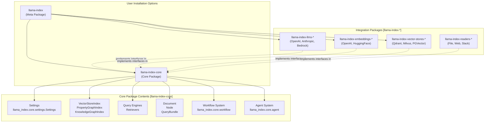
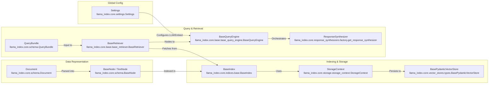

<!-- source: DeepWiki mcp.deepwiki.com · repo run-llama/llama_index · page 1 Overview · fetched 2026-10-26 -->

# Overview

Relevant source files

The following files were used as context for generating this wiki page:

- [.github/workflows/close_new_integration_prs.yml](.github/workflows/close_new_integration_prs.yml)
- [CHANGELOG.md](CHANGELOG.md)
- [CONTRIBUTING.md](CONTRIBUTING.md)
- [README.md](README.md)
- [docs/DOCS_README.md](docs/DOCS_README.md)
- [docs/api_reference/api_reference/llms/azure_openai.md](docs/api_reference/api_reference/llms/azure_openai.md)
- [docs/api_reference/api_reference/llms/minimax.md](docs/api_reference/api_reference/llms/minimax.md)
- [docs/api_reference/api_reference/llms/openai_like.md](docs/api_reference/api_reference/llms/openai_like.md)
- [docs/api_reference/api_reference/llms/sarvam.md](docs/api_reference/api_reference/llms/sarvam.md)
- [docs/api_reference/api_reference/memory/bedrock_agentcore.md](docs/api_reference/api_reference/memory/bedrock_agentcore.md)
- [docs/api_reference/api_reference/postprocessor/google_rerank.md](docs/api_reference/api_reference/postprocessor/google_rerank.md)
- [docs/api_reference/api_reference/storage/vector_store/solr.md](docs/api_reference/api_reference/storage/vector_store/solr.md)
- [docs/api_reference/api_reference/tools/aws_bedrock_agentcore.md](docs/api_reference/api_reference/tools/aws_bedrock_agentcore.md)
- [docs/api_reference/mkdocs.yml](docs/api_reference/mkdocs.yml)
- [docs/src/content/docs/framework/CHANGELOG.md](docs/src/content/docs/framework/CHANGELOG.md)
- [docs/src/content/docs/framework/CONTRIBUTING.md](docs/src/content/docs/framework/CONTRIBUTING.md)
- [llama-index-core/llama_index/core/__init__.py](llama-index-core/llama_index/core/__init__.py)
- [llama-index-core/llama_index/core/indices/base.py](llama-index-core/llama_index/core/indices/base.py)
- [llama-index-core/llama_index/core/indices/vector_store/base.py](llama-index-core/llama_index/core/indices/vector_store/base.py)
- [llama-index-core/llama_index/core/storage/index_store/keyval_index_store.py](llama-index-core/llama_index/core/storage/index_store/keyval_index_store.py)
- [llama-index-core/llama_index/core/storage/index_store/types.py](llama-index-core/llama_index/core/storage/index_store/types.py)
- [llama-index-core/pyproject.toml](llama-index-core/pyproject.toml)
- [llama-index-core/tests/indices/list/test_index.py](llama-index-core/tests/indices/list/test_index.py)
- [llama-index-core/tests/indices/vector_store/test_simple.py](llama-index-core/tests/indices/vector_store/test_simple.py)
- [llama-index-core/tests/indices/vector_store/test_simple_async.py](llama-index-core/tests/indices/vector_store/test_simple_async.py)
- [llama-index-core/uv.lock](llama-index-core/uv.lock)
- [llama-index-integrations/storage/index_store/llama-index-storage-index-store-dynamodb/llama_index/storage/index_store/dynamodb/base.py](llama-index-integrations/storage/index_store/llama-index-storage-index-store-dynamodb/llama_index/storage/index_store/dynamodb/base.py)
- [llama-index-integrations/storage/index_store/llama-index-storage-index-store-elasticsearch/llama_index/storage/index_store/elasticsearch/base.py](llama-index-integrations/storage/index_store/llama-index-storage-index-store-elasticsearch/llama_index/storage/index_store/elasticsearch/base.py)
- [llama-index-integrations/storage/index_store/llama-index-storage-index-store-elasticsearch/pyproject.toml](llama-index-integrations/storage/index_store/llama-index-storage-index-store-elasticsearch/pyproject.toml)
- [llama-index-integrations/storage/index_store/llama-index-storage-index-store-firestore/llama_index/storage/index_store/firestore/base.py](llama-index-integrations/storage/index_store/llama-index-storage-index-store-firestore/llama_index/storage/index_store/firestore/base.py)
- [llama-index-integrations/storage/index_store/llama-index-storage-index-store-mongodb/llama_index/storage/index_store/mongodb/base.py](llama-index-integrations/storage/index_store/llama-index-storage-index-store-mongodb/llama_index/storage/index_store/mongodb/base.py)
- [llama-index-integrations/storage/index_store/llama-index-storage-index-store-postgres/llama_index/storage/index_store/postgres/base.py](llama-index-integrations/storage/index_store/llama-index-storage-index-store-postgres/llama_index/storage/index_store/postgres/base.py)
- [llama-index-integrations/storage/index_store/llama-index-storage-index-store-redis/llama_index/storage/index_store/redis/base.py](llama-index-integrations/storage/index_store/llama-index-storage-index-store-redis/llama_index/storage/index_store/redis/base.py)
- [pyproject.toml](pyproject.toml)
- [uv.lock](uv.lock)

LlamaIndex is a comprehensive data framework for building LLM-powered applications, specifically designed to connect custom data sources with Large Language Models. The framework provides a robust suite of tools for data ingestion, indexing, retrieval, and query orchestration, enabling both Retrieval-Augmented Generation (RAG) applications and autonomous AI agents [README.md:1-11]().

**Scope**: This page introduces the high-level architecture, package structure, and core abstractions of the LlamaIndex framework.

## Package Structure

LlamaIndex follows a modular architecture consisting of a core engine and a vast ecosystem of integration packages.

**Sources**: [pyproject.toml:41-46](), [llama-index-core/pyproject.toml:35-87](), [README.md:19-43]()

### Meta Package: `llama-index`
The `llama-index` package serves as a "starter" bundle. It includes `llama-index-core` and a selection of default integrations (OpenAI LLM/Embeddings and basic file readers) to allow users to begin building immediately [README.md:22-23]().

**Key dependencies**:
- `llama-index-core>=0.14.25,<0.15.0` [pyproject.toml:42]()
- `llama-index-llms-openai>=0.7.0,<0.8` [pyproject.toml:44]()
- `llama-index-embeddings-openai>=0.6.0,<0.7` [pyproject.toml:43]()

### Core Package: `llama-index-core`
The `llama-index-core` package contains the fundamental abstractions, data schemas, and orchestration logic. It is designed to be provider-agnostic [README.md:24-27]().

**Key internal modules**:
- `llama_index.core.workflow`: The event-driven orchestration engine [llama-index-core/pyproject.toml:83]().
- `llama_index.core.indices`: Implementations for various data structures like `VectorStoreIndex` and `PropertyGraphIndex` [llama-index-core/llama_index/core/__init__.py:26-48]().
- `llama_index.core.schema`: Base classes for `Document` and `Node` [llama-index-core/llama_index/core/__init__.py:71]().

### Integration Ecosystem
LlamaIndex features over 300 integration packages [README.md:25](). These follow a strict naming convention: `llama-index-{category}-{provider}`. For example:
- `llama-index-llms-openai` [llama-index-core/pyproject.toml:154]()
- `llama-index-embeddings-cohere` [CHANGELOG.md:117]()
- `llama-index-vector-stores-milvus` [docs/api_reference/mkdocs.yml:64]()

## Core Framework Abstractions

The following diagram maps high-level RAG concepts to specific code entities within the `llama-index-core` package.

**Sources**: [llama-index-core/llama_index/core/__init__.py:17-140](), [llama-index-core/pyproject.toml:57-87](), [llama-index-core/llama_index/core/indices/base.py:25-188]()

### Key Classes and Roles

| Class | Purpose | Source |
| :--- | :--- | :--- |
| `Settings` | A global singleton for configuring default LLMs, embedding models, and callbacks. | [llama-index-core/llama_index/core/__init__.py:78]() |
| `Document` | A container for data (text, images) and its associated metadata. | [llama-index-core/llama_index/core/__init__.py:71]() |
| `VectorStoreIndex` | The most common index type; handles embedding generation and vector store storage. | [llama-index-core/llama_index/core/__init__.py:44]() |
| `PropertyGraphIndex` | A modern graph index that combines vector search with labeled property graphs. | [llama-index-core/llama_index/core/__init__.py:39]() |
| `StorageContext` | Manages the underlying stores (DocumentStore, IndexStore, VectorStore). | [llama-index-core/llama_index/core/__init__.py:81]() |
| `QueryBundle` | Encapsulates a query string and its pre-computed embedding. | [llama-index-core/llama_index/core/__init__.py:71]() |

## Data Flow Pipeline

LlamaIndex orchestrates a multi-stage pipeline to transform raw data into LLM-generated responses.

**Sources**: [llama-index-core/llama_index/core/__init__.py:67-71](), [llama-index-core/llama_index/core/indices/base.py:111-129](), [llama-index-core/llama_index/core/embeddings/mock_embed_model.py](), [llama-index-core/llama_index/core/indices/vector_store/base.py:36](), [llama-index-core/llama_index/core/llms/utils.py]()

1.  **Ingestion**: `BaseReader` subclasses (like `SimpleDirectoryReader`) ingest data into `Document` objects [llama-index-core/llama_index/core/__init__.py:67]().
2.  **Transformation**: `NodeParser` objects split documents into `Nodes`, which are the atomic units of data in LlamaIndex [llama-index-core/llama_index/core/indices/base.py:115-120]().
3.  **Indexing**: Nodes are processed by an `Index` (e.g., `VectorStoreIndex`). This stage typically involves generating embeddings via an `EmbedModel` [llama-index-core/llama_index/core/__init__.py:22,44]().
4.  **Retrieval**: A `BaseRetriever` fetches the most relevant `Nodes` for a given `QueryBundle` [llama-index-core/llama_index/core/indices/base.py:8]().
5.  **Synthesis**: The `ResponseSynthesizer` takes the retrieved nodes and the user query to generate a final `Response` using an `LLM` [llama-index-core/llama_index/core/__init__.py:17,70]().

## Orchestration Systems

Beyond standard RAG, LlamaIndex provides two advanced orchestration frameworks:

### 1. Workflow System
A low-level, event-driven engine for building complex, custom AI processes. It uses an internal event bus to manage state and execution flow [llama-index-core/pyproject.toml:83]().

### 2. Agent System
High-level autonomous entities capable of using tools.
- **FunctionAgent**: Uses native LLM function-calling capabilities.
- **ReActAgent**: Implements the "Reason + Act" prompting pattern for multi-step reasoning.
- **AgentWorkflow**: Orchestrates multiple agents working together [CHANGELOG.md:19]().

**Sources**: [CHANGELOG.md:19](), [llama-index-core/pyproject.toml:83]()

---

